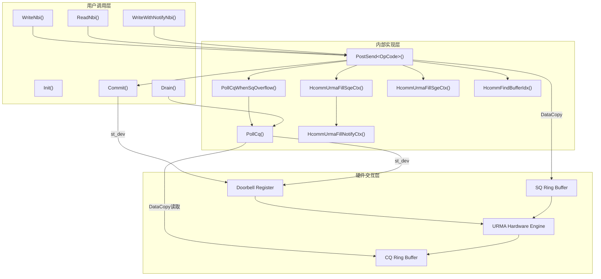
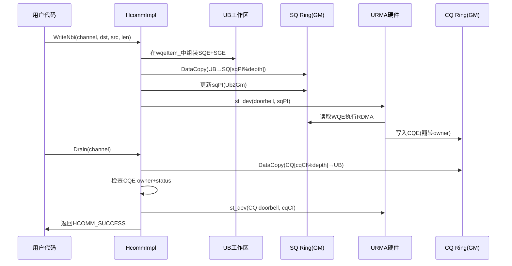
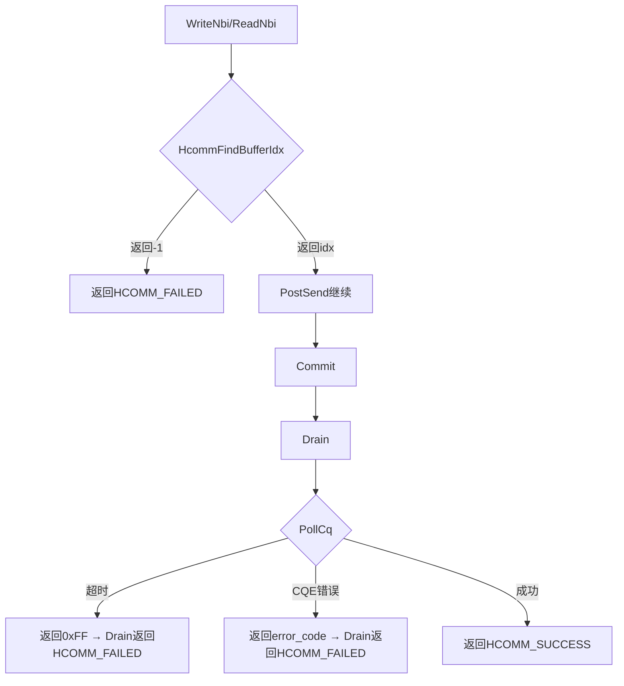

# 设计文档：HcommImpl<COMM_PROTOCOL_UBC_CTP> AIV直驱URMA通信

## Overview

本设计文档描述了 `HcommImpl<COMM_PROTOCOL_UBC_CTP>` 类的技术架构，该类是基于URMA（Unified Remote Memory Access）协议的AIV引擎直驱通信实现，运行于V310平台。其核心设计思路为：AIV核心直接操作硬件SQ/CQ环形队列，通过doorbell通知硬件执行远程读写，无需CPU/TS介入，实现零拷贝低延迟通信路径。

### 设计目标

- **零拷贝路径**：AIV引擎通过UB工作区组装WQE后直接DataCopy到SQ，硬件从SQ取数据执行RDMA
- **强序一致性**：默认配置odr=5 + fence=1，保证跨节点数据顺序和可见性
- **Token保护**：通过注册Buffer的tokenId/tokenValue验证远端内存访问权限
- **SQ溢出保护**：自动检测队列满状态并排水，避免丢请求
- **同步/异步模式**：通过模板参数commit控制是否自动提交doorbell

### 关键设计决策

| 决策 | 选择 | 理由 |
|------|------|------|
| WQE组装位置 | UB片上缓冲区 | 避免GM访问延迟，利用UB高带宽 |
| SQ溢出策略 | 提前10条排水100条 | 平衡吞吐和延迟，避免死锁 |
| CQ轮询超时 | 1000000次重试 | 覆盖硬件最大响应延迟 |
| Owner位翻转 | depth为基数取模判断 | URMA硬件规范要求 |

## Architecture

### 系统分层架构



### 数据流架构



## Components and Interfaces

### 类定义

```cpp
template <>
class HcommImpl<COMM_PROTOCOL_UBC_CTP> {
public:
    // 生命周期
    __aicore__ inline HcommImpl();
    __aicore__ inline ~HcommImpl();
    __aicore__ inline int32_t Init(__ubuf__ uint8_t* buff, uint32_t len);
    template <typename T>
    __aicore__ inline int32_t Init(const LocalTensor<T>& buff, uint32_t len);

    // 数据面操作
    template <bool commit, pipe_t commitPipe, pipe_t reqPipe, auto const &config>
    __aicore__ inline int32_t WriteNbi(ChannelHandle channel, GM_ADDR dst, GM_ADDR src, uint64_t len);

    template <bool commit, pipe_t commitPipe, pipe_t reqPipe, auto const &config>
    __aicore__ inline int32_t ReadNbi(ChannelHandle channel, GM_ADDR dst, GM_ADDR src, uint64_t len);

    template <bool commit, pipe_t commitPipe, pipe_t reqPipe, auto const &config>
    __aicore__ inline int32_t WriteWithNotifyNbi(ChannelHandle channel, GM_ADDR dst, GM_ADDR src,
        uint64_t len, GM_ADDR notifyAddr, uint64_t notifyVal);

    // 数据面操作（提交与同步）
    template <pipe_t pipe>
    __aicore__ inline int32_t Commit(ChannelHandle channel);

    template <pipe_t pipe>
    __aicore__ inline int32_t Drain(ChannelHandle channel);

private:
    // 核心内部方法
    template <bool commit, pipe_t commitPipe, pipe_t reqPipe, HcommUrmaOpCode opCode, auto const &config>
    __aicore__ inline int32_t PostSend(ChannelHandle channel, GM_ADDR dst, GM_ADDR src,
        uint64_t len, GM_ADDR notifyAddr, uint64_t notifyVal);

    __aicore__ inline void PollCqWhenSqOverflow(ChannelHandle channel,
        const SqContext& sqCtx, const CqContext& cqCtx, uint32_t sqHead);

    __aicore__ inline uint32_t PollCq(ChannelHandle channel, uint32_t expectTail);

private:
    // UB工作区分区
    LocalTensor<uint32_t> wqeItem_;   // 128B, WQE组装区
    LocalTensor<uint32_t> cqeItem_;   // 64B, CQE读取区
    LocalTensor<uint32_t> sqPI_;      // 32B, SQ生产者索引缓存
    LocalTensor<uint32_t> sqCI_;      // 32B, SQ消费者索引缓存
    LocalTensor<uint32_t> cqCI_;      // 32B, CQ消费者索引缓存
};
```

### 接口交互关系

- `WriteNbi` / `ReadNbi` / `WriteWithNotifyNbi` 均委托给内部 `PostSend<OpCode>` 完成SQE/SGE组装和SQ写入
- `PostSend` 内部验证远端地址合法性，在SQ满时自动排水
- `Commit` 通过 `st_dev` 写SQ doorbell通知硬件
- `Drain` 通过轮询CQ逐条检查CQE直到所有请求完成

## Data Models

### ChannelEntity（通信通道实体）

```cpp
typedef struct {
    CommAbiHeader abiHeader;         // ABI头（版本、魔数、大小）
    CommEngineType engine;           // 通信引擎类型（AIV=4）
    int32_t protocol;                // 通信协议标识
    uint32_t localNotifyNum;         // 本地通知数量
    uint32_t remoteNotifyNum;        // 远端通知数量
    uint32_t localBufferNum;         // 本地注册Buffer数量
    uint32_t remoteBufferNum;        // 远端注册Buffer数量
    uint32_t sqNum;                  // SQ数量
    uint32_t cqNum;                  // CQ数量
    RegedNotifyEntity* localNotifyAddr;
    RegedNotifyEntity* remoteNotifyAddr;
    RegedBufferEntity* localBufferAddr;   // 本地Buffer数组
    RegedBufferEntity* remoteBufferAddr;  // 远端Buffer数组
    SqContext* sqContextAddr;             // SQ上下文数组
    CqContext* cqContextAddr;             // CQ上下文数组
    uint8_t reserve[160];
} ChannelEntity;  // 固定256字节
```

### SqContext（发送队列上下文）

```cpp
// ubJfs子结构（URMA使用）
struct {
    uint64_t sqVa;           // SQ环形缓冲区虚拟地址
    uint64_t headAddr;       // sqPI存储地址（GM）
    uint64_t tailAddr;       // sqCI存储地址（GM）
    uint64_t dbVa;           // SQ doorbell寄存器地址
    uint32_t jfsID;          // JFS标识
    uint32_t wqeSize;        // 单个WQE大小（字节）
    uint32_t sqDepth;        // SQ深度（条目数）
    uint32_t tpID;           // 传输路径ID
    uint8_t remoteEID[16];   // 远端EID（128位）
} ubJfs;
```

### CqContext（完成队列上下文）

```cpp
// ubJfc子结构（URMA使用）
struct {
    uint64_t scqVa;          // CQ环形缓冲区虚拟地址
    uint64_t headAddr;       // cqPI存储地址（GM）
    uint64_t tailAddr;       // cqCI存储地址（GM）
    uint64_t dbVa;           // CQ doorbell寄存器地址
    uint32_t jfcID;          // JFC标识
    uint32_t cqeSize;        // 单个CQE大小（字节）
    uint32_t cqDepth;        // CQ深度（条目数）
} ubJfc;
```

### HcommUrmaSqeCtx（SQE结构，48字节）

```cpp
typedef struct {
    uint32_t sqeBbIdx : 16;           // SQE块索引
    uint32_t flag : 8;                // 标志位(odr|fence|se|cqe|inlineEn)
    uint32_t rsv0 : 3;
    uint32_t nf : 1;                  // 通知标志
    uint32_t tokenEn : 1;             // Token使能
    uint32_t rmtJettyType : 2;        // 远端Jetty类型
    uint32_t owner : 1;               // Owner位（交替翻转）
    uint32_t targetHint : 8;          // 目标提示
    uint32_t opcode : 8;              // 操作码（WRITE=3, READ=6等）
    uint32_t rsv1 : 6;
    uint32_t inlineMsgLen : 10;       // Inline消息长度
    uint32_t tpId : 24;              // 传输路径ID
    uint32_t sgeNum : 8;             // SGE数量
    uint32_t rmtJettyOrSegId : 20;   // 远端Jetty/Segment ID（=tokenId）
    uint32_t rsv2 : 12;
    uint64_t rmtEidL;                // 远端EID低64位
    uint64_t rmtEidH;                // 远端EID高64位
    uint32_t rmtTokenValue;          // 远端Token值
    uint32_t udfType : 8;
    uint32_t reduceDataType : 4;
    uint32_t reduceOpcode : 4;
    uint32_t rsv3 : 16;
    uint32_t rmtAddrLOrTokenId;      // 远端地址低32位
    uint32_t rmtAddrHOrTokenValue;   // 远端地址高32位
} HcommUrmaSqeCtx;
```

### HcommUrmaSgeCtx（SGE结构，16字节）

```cpp
typedef struct {
    uint32_t len;       // 数据长度
    uint32_t tokenId;   // 本地Token ID
    uint64_t va;        // 本地虚拟地址
} HcommUrmaSgeCtx;
```

### HcommUrmaNotifyCtx（Notify上下文，32字节）

```cpp
typedef struct {
    uint32_t notifyTokenId : 20;     // 通知Token ID
    uint32_t rsv : 12;
    uint32_t notifyTokenValue;       // 通知Token值
    uint32_t notifyAddrL;            // 通知地址低32位
    uint32_t notifyAddrH;            // 通知地址高32位
    uint32_t notifyDataL;            // 通知数据低32位
    uint32_t notifyDataH;            // 通知数据高32位
    uint32_t rsv2[2];                // 保留字段
} HcommUrmaNotifyCtx;
```

### HcommUrmaJfcCqeCtx（CQE结构，64字节）

```cpp
typedef struct {
    uint32_t sR : 1;          // 发送/接收标志
    uint32_t isJetty : 1;     // Jetty标志
    uint32_t owner : 1;       // Owner位（用于轮询判断有效性）
    uint32_t inlineEn : 1;    // Inline使能
    uint32_t opcode : 3;      // 操作码
    uint32_t fd : 1;          // Flush Done
    uint32_t rsv : 8;
    uint32_t substatus : 8;   // 子状态（非0表示错误）
    uint32_t status : 8;      // 状态（非0表示错误）
    uint32_t entryIdx : 16;   // 条目索引
    uint32_t localNumL : 16;
    uint32_t localNumH : 4;
    uint32_t rmtIdx : 20;
    // ... 后续为userData, rmtEid, data, inlineData等字段
} HcommUrmaJfcCqeCtx;
```

### UB工作区Buffer布局

```
┌─────────────────────────────────────────────────────────────────┐
│                    UB Buffer (≥ 512 字节)                         │
├────────────────┬───────────────┬────────┬────────┬──────────────┤
│  wqeItem_      │  cqeItem_     │ sqPI_  │ sqCI_  │ cqCI_        │
│  128B (32×u32) │  64B (16×u32) │ 32B    │ 32B    │ 32B          │
│                │               │(8×u32) │(8×u32) │(8×u32)       │
│  WQE组装暂存区  │  CQE读取暂存区 │ 缓存头  │ 缓存尾  │ CQ尾缓存     │
├────────────────┴───────────────┴────────┴────────┴──────────────┤
│  偏移: 0        128             192      224      256            │
└─────────────────────────────────────────────────────────────────┘
```

### WQE在SQ中的布局

```
普通操作（WRITE/READ）: 1个BB (wqeSize字节)
┌──────────────────────────────────────────────┐
│  SQE (48B)  │  SGE (16B)  │  padding         │
└──────────────────────────────────────────────┘

WRITE_WITH_NOTIFY: 2个BB (2 × wqeSize字节)
┌──────────────────────────────────────────────────────────────────┐
│  SQE (48B)  │  NotifyCtx (32B)  │  SGE (16B)  │  padding        │
└──────────────────────────────────────────────────────────────────┘
```

### UrmaWqeEntry（WQE配置参数）

```cpp
struct UrmaWqeEntry {
    uint32_t odr : 3;       // 排序强度 (0=无序, 5=强序)
    uint32_t fence : 1;     // 栅栏 (1=等待前序WQE完成)
    uint32_t se : 1;        // 触发远端事件通知
    uint32_t cqe : 1;       // 1=完成时生成CQE
    uint32_t inlineEn : 1;  // 1=数据内联到WQE中
};

// 默认配置
static constexpr UrmaWqeEntry URMA_DEFAULT_CFG = {
    .odr = 5, .fence = 1, .se = 0, .cqe = 1, .inlineEn = 0
};
```

### Owner位判断逻辑

| 概念 | 说明 |
|------|------|
| SQE Owner位 | `(curHead & sqDepth) == 0 ? 1 : 0`，随队列绕回翻转 |
| CQE Owner位 | `(curTail / cqDepth) & 1`，硬件写入时翻转，软件轮询判断有效 |
| 有效性判断 | `validOwner ^ cqeUb->owner != 0` 时CQE有效 |

### 关键常量

| 常量 | 值 | 说明 |
|------|---|------|
| HCOMM_URMA_TMP_BUF_SIZE | 512 | Init最小缓冲区大小 |
| HCOMM_URMA_WQE_U32_NUM | 32 | wqeItem_区域大小（uint32_t个数） |
| HCOMM_URMA_CQE_U32_NUM | 16 | cqeItem_区域大小（uint32_t个数） |
| HCOMM_URMA_MAX_RETRY_TIMES | 1000000 | PollCq最大重试次数 |
| POLL_CQ_THRESHOLD | 10 | SQ溢出检测阈值 |
| NUM_CQE_PER_POLL_CQ | 100 | 单次排水最大CQE数 |
| HCOMM_URMA_DEFAULT_QP_IDX | 0 | 默认QP索引 |


## Correctness Properties

*正确性属性是一种在系统所有合法执行路径上都应成立的特征或行为描述——本质上是对系统行为的形式化陈述。属性作为人类可读规格说明与机器可验证正确性保证之间的桥梁。*

### Property 1: Init缓冲区分区正确性

*对于任意*有效缓冲区（长度 ≥ 512字节），无论通过原始指针还是LocalTensor接口调用Init，内部分区布局应满足：wqeItem_起始于缓冲区首地址（对齐后），cqeItem_偏移为128字节（32×uint32_t），sqPI_偏移为192字节（48×uint32_t），sqCI_偏移为224字节（56×uint32_t），cqCI_偏移为256字节（64×uint32_t），且返回值为HCOMM_SUCCESS(0)。

**Validates: Requirements 1.1, 1.3, 7.2**

### Property 2: WriteNbi填充SQE/SGE正确性

*对于任意*在远端注册Buffer范围内的目的地址dst和任意合法长度len，调用WriteNbi后，UB工作区中的SQE应满足：opcode=WRITE(3)、sgeNum=1、rmtAddrL/H对应dst地址、flag字段正确编码config参数；SGE应满足：va=src地址、len=数据长度；且sqPI递增1。

**Validates: Requirements 2.1, 2.6**

### Property 3: ReadNbi参数映射与SQE正确性

*对于任意*在远端注册Buffer范围内的源地址src和任意合法长度len，调用ReadNbi后，SQE应满足：opcode=READ(6)、rmtAddrL/H对应src（远端）地址；SGE应满足：va=dst（本地）地址、len=数据长度；且sqPI递增1。ReadNbi的参数映射为PostSend(src, dst, len)，即远端地址作为PostSend的第一参数。

**Validates: Requirements 3.1, 3.4**

### Property 4: 远端Buffer地址验证拒绝非法地址

*对于任意*不在任何已注册RegedBufferEntity范围内的地址（addr < baseAddr 或 addr+len > baseAddr+size），HcommFindBufferIdx应返回HCOMM_FAILED(-1)，PostSend应返回HCOMM_FAILED(-1)且不修改SQ内容。

**Validates: Requirements 2.2, 3.2, 9.1, 9.2**

### Property 5: 32字节地址对齐

*对于任意*输入地址addr，AlignAddrTo32Bytes(addr)的返回值应满足：(1) 返回值 ≥ addr，(2) 返回值 ≤ addr + 31，(3) 返回值 % 32 == 0。

**Validates: Requirements 8.1**

### Property 6: CQE错误码编码

*对于任意*非零status值s和substatus值ss（均为uint8_t范围），PollCq返回的错误码应等于 `(s << 8) | ss`。

**Validates: Requirements 5.3**

### Property 7: WQE配置编码

*对于任意*合法的UrmaWqeEntry配置（odr∈[0,7], fence∈{0,1}, se∈{0,1}, cqe∈{0,1}, inlineEn∈{0,1}），SQE的flag字段应等于 `(odr & 0x7) | ((fence & 0x1) << 3) | ((se & 0x1) << 4) | ((cqe & 0x1) << 5) | ((inlineEn & 0x1) << 6)`。

**Validates: Requirements 10.1, 10.2**

## Error Handling

### 错误分类与处理策略

| 错误类型 | 检测时机 | 处理方式 | 返回值 |
|----------|----------|----------|--------|
| 缓冲区不足 | Init时 | 提前返回，不修改状态 | HCOMM_FAILED(-1) |
| 远端地址非法 | PostSend时 | 日志KERNEL_ERROR + 返回 | HCOMM_FAILED(-1) |
| Buffer指针为空 | HcommFindBufferIdx时 | 日志KERNEL_ERROR + 返回 | HCOMM_FAILED(-1) |
| CQE超时 | PollCq循环中 | 日志KERNEL_ERROR + dump CQE | 0xFF |
| CQE硬件错误 | PollCq循环中 | 日志KERNEL_ERROR + dump CQE | (status<<8)\|substatus |
| Drain失败 | Drain调用PollCq后 | 日志KERNEL_ERROR | HCOMM_FAILED(-1) |

### 错误传播路径



### 日志策略

- **KERNEL_ERROR**：所有导致操作失败的异常路径
- **KERNEL_INFO**：正常流程关键节点（PostSend开始/结束、PollCq进出、Commit完成）
- **Dump函数**：在错误路径中自动打印完整WQE/CQE字段，辅助离线诊断

## Testing Strategy

### 双轨测试方法

本模块采用单元测试（Example-based）与属性测试（Property-based）相结合的策略：

#### 属性测试（Property-Based Testing）

适用场景：纯逻辑函数（地址验证、对齐计算、字段编码、索引管理）

- **测试框架**：推荐使用 [RapidCheck](https://github.com/emil-e/rapidcheck)（C++ PBT库）
- **最低迭代次数**：每个属性测试至少100次
- **标签格式**：`Feature: hcomm-aiv-urma, Property {N}: {property_text}`
- **每个正确性属性对应一个属性测试用例**

覆盖的属性：
1. Init分区正确性 → 生成随机合法buffer大小验证分区偏移
2. WriteNbi SQE填充 → 生成随机合法地址/长度验证SQE字段
3. ReadNbi参数映射 → 验证src/dst在PostSend中的正确映射
4. 地址验证 → 生成随机非法地址验证拒绝逻辑
5. 32字节对齐 → 生成随机地址验证对齐属性
6. CQE错误码 → 生成随机status/substatus验证编码
7. WQE配置编码 → 生成随机config验证flag字段

#### 单元测试（Example-Based）

适用场景：硬件交互、特定场景验证、集成流程

| 测试类别 | 测试内容 | 对应需求 |
|----------|----------|----------|
| 正向流程 | ReadNbi默认commit=true端到端 | 2.3, 3.3 |
| 正向流程 | WriteNbi commit=false + 手动Commit | 2.4, 4.1 |
| 正向流程 | 批量Write+Commit+Drain | 4.3 |
| 边界条件 | Init len < 512 返回失败 | 1.2, 1.4, 7.1 |
| 边界条件 | SQ满时触发PollCqWhenSqOverflow | 6.1 |
| 边界条件 | PollCq超时场景 | 5.2 |
| 状态验证 | WriteNbi推进sqPI+1 | 2.6 |
| 状态验证 | WriteWithNotifyNbi推进sqPI+2 | - |
| 接口兼容 | LocalTensor重载Init功能等价 | 1.3 |

#### 已有测试用例（test_hcomm_urma_950.cpp）

现有7个GTest用例已覆盖主要正向流程和关键边界条件，作为回归基线。

### 测试环境

- **UT_TEST宏**：在单元测试模式下跳过真实硬件轮询，直接设置curTail=expectIdx
- **UrmaChannelResource**：模拟ChannelEntity的测试辅助类，提供SQ/CQ内存和上下文
- **CompleteCurrentSq()**：模拟硬件完成所有pending请求
