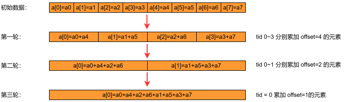
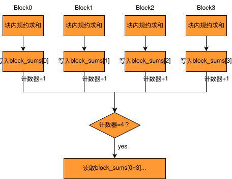

# SIMT 编程模式实现规约求和样例

## 概述

本样例基于 Ascend C SIMT 编程方式实现一维 `float` 输入的归约求和，通过 3 个递进场景展示线程块内同步与线程块间内存顺序控制的典型用法。

3 个场景分别对应单个线程块归约、多个线程块分段归约以及大规模输入下的固定 72 个线程块归约，重点说明 `asc_syncthreads()` 和 `asc_threadfence()` 在不同归约规模下的使用方法。

## 支持的产品

- Ascend 950PR/Ascend 950DT

## 支持的CANN软件版本
- \> CANN 9.0.0

## 目录结构介绍

```text
01_sync_instruction/
├── sync_barrier.asc      # 场景1：单个线程块归约样例，展示 asc_syncthreads() 的线程块内同步用法
├── memory_fence_v1.asc   # 场景2：多个线程块归约样例，展示 asc_threadfence() 与原子计数的线程块间协作用法
├── memory_fence_v2.asc   # 场景3：大规模输入归约样例，固定 72 个线程块，单线程处理多个输入元素
├── CMakeLists.txt        # 编译工程文件
└── README.md
```

## 样例描述

### 样例功能

<table border="1" align="center">
  <tr>
    <td align="center">SCENARIO 取值</td>
    <td align="center">功能场景</td>
    <td align="center">场景说明</td>
    <td align="center">对应文件</td>
  </tr>
  <tr>
    <td align="center">1</td>
    <td align="center">单个线程块归约场景</td>
    <td align="center">使用 asc_syncthreads() 完成线程块内归约同步</td>
    <td align="center">sync_barrier.asc</td>
  </tr>
  <tr>
    <td align="center">2</td>
    <td align="center">多线程块分段归约场景</td>
    <td align="center">使用 asc_threadfence() 完成多线程块间局部和的合并求和</td>
    <td align="center">memory_fence_v1.asc</td>
  </tr>
  <tr>
    <td align="center">3</td>
    <td align="center">固定 72 个线程块的大规模归约场景</td>
    <td align="center">单线程处理多个输入元素完成大规模归约求和</td>
    <td align="center">memory_fence_v2.asc</td>
  </tr>
</table>

本样例通过 `SCENARIO` 控制构建分支，3 个场景在输入规模和线程组织方式上逐层递进：场景1演示单个线程块内的归约求和与 `asc_syncthreads()` 同步用法；场景2扩展到多个线程块的分段归约，引入 `asc_threadfence()` 完成线程块间合并；场景3进一步展示当输入规模较大时（`gridDim` 过大会产生较重头开销），通过固定 `gridDim` 为72并让每个线程处理多个输入元素来完成大规模归约求和。

### 样例规格

#### SCENARIO=1（单个线程块归约场景）

- 样例功能：

  对 2048 个 `float` 输入元素在单个线程块内执行**归约求和**。

- 样例规格：

  <table border="1" align="center">
  <tr><td rowspan="1" align="center">样例类型(OpType)</td><td colspan="4" align="center">SyncBarrierSingleBlock</td></tr>
  <tr><td rowspan="2" align="center">样例输入</td><td align="center">name</td><td align="center">shape</td><td align="center">data type</td><td align="center">format</td></tr>
  <tr><td align="center">input</td><td align="center">[2048]</td><td align="center">float</td><td align="center">ND</td></tr>
  <tr><td rowspan="1" align="center">样例输出</td><td align="center">output</td><td align="center">[1]</td><td align="center">float</td><td align="center">ND</td></tr>
  </table>

- 数据切分：

  - gridDim：1
  - blockDim：2048
  - 单线程处理：1 个输入元素

#### SCENARIO=2（多个线程块分段归约场景）

- 样例功能：

  对 `36 * 2048` 个 `float` 输入元素执行**分段归约求和**，每个线程块先完成本线程块负责片段的**局部求和**，再对所有线程块的局部和做第二次归约求和，得到最终总和。

- 样例规格：

  <table border="1" align="center">
  <tr><td rowspan="1" align="center">样例类型(OpType)</td><td colspan="4" align="center">ThreadFenceMultiBlock</td></tr>
  <tr><td rowspan="2" align="center">样例输入</td><td align="center">name</td><td align="center">shape</td><td align="center">data type</td><td align="center">format</td></tr>
  <tr><td align="center">input</td><td align="center">[36 * 2048]</td><td align="center">float</td><td align="center">ND</td></tr>
  <tr><td rowspan="1" align="center">样例输出</td><td align="center">output</td><td align="center">[1]</td><td align="center">float</td><td align="center">ND</td></tr>
  </table>

- 数据切分：

  - gridDim：ceil(shape / 2048)，当前样例为 36
  - blockDim：2048
  - 单线程处理：1 个输入元素

#### SCENARIO=3（固定 72 个线程块的大规模归约场景）

- 样例功能：

  对 `512 * 2048` 个 `float` 输入元素执行**大规模归约求和**，固定启动 72 个线程块。每个线程先将多个输入元素累加为局部值，随后在线程块内执行归约求和得到本线程块的局部和，再完成线程块间归约求和，得到最终结果。

- 样例规格：

  <table border="1" align="center">
  <tr><td rowspan="1" align="center">样例类型(OpType)</td><td colspan="4" align="center">ThreadFenceLargeInput</td></tr>
  <tr><td rowspan="2" align="center">样例输入</td><td align="center">name</td><td align="center">shape</td><td align="center">data type</td><td align="center">format</td></tr>
  <tr><td align="center">input</td><td align="center">[512 * 2048]</td><td align="center">float</td><td align="center">ND</td></tr>
  <tr><td rowspan="1" align="center">样例输出</td><td align="center">output</td><td align="center">[1]</td><td align="center">float</td><td align="center">ND</td></tr>
  </table>

- 数据切分：

  - gridDim：72
  - blockDim：2048
  - 单线程处理：多个输入元素，每个线程从自身索引开始，每隔 `blockDim.x * gridDim.x` 取一个元素并累加

### 样例实现

### 1：单个线程块归约场景

单个线程块内的每个线程先读取一个输入元素并写入共享内存 `smem`，随后执行归约求和。以 8 个元素为例，归约过程如图1所示：

<p align="center">
  
   </p>
<p align="center">
图1：规约过程示意图
</p>

每轮归约后都调用 `asc_syncthreads()`，保证参与下一轮计算的线程读取到的是当前轮已经更新完成的共享内存数据。

`asc_syncthreads()` 的作用是让同一个线程块内的所有线程在当前位置完成同步，只有当前线程块内所有线程都到达同步点后，后续指令才会继续执行。该场景重点说明线程块内同步的必要性：如果在归约的过程中缺少 `asc_syncthreads()`，不同线程可能会交叉读写 `smem`，导致最终归约结果不正确。

### 2：多个线程块分段归约场景

每个线程块先在块内完成局部归约，再由 `tid = 0` 的线程将本线程块的局部和写入 `block_sums[blockIdx.x]`。写入后执行 `asc_threadfence()`，再将全局计数器加 1。最后一个对计数器加 1 的线程块（即 `ticket = gridDim.x - 1` 的线程块）会读取 `block_sums` 并执行第二次归约，输出最终结果。

以 4 个线程块为例，跨线程块协作过程如图2所示：

<p align="center">
  
   </p>
<p align="center">
图2：跨线程块协作过程示意图
</p>

`asc_threadfence()` 的作用是将当前线程块对全局内存的写操作暴露给其他线程块，确保其他线程块能够正确读到已写入的数据。该场景重点说明线程块间可见性顺序控制：局部和的写入必须在完成计数器递增之前对其他线程块可见，否则最后一个线程块可能在读取 `block_sums` 时拿到未更新完成的值，导致归约结果不正确。

### 3：固定 72 个线程块的大规模归约场景

该场景复用场景2的**跨线程块协作机制**，但输入规模更大，固定启动 72 个线程块。每个线程不再只处理一个元素，而是先将多个输入元素累加为局部值，随后在线程块内执行归约求和得到本线程块的局部和，再完成跨线程块的归约求和。

该场景重点说明大规模输入下的数据切分方式：当输入规模较大时，若按场景2的方式将 `gridDim` 设为 `ceil(shape / blockDim)`，会产生较重的头开销。因此将 `gridDim` 固定为 72（与当前硬件 AIV 数量一致），让每个线程处理多个输入元素。

## 编译运行

在本样例根目录下执行如下步骤，编译并执行算子。
- 配置环境变量   
  请根据当前环境上CANN开发套件包的[安装方式](../../../../../docs/quick_start.md#prepare&install)，选择对应配置环境变量的命令。
  - 默认路径，root用户安装CANN软件包
    ```bash
    source /usr/local/Ascend/cann/set_env.sh
    ```

  - 默认路径，非root用户安装CANN软件包
    ```bash
    source $HOME/Ascend/cann/set_env.sh
    ```

  - 指定路径install_path，安装CANN软件包
    ```bash
    source ${install_path}/cann/set_env.sh
    ```

- 样例执行  
```bash
  SCENARIO=1 #取值为1、2、3
  mkdir -p build && cd build;   # 创建并进入build目录
  cmake .. -DSCENARIO_NUM=$SCENARIO; make -j;            # 编译工程
  ./demo                      # 执行样例
  ```
  执行结果如下，说明精度对比成功。
  ```
  [Success] Case accuracy is verification passed.
  ```