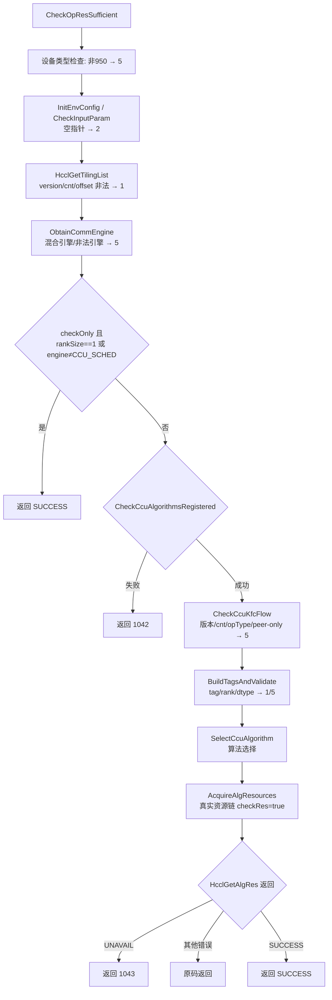

# CheckOpResSufficient 错误码全景与真机用例设计

## 1. 接口概述

```c
HcclResult CheckOpResSufficient(HcclComm comm, void* stream, void* mc2Tiling);
```

- 头文件：[hccl_mc2.h](file:///home/pj2/asc-devkit/include/adv_api/hccl/hccl_mc2.h#L110-L111)
- 实现：[hccl_mc2.cc](file:///home/pj2/asc-devkit/impl/adv_api/detail/hccl/cc/src/common/hccl_mc2.cc#L437-L444)

调用链：`CheckOpResSufficient` → `HcclAllocComResourceByTilingImpl(checkOnly=true)` → 公共校验 →
（rankSize==1 或非 CCU_SCHED 引擎 → 提前 SUCCESS）→ CCU 分支 → 算法注册检查 → KFC 流程检查 →
逐 tiling 算法选择 + 真实资源链探测。



## 2. 表1：错误码、返回点、触发条件

| 错误码 | 返回点 | 触发条件 |
|---|---|---|
| **HCCL_SUCCESS (0)** | [hccl_mc2.cc:419-424](file:///home/pj2/asc-devkit/impl/adv_api/detail/hccl/cc/src/common/hccl_mc2.cc#L419-L424) 及各级正常返回 | 资源充足；或 checkOnly 且 rankSize==1；或 checkOnly 且 commEngine≠CCU_SCHED（如 AICPU_TS，不探测直接放行） |
| **HCCL_E_PTR (2)** | [hccl_alloc_ctx_res.cc:36-56](file:///home/pj2/asc-devkit/impl/adv_api/detail/hccl/cc/src/common/hccl_alloc_ctx_res.cc#L36-L56)（comm/stream/tiling 三处 CHK_PTR_NULL） | comm / stream / mc2Tiling 任一为 nullptr |
| **HCCL_E_PARA (1)** | [hccl_alloc_ctx_res.cc:65](file:///home/pj2/asc-devkit/impl/adv_api/detail/hccl/cc/src/common/hccl_alloc_ctx_res.cc#L65) | tiling 首字段 version < MC2_TILING_VERSION |
| | [hccl_alloc_ctx_res.cc:68](file:///home/pj2/asc-devkit/impl/adv_api/detail/hccl/cc/src/common/hccl_alloc_ctx_res.cc#L68)、[:116-118](file:///home/pj2/asc-devkit/impl/adv_api/detail/hccl/cc/src/common/hccl_alloc_ctx_res.cc#L116-L118) | tiling cnt==0 或 > MAX_HCOM_NUM |
| | [hccl_alloc_ctx_res.cc:70-77](file:///home/pj2/asc-devkit/impl/adv_api/detail/hccl/cc/src/common/hccl_alloc_ctx_res.cc#L70-L77) | offset 小于 offsetTable 末尾，或未按 `Mc2CcTilingInner` 对齐 |
| | [op_common.cc:2371-2381](file:///home/pj2/asc-devkit/impl/adv_api/detail/hccl/cc/src/ops/op_common/op_common.cc#L2371-L2381)（经 [hccl_mc2.cc:203](file:///home/pj2/asc-devkit/impl/adv_api/detail/hccl/cc/src/common/hccl_mc2.cc#L203)） | topoTag（`opType_srcDataType_commName`）为空或超 TAG_MAX_LEN（commName 过长） |
| | [param_check.cc:143-152](file:///home/pj2/asc-devkit/impl/adv_api/detail/hccl/cc/src/common/param_check.cc#L143-L152) | userRank >= rankSize（合法 comm 下不可达，仅白盒） |
| | [hccl_alloc_ctx_res.cc:869-872](file:///home/pj2/asc-devkit/impl/adv_api/detail/hccl/cc/src/common/hccl_alloc_ctx_res.cc#L869-L872) | registry 中找不到 algName 对应 executor（内部一致性问题） |
| **HCCL_E_NOT_SUPPORT (5)** | [hccl_mc2.cc:387-389](file:///home/pj2/asc-devkit/impl/adv_api/detail/hccl/cc/src/common/hccl_mc2.cc#L387-L389) | 设备非 950 |
| | [hccl_alloc_ctx_res.cc:126-128](file:///home/pj2/asc-devkit/impl/adv_api/detail/hccl/cc/src/common/hccl_alloc_ctx_res.cc#L126-L128) | 多 tiling 间 commEngine 不一致 |
| | [hccl_alloc_ctx_res.cc:132-135](file:///home/pj2/asc-devkit/impl/adv_api/detail/hccl/cc/src/common/hccl_alloc_ctx_res.cc#L132-L135) | commEngine 非 AICPU_TS/CCU_SCHED（如 AIV） |
| | [hccl_alloc_ctx_res.cc:155-158](file:///home/pj2/asc-devkit/impl/adv_api/detail/hccl/cc/src/common/hccl_alloc_ctx_res.cc#L155-L158) | initTiling->version != INIT_TILING_CCU_NEW_VERSION |
| | [hccl_alloc_ctx_res.cc:159-162](file:///home/pj2/asc-devkit/impl/adv_api/detail/hccl/cc/src/common/hccl_alloc_ctx_res.cc#L159-L162) | tilingNum != initTiling->mc2HcommCnt（或超 MAX_CC_TILING_NUM） |
| | [hccl_alloc_ctx_res.cc:167-171](file:///home/pj2/asc-devkit/impl/adv_api/detail/hccl/cc/src/common/hccl_alloc_ctx_res.cc#L167-L171) | peer-only ReduceScatter 但 rankSize≠2 |
| | [hccl_alloc_ctx_res.cc:175-182](file:///home/pj2/asc-devkit/impl/adv_api/detail/hccl/cc/src/common/hccl_alloc_ctx_res.cc#L175-L182) | opType 不在 CCU KFC 支持集（仅 AG/RS/A2A/A2AV/AR）/ tiling 内 commEngine≠CCU_SCHED / 多 tiling opType 不一致 |
| | [op_common.cc:2256-2274](file:///home/pj2/asc-devkit/impl/adv_api/detail/hccl/cc/src/ops/op_common/op_common.cc#L2256-L2274) | 数据类型/归约类型不支持（如 RS + INT64/FP64、PROD） |
| | [hccl_alloc_ctx_res.cc:978-984](file:///home/pj2/asc-devkit/impl/adv_api/detail/hccl/cc/src/common/hccl_alloc_ctx_res.cc#L978-L984) | selector 选出的算法不在 CCU algorithmMap 中 |
| | [op_common.cc:2172-2178](file:///home/pj2/asc-devkit/impl/adv_api/detail/hccl/cc/src/ops/op_common/op_common.cc#L2172-L2178) | 编译宏 MC2_CLIENT_ENABLE_CCU=0 |
| **HCCL_E_ALG_NOT_SUPPORTED (1042)** | [hccl_mc2.cc:348-351](file:///home/pj2/asc-devkit/impl/adv_api/detail/hccl/cc/src/common/hccl_mc2.cc#L348-L351)（CheckCcuAlgorithmsRegistered=false），子条件见 [hccl_mc2.cc:228-250](file:///home/pj2/asc-devkit/impl/adv_api/detail/hccl/cc/src/common/hccl_mc2.cc#L228-L250) | ① tilingNum>1；② algConfig 非合法强制算法名（空/格式错）；③ 算法未在 mc2_client 注册（版本不匹配/裁剪编译） |
| **HCCL_E_RES_NOT_SUFFICIENT (1043)** | [hccl_alloc_ctx_res.cc:806-810](file:///home/pj2/asc-devkit/impl/adv_api/detail/hccl/cc/src/common/hccl_alloc_ctx_res.cc#L806-L810) | checkRes 链中 HcclGetAlgRes 返回 UNAVAIL 被翻译。UNAVAIL 三个源头：① channel 不足 [op_common.cc:1474-1478](file:///home/pj2/asc-devkit/impl/adv_api/detail/hccl/cc/src/ops/op_common/op_common.cc#L1474-L1478)；② 复用 CcuIns 容量不足 [op_common.cc:1960-1964](file:///home/pj2/asc-devkit/impl/adv_api/detail/hccl/cc/src/ops/op_common/op_common.cc#L1960-L1964)；③ 新建 CcuIns 失败 CCU_E_UNAVAIL [op_common.cc:2071-2078](file:///home/pj2/asc-devkit/impl/adv_api/detail/hccl/cc/src/ops/op_common/op_common.cc#L2071-L2078) |
| **HCCL_E_INTERNAL (4)** | [hccl_alloc_ctx_res.cc:772-774](file:///home/pj2/asc-devkit/impl/adv_api/detail/hccl/cc/src/common/hccl_alloc_ctx_res.cc#L772-L774)、[:987-988](file:///home/pj2/asc-devkit/impl/adv_api/detail/hccl/cc/src/common/hccl_alloc_ctx_res.cc#L987-L988)、[ccu_log.cc:32-33](file:///home/pj2/asc-devkit/impl/adv_api/detail/hccl/cc/src/ops/op_common/ccu_log.cc#L32-L33) | sprintf 失败、CCU 未知错误码等内部异常，正常不可构造 |
| **其他透传码**（6/15/16 等） | CCU→HCCL 映射 [ccu_log.cc:13-34](file:///home/pj2/asc-devkit/impl/adv_api/detail/hccl/cc/src/ops/op_common/ccu_log.cc#L13-L34) 及资源链内 runtime/driver 调用 | 设备故障注入类场景（复位、驱动错误注入） |

两点说明：

- **HCCL_E_UNAVAIL(7) 不会透出**：check 路径下统一翻译为 1043，仅在非 check 的真实分配路径才可能见到。
- [hccl_alloc_ctx_res.cc:1143-1148](file:///home/pj2/asc-devkit/impl/adv_api/detail/hccl/cc/src/common/hccl_alloc_ctx_res.cc#L1143-L1148) 的"多 tiling 算法类型不一致→5"在 check 路径**不可达**（tilingNum>1 已被 1042 拦截）。

## 3. 表2：真机用例设计（如何构造每个错误码）

前置条件：950 真机、`HcclCommInitClusterInfo` 建真实 comm、`aclrtCreateStream` 取流、tiling 用 host 构造（参照单测 `BuildMc2Tiling`，字段可控）。

| 目标码 | 用例 | 构造方法 | 判定依据 |
|---|---|---|---|
| 2 (PTR) | NullComm / NullStream / NullTiling | 三条用例分别传 nullptr，其余参数合法 | ret==2 |
| 1 (PARA-version) | TilingVersionTooOld | tiling.version 置 0 或小于当前 MC2_TILING_VERSION | ret==1，日志 "Invalid tiling version" |
| 1 (PARA-cnt) | TilingCntInvalid | cnt=0；或 cnt=MAX_HCOM_NUM+1 | ret==1，日志 "Invalid hcom tiling number" |
| 1 (PARA-offset) | TilingOffsetInvalid | offset[0] 改为小于 offsetTable 末尾的值，或 +1 破坏对齐 | ret==1，日志 "Invalid hcom tiling offset" |
| 1 (PARA-tag) | CommNameTooLong | 用 HcclCommConfig 的 hcclCommName 初始化接近 TAG_MAX_LEN 的通信域名，使 `opType_dtype_commName` 超限 | ret==1 |
| 5 (设备) | Non950Device | 同用例在 910B/310P 等非 950 设备上执行 | ret==5，日志 "invalid deviceType" |
| 5 (引擎) | UnsupportedEngine | ccTiling.commEngine=AIV | ret==5 |
| 5 (混合引擎) | MixedEngines | 2 个 tiling，engine 分别为 CCU_SCHED / AICPU（ObtainCommEngine 在分发前拦截） | ret==5 |
| 5 (CCU版本) | CcuTilingVersionMismatch | version 置为 INIT_TILING_CCU_NEW_VERSION+1（满足 ≥MC2_TILING_VERSION 但 ≠CCU 新版本） | ret==5，日志 "Invalid CCU KFC tiling version" |
| 5 (cnt不匹配) | HcomCntMismatch | cnt=1 但 initTiling.mc2HcommCnt=2 | ret==5 |
| 5 (peer-only) | PeerOnlyRankSizeNot2 | algConfig=peer-only RS 算法名，comm 用 4 卡（注意不能用单卡，rankSize==1 会提前 SUCCESS） | ret==5 |
| 5 (opType) | UnsupportedOpType | tiling.opType=HCCL_CMD_GATHER（不在 KFC 支持集） | ret==5 |
| 5 (dtype) | ReduceScatterBadCombo | REDUCE_SCATTER + srcDataType=INT64/UINT64/FP64；或 reduceType=PROD | ret==5 |
| 1042 | MultiTiling / EmptyAlgConfig / UnregisteredAlg | ① 2 个合法 CCU tiling；② algConfig=""；③ algConfig=格式合法但本版本未注册的算法名（可借旧版本库或裁剪编译产物） | ret==1042，日志 "[AllocComResourceByTilingCcu] ..." |
| 1043 (channel 不足) | ChannelExhausted | 并发压测法：多进程/多 comm 反复执行真实分配，消耗 channel 至剩余不足，再对新 op 调 check | ret==1043，日志 "[HcclChannelAcquire] channel unavailable" |
| 1043 (复用实例不足) | ReuseInsInsufficient | 同一 comm 先走一次真实 `HcclAllocComResourceByTiling`（绑定按默认阈值建的 CcuIns），再 check 一个聚合需求超出该实例容量的算子组合 | ret==1043，日志 "[ReuseExistingCcuIns] insufficient res detail: dieId[x]: LOOP(need=..,remain=..)" |
| 1043 (新建失败) | CcuInsCreateFail | 设备级 CCU 实例资源被其他进程占满（未绑定 CcuIns 的新 comm 上 check） | ret==1043，日志 "HcommCcuInsCreate ret=UNAVAIL" + "insufficient res detail" |
| 0 (单rank) | SingleRankGuard | rankSize=1 的 comm + 合法 CCU tiling（入口守卫直接放行，不进资源链） | ret==0，日志 "checkOnly ... return SUCCESS" |
| 0 (非CCU引擎) | AicpuTsEngine | commEngine=AICPU_TS（checkOnly 提前返回） | ret==0 |
| 0 (正常) | ResourceSufficient | 2 卡、ALLGATHER、FP16、空载设备 | ret==0 |
| 4/15/16 (故障) | FaultInjection | 调用期间复位设备 / 注入驱动错误（依赖故障注入平台） | 对应透传码 |

### 用例设计建议

1. **1043 是唯一需要"资源竞争"才能触发的码**，建议优先做"复用实例不足"变体（同 comm 两步操作，确定性强），channel/新建实例两条依赖设备全局资源状态，需在用例前清理环境（确保 `HcclCommDestroy` 释放历史 comm）。
2. **5 与 1042 的边界用例**值得成对设计：同样的 2-tiling 输入，engine 一致时是 1042（先查注册），engine 不一致时是 5（ObtainCommEngine 更早拦截）——正好覆盖两个检查点的先后顺序。

## 4. 错误码速查

| 排查口径 | 含义 |
|---|---|
| PARA(1) | tiling 结构体本身非法（version/cnt/offset/tag/rank） |
| PTR(2) | 入参空指针 |
| NOT_SUPPORT(5) | 设备/引擎/tiling 版本/数据类型等环境或参数类限制 |
| ALG_NOT_SUPPORTED(1042) | 算法未注册/algConfig 非法/多 tiling（算法回退语义） |
| RES_NOT_SUFFICIENT(1043) | 资源链探测不足（channel / CcuIns 容量） |
