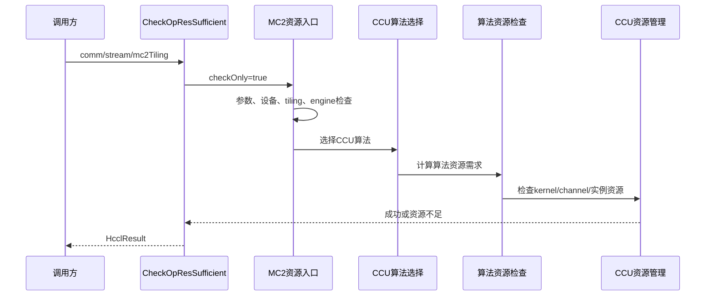

# CheckOpResSufficient 接口说明

> 基于提交 `82eec6ab436fb052a2a001dd770bb7bbd0a8f9ee` 整理。

## 1. 接口作用

`CheckOpResSufficient` 用于在真正创建 MC2 通信操作资源前，依据 `mc2Tiling` 预检查 CCU 通信资源是否足够。

```cpp
HcclResult CheckOpResSufficient(
    HcclComm comm, void* stream, void* mc2Tiling);
```

接口内部复用 `HcclAllocComResourceByTilingImpl(..., checkOnly=true)`，因此检查逻辑与真实资源分配路径基本一致，但不保存最终 `OpResCtx`。

## 2. 处理流程



## 3. 主要检查内容

- 输入参数、设备类型、tiling格式及通信引擎。
- CCU算法是否已注册、KFC flow是否合法。
- 算法选择、拓扑和算法资源需求计算。
- 动态CCU资源接口可用时，检查kernel资源需求及已有 `CcuIns` 容量。
- 资源获取阶段的 `HCCL_E_UNAVAIL` 在 check-only 模式下转换为 `HCCL_E_RES_NOT_SUFFICIENT`。

## 4. 明确不会做的事情

check-only模式下通常不会：

- 创建最终device侧 `OpResCtx`；
- 获取CCL buffer、更新token；
- 获取CCU thread；
- 注册CCU kernel。

单rank或非 `CCU_SCHED` 引擎会直接返回 `HCCL_SUCCESS`，不执行CCU资源检查。当前公开入口对多tiling存在前置限制，通常会返回 `HCCL_E_ALG_NOT_SUPPORTED`，底层的多kernel资源累计逻辑因此未必能被该接口实际触发。

## 5. 当前隐藏问题

### 5.1 预检查并非完全无副作用

动态CCU路径仍会调用channel acquire，可能真实申请channel；资源不足时还可能创建并绑定新的 `CcuIns`。绑定失败会清理，但 check-only成功后新实例可能保留。接口并非严格意义上的只读探测。

### 5.2 动态资源接口不支持时可能误报成功

当运行环境不支持动态CCU资源API时，check-only会跳过CCU kernel资源检查并返回成功。因此成功只能说明前置流程通过，不能完全证明真实运行时资源充足。

### 5.3 cache命中会缩小检查范围

算法资源cache命中后会复用已有context，可能跳过当前tiling的完整资源重算和动态容量检查。检查结果会受到已有cache状态影响。

### 5.4 多tiling语义不一致

底层支持对多个kernel累计资源需求，但公开CCU入口对多tiling有前置拒绝，接口表现与底层设计能力不完全一致。

### 5.5 返回码不能简单等同于“资源不足”

只有资源获取阶段的 `HCCL_E_UNAVAIL` 才会转换为 `HCCL_E_RES_NOT_SUFFICIENT`；参数错误、算法未注册、不支持或内部错误仍返回对应错误码。

## 6. 使用建议

调用方应将该接口视为“尽量复用真实分配流程的预检查”，不要假设它完全无副作用，也不要仅依据 `HCCL_SUCCESS` 判断所有CCU运行资源均已得到验证。上线前建议补充真实硬件环境下的channel、`CcuIns`残留以及动态API不支持场景测试。
