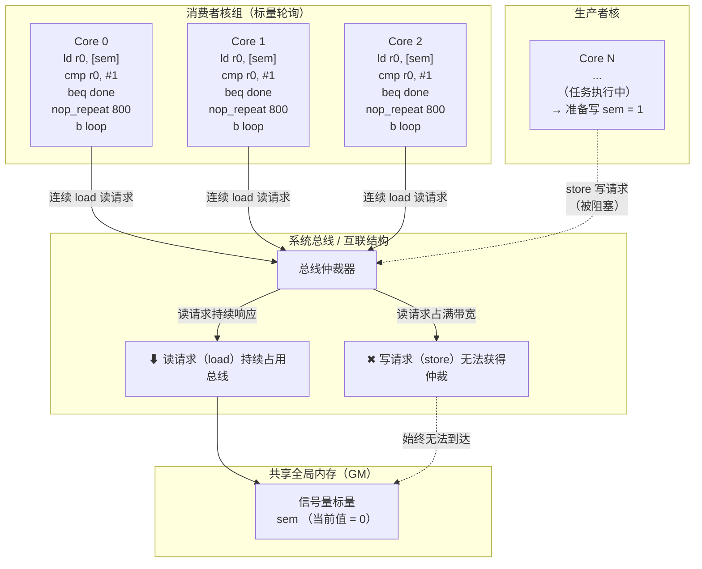

# 关键特性说明

在多核系统中，不同核之间通过在共享全局内存（GM）上读写一个标量值来实现核间同步。典型模式如下：

1. **消费者核**：连续轮询共享内存中的信号量标量，等待其值变为 1。
2. **生产者核**：完成本核任务后，向该信号量标量写入 1，以释放消费者核。

核间同步 — 标量轮询读饿写死问题说明与规避指导

## 1 问题场景描述

在多核系统中，不同核之间通过在共享全局内存（GM）上读写一个标量值来实现核间同步。典型模式如下：

1. **消费者核**：连续轮询共享内存中的信号量标量，等待其值变为 1。
2. **生产者核**：完成本核任务后，向该信号量标量写入 1，以释放消费者核。

在此模式下，消费者核的标量单元连续发射标量 load 指令访问共享 GM。若多个消费者核同时轮询同一信号量，标量读请求将持续占用总线，导致生产者核的 store 写请求无法在总线上获得仲裁，无法将信号量更新为 1。由此造成核间同步死锁，最终导致整个设备挂死。

下图展示了标量轮询导致读饿写死的总线竞争场景：



典型场景包括：
- 开发者使用 Cube（或其他软件模拟器）进行手动软仿，自行编写基于共享内存标量轮询的核间同步代码，而未采用硬件提供的核间同步机制。

---

## 2 推荐做法：使用核间同步接口

上述场景常见于开发者通过手动软仿实现核间同步。手动轮询共享 GM 标量的方式存在以下问题：

- 总线读写竞争不可控：标量连续读可能饿死写请求，导致同步死锁。
- 与硬件行为耦合：是否触发该问题取决于微架构实现（总线仲裁策略、Cache 一致性协议等），在不同硬件版本上表现不一致。
- 无官方保障：不支持、不推荐、不受版本兼容性保护。

**因此，强烈建议开发者使用核间同步章节提供的官方接口来实现核间同步。** 硬件层面提供的核间同步机制已针对总线竞争问题做了处理，包括但不限于：
- 使用独立的硬件信号量通道，不占用数据总线。
- 采用硬件写优先仲裁或专用同步指令，避免读饿死写。
- 保证在多核竞争场景下的确定性行为。

> 核间同步接口的详细说明和用法，请参见《核间同步》章节。

---

## 3 问题规避方案

若因某些原因无法使用官方核间同步接口（如仅在软仿环境下验证原型），可尝试通过插入 NOP 指令来降低标量读请求频率，从而为写请求留出总线时间片。

### 3.1 基本方案

在消费者核的轮询循环中，每次读取信号量后插入 **800 个 NOP** 指令：

```asm
loop:
    ld  r0, [semaphore_addr]    // 读取信号量
    cmp r0, #1                   // 检查是否释放
    beq done                     // 已释放则退出
    nop_repeat 800               // 插入 800 个 NOP，降低读频率
    b loop
done:
```

插入 NOP 的效果：
- 降低标量单元发射 load 指令的频率。
- 减少对总线的读请求占用。
- 为生产者核的写请求提供总线仲裁机会。

### 3.2 增强方案

若插入 800 个 NOP 后问题仍然存在，表明总线竞争仍然激烈，需要进一步降低读请求频率。此时建议插入的 NOP 数量为：

```
NOP 数量 = 200 × N_sync
```

其中 `N_sync` 为参与该核间同步的核总数。

**示例：**

| 参与同步的核数 | 建议 NOP 数量 |
|---|---|
| 2 | 200 × 2 = 400 |
| 4 | 200 × 4 = 800 |
| 8 | 200 × 8 = 1600 |
| 16 | 200 × 16 = 3200 |

> **注意：**
> - 上述方案为经验值，适用于基于手动软仿的原型验证场景。
> - 增加 NOP 数量会降低消费者核的响应延迟，请根据实际场景权衡。
> - 该方案仅为临时规避手段，长期方案应迁移至官方核间同步接口。
