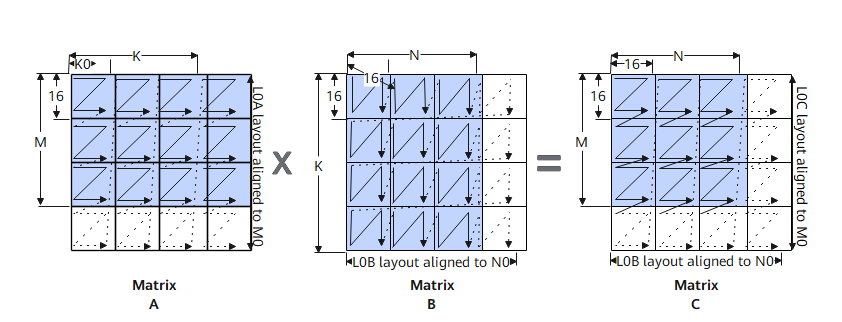

# Mmad

## 产品支持情况

| 产品 | 是否支持（<br><br>不传入bias的原型<br><br>） | 是否支持（<br><br>传入bias的原型<br><br>） |
| --- | --- | --- |
| Ascend 950PR/Ascend 950DT | √ | √ |
| Atlas A3 训练系列产品/Atlas A3 推理系列产品 | √ | √ |
| Atlas A2 训练系列产品/Atlas A2 推理系列产品 | √ | √ |
| Atlas 200I/500 A2 推理产品 | √ | √ |
| Atlas 推理系列产品AI Core | √ | x |
| Atlas 推理系列产品Vector Core | x | x |
| Atlas 训练系列产品 | √ | x |
| Kirin X90 | √ | √ |
| Kirin 9030 | √ | x |

## 功能说明

头文件路径为: \#include "basic\_api/kernel\_operator\_mm\_intf.h"

Mmad接口是AscendC面向昇腾 AI 芯片的矩阵乘加核心计算接口，专为高性能算子开发设计，封装了昇腾 NPU 硬件的矩阵乘加计算能力，广泛用于神经网络层（如全连接层、卷积层）、数值计算类算子的开发。

Mmad接口实现昇腾NPU矩阵乘计算能力，其数学表达式为：

$$C = A \times B + C$$

完整示例请参考：[Mmad示例](https://gitcode.com/cann/asc-devkit/blob/master/examples/01_simd_cpp_api/02_features/03_basic_api/01_matrix_compute/mmad/scripts/mmad.py)

</cann-filter npu-type="910b,A3">

针对Atlas A2 训练系列产品/Atlas A2 推理系列产品  和  Atlas A3 训练系列产品/Atlas A3 推理系列产品：

**表 1**  矩阵计算矩阵A、B、C解释说明

  <table>
    <thead>
      <tr>
        <th>矩阵计算逻辑</th>
        <th>矩阵计算物理位置</th>
        <th>维度</th>
        <th>输入/输出数据格式</th>
        <th>数据类型</th>
      </tr>
    </thead>
    <tbody>
      <tr>
        <td>A</td>
        <td>L0A Buffer</td>
        <td>M x K</td>
        <td>[Zz]</td>
        <td rowspan="3">[数据类型]</td>
      </tr>
      <tr>
        <td>B</td>
        <td>L0B Buffer</td>
        <td>K x N</td>
        <td>[Zn]</td>
      </tr>
      <tr>
        <td>C</td>
        <td>L0C Buffer</td>
        <td>M x N，可支持使用偏置矩阵Bias 进行初始化，维度为1 x N</td>
        <td>[Nz]</td>
      </tr>
    </tbody>
  </table>
</cann-filter>

</cann-filter npu-type="950">

针对Ascend 950PR/Ascend 950DT:
**表 2**  矩阵计算矩阵A、B、C解释说明

  <table>
    <thead>
      <tr>
        <th>矩阵计算逻辑</th>
        <th>矩阵计算物理位置</th>
        <th>维度</th>
        <th>输入/输出数据格式</th>
        <th>数据类型</th>
      </tr>
    </thead>
    <tbody>
      <tr>
        <td>A</td>
        <td>L0A Buffer</td>
        <td>M x K</td>
        <td>[Nz]</td>
        <td rowspan="3">[数据类型]</td>
      </tr>
      <tr>
        <td>B</td>
        <td>L0B Buffer</td>
        <td>K x N</td>
        <td>[Zn]</td>
      </tr>
      <tr>
        <td>C</td>
        <td>L0C Buffer</td>
        <td>M x N，可支持使用偏置矩阵Bias 进行初始化，维度为1 x N</td>
        <td>[Nz]</td>
      </tr>
    </tbody>
  </table>

**图 1**  Mmad接口矩阵乘分形示意图（Ascend 950PR/Ascend 950DT）



</cann-filter>


## 函数原型

-   不传入bias

    ```cpp
    template <typename T, typename U, typename S>
    __aicore__ inline void Mmad(const LocalTensor<T>& dst, const LocalTensor<U>& fm, const LocalTensor<S>& filter, const MmadParams& mmadParams)
    ```

-   传入bias

    ```cpp
    template <typename T, typename U, typename S, typename V>
    __aicore__ inline void Mmad(const LocalTensor<T>& dst, const LocalTensor<U>& fm, const LocalTensor<S>& filter, const LocalTensor<V>& bias, const MmadParams& mmadParams)
    ```

</cann-filter npu-type="950">

针对Ascend 950PR/Ascend 950DT，对于MmadParams结构体构造进行了优化，新增了对于MmadBitModeParams结构体支持：

-   不传入bias

    ```cpp
    template <typename T, typename U, typename S>
    __aicore__ inline void Mmad(const LocalTensor<T>& dst, const LocalTensor<U>& fm, const LocalTensor<S>& filter, const MmadBitModeParams& mmadParams)
    ```

-   传入bias

    ```cpp
    template <typename T, typename U, typename S, typename V>
    __aicore__ inline void Mmad(const LocalTensor<T>& dst, const LocalTensor<U>& fm, const LocalTensor<S>& filter, const LocalTensor<V>& bias, const MmadBitModeParams& mmadParams)
    ```
</cann-filter>

## 参数说明

**表 3**  模板参数说明

| 参数名称 | 输入/输出 | 含义 |
| --- | --- | --- |
| c | 输出 | 目的操作数，结果矩阵c，类型为LocalTensor，支持的物理存储位置为L0C Buffer(TPosition:CO1)。<br><br>LocalTensor的起始地址需要按照1024字节对齐。 |
| a | 输入 | 源操作数，左矩阵a，类型为LocalTensor，支持的物理存储位置为L0A Buffer(TPosition: A2)。<br><br>LocalTensor的起始地址需要按照512字节对齐。 |
| b | 输入 | 源操作数，右矩阵b，类型为LocalTensor，支持的物理存储位置为L0B Buffer(TPosition: B2)。<br><br>LocalTensor的起始地址需要按照512字节对齐。 |
| bias | 输入 | 源操作数，bias矩阵，类型为LocalTensor，支持的物理存储位置为BT Buffer(TPosition:C2)。<br><br>LocalTensor的起始地址需要按照64字节对齐。 |
| mmadParams | 输入 | 矩阵乘相关参数。该参数类型的具体定义请参考\${INSTALL_DIR}/include/ascendc/basic_api/interface/kernel_struct_mm.h，${INSTALL_DIR}请替换为CANN软件安装后文件存储路径。<br><br>MmadParams参数说明请参考表 MmadParams结构体内参数说明。 |

**表 3**  MmadParams结构体内参数说明

| 参数名称 | 含义 |
| --- | --- |
| m | 左矩阵Height，取值范围：m∈[0, 4095] 。默认值为0。 |
| n | 右矩阵Width，取值范围：n∈[0, 4095] 。默认值为0。 |
| k | 左矩阵Width、右矩阵Height，取值范围：k∈[0, 4095] 。默认值为0。 |
| cmatrixInitVal | 是否使能C矩阵默认初始化清零操作。默认值true。<br>true：C矩阵默认初始化为0；false：C矩阵不进行默认操作，通过设置cmatrixSource参数进行初始化。 |
| cmatrixSource | 配置C矩阵初始值是否来源于BT Buffer。默认值为false。<br>false：不对L0C进行初始化操作；<br>true：使用BT Buffer(TPosition:C2)的数据对L0C进行初始化操作。<br><br>Atlas 训练系列产品，仅支持配置为false。<br><br>Atlas 推理系列产品AI Core，仅支持配置为false。<br><br>Atlas A2 训练系列产品/Atlas A2 推理系列产品，支持配置为true/false。<br><br>Atlas A3 训练系列产品/Atlas A3 推理系列产品，支持配置为true/false。<br><br>Atlas 200I/500 A2 推理产品，支持配置为true/false。<br><br>Ascend 950PR/Ascend 950DT，支持配置为true/false。<br><br>Kirin X90 仅支持配置为false。<br><br>Kirin 9030仅支持配置为false。<br><br>注意：带bias输入的接口配置该参数无效，会根据bias输入的位置来判断C矩阵初始值是否来源于BT Buffer。 |
| isBias | 该参数废弃，新开发内容不要使用该参数。如果需要累加初始矩阵，请使用带bias的接口来实现；也可以通过cmatrixInitVal和cmatrixSource参数配置C矩阵的初始值来源来实现。推荐使用带bias的接口，相比于配置cmatrixInitVal和cmatrixSource参数更加简单方便。<br><br>配置是否需要累加初始矩阵，默认值为false，取值说明如下：<br>false：矩阵乘，无需累加初始矩阵，C = A * B。true：矩阵乘加，需要累加初始矩阵，C += A * B。 |
| disableGemv | M=1时，该参数用来配置Mmad计算是否开启[GEMV](GEMV.md#ZH-CN_TOPIC_0000002568950965)模式。<br>false：开启GEMV模式。true：关闭GEMV模式。<br><br>该参数仅支持如下型号：<br><br>Ascend 950PR/Ascend 950DT |
| unitFlag | unitFlag可以控制Mmad指令和Fixpipe指令细粒度的并行，使能该功能后，硬件每计算完一个分形，计算结果就会被搬出。取值说明如下：<br><br>0（2'b00）：不使能unitFlag；<br><br>1  (2'b01):  保留值；<br><br>2（2'b10）:  使能unitFlag，硬件执行完指令之后，不复位单元标记位；<br><br>3（2'b11）:  使能unitFlag，硬件执行完指令之后，复位单元标记位。<br><br>使能该功能时，须将Mmad指令和Fixpipe指令的unitFlag值设置为2或3。<br><br>该参数仅支持如下型号：<br><br>Ascend 950PR/Ascend 950DT<br><br>Atlas A2 训练系列产品/Atlas A2 推理系列产品<br><br>Atlas A3 训练系列产品/Atlas A3 推理系列产品。参数设置方案和特性细节可参考： [UnitFlag特性说明](UnitFlag.md#ZH-CN_TOPIC_0000002538071264) |
| kDirectionAlign | K方向对齐的核心功能是通过 `kDirectionAlign` 参数控制在使用 float 数据类型时，L0A 和 L0B 矩阵在 K 方向上的对齐方式。<br><br>取值说明如下：<br><br>false：默认值,  K 方向对齐到 `ceil(K / 8) * 8`。<br><br>true:   K 方向对齐到 `ceil(K/16)*16`。<br><br>Atlas A2 训练系列产品/Atlas A2 推理系列产品, 支持配置为true/false。<br><br>Atlas A3 训练系列产品/Atlas A3 推理系列产品, 支持配置为true/false。<br><br>特性细节可参考：[kDirectionAlign特性说明](K-方向对齐约束.md#ZH-CN_TOPIC_0000002569070973) |
| fmOffset | 左矩阵offset（整个左矩阵对应一个值），支持 Scalar（应与 src_fm.dtype 一致）/立即数，默认0。<br><br>注：未使用，兼容旧款产品接口传入，Atlas A2 训练系列产品/Atlas A2 推理系列产品及往后产品不做处理。 |
| enSsparse | 使能结构化稀疏特性，默认false;<br><br>注：未使用，兼容旧款产品接口传入，Atlas A2 训练系列产品/Atlas A2 推理系列产品及往后产品不做处理。 |
| enWinogradA | 指示矩阵 a 是否通过 winograd_feature_map_transform() 生成，用于支持 winograd 特性，bool 类型，默认 false；<br><br>注：未使用，兼容旧款产品接口传入，Atlas A2 训练系列产品/Atlas A2 推理系列产品及往后产品不做处理。 |
| enWinogradB | 指示矩阵 b 是否通过 winograd_weight_transform() 生成，用于支持 winograd 特性，bool 类型，默认 false；<br><br>注：未使用，兼容旧款产品接口传入，Atlas A2 训练系列产品/Atlas A2 推理系列产品及往后产品不做处理。 |

**表 4**  dst、fm、filter支持的精度类型组合（Atlas 训练系列产品）

| 左矩阵fm type | 右矩阵filter type | 结果矩阵dst type |
| --- | --- | --- |
| uint8_t | uint8_t | uint32_t |
| int8_t | int8_t | int32_t |
| uint8_t | int8_t | int32_t |
| half | half | half<br> 说明： <br>该精度类型组合，精度无法达到双千分之一，且后续处理器版本不支持该类型转换，建议直接使用half输入float输出。<br><br>双千分之一是指每个实际数据和真值数据之间的误差不超过千分之一，误差超过千分之一的数据总和不超过总数据数的千分之一。 |
| half | half | float |

**表 5**  dst、fm、filter支持的精度类型组合（Atlas 推理系列产品AI Core  ）

| 左矩阵fm type | 右矩阵filter type | 结果矩阵dst type |
| --- | --- | --- |
| int8_t | int8_t | int32_t |
| uint8_t | int8_t | int32_t |
| uint8_t | uint8_t | int32_t |
| half | half | half<br> 说明： <br>该精度类型组合，精度无法达到双千分之一，且后续处理器版本不支持该类型转换，建议直接使用half输入float输出。<br><br>双千分之一是指每个实际数据和真值数据之间的误差不超过千分之一，误差超过千分之一的数据总和不超过总数据数的千分之一。 |
| half | half | float |
| int4b_t | int4b_t | int32_t |

**表 6**  dst、fm、filter支持的精度类型组合（Atlas 200I/500 A2 推理产品）（Atlas A2 训练系列产品/Atlas A2 推理系列产品）（Atlas A3 训练系列产品/Atlas A3 推理系列产品）

| 左矩阵fm type | 右矩阵filter type | 结果矩阵dst type |
| --- | --- | --- |
| int8_t | int8_t | int32_t |
| half | half | float |
| float | float | float |
| bfloat16_t | bfloat16_t | float |
| int4b_t | int4b_t | int32_t |

**表 7**  dst、fm、filter支持的精度类型组合（Ascend 950PR/Ascend 950DT）

| 左矩阵fm type | 右矩阵filter type | 结果矩阵dst type | 备注 |
| --- | --- | --- | --- |
| int8_t | int8_t | int32_t | 仅支持不含缩放的矩阵乘 |
| half | half | float |  |
| float | float | float |  |
| bfloat16_t | bfloat16_t | float |  |
| fp8_e4m3fn_t | fp8_e4m3fn_t | float |  |
| fp8_e4m3fn_t | fp8_e5m2_t | float |  |
| fp8_e5m2_t | fp8_e4m3fn_t | float |  |
| fp8_e5m2_t | fp8_e5m2_t | float |  |
| hifloat8_t | hifloat8_t | float |  |
| fp4x2_e1m2_t | fp4x2_e1m2_t | float | 仅支持包含缩放的矩阵乘 |
| fp4x2_e2m1_t | fp4x2_e1m2_t | float |  |
| fp4x2_e1m2_t | fp4x2_e2m1_t | float |  |
| fp4x2_e2m1_t | fp4x2_e2m1_t | float |  |
| AscendC::mx_fp8_e4m3_t | AscendC::mx_fp8_e4m3_t | float |  |
| AscendC::mx_fp8_e4m3_t | AscendC::mx_fp8_e5m2_t | float |  |
| AscendC::mx_fp8_e5m2_t | AscendC::mx_fp8_e4m3_t | float |  |
| AscendC::mx_fp8_e5m2_t | AscendC::mx_fp8_e5m2_t | float |  |

**表 8**  dst、fm、filter、bias支持的精度类型组合（Atlas 200I/500 A2 推理产品）（Atlas A2 训练系列产品/Atlas A2 推理系列产品）（Atlas A3 训练系列产品/Atlas A3 推理系列产品）

| 左矩阵fm type | 右矩阵filter type | bias type | 结果矩阵dst type |
| --- | --- | --- | --- |
| int8_t | int8_t | int32_t | int32_t |
| half | half | float | float |
| float | float | float | float |
| bfloat16_t | bfloat16_t | float | float |

**表 9**  dst、fm、filter、bias支持的精度类型组合（Ascend 950PR/Ascend 950DT）

| 左矩阵fm type | 右矩阵filter type | bias type | 结果矩阵dst type | 备注 |
| --- | --- | --- | --- | --- |
| int8_t | int8_t | int32_t | int32_t | 仅支持不含缩放的矩阵乘 |
| half | half | float | float |  |
| float | float | float | float |  |
| bfloat16_t | bfloat16_t | float | float |  |
| fp8_e4m3fn_t | fp8_e4m3fn_t | float | float |  |
| fp8_e4m3fn_t | fp8_e5m2_t | float | float |  |
| fp8_e5m2_t | fp8_e4m3fn_t | float | float |  |
| fp8_e5m2_t | fp8_e5m2_t | float | float |  |
| hifloat8_t | hifloat8_t | float | float |  |
| fp4x2_e1m2_t | fp4x2_e1m2_t | float | float | 仅支持包含缩放的矩阵乘 |
| fp4x2_e2m1_t | fp4x2_e1m2_t | float | float |  |
| fp4x2_e1m2_t | fp4x2_e2m1_t | float | float |  |
| fp4x2_e2m1_t | fp4x2_e2m1_t | float | float |  |
| AscendC::mx_fp8_e4m3_t | AscendC::mx_fp8_e4m3_t | float | float |  |
| AscendC::mx_fp8_e4m3_t | AscendC::mx_fp8_e5m2_t | float | float |  |
| AscendC::mx_fp8_e5m2_t | AscendC::mx_fp8_e4m3_t | float | float |  |
| AscendC::mx_fp8_e5m2_t | AscendC::mx_fp8_e5m2_t | float | float |  |

**表 10**  dst、fm、filter、bias支持的精度类型组合 （Kirin 9030）

| 左矩阵fm type | 右矩阵filter type | bias type | 结果矩阵dst type |
| --- | --- | --- | --- |
| half | half | half | half |

**表 11**  dst、fm、filter、bias支持的精度类型组合 （Kirin X90）

| 左矩阵fm type | 右矩阵filter type | bias type | 结果矩阵dst type |
| --- | --- | --- | --- |
| int8_t | int8_t | int32_t | int32_t |
| half | half | half | half |

## 约束说明

-   dst只支持位于CO1，fm只支持位于A2，filter只支持位于B2。
-   当M、K、N中的任意一个值为0时，该指令不会被执行。
-   当M = 1时，会默认开启GEMV（General Matrix-Vector Multiplication）功能。在这种情况下，Mmad API从L0A Buffer读取数据时，会以ND格式进行读取，而不会将其视为ZZ格式。所以此时左矩阵需要直接按照ND格式进行排布。针对Ascend 950PR/Ascend 950DT，可以通过设置MmadParams的disableGemv参数为true，将该功能关闭。
-   操作数地址对齐要求请参见[通用地址对齐约束](../../../通用说明和约束.md#section796754519912)。
-   通过一个具体的示例来介绍无效数据与有效数据的排布方式。

    数据为half类型，当M=30，K=70，N=40的时候，A2中有2x5个16x16矩阵，B2中有5x3个16x16矩阵，CO1中有2x3个16x16矩阵。在这种场景下M、K和N都不是16的倍数，A2中右下角的矩阵实际有效的数据只有14x6个，但是也需要占一个16x16矩阵的空间，其他无效数据在计算中会被忽略。一个16x16分形的数据块中，无效数据与有效数据排布的方式示意如下：

    

## 调用示例

不含矩阵乘偏置的样例请参考[Mmad样例](https://gitee.com/ascend/samples/tree/master/operator/ascendc/0_introduction/20_mmad_kernellaunch/MmadInvocation)。

包含矩阵乘偏置的样例请参考[包含矩阵乘偏置的Mmad样例](https://gitee.com/ascend/samples/blob/master/operator/ascendc/0_introduction/20_mmad_kernellaunch/MmadBiasInvocation/)。
