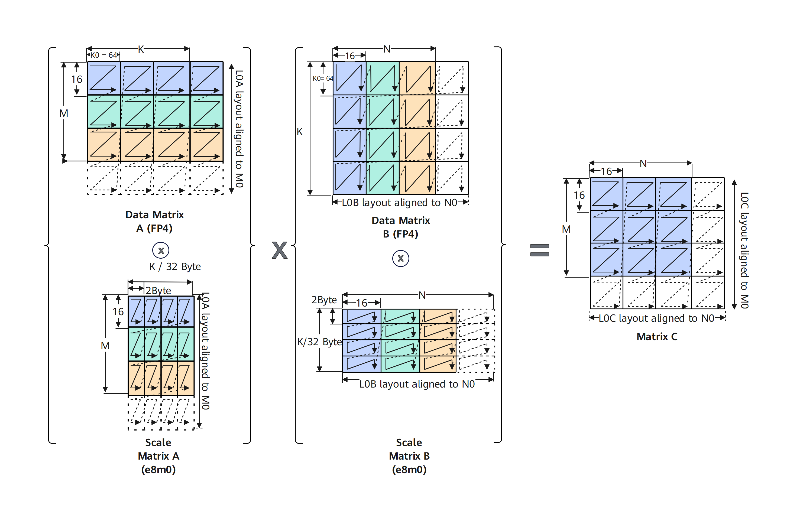

# Mmad

## 产品支持情况

| 产品 | 是否支持（<br><br>不传入bias的原型<br><br>） | 是否支持（<br><br>传入bias的原型<br><br>） |
| --- | --- | --- |
| Ascend 950PR/Ascend 950DT | √ | √ |
| Atlas A3 训练系列产品/Atlas A3 推理系列产品 | x | x |
| Atlas A2 训练系列产品/Atlas A2 推理系列产品 | x | x |
| Atlas 200I/500 A2 推理产品 | x | x |
| Atlas 推理系列产品AI Core | x | x |
| Atlas 推理系列产品Vector Core | x | x |
| Atlas 训练系列产品 | x | x |
| Kirin X90 | x | x |
| Kirin 9030 | x | x |

## 功能说明

头文件路径为: \#include "basic\_api/kernel\_operator\_mm\_intf.h"

MxMmad（全称Microscaling Mmad）为带有量化系数的矩阵乘法

**图 1**  MmadMx接口矩阵乘分形示意图



**表 1**  矩阵计算矩阵A、B、C解释说明

  <table>
    <thead>
      <tr>
        <th>矩阵计算逻辑</th>
        <th>矩阵计算物理位置</th>
        <th>维度</th>
        <th>输入/输出数据格式</th>
        <th>数据类型</th>
      </tr>
    </thead>
    <tbody>
      <tr>
        <td>A</td>
        <td>L0A Buffer</td>
        <td>M x K</td>
        <td>[Nz]</td>
        <td rowspan="3">[数据类型]</td>
      </tr>
      <tr>
        <td>scaleA</td>
        <td>L0A_MX Buffer</td>
        <td>M x K/32</td>
        <td>[大Z小z]小z shape为（2，16）</td>
      </tr>
      <tr>
        <td>B</td>
        <td>L0B Buffer</td>
        <td>K x N</td>
        <td>[Zn]</td>
      </tr>
      <tr>
        <td>scaleB</td>
        <td>L0B_MX Buffer</td>
        <td>K/32 x N</td>
        <td>[大N小n]小n shape为（2，16）</td>
      </tr>
      <tr>
        <td>C</td>
        <td>L0C Buffer</td>
        <td>M x N，可支持使用偏置矩阵Bias 进行初始化，维度为1 x N</td>
        <td>[Nz]</td>
      </tr>
    </tbody>
  </table>

## 函数原型

-   不传入bias

    ```cpp
    template <typename T, typename U, typename S>
    __aicore__ inline void MmadMx(const LocalTensor<T>& dst, const LocalTensor<U>& fm, const LocalTensor<S>& filter, const MmadParams& mmadParams)
    ```

-   传入bias

    ```cpp
    template <typename T, typename U, typename S, typename V>
    __aicore__ inline void MmadMx(const LocalTensor<T>& dst, const LocalTensor<U>& fm, const LocalTensor<S>& filter, const LocalTensor<V>& bias, const MmadParams& mmadParams)
    ```


## 参数说明

**表 2**  参数说明

| 参数名称 | 输入/输出 | 含义 |
| --- | --- | --- |
| dst | 输出 | 目的操作数，结果矩阵c，类型为LocalTensor，支持的物理存储位置为L0C Buffer(TPosition:CO1)。<br><br>LocalTensor的起始地址需要按照1024字节对齐。 |
| fm | 输入 | 源操作数，左矩阵a，类型为LocalTensor，支持的物理存储位置为L0A Buffer(TPosition: A2)。<br><br>LocalTensor的起始地址需要按照512字节对齐。 |
| filter | 输入 | 源操作数，右矩阵b，类型为LocalTensor，支持的物理存储位置为L0B Buffer(TPosition: B2)。<br><br>LocalTensor的起始地址需要按照512字节对齐。 |
| bias | 输入 | 源操作数，bias矩阵，类型为LocalTensor，支持的物理存储位置为BT Buffer(TPosition:C2)。<br><br>LocalTensor的起始地址需要按照64字节对齐。 |
| mmadParams | 输入 | 矩阵乘相关参数。该参数类型的具体定义请参考\${INSTALL_DIR}/include/ascendc/basic_api/interface/kernel_struct_mm.h，${INSTALL_DIR}请替换为CANN软件安装后文件存储路径。<br><br>MmadParams参数说明请参考表 MmadParams结构体内参数说明。 |

## 数据类型

**表 3**  左矩阵、右矩阵、Scale矩阵、结果矩阵支持的精度类型组合（Ascend 950PR/Ascend 950DT）

| 左矩阵fm | 右矩阵filter | Scale矩阵 | 偏置Bias | 结果矩阵dst |
| --- | --- | --- | --- | --- |
| fp4x2_e1m2_t | fp4x2_e1m2_t | fp8_e8m0_t | float | float |
| fp4x2_e2m1_t | fp4x2_e1m2_t | fp8_e8m0_t | float | float |
| fp4x2_e1m2_t | fp4x2_e2m1_t | fp8_e8m0_t | float | float |
| fp4x2_e2m1_t | fp4x2_e2m1_t | fp8_e8m0_t | float | float |
| fp8_e4m3fn_t | fp8_e4m3fn_t | fp8_e8m0_t | float | float |
| fp8_e4m3fn_t | fp8_e5m2_t | fp8_e8m0_t | float | float |
| fp8_e5m2_t | fp8_e4m3fn_t | fp8_e8m0_t | float | float |
| fp8_e5m2_t | fp8_e5m2_t | fp8_e8m0_t | float | float |


## 返回值说明
无

## 约束说明

-   结果矩阵C只支持位于CO1\(存储位置为L0C Buffer\)，左矩阵A只支持位于A2\(存储位置为L0A Buffer\)，右矩阵B只支持位于B2\(存储位置为L0B Buffer\)。
-   当M、K、N中的任意一个值为0时，表示指令不会执行，该接口将被视为 NOP（空操作）。
-   当M = 1时，会默认开启GEMV（General Matrix-Vector Multiplication）功能。在这种情况下，Mmad API从L0A Buffer读取数据时，会以ND格式进行读取，而不会将其视为ZZ格式 （。所以此时左矩阵需要直接按照ND格式进行排布\([GEMV特性说明](GEMV.md#ZH-CN_TOPIC_0000002568950965)\)。要注意的是，开启GEMV的情况下，A矩阵的起始地址仍要求512字节对齐。
-   一般来说，一次Mmad计算至少完成一次A\(16\*16\*half\) \* B\(16\*16\*half）数据块计算。但实际计算时M、K、N有效值可能不是16的倍数，从而有部分数据为无效数据。以M=30, K=70, N=40 为例来介绍无效数据与有效数据的排布方式。

## 调用示例

完整使用样例请参考[MmadMx最佳实践](https://gitcode.com/cann/asc-devkit/tree/master/examples/01_simd_cpp_api/04_best_practices/01_matrix_compute_practices/matmul_mxfp4_basic_api_high_performance)。
