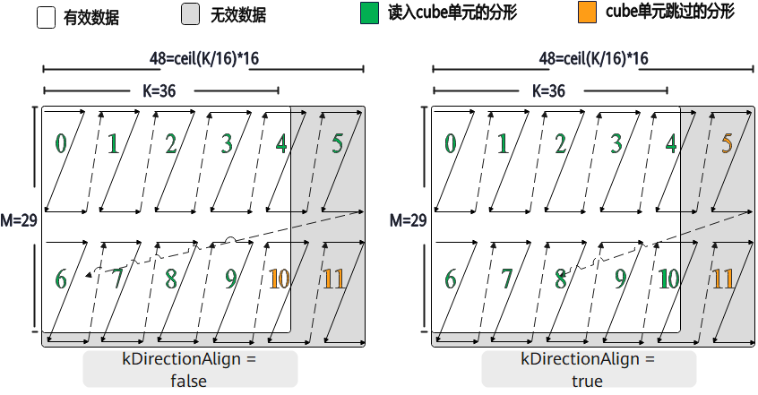

# K 方向对齐约束<a name="ZH-CN_TOPIC_0000002569070973"></a>

**特性说明:**

Atlas A2 训练系列产品/Atlas A2 推理系列产品/Atlas A3 训练系列产品/Atlas A3 推理系列产品  Mmad接口支持使能此特性。

Ascend 950PR/Ascend 950DT产品上L0A为NZ排布，非ZZ排布，A矩阵转置非对齐float数据类型场景，L0A在K方向8对齐，无需使能此特性去确保计算正确性。

K方向对齐的核心功能是通过 \`kDirectionAlign\` 参数控制在使用 float 数据类型\(其他数据类型无需关注此特性\)时，L0A 和 L0B 矩阵在 K 方向上的对齐方式。

当设置 \`mmadParams.kDirectionAlign = true\` 时，L0A/L0B 中的矩阵会将 K 方向对齐到 \`ceil\(K/16\)\*16\`。



例如，当 K=44 和 K=36 时，都会被对齐到 48。在这种情况下，对于 K=44，L0A/L0B 中的 12 个分形块都会被完整读入 CUBE；而对于 K=36 的情况，虽然对齐后也是 48，但只有其中的 10 个分形块会被读入 CUBE。


当设置 \`mmadParams.kDirectionAlign = false\` 时，L0A/L0B 中的矩阵会将 K 方向对齐到 \`ceil\(K/8\)\*8\`。

例如，当K=44时对齐到48，而K=36时对齐到40。在这种情况下，对于 K=44，L0A/L0B 中的 12 个分形块都会被完整读入 CUBE；而对于K=36的情况，L0A/L0B中的10个分形块都会被读取到CUBE中。


1. A矩阵非转置的场景，无需开启kDirectionAlign

2. A矩阵转置的场景，需要开启kDirectionAlign

当输入需要进行转置操作时，例如原始矩阵A的维度为K×M，在搬入L1 Buffer后，其存储形式会变为NZ排布（本质上仍为K×M）。此时应调用具备转置能力的LoadData接口。该接口的内部实现如下图所示：在K方向上会进行16的对齐处理（如左图所示）。完成转置后，数据将呈现出如右图所示的ZZ分形形式，存储在L0A Buffer中。为了避免读入无效数据，可以通过开启kDirectionAlign参数，仅读取有效分形的数据。


**使用示例：**

```cpp
AscendC::MmadParams mmadParams;
mmadParams.m = m;
mmadParams.n = n;
mmadParams.k = k;
// 设置float数据类型下K方向对齐到ceil(K/16)*16
mmadParams.kDirectionAlign = true;
AscendC::Mmad(c, a, b, mmadParams);
```
