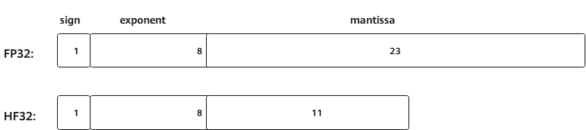

<a name="ZH-CN_TOPIC_0000002538231188"></a>

# HF32

## 特性说明

HF32的核心功能体现为：用户在输入矩阵A和B都为`fp32`数据类型的场景下，当配置开启HF32开关后，`fp32`数据在执行矩阵乘法运算前会被转换并舍入为HF32（half-fp32）格式。这种做法可使`Mmad`（`fp32`->`fp32`）接口的计算性能提升至原来的两倍，但会带来一定的精度损失。需要注意的是，尽管中间计算使用HF32格式，最终的运算结果仍以`fp32`格式输出，以保证后续处理的兼容性。

舍入模式说明：`fp32`至HF32转换过程中的舍入模式由`SetHF32TransMode`接口配置。当HF32模式使能且设置`TransMode`为`true`时，则`fp32`将以向零舍入的方式转换为HF32。若设置`TransMode`为`false`，则`fp32`将以最接近偶数的方式舍入为HF32。

**图 1**  HF32数值精度示意图<a id="zh_cn_topic_mmad_keyfunc_section1_figure1"></a>



## 使用示例

```cpp
using namespace AscendC;
using namespace AscendC::Te;

// 开启HF32模式。
SetHF32Mode(HF32Mode::Enable);
// 设置转换模式为向零舍入。
SetHF32TransMode(HF32TransMode::Enable);

// Mmad计算代码。
MmadParams params(m, n, k, 0, true);
auto atom = MakeMmad(MmadOperation{}, MmadTraitDefault{}).with(params);
Mmad(atom, l0C, l0A, l0B);

// 关闭HF32模式。
SetHF32Mode(HF32Mode::Disable);
SetHF32TransMode(HF32TransMode::Disable);
```
