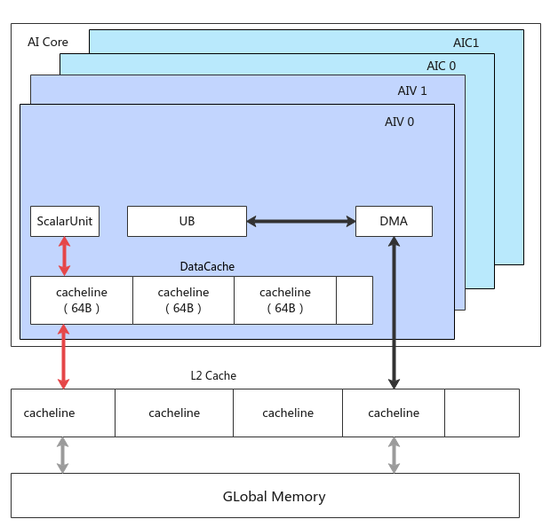

# asc_dcci

## AI处理器支持情况

| AI处理器类型 | 是否支持  |
| :-----------| :------: |
| Ascend 910C |    √     |
| Ascend 910B |    √     |

## 功能说明

在AI Core内部，Scalar单元和DMA单元都可能对Global Memory进行访问。
 \\

如上图所示：

DMA搬运单元读写Global Memory，数据通过asc_copy_ub2gm和asc_copy_gm2ub等接口在UB等Local Memory和Global Memory间交互，没有Cache一致性问题；
Scalar单元访问Global Memory，首先会访问每个核内的Data Cache，因此存在Data Cache与Global Memory的Cache一致性问题。
该接口用来刷新Cache，保证Cache的一致性，使用场景如下：

读取Global Memory的数据，但该数据可能在外部被其余核修改，此时需要使用asc_dcci接口，直接访问Global Memory，获取最新数据；
用户通过Scalar单元写Global Memory的数据，希望立刻写出，也需要使用asc_dcci接口。

## 函数原型

   ```cpp
    __aicore__ inline void asc_dcci(__gm__ void *dst, uint64_t entire, uint64_t type)
   ```

## 参数说明

| 参数名 | 输入/输出 | 描述 |
| :--- | :--- | :--- |
| dst | 输入 | 需要刷新缓存的向量的起始地址。 |
| entire | 输入 | 指令操作模式，类型为cache_line_t枚举类型。<br> SINGLE_CACHE_LINE：只刷新传入地址所在的Cache Line，注意如果该地址非64B对齐，只会操作传入地址到64B对齐的部分。<br> ENTIRE_DATA_CACHE：此时传入的地址无效，核内会刷新整个Data Cache，但是耗时较大，性能敏感的场景慎用。  |
| type | 输入 | 表示使用该接口来保证Data Cache与哪一种存储保持一致性，类型为dcci_dst_t枚举类。<br> CACHELINE_ALL：与CACHELINE_OUT效果一致。<br> CACHELINE_UB：预留参数，暂未支持。<br> CACHELINE_OUT：表示通过该接口来保证Data Cache与Global Memory的一致性。 <br> CACHELINE_ATOMIC：预留参数，暂未支持 |

## 返回值说明

无

## 流水类型

PIPE_S


## 约束说明

无

## 调用示例

```cpp
// 示例1：SINGLE_CACHE_LINE 模式，假设mmAddr_为0x40（64B对齐）
// total_length 指参与计算的数据长度
constexpr uint64_t total_length = 32;
__gm__ int16_t src[total_length];
for( int i = 0; i < total_length; i++) {
   src[i] = i;
}
asc_dcci(src, SINGLE_CACHE_LINE, CACHELINE_ALL)
// 由于首地址64B对齐，调用asc_dcci指令后，会立刻刷新前32个数

```