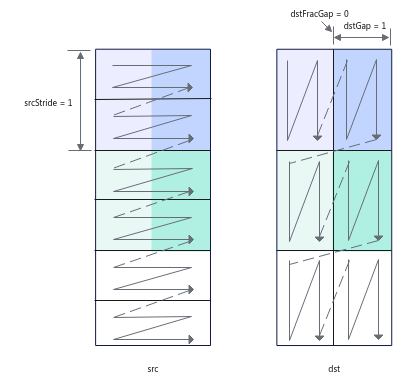
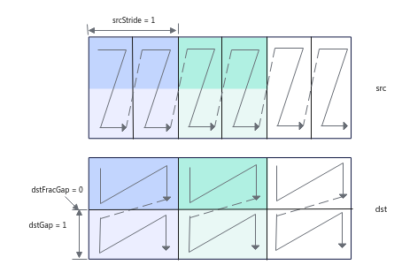
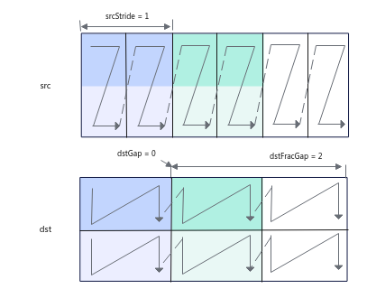

# asc_copy_l12l0b_trans

## AI处理器支持情况

| AI处理器类型     | 是否支持 |
| ----------- |:----:|
| Ascend 910C | √    |
| Ascend 910B | √    |

## 功能说明

该接口实现带转置的2D格式数据从cbuf到cb的加载。

下面通过示例来讲解接口功能和关键参数：下文图中一个N形或者一个Z形代表一个分形。

- 对于uint8_t/int8_t数据类型，每次迭代处理32 $ \times $ 32 $ \times $ 1B数据，可处理2个分形（一个分形512B），每次迭代中，源操作数中2个连续的16 $ \times $ 32分形将被合并为1个32 $ \times $ 32的方块矩阵，基于方块矩阵做转置，转置后分裂为2个16 $ \times $ 32分形，根据目的操作数分形间隔等参数可以有不同的排布。

如下图示例：

- - 共处理3072B的数据，每次迭代处理32 $ \times $ 32 $ \times $ 1B数据，需要3次迭代可以完成，repeatTime = 3；
- - srcStride = 1，表示相邻迭代间，源操作数前一个方块矩阵与后一个方块矩阵起始地址的间隔为1（单位：32 $ \times $ 32 $ \times $ 1B），这里的单位实际上是拼接后的方块矩阵的大小；
- - dstGap = 1，表示相邻迭代间，目的操作数前一个迭代第一个分形的结束地址到下一个迭代第一个分形起始地址的间隔为1（单位：512B）；
- - dstFracGap = 0，表示每个迭代内目的操作数前一个分形的结束地址与后一个分形起始地址的间隔为0（单位：512B）。


如下图示例：

- - repeatTime和srcStride的解释和上图示例一致。
- - dstGap = 0，表示相邻迭代间，目的操作数前一个迭代第一个分形的结束地址和下一个迭代第一个分形起始地址无间隔。
- - dstFracGap = 2，表示每个迭代内目的操作数前一个分形的结束地址与后一个分形起始地址的间隔为2（单位：512B）。


- 对于half/bfloat16_t数据类型，每次迭代处理16 $ \times $ 16 $ \times $ 2B数据，可处理1个分形（一个分形512B），每次迭代中，源操作数中1个16 $ \times $ 16分形将被转置。
- - 因为每次迭代处理16 $ \times $ 16 $ \times $ 2B数据，需要3次迭代可以完成，repeatTime = 3；
- - srcStride = 1，表示相邻迭代间，源操作数前一个方块矩阵与后一个方块矩阵起始地址的间隔为1 （单位：16 $ \times $ 16 $ \times $ 2B）；
- - dstGap = 0，表示相邻迭代间，目的操作数前一个迭代第一个分形的结束地址到下一个迭代第一个分形起始地址无间隔；
- - 该场景下，因为其分形即为方块矩阵，每个迭代处理一个分形，不存在迭代内分形的间隔，该参数设置无效。


- 对于float/int32_t/uint32_t数据类型，每次迭代处理16 $ \times $ 16 $ \times $ 4B数据，可处理2个分形（一个分形512B），每次迭代中，源操作数2个连续的16 $ \times $ 8分形将被合并为1个16 $ \times $ 16的方块矩阵，基于方块矩阵做转置，转置后分裂为2个16 $ \times $ 8分形，根据目的操作数分形间隔等参数可以有不同的排布。
如下图示例：
- - 因为每次迭代处理16 $ \times $ 16 $ \times $ 4B数据，需要3次迭代可以完成，repeatTime = 3；
- - srcStride = 1，表示相邻迭代间，源操作数前一个方块矩阵与后一个方块矩阵起始地址的间隔为1（单位：16 $ \times $ 16 $ \times $ 4B），这里的单位实际上是拼接后的方块矩阵的大小；
- - dstGap = 1，表示相邻迭代间，目的操作数前一个迭代第一个分形的结束地址到下一个迭代第一个分形起始地址的间隔为1（单位：512B）；
- - dstFracGap = 0，表示每个迭代内目的操作数前一个分形结束地址与后一个分形起始地址的间隔为0（单位：512B）。


如下图示例：
- - repeatTime和srcStride的解释和上图示例一致。
- - dstGap = 0，表示相邻迭代间，目的操作数前一个迭代第一个分形的结束地址和下一个迭代第一个分形起始地址无间隔。
- - dstFracGap = 2，表示每个迭代内目的操作数前一个分形结束地址与后一个分形起始地址的间隔为2（单位：512B）。



## 函数原型

```cpp
    __aicore__ inline void asc_copy_l12l0b_trans(__cb__ bfloat16_t* dst, __cbuf__ bfloat16_t* src, const asc_copy_l12l0b_trans_config& config, uint64_t frac_stride)
    __aicore__ inline void asc_copy_l12l0b_trans(__cb__ half* dst, __cbuf__ half* src, const asc_copy_l12l0b_trans_config& config, uint64_t frac_stride)
    __aicore__ inline void asc_copy_l12l0b_trans(__cb__ float* dst, __cbuf__ float* src, const asc_copy_l12l0b_trans_config& config, uint64_t frac_stride)
    __aicore__ inline void asc_copy_l12l0b_trans(__cb__ int32_t* dst, __cbuf__ int32_t* src, const asc_copy_l12l0b_trans_config& config, uint64_t frac_stride)
    __aicore__ inline void asc_copy_l12l0b_trans(__cb__ int8_t* dst, __cbuf__ int8_t* src, const asc_copy_l12l0b_trans_config& config, uint64_t frac_stride)
    __aicore__ inline void asc_copy_l12l0b_trans(__cb__ uint32_t* dst, __cbuf__ uint32_t* src, const asc_copy_l12l0b_trans_config& config, uint64_t frac_stride)
    __aicore__ inline void asc_copy_l12l0b_trans(__cb__ uint8_t* dst, __cbuf__ uint8_t* src, const asc_copy_l12l0b_trans_config& config, uint64_t frac_stride)
```

## 参数说明

| 参数名       | 输入/输出 | 描述               |
| --------- | ----- | ---------------- |
| dst       | 输出    | 目的操作数。            |
| src | 输入    | 源操作数。            |
| config    | 输入  | 读取数据并进行转置过程中的参数配置。<br/>详细说明请参考[asc_copy_l12l0b_trans_config](../struct/asc_copy_l12l0b_trans_config.md)。 |
| frac_stride | 输入  | 每个迭代内目的操作数转置前一个分形结束地址与后一个分形起始地址的间隔，单位为512B，仅在数据类型为float/int32_t/uint32_t/uint8_t/int8_t时有效。|


## 返回值说明

无

## 流水类型

PIPE_MTE1

## 约束说明

- config.repeat=0表示不执行搬运操作。
- 开发者需要保证目的操作数转置后的分形没有重叠。
- 操作数地址重叠约束请参考[通用地址重叠约束](../general_instruction.md#通用地址重叠约束)。

## 调用示例

```cpp
// 设置源操作数和目的操作数，total_length 指参与计算的数据长度
__cbuf__ int16_t src[total_length];
__cb__ int16_t dst[total_length];

// 设置搬运过程中的config配置
uint16_t n = 64;
uint8_t nBlockSize = 32;
asc_copy_l12l0b_trans_config load_config;
load_config.index_id = 0;
load_config.repeat = n / nBlockSize;
load_config.src_stride = 1;
load_config.dst_stride = 1;
uint64_t frac_stride = 0;

// 搬运过程
asc_copy_l12l0b_trans(dst, src, load_config, frac_stride);

```
