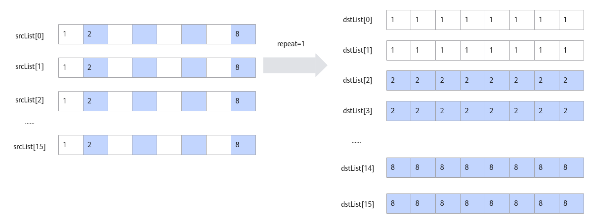
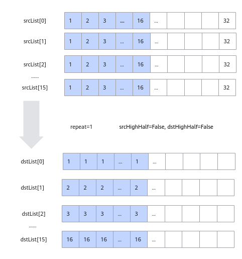

# asc_transposedata_to_5hd

## AI处理器支持情况

| AI处理器类型     | 是否支持 |
| ----------- |:----:|
| Ascend 910C | √    |
| Ascend 910B | √    |

## 功能说明

数据格式转换，一般用于将NCHW格式转换成NC1HWC0格式。特别的，也可以用于二维矩阵数据块的转置。完成转置功能时，相比于Transpose接口，Transpose仅支持16*16大小的矩阵转置；本接口单次repeat内可处理512Byte的数据（16个datablock），根据数据类型不同，支持不同shape的矩阵转置（比如数据类型为half时，单次repeat可完成16*16大小的矩阵转置），同时还可以支持多次repeat操作。

单次repeat内转换规则如下：

- 当输入数据类型位宽为16位时，每个datablock中包含16个数，指令内部会循环16次，每次循环都会分别从指定的16个datablock中的对应位置取值，组成一个新的datablock单元放入目的地址中。如下图所示，图中的srcList[0]-srcList[15]代表源操作数的16个datablock。

- 当数据类型位宽为32位时，每个datablock包含8个数，指令内部会循环8次，每次循环都会分别从指定的16个datablock中的对应位置取值，组成2个新的datablock放入目的地址中。如下图所示：

-当数据类型位宽为8位时，每个datablock包含32个数，指令内部会循环16次，每次循环都会分别从指定的16个datablock中的对应位置取值，组成半个datablock放入目的地址中，读取和存放是在datablock的高半部还是低半部由参数srcHighHalf和dstHighHalf决定。如下图所示：

基于以上的转换规则，使用该接口进行NC1HWC0格式转换或者矩阵转置。NC1HWC0格式转换相对复杂，这里给出其具体的转换方法：

NCHW格式转换成NC1HWC0格式时，如果是数据类型的位宽为32位或者16位，则C0=16；如果数据类型的位宽为8位，则C0=32。下图以C0=16为例进行介绍：

## 函数原型

- dstList与srcList类型为_ubuf_上的数组。

```c++
__aicore__ inline void asc_add(__ubuf__ int16_t* dst, __ubuf__ int16_t* src0, __ubuf__ int16_t* src1, uint32_t count)
__aicore__ inline void asc_add(__ubuf__ half* dst, __ubuf__ half* src0, __ubuf__ half* src1, uint32_t count)
__aicore__ inline void asc_add(__ubuf__ int32_t* dst, __ubuf__ int32_t* src0, __ubuf__ int32_t* src1, uint32_t count)
__aicore__ inline void asc_add(__ubuf__ float* dst, __ubuf__ float* src0, __ubuf__ float* src1, uint32_t count)
```

- dstList与srcList类型为uint64_t的数组，数组元素对应LocaTensor的地址值，该接口性能更优。开发者可以通过LocalTensor的GetPhyAddr接口获取该地址值。

```cpp
__aicore__ inline void asc_add(__ubuf__ int16_t* dst, __ubuf__ int16_t* src0, __ubuf__ int16_t* src1, const asc_binary_config& config)
__aicore__ inline void asc_add(__ubuf__ half* dst, __ubuf__ half* src0, __ubuf__ half* src1, const asc_binary_config& config)
__aicore__ inline void asc_add(__ubuf__ int32_t* dst, __ubuf__ int32_t* src0, __ubuf__ int32_t* src1, const asc_binary_config& config)
__aicore__ inline void asc_add(__ubuf__ float* dst, __ubuf__ float* src0, __ubuf__ float* src1, const asc_binary_config& config) 
```

- dst与src类型为uint64_t的LocalTensor，连续存储对应LocalTensor的地址值。开发者可以通过LocalTensor的GetPhyAddr接口获取该地址值。

```cpp
__aicore__ inline void asc_add_sync(__ubuf__ int16_t* dst, __ubuf__ int16_t* src0, __ubuf__ int16_t* src1, uint32_t count)
__aicore__ inline void asc_add_sync(__ubuf__ half* dst, __ubuf__ half* src0, __ubuf__ half* src1, uint32_t count)
__aicore__ inline void asc_add_sync(__ubuf__ int32_t* dst, __ubuf__ int32_t* src0, __ubuf__ int32_t* src1, uint32_t count)
__aicore__ inline void asc_add_sync(__ubuf__ float* dst, __ubuf__ float* src0, __ubuf__ float* src1, uint32_t count)
```

## 参数说明

表1 参数说明

| 参数名       | 输入/输出 | 描述                |
| --------- | ----- | ----------------- |
| dst       | 输出    | 目的操作数。            |
| src0、src1 | 输入    | 源操作数。             |
| count     | 输入    | 参与计算的元素个数。        |
| config    | 输入    | 在高维切分计算场景下使用的计算配置参数。<br/>详细说明请参考[asc_binary_config](../struct/asc_binary_config.md)。 |

## 返回值说明

无

## 流水类型

PIPE_V

## 约束说明

- 操作数地址重叠约束请参考[通用地址重叠约束](../general_instruction.md#通用地址重叠约束)。
- dst、src的起始地址需要32字节对齐。

## 调用示例

```c++
//total_length 指参与计算的数据长度
uint64_t offset = 0;
__ubuf__ half* src0 = (__ubuf__ half*)asc_get_phy_buf_addr(0);
offset += total_length * sizeof(half);
__ubuf__ half* src1 = (__ubuf__ half*)asc_get_phy_buf_addr(offset);
offset += total_length * sizeof(half);
__ubuf__ half* dst= (__ubuf__ half*)asc_get_phy_buf_addr(offset);
asc_add(dst, src0, src1, total_length );
```
