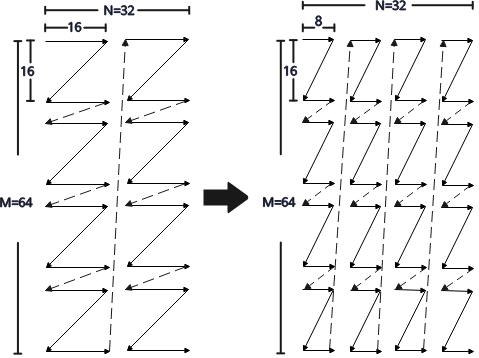
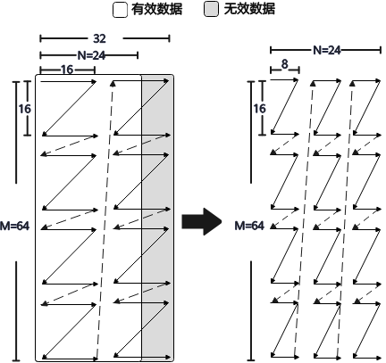

# F32 Channel Split

F32 Channel Split 是矩阵计算结果搬出过程中的通道拆分能力。当源类型和目的类型均为 `float`、目的布局为 `NZLayoutPtn`，且 `CopyL0C2GMTrait::enableChannelSplit`或`CopyL0C2UBTrait::enableChannelSplit` 设置为 `true` 时，硬件会将 16 x 16 的分形矩阵拆分为两个独立的 16 x 8 小 Z 分形矩阵。

启用该能力后，目的 NZ 输出的 C0 按 8 处理，N 方向大小必须为 8 的倍数。如下图所示，当源操作数 shape 为 `[64, 32]` 时，搬出结果会被拆分为 16 个独立的 16 x 8 分形矩阵；当源操作数 shape 为 `[64, 24]` 时，搬出结果会被拆分为 3 列 16 x 8 分形矩阵。


## 调用形式

```cpp
using namespace AscendC::Te;

auto l0c = MakeTensor(MakeMemPtr<Location::L0C, float>(l0cAddr),
    MakeFrameLayout<NZLayoutPtn, LayoutTraitDefault<float>>(m, n));
auto gm = MakeTensor(MakeMemPtr<Location::GM, float>(gmAddr),
    MakeFrameLayout<NZLayoutPtn, LayoutTraitDefault<float>>(m, n));

constexpr CopyL0C2GMTrait l0c2gmTrait = {
    RoundMode::DEFAULT,
    false,
    true
};

struct CopyL0C2GMTraitCustom {
    using TraitType = CopyL0C2GMTrait;
    static constexpr const TraitType value = l0c2gmTrait;
};

FixpipeParams params;
auto atom = MakeCopy(CopyL0C2GM{}, CopyL0C2GMTraitCustom{}).with(params);
Copy(atom, gm, l0c);
```

**图 1** F32 channel split示意图1



**图 2** F32 channel split示意图2



## 约束说明

- F32 Channel Split 仅支持源类型和目的类型均为 `float`，目的布局为 `NZLayoutPtn`。
- 启用 F32 Channel Split 时，不能同时使能 NZ2ND、NZ2DN 和 `unitFlag`，N 方向大小必须为 8 的倍数。。
