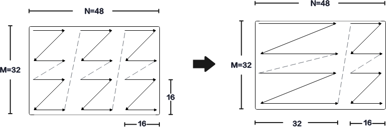
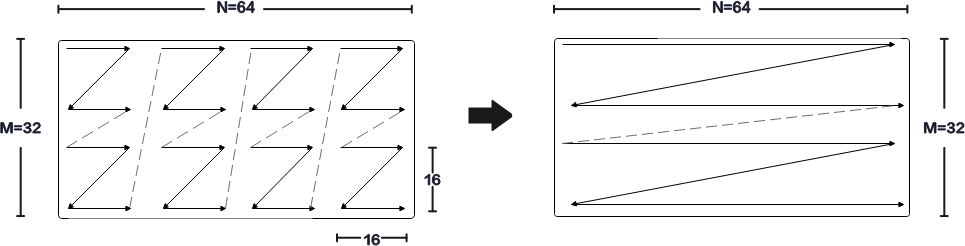

# Int8/Int4 Channel Merge

Channel Merge 是矩阵计算结果搬出过程中的硬件自动合并能力，仅在目的布局为 `NZLayoutPtn` 的 NZ 输出场景生效，用户无需也不能通过参数手动配置。

- Int8 Channel Merge：当目标数据类型为 `int8_t` 或 `uint8_t` 时，NZ 输出自动启用该特性。硬件会将分形矩阵从 16 x 16 扩展为 16 x 32。若输出通道数 N 是 16 的偶数倍，则 N 方向上每两个相邻的 16 x 16 分形矩阵合并为一个 16 x 32 分形矩阵；若 N 是 16 的奇数倍，则前 N - 16 个通道参与合并，最后 16 个通道保持 16 x 16 分形矩阵不变。针对 Ascend 950PR/Ascend 950DT，`fp8_e4m3fn_t`、`hifloat8_t` 类型也支持该特性。
- Int4 Channel Merge：当目标数据类型为 `int4_t` 或 `uint4_t` 时，NZ 输出自动启用该特性。硬件会将分形矩阵从 16 x 16 扩展为 16 x 64。若输出通道数 N 是 64 的倍数，则 N 方向上每 4 个相邻的 16 x 16 分形矩阵合并为一个 16 x 64 分形矩阵。针对 Ascend 950PR/Ascend 950DT，若 N 不是 64 的倍数，剩余部分会自动补零对齐。

当前 Tensor API 的 L0C 到 GM/UB 搬运支持 `int8_t`、`uint8_t`、`fp8_e4m3fn_t`、`hifloat8_t` 等量化输出类型；`int4_t`/`uint4_t` 输出能力以具体接口和类型支持情况为准。

## 使用示例

- Int8 Channel Merge：当目标数据类型为 `int8_t`，M 为 32，N 为 48 时，硬件会将 N 方向上前两个 16 x 16 分形矩阵合并成一个 16 x 32 分形矩阵，剩余的一个 16 x 16 分形矩阵保持不变并输出。
- Int4 Channel Merge：当目标数据类型为 `int4_t`，M 为 32，N 为 64 时，硬件会将 N 方向上每 4 个相邻的 16 x 16 分形矩阵合并成一个 16 x 64 分形矩阵后输出。

**图 1** Int8 Channel Merge示意图

**图 2** Int4 Channel Merge示意图

## 约束说明

- Channel Merge 为硬件自动使能，不能通过参数配置。
- Int8 Channel Merge 在 NZ 输出且目的类型为 `int8_t` 或 `uint8_t` 时自动启用；Ascend 950PR/Ascend 950DT 上 `fp8_e4m3fn_t`、`hifloat8_t` NZ 输出也支持该特性。
- Int4 Channel Merge 在底层 `int4_t`/`uint4_t` NZ 输出场景自动启用。Atlas A3 训练系列产品/Atlas A3 推理系列产品和 Atlas A2 训练系列产品/Atlas A2 推理系列产品上，启用 Int4 Channel Merge 时 N 维度必须是 64 的倍数；Ascend 950PR/Ascend 950DT 上 N 不是 64 的倍数时，剩余部分会自动补零对齐。
