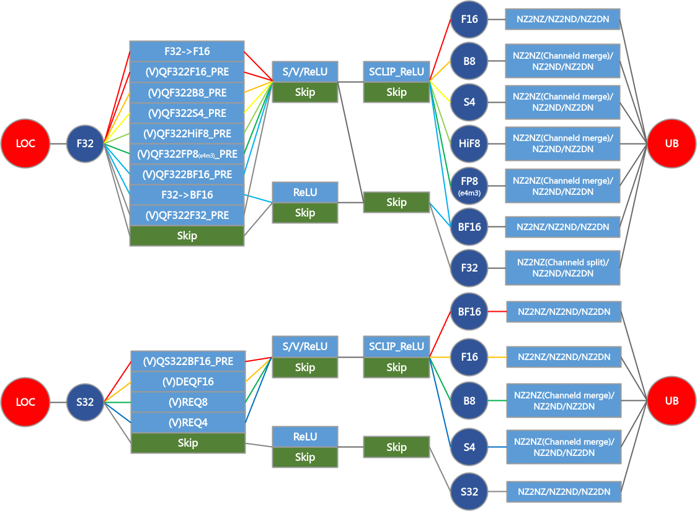

# L0C Buffer到Unified Buffer数据搬运

## 产品支持情况

|产品|是否支持|
|--------|--------|
|Ascend 950PR/Ascend 950DT|√|

## 功能说明

头文件为：#include "tensor_api/tensor.h"

该接口用于将L0C Buffer中的矩阵计算结果搬运到Unified Buffer。L0C Buffer中的数据通常为`Mmad`的输出，数据布局为NZ。搬运到Unified Buffer时，接口会根据目的张量布局自动选择NZ到ND、NZ到DN或NZ到NZ的随路格式转换。

L0C Buffer到Unified Buffer搬运支持不量化输出、float到half或bfloat16_t的直接转换输出，以及配合标量或张量量化参数的随路量化输出。随路Relu、双目的模式和舍入方式通过`CopyL0C2UBTrait`配置；Mmad与Fixpipe细粒度并行相关的`unitFlag`通过`FixpipeParams`配置。

随路量化、随路Relu、随路格式转换、随路通道拆分以及随路通道合并的有效组合、中间数据类型和数据路径如下图所示。图中的F32到F16、F32到BF16为非量化模式，仅进行cast；其余路径为随路scalar或tensor量化模式。针对Ascend 950PR/Ascend 950DT，还支持NZ2DN随路格式转换。

**图1**L0C2UB流程图



## 函数原型

```cpp
template <typename AtomType, typename DstTensor, typename SrcTensor>
__aicore__ inline void Copy(const CopyAtom<AtomType>& atomCopy, const DstTensor& dst, const SrcTensor& src)

template <typename AtomType, typename DstTensor, typename SrcTensor, typename QuantParam,
    Std::enable_if_t<IsCopyQuantParamV<QuantParam>, int> Enable>
__aicore__ inline void Copy(const CopyAtom<AtomType>& atomCopy, const DstTensor& dst, const SrcTensor& src,
    const QuantParam& quant)

template <typename CopyOperationType>
__aicore__ inline constexpr auto MakeCopy(const CopyOperationType& copyOperation)

template <typename CopyOperationType, typename CopyTraitType>
__aicore__ inline constexpr auto MakeCopy(const CopyOperationType& copyOperation, const CopyTraitType& copyTrait)
```

常用调用形式如下：

```cpp
auto atom = MakeCopy(CopyL0C2UB{}).with(fixpipeParams);
Copy(atom, dst, src);
Copy(atom, dst, src, quant);
```

## 参数说明

|参数名|输入/输出|描述|
|--------|--------|--------|
|`dst`|输出|目的张量，存储位置为`Location::UB`。支持`NDExtLayoutPtn`、`DNExtLayoutPtn`和`NZLayoutPtn`。目的布局为ND时使能NZ2ND，目的布局为DN时使能NZ2DN，目的布局为NZ时执行NZ2NZ。|
|`src`|输入|源张量，存储位置为`Location::L0C`，布局为`NZLayoutPtn`，通常为`Mmad`的计算结果。|
|`quant`|输入|可选量化参数。传入`uint64_t`时表示scalar量化参数；传入Tensor API张量时表示tensor量化参数，张量通常位于L1 Buffer，元素类型为`uint64_t`。|
|`fixpipeParams`|输入|可选搬运参数，类型为`FixpipeParams`，通过`MakeCopy(CopyL0C2UB{}).with(fixpipeParams)`绑定到atom。未绑定时使用默认值。|
|`atomCopy`|输入|搬运原子对象，可由`MakeCopy(CopyL0C2UB{})`或`MakeCopy(CopyL0C2UB{}, CopyL0C2UBTraitDefault{})`构造。|
|`traits`|输入|`MakeCopy`的构造参数，用于指定`CopyL0C2UB`搬运操作对象和对应trait对象。|

## CopyL0C2UBTrait说明

`CopyL0C2UBTrait`用于配置L0C Buffer到Unified Buffer搬运的编译期行为。

```cpp
struct CopyL0C2UBTrait {
    RoundMode roundMode = RoundMode::DEFAULT;
    bool enableRelu = false;
    bool enableChannelSplit = false;
    DualDstMode dualDstCtl = DUAL_DST_DISABLE;
};
```

|成员|默认值|描述|
|--------|--------|--------|
|`roundMode`|`RoundMode::DEFAULT`|舍入模式。`RoundMode::HYBRID`仅在源类型为`float`、目的类型为`hifloat8_t`的量化输出场景支持。|
|`enableRelu`|`false`|是否使能随路Relu。|
|`enableChannelSplit`|`false`|是否使能F32 Channel Split。|
|`dualDstCtl`|`DUAL_DST_DISABLE`|双目标模式控制，取值包括`DUAL_DST_DISABLE`、`DUAL_DST_SPLIT_M`、`DUAL_DST_SPLIT_N`。详细说明参见[L0C Buffer到Unified Buffer双目标模式](l0c_to_ub_dual_dst.md)。|

使用自定义trait的示例：

```cpp
constexpr CopyL0C2UBTrait l0c2ubTrait = {
    RoundMode::DEFAULT,
    false,
    false,
    DUAL_DST_DISABLE
};

struct CopyL0C2UBTraitCustom {
    using TraitType = CopyL0C2UBTrait;
    static constexpr const TraitType value = l0c2ubTrait;
};
```

## FixpipeParams说明

`FixpipeParams`用于配置运行时搬运参数。

```cpp
struct FixpipeParams {
    uint8_t unitFlag = 0;
};
```

|成员|默认值|描述|
|--------|--------|--------|
|`unitFlag`|`0`|控制Mmad指令和Fixpipe指令的细粒度并行。`0`表示不使能；`2`表示使能且执行后不复位单元标记位；`3`表示使能且执行后复位单元标记位。使能时，`MmadParams`和`FixpipeParams`中的`unitFlag`需要配套设置为`2`或`3`。|

## 数据类型

L0C Buffer到Unified Buffer搬运根据是否传入量化参数自动选择量化模式。

|源张量类型（L0C Buffer）|目的张量类型（Unified Buffer）|调用形式|说明|
|--------|--------|--------|--------|
|`int32_t`|`int8_t`、`uint8_t`|`Copy(atom, dst, src, quant)`|scalar或tensor量化输出。|
|`float`|`int8_t`、`uint8_t`|`Copy(atom, dst, src, quant)`|scalar或tensor量化输出。|
|`float`|`fp8_e4m3fn_t`、`hifloat8_t`|`Copy(atom, dst, src, quant)`|scalar或tensor量化输出。`hifloat8_t`支持`RoundMode::DEFAULT`和`RoundMode::HYBRID`。|
|`int32_t`|`half`、`bfloat16_t`|`Copy(atom, dst, src, quant)`|scalar或tensor量化输出。|
|`float`|`half`|`Copy(atom, dst, src)`|直接转换输出，对应F32到F16。|
|`float`|`bfloat16_t`|`Copy(atom, dst, src)`|直接转换输出，对应F32到BF16。|
|`float`|`half`、`bfloat16_t`|`Copy(atom, dst, src, quant)`|scalar或tensor量化输出。|
|`int32_t`|`int32_t`|`Copy(atom, dst, src)`|不量化输出。|
|`float`|`float`|`Copy(atom, dst, src)`|不量化输出。|
|`float`|`float`|`Copy(atom, dst, src, quant)`|scalar或tensor量化输出。|

不传入`quant`时，接口选择不量化或直接转换模式；传入`uint64_t`时选择scalar量化模式；传入Tensor API张量时选择tensor量化模式。

## 布局和格式转换

|源布局|目的布局|随路转换|说明|
|--------|--------|--------|--------|
|`NZLayoutPtn`|`NDExtLayoutPtn`|NZ2ND|将L0C Buffer NZ结果输出为Unified Buffer上的ND排布。|
|`NZLayoutPtn`|`DNExtLayoutPtn`|NZ2DN|将L0C Buffer NZ结果输出为Unified Buffer上的DN排布。|
|`NZLayoutPtn`|`NZLayoutPtn`|NZ2NZ|将L0C Buffer NZ结果输出为Unified Buffer上的NZ排布。|

底层搬运接口的`nSize`、`mSize`、`srcStride`、`dstStride`等参数由源张量和目的张量的布局描述推导得到。调用者需要保证布局中的shape、stride与实际内存空间一致。

## 关键特性

L0C Buffer到Unified Buffer搬运涉及[随路量化](quant_pre.md)、[随路Relu](relu_pre.md)、[Int8/Int4 Channel Merge](int8_int4_channel_merge.md)、[L0C Buffer到Unified Buffer双目标模式](l0c_to_ub_dual_dst.md)等关键特性。

## 返回值说明

`Copy`无返回值。`MakeCopy`返回`CopyAtom`对象。

## 约束说明

- 目的张量必须位于Unified Buffer，源张量必须位于L0C Buffer。
- 源张量布局必须为`NZLayoutPtn`。目的张量支持`NDExtLayoutPtn`、`DNExtLayoutPtn`、`NZLayoutPtn`。
- 源L0C Buffer NZ地址要求64字节对齐。目的Unified Buffer地址要求32字节对齐。
- 当搬运的M方向大小、N方向大小为0时，底层搬运指令不会执行。
- N方向大小取值范围为`[0, 4095]`。目的矩阵为NZ输出时，通常要求N方向大小为16的倍数。
- tensor量化参数张量应位于L1 Buffer，元素类型为`uint64_t`，地址要求32字节对齐。详细约束参见[随路量化](quant_pre.md)。
- 量化和Relu参数不能为INF、NaN或非规格化数。随路Relu详细约束参见[随路Relu](relu_pre.md)。
- 当前不支持随路pRelu操作，参见[随路Relu](relu_pre.md)。
- 目的地址写入区域不能重叠。若目的地址存在重叠写入，硬件不保证写入顺序。
- 使能`unitFlag`时，需要配合`Mmad`同时使能。
- 使用`RoundMode::HYBRID`时，源类型必须为`float`，目的类型必须为`hifloat8_t`。
- 当前搬出到Unified Buffer不支持F32 Channel Split，`enableChannelSplit`应保持默认值`false`。详细约束参见[F32 Channel Split](f32_channel_split.md)。
- 目的布局为`NZLayoutPtn`时，不支持`dualDstCtl`设置为`DUAL_DST_SPLIT_N`。双目标模式详细约束参见[L0C Buffer到Unified Buffer双目标模式](l0c_to_ub_dual_dst.md)。
- Channel Merge为硬件自动使能，不能通过参数配置。详细约束参见[Int8/Int4 Channel Merge](int8_int4_channel_merge.md)。

## 调用示例

### 不量化输出到ND

```cpp
using namespace AscendC::Te;

auto l0c = MakeTensor(MakeMemPtr<Location::L0C, float>(l0cAddr),
    MakeFrameLayout<NZLayoutPtn, LayoutTraitDefault<float, 16>>(m, n));
auto ub = MakeTensor(MakeMemPtr<Location::UB, float>(ubAddr),
    MakeFrameLayout<NDExtLayoutPtn, LayoutTraitDefault<float>>(m, n));

FixpipeParams params;
auto atom = MakeCopy(CopyL0C2UB{}).with(params);
Copy(atom, ub, l0c);
```

### 显式指定搬运原子对象

```cpp
using namespace AscendC::Te;

auto atom = MakeCopy(CopyL0C2UB{}, CopyL0C2UBTraitDefault{}).with(FixpipeParams{});
Copy(atom, ub, l0c);
```

### scalar量化输出

```cpp
using namespace AscendC::Te;

auto l0c = MakeTensor(MakeMemPtr<Location::L0C, int32_t>(l0cAddr),
    MakeFrameLayout<NZLayoutPtn, LayoutTraitDefault<int32_t, 16>>(m, n));
auto ub = MakeTensor(MakeMemPtr<Location::UB, int8_t>(ubAddr),
    MakeFrameLayout<NDExtLayoutPtn, LayoutTraitDefault<int8_t>>(m, n));

uint64_t quant = 1;
auto atom = MakeCopy(CopyL0C2UB{}).with(FixpipeParams{});
Copy(atom, ub, l0c, quant);
```

### tensor量化输出

```cpp
using namespace AscendC::Te;

auto l0c = MakeTensor(MakeMemPtr<Location::L0C, float>(l0cAddr),
    MakeFrameLayout<NZLayoutPtn, LayoutTraitDefault<float, 16>>(m, n));
auto ub = MakeTensor(MakeMemPtr<Location::UB, half>(ubAddr),
    MakeFrameLayout<NDExtLayoutPtn, LayoutTraitDefault<half>>(m, n));
auto quant = MakeTensor(MakeMemPtr<Location::L1, uint64_t>(quantAddr),
    MakeFrameLayout<NDExtLayoutPtn, LayoutTraitDefault<uint64_t>>(1, n));

auto atom = MakeCopy(CopyL0C2UB{}).with(FixpipeParams{});
Copy(atom, ub, l0c, quant);
```
