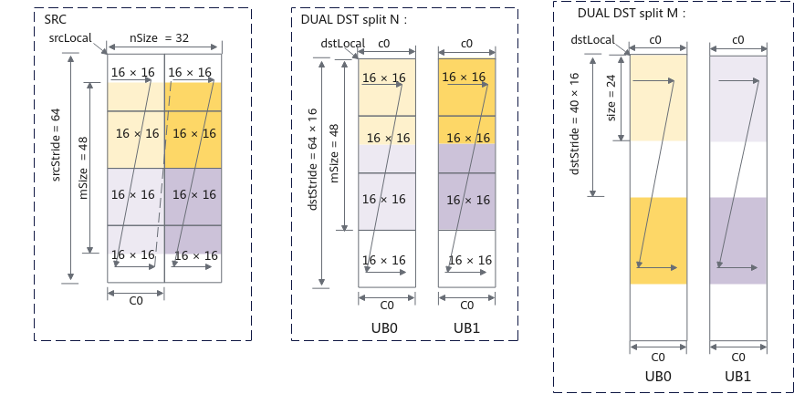
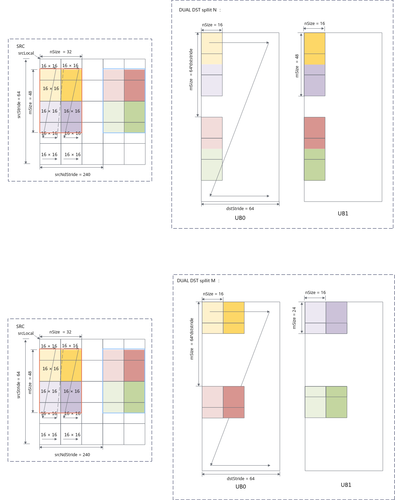

# L0C到UB双目标模式

L0C 到 UB 双目标模式用于将同一 AI Core 内 L0C 的矩阵结果拆分后，同时写入两个 Vector Core 各自的 UB。一个 AI Core 内包含一个 Cube Core 和两个 Vector Core，启用双目标模式后，源矩阵会按指定维度拆分为两部分，前半部分写入 SUB BLOCK0，后半部分写入 SUB BLOCK1。

Tensor API 通过 `CopyL0C2UBTrait::dualDstCtl` 控制双目标模式。

| 取值 | 说明 |
| :--- | :--- |
| `DUAL_DST_DISABLE` | 单目标模式。整个矩阵写入默认目标 UB。 |
| `DUAL_DST_SPLIT_M` | 双目标模式，按 M 维度拆分。源矩阵拆分为两个形状为 `M / 2 * N` 的矩阵，分别写入两个 UB。 |
| `DUAL_DST_SPLIT_N` | 双目标模式，按 N 维度拆分。源矩阵拆分为两个形状为 `M * N / 2` 的矩阵，分别写入两个 UB。 |

## 使用示例

```cpp
constexpr CopyL0C2UBTrait l0c2ubTrait = {
    RoundMode::DEFAULT,
    false,
    false,
    DUAL_DST_SPLIT_M
};

struct CopyL0C2UBTraitCustom {
    using TraitType = CopyL0C2UBTrait;
    static constexpr const TraitType value = l0c2ubTrait;
};
```

## NZ2NZ双目标模式

在 NZ2NZ 搬运场景下，双目标模式支持按 M 维度拆分和按 N 维度拆分。

N 方向切分示例：

- `nSize = 32`，表示源 NZ 矩阵中待搬运矩阵在 N 方向上的大小为 32 个元素。
- `mSize = 48`，表示源 NZ 矩阵中待搬运矩阵在 M 方向上的大小为 48 个元素。
- `srcStride = 64`，表示源 NZ 矩阵中相邻 Z 排布的起始地址偏移为 `64 * C0_SIZE`。
- `dstStride = 64 * C0`，表示目的 NZ 矩阵中相邻 Z 排布的起始地址偏移为 `64 * 16` 个元素。

M 方向切分示例：

- `nSize = 32`，表示源 NZ 矩阵中待搬运矩阵在 N 方向上的大小为 32 个元素。
- `mSize = 24`，表示每个目标 UB 接收的 M 方向大小；源矩阵 M 方向总大小为 48 个元素。
- `srcStride = 64`，表示源 NZ 矩阵中相邻 Z 排布的起始地址偏移为 `64 * C0_SIZE`。
- `dstStride = 40 * C0`，表示目的 NZ 矩阵中相邻 Z 排布的起始地址偏移为 `40 * 16` 个元素。

**图 1** NZ2NZ双目标搬运模式设置示意图



## NZ2ND双目标模式

在 NZ2ND 搬运场景下，双目标模式也支持按 M 维度拆分和按 N 维度拆分。

- `ndNum = 2`，表示源 NZ 矩阵的数目为 2。
- `nSize = 32`，表示源 NZ 矩阵在 N 方向上的大小为 32 个元素。
- `mSize = 48`，表示源 NZ 矩阵在 M 方向上的大小为 48 个元素。
- `srcStride = 64`，表示源 NZ 矩阵中相邻 Z 排布的起始地址偏移为 `64 * C0_SIZE`。
- `dstStride = 64`，表示目的 ND 矩阵每一行中的元素个数为 64。
- `srcNdStride = 240`，表示不同 NZ 矩阵起始地址之间的间隔为 `240 * C0_SIZE`。
- `dstNdStride = 4096`，表示目的相邻 ND 矩阵起始地址之间的偏移为 4096 个元素。

**图 2** 使能NZ2ND参数双搬入模式设置示意图



## 约束说明

- 双目标模式仅支持 L0C 到 UB 通路。
- 双目标模式支持普通搬运模式 NZ2NZ 和 NZ2ND 搬运场景。
- 双目标模式不支持随路功能场景。
- 按 M 维度拆分时，M 必须为 2 的倍数。
- 按 N 维度拆分时，N 必须为 32 的倍数。
- 目的布局为 `NZLayoutPtn` 时，不支持 `dualDstCtl` 设置为 `DUAL_DST_SPLIT_N`。
