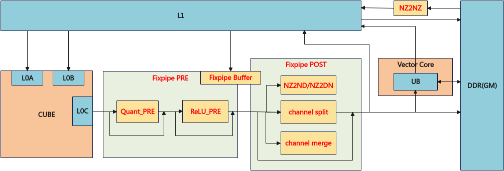

# 矩阵计算的搬出总体说明

矩阵计算的搬出是AscendC编程框架中用于数据搬运的核心接口系列，主要实现L0C与Global Memory、UB之间的数据高效传输。该接口系列提供了多种数据搬运模式，能够满足矩阵计算中左右矩阵等数据的搬运需求，通常在Mmad接口后配合使用。

矩阵计算的搬出接口支持多种随路搬运场景，包括**随路量化、随路Relu、随路格式转换\(NZ2ND\)、随路通道拆分\(channel split\)、随路通道合并\(channel merge\)**。针对Ascend 950PR/Ascend 950DT，还支持NZ2DN随路格式转换和**UB双目标模式。**

针对Ascend 950PR/Ascend 950DT：

**图 1**  fixpipe整体流程图  

**数据通路与存储层级**

矩阵计算的搬出接口支持多种数据通路，每种通路对应特定的存储层级和访问特性。

针对Ascend 950PR/Ascend 950DT：

<table><thead align="left"><tr id="zh-cn_topic_0000002542682989_row1516151923315"><th class="cellrowborder" valign="top" width="16.76832316768323%" id="mcps1.1.6.1.1">
源位置

</th>
<th class="cellrowborder" valign="top" width="13.638636136386362%" id="mcps1.1.6.1.2">
源地址对齐要求

</th>
<th class="cellrowborder" valign="top" width="11.868813118688132%" id="mcps1.1.6.1.3">
目的位置

</th>
<th class="cellrowborder" valign="top" width="17.908209179082093%" id="mcps1.1.6.1.4">
目的地址对齐要求

</th>
<th class="cellrowborder" valign="top" width="39.81601839816019%" id="mcps1.1.6.1.5">
典型应用场景

</th>
</tr>
</thead>
<tbody><tr id="zh-cn_topic_0000002542682989_row05161919103316"><td class="cellrowborder" valign="top" width="16.76832316768323%" headers="mcps1.1.6.1.1 ">
L0C

</td>
<td class="cellrowborder" valign="top" width="13.638636136386362%" headers="mcps1.1.6.1.2 ">
64字节

</td>
<td class="cellrowborder" valign="top" width="11.868813118688132%" headers="mcps1.1.6.1.3 ">
Global Memory

</td>
<td class="cellrowborder" valign="top" width="17.908209179082093%" headers="mcps1.1.6.1.4 ">
1字节/32字节

</td>
<td class="cellrowborder" valign="top" width="39.81601839816019%" headers="mcps1.1.6.1.5 ">
从L0C搬出数据至GM（NZ2NZ/NZ2ND/NZ2DN）

</td>
</tr>
<tr id="zh-cn_topic_0000002542682989_row1351731917338"><td class="cellrowborder" valign="top" width="16.76832316768323%" headers="mcps1.1.6.1.1 ">
L0C

</td>
<td class="cellrowborder" valign="top" width="13.638636136386362%" headers="mcps1.1.6.1.2 ">
64字节

</td>
<td class="cellrowborder" valign="top" width="11.868813118688132%" headers="mcps1.1.6.1.3 ">
UB

</td>
<td class="cellrowborder" valign="top" width="17.908209179082093%" headers="mcps1.1.6.1.4 ">
32字节

</td>
<td class="cellrowborder" valign="top" width="39.81601839816019%" headers="mcps1.1.6.1.5 ">
从L0C搬出数据至UB(NZ2NZ/NZ2ND/NZ2DN)

</td>
</tr>
</tbody>
</table>

**接口分类与功能场景**

针对Ascend 950PR/Ascend 950DT：

<table><thead align="left"><tr id="zh-cn_topic_0000002542682989_row45451951101311"><th class="cellrowborder" valign="top" width="7.3999999999999995%" id="mcps1.1.6.1.1">
接口类别

</th>
<th class="cellrowborder" valign="top" width="12.75%" id="mcps1.1.6.1.2">
主要功能

</th>
<th class="cellrowborder" valign="top" width="30.099999999999998%" id="mcps1.1.6.1.3">
支持的随路特性能力

</th>
<th class="cellrowborder" valign="top" width="36.49%" id="mcps1.1.6.1.4">
搬出支持的数据类型

</th>
<th class="cellrowborder" valign="top" width="13.26%" id="mcps1.1.6.1.5">
流水类型

</th>
</tr>
</thead>
<tbody><tr id="zh-cn_topic_0000002542682989_row105453518135"><td class="cellrowborder" valign="top" width="7.3999999999999995%" headers="mcps1.1.6.1.1 ">
L0C到GM

</td>
<td class="cellrowborder" valign="top" width="12.75%" headers="mcps1.1.6.1.2 ">
实现L0C到GM的数据搬运

</td>
<td class="cellrowborder" valign="top" width="30.099999999999998%" headers="mcps1.1.6.1.3 ">
<a href="quant_pre.md">随路量化</a>(Quant_PRE)、<a href="relu_pre.md">随路Relu</a>(ReLU_PRE)、<a href="int8_int4_channel_merge.md">Int8/Int4 Channel Merge</a>、NZ2ND、NZ2NZ、NZ2DN、<a href="f32_channel_split.md">F32 Channel Split</a>

</td>
<td class="cellrowborder" valign="top" width="36.49%" headers="mcps1.1.6.1.4 ">
float、int32_t、half、bfloat16_t、uint8_t/int8_t、fp8_e4m3fn_t、hifloat8_t

</td>
<td class="cellrowborder" valign="top" width="13.26%" headers="mcps1.1.6.1.5 ">
PIPE_FIX

</td>
</tr>
<tr id="zh-cn_topic_0000002542682989_row1718919141820"><td class="cellrowborder" valign="top" width="7.3999999999999995%" headers="mcps1.1.6.1.1 ">
L0C到UB

</td>
<td class="cellrowborder" valign="top" width="12.75%" headers="mcps1.1.6.1.2 ">
实现L0C到UB的数据搬运

</td>
<td class="cellrowborder" valign="top" width="30.099999999999998%" headers="mcps1.1.6.1.3 ">
<a href="quant_pre.md">随路量化</a>(Quant_PRE)、<a href="relu_pre.md">随路Relu</a>(ReLU_PRE)、<a href="int8_int4_channel_merge.md">Int8/Int4 Channel Merge</a>、NZ2NZ、NZ2ND、NZ2DN、<a href="f32_channel_split.md">F32 Channel Split</a>、<a href="l0c_to_ub_dual_dst.md">UB双目标模式</a>

</td>
<td class="cellrowborder" valign="top" width="36.49%" headers="mcps1.1.6.1.4 ">
float、int32_t、half、bfloat16_t、uint8_t/int8_t、fp8_e4m3fn_t、hifloat8_t

</td>
<td class="cellrowborder" valign="top" width="13.26%" headers="mcps1.1.6.1.5 ">
PIPE_FIX

</td>
</tr>
</tbody>
</table>
