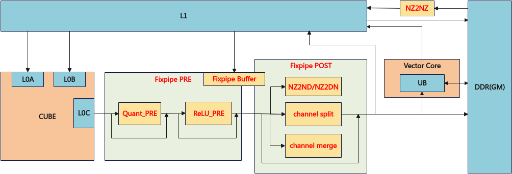

# 矩阵计算的搬出总体说明

矩阵计算的搬出是AscendC编程框架中用于数据搬运的核心接口系列，主要实现L0C Buffer与Global Memory、Unified Buffer之间的数据高效传输。该接口系列提供了多种数据搬运模式，能够满足矩阵计算中左右矩阵等数据的搬运需求，通常在Mmad接口后配合使用。

矩阵计算的搬出接口支持多种随路搬运场景，包括**随路量化、随路Relu、随路格式转换（NZ2ND/NZ2DN/NZ2NZ）、随路通道拆分（channel split）、随路通道合并（channel merge）**。针对Ascend 950PR/Ascend 950DT，还支持**Unified Buffer双目标模式。**

针对Ascend 950PR/Ascend 950DT：

**图1**fixpipe整体流程图

**数据通路与存储层级**

矩阵计算的搬出接口支持多种数据通路，每种通路对应特定的存储层级和访问特性。

针对Ascend 950PR/Ascend 950DT：

|源位置|源地址对齐要求|源数据布局|目的位置|目的地址对齐要求|目的数据布局|格式转换|典型应用场景|
|--------|--------|--------|--------|--------|--------|--------|--------|
|L0C Buffer|64字节|`NZLayoutPtn`|Global Memory|1字节/32字节|`NDExtLayoutPtn`、`DNExtLayoutPtn`、`NZLayoutPtn`|NZ2ND、NZ2DN、NZ2NZ|从L0C Buffer搬出数据至Global Memory|
|L0C Buffer|64字节|`NZLayoutPtn`|Unified Buffer|32字节|`NDExtLayoutPtn`、`DNExtLayoutPtn`、`NZLayoutPtn`|NZ2ND、NZ2DN、NZ2NZ|从L0C Buffer搬出数据至Unified Buffer|

**接口分类与功能场景**

针对Ascend 950PR/Ascend 950DT：

|接口类别|主要功能|支持的随路特性能力|搬出支持的数据类型|流水类型|
|--------|--------|--------|--------|--------|
|L0C Buffer到Global Memory|实现L0C Buffer到Global Memory的数据搬运|[随路量化](quant_pre.md)（Quant_PRE）、[随路Relu](relu_pre.md)（ReLU_PRE）、[Int8/Int4 Channel Merge](int8_int4_channel_merge.md)、NZ2ND、NZ2NZ、NZ2DN、[F32 Channel Split](f32_channel_split.md)|int8_t/uint8_t、fp8_e4m3fn_t、hifloat8_t、half、bfloat16_t、int32_t、float|PIPE_FIX|
|L0C Buffer到Unified Buffer|实现L0C Buffer到Unified Buffer的数据搬运|[随路量化](quant_pre.md)（Quant_PRE）、[随路Relu](relu_pre.md)（ReLU_PRE）、[Int8/Int4 Channel Merge](int8_int4_channel_merge.md)、NZ2NZ、NZ2ND、NZ2DN、[F32 Channel Split](f32_channel_split.md)、[Unified Buffer双目标模式](l0c_to_ub_dual_dst.md)|int8_t/uint8_t、fp8_e4m3fn_t、hifloat8_t、half、bfloat16_t、int32_t、float|PIPE_FIX|

## API映射关系

`Copy`接口在`impl/tensor_api/arch/cube`路径下的`instruction.h`中完成到底层`asc_`函数的封装映射，映射关系如下：

|接口名称|对应`instruction.h`路径|底层`asc_`函数|
|--------|--------|--------|
|[CopyL0C2GM](l0c_to_gm.md)|`impl/tensor_api/arch/cube/l0c_to_gm/npu_arch_3510/instruction.h`|`asc_copy_l0c2gm`|
|[CopyL0C2UB](l0c_to_ub.md)|`impl/tensor_api/arch/cube/l0c_to_ub/npu_arch_3510/instruction.h`|`asc_copy_l0c2ub`|
