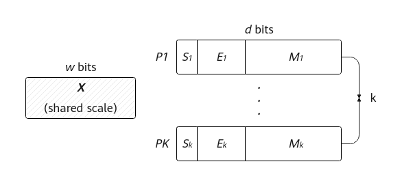
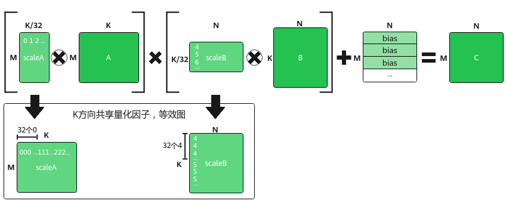
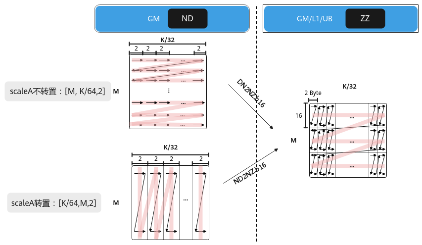
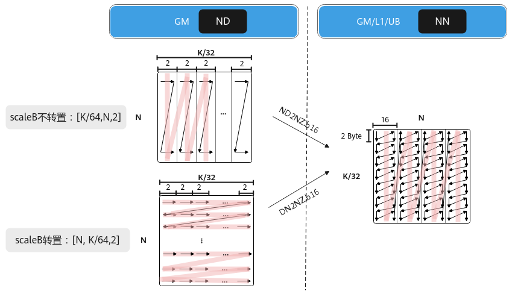

# 辅助矩阵分形格式详解

针对Ascend 950PR/Ascend 950DT产品：

## MX系数矩阵<a name="zh-cn_topic_0000002563445163_section648585413300"></a>

浮点数在科学计算、图像处理、神经网络等领域应用广泛。以AI训练为例，现有的浮点数格式或数值范围不足，或精度不高，这影响了模型的收敛速度和性能。如果要同时满足数值范围和精度的要求，将会导致内存占用过大，从而增加数据存储和传输的成本。基于此种情况，业内提出了一种新的浮点数格式——微缩放（Microscaling，MX）格式。MX格式的浮点数可以支持更低比特位宽的AI训练和推理，并且占用的内存更少。符合MX标准的数据格式在使用8位或更低比特位的情况下，能够实现稳健的AI训练和推理模型精度。

MX格式是一种块数据格式，若干个数据可以组成一个块（或者一个组），数据以块为单位。MX格式的数据由三部分构成：

- 共享缩放因子X，位宽为w bits；
- 私有元素P<sub>i</sub>，位宽为d bits；
- 块大小k，表示多少个低比特数据形成一个块；

所有k个元素P<sub>i</sub>有相同的位宽和数据类型，并且共享一个缩放因子X，每个包含k个元素的块可以使用（w+k\*d）位进行编码。元素的数据类型和缩放因子可以独立选择。

下图为MX格式的浮点数的数据结构，S、E和M分别用于表示浮点数的符号、指数和尾数字段的值。其中，共享缩放因子X是一个用于整个数据块的缩放比例因子，它决定了数据块中所有元素的动态范围。通过引入共享缩放因子，MX格式的数据能够在保持低位宽的同时，灵活地表示不同范围的数据。块大小k指的是组成一个数据块（或组）的低比特数据的数量。私有元素P<sub>i</sub>是指数据块中的每个低比特数据元素。这些元素经过缩放因子X的调整后，共同表示了一个高精度的浮点数或整数。

**图1**MX格式组成示意图<a name="zh-cn_topic_0000002563445163_fig3385175571011"></a>


MXMmad为带有量化系数X的矩阵乘法，即左矩阵和右矩阵均有对应的量化系数矩阵，左量化系数矩阵scaleA和右量化系数矩阵scaleB。计算公式为：C = （scaleA ⊗ A） \* （scaleB ⊗ B） + Bias，“⊗”表示广播乘法，左/右矩阵与左/右量化系数矩阵做乘积时，K方向上每32个元素共享一个量化因子。如下图所示，其中A为左矩阵，形状为\[M，K\]；scaleA为左量化系数矩阵，形状为\[M，K/32\]；B为右矩阵，形状为\[K，N\]；scaleB为右量化系数矩阵，形状为\[K/32，N\]。

**图2**MX矩阵乘示意图<a name="zh-cn_topic_0000002563445163_fig33303533712"></a>


- **MX scaleA系数矩阵分型介绍**

**物理位置：**Global Memory/L1 Buffer/Unified Buffer**：**保存离线/在线生成左矩阵量化系数数据。

**物理说明（Why）：**MX矩阵乘法中A矩阵与scaleA矩阵物理地址上一一映射，Load2DV2MX指令要求在L1 Buffer scaleA矩阵满足行读取需求，因此在L1 Buffer上scaleA矩阵为按行存储的小z大Z排布（Zz）。

**格式转换过程（How）：**假设原始A矩阵大小为（M，K），则对应的scaleA矩阵大小为（M，K/32），scaleA矩阵被分为M1 \* K1个分形，按照行主序排布，形状如Z字形；每个分形内部有M0 \* K0个元素，按照行主序排布，形状如Z字形，Zz排布。其中，（M0，K0）表示一个分形的shape，其分形需要与L0A Buffer\_MX物理内存排布保持一致，且数据类型必须为fp8\_e8m0\_t，shape为16x2。

通过公式表达转换过程如下：

```
(…, B, M, K/32)->pad->(…, B, M1 * M0, K1 * K0)->reshape->(…, B, M1, M0, K1, K0)->transpose->(…, B, M1, K1, M0, K0)
```

- **分形大小约束：**数据类型为fp8\_e8m0\_t，分形大小为16x2（M0，K0）

如上图所示，若Global Memory上scaleA矩阵为ND排布，可以通过DN2NZ.b16/ND2NZ.b16指令搬运到L1 Buffer，确保L1 Buffer上分型为Zz排布，满足Load2DV2MX指令要求。

**图3**scaleA矩阵在不同位置上的排布格式<a name="zh-cn_topic_0000002563445163_fig6871154411446"></a>


- **MX scaleB系数矩阵分型介绍**

**物理位置：**Global Memory/L1 Buffer/Unified Buffer**：**保存离线/在线生成右矩阵量化系数数据。

**物理说明（Why）：**MX矩阵乘法中B矩阵与scaleB矩阵物理地址上一一映射，Load2DV2MX指令要求在L1 Buffer scaleB矩阵满足列读取需求，因此在L1 Buffer上scaleB矩阵为按列存储的小n大N排布（Nn）。

**格式转换过程（How）：**假设原始B矩阵大小为（K，N），则对应的scaleB矩阵大小为（K/32，N），scaleB矩阵被分为K1 \* N1个分形，按照列主序排布，形状如N字形；每个分形内部有K0 \* N0个元素，按照列主序排布，形状如n字形，所以这种数据格式称为Nn格式。其中，（K0，N0）表示一个分形的shape，其分形需要与L0B Buffer\_MX物理内存排布保持一致，且数据类型必须为fp8\_e8m0\_t，shape为2x16。

通过公式表达转换过程如下：

```
(…, B, K/32, N)->pad->(…, B, K1 * K0, N1 * N0)->reshape->(…, B, K1, K0, N1, N0)->transpose->(…, B, N1, K1, N0, K0)
```

- **分形大小约束：**数据类型为fp8\_e8m0\_t，分形大小为2x16（K0，N0）

如下图所示，若Global Memory上scaleB矩阵为ND排布，可以通过ND2NZ.b16/DN2NZ.b16指令搬运到L1 Buffer，确保L1 Buffer上分型为Nn排布，满足Load2DV2MX指令要求。

**图4**scaleB矩阵在不同位置上的排布格式<a name="zh-cn_topic_0000002563445163_fig599218260112"></a>


具体实现可参考[MX矩阵计算](mx_matrix_computation.md)。

