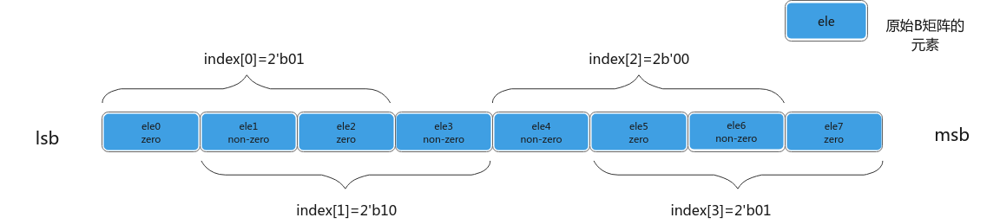
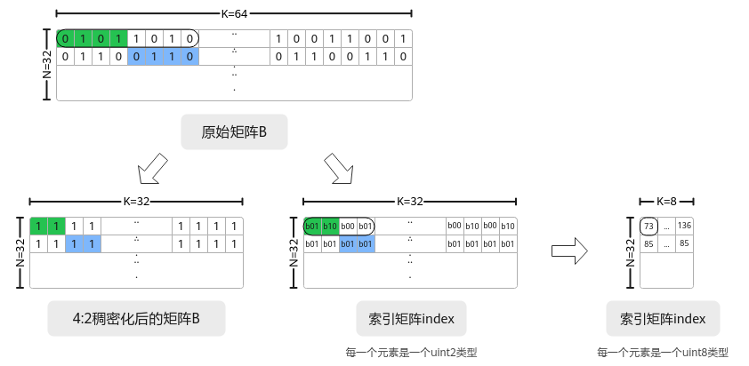

# 辅助矩阵分形格式详解

针对Ascend 950PR/Ascend 950DT产品：

## MX 系数矩阵<a name="zh-cn_topic_0000002563445163_section648585413300"></a>

浮点数在科学计算、图像处理、神经网络等领域应用广泛。以AI训练为例，现有的浮点数格式或数值范围不足，或精度不高，这影响了模型的收敛速度和性能。如果要同时满足数值范围和精度的要求，将会导致内存占用过大，从而增加数据存储和传输的成本。基于此种情况，业内提出了一种新的浮点数格式——微缩放（Microscaling，MX）格式。MX格式的浮点数可以支持更低比特位宽的AI训练和推理，并且占用的内存更少。符合MX标准的数据格式在使用8位或更低比特位的情况下，能够实现稳健的AI训练和推理模型精度。

MX格式是一种块数据格式，若干个数据可以组成一个块（或者一个组），数据以块为单位。MX格式的数据由三部分构成：

-   共享缩放因子X，位宽为w bits；
-   私有元素P<sub>i</sub>，位宽为d bits；
-   块大小k，表示多少个低比特数据形成一个块；

所有k个元素P<sub>i</sub>有相同的位宽和数据类型，并且共享一个缩放因子X，每个包含k个元素的块可以使用（w+k\*d）位进行编码。元素的数据类型和缩放因子可以独立选择。

下图为MX格式的浮点数的数据结构，S、E和M分别用于表示浮点数的符号、指数和尾数字段的值。其中，共享缩放因子X是一个用于整个数据块的缩放比例因子，它决定了数据块中所有元素的动态范围。通过引入共享缩放因子，MX格式的数据能够在保持低位宽的同时，灵活地表示不同范围的数据。块大小k指的是组成一个数据块（或组）的低比特数据的数量。私有元素P<sub>i</sub>是指数据块中的每个低比特数据元素。这些元素经过缩放因子X的调整后，共同表示了一个高精度的浮点数或整数。

**图 1**  MX格式组成示意图<a name="zh-cn_topic_0000002563445163_fig3385175571011"></a>  


MXMmad为带有量化系数X的矩阵乘法，即左矩阵和右矩阵均有对应的量化系数矩阵，左量化系数矩阵scaleA和右量化系数矩阵scaleB。计算公式为：C = \(scaleA ⊗ A\) \* \(scaleB ⊗ B\) + Bias，“⊗”表示广播乘法，左/右矩阵与左/右量化系数矩阵做乘积时，K方向上每32个元素共享一个量化因子。如下图所示，其中A为左矩阵，形状为\[M, K\]；scaleA为左量化系数矩阵，形状为\[M, K/32\]；B为右矩阵，形状为\[K, N\]；scaleB为右量化系数矩阵，形状为\[K/32, N\]。

**图 2**  MX矩阵乘示意图<a name="zh-cn_topic_0000002563445163_fig33303533712"></a>  


-   **MX scaleA 系数矩阵分型介绍**

**物理位置：**GM/L1/UB Buffer**：**保存离线/在线生成左矩阵量化系数数据。

**物理说明 \(Why\)：**MX矩阵乘法中 A矩阵与scaleA矩阵物理地址上一一映射，Load2DV2MX指令要求在L1 scaleA矩阵满足行读取需求，因此在L1上scaleA矩阵为按行存储的小z大Z排布\(Zz\)。

**格式转换过程 \(How\)：**假设原始A矩阵大小为（M,  K），则对应的scaleA矩阵大小为（M, K/32），scaleA矩阵被分为M1 \* K1个分形，按照行主序排布，形状如Z字形；每个分形内部有M0 \* K0个元素，按照行主序排布，形状如Z字形，Zz排布。其中，\(M0, K0\)表示一个分形的shape，其分形需要与L0A\_MX物理内存排布保持一致，且数据类型必须为fp8\_e8m0\_t，shape为16x2。

通过公式表达转换过程如下：

```
(…, B, M, K/32)->pad->(…, B, M1 * M0, K1 * K0)->reshape->(…, B, M1, M0, K1, K0)->transpose->(…, B, M1, K1, M0, K0)
```

-   **分形大小约束：**数据类型为fp8\_e8m0\_t，分形大小为 16x2（M0，K0）

如上图所示，若GM上scaleA矩阵为ND排布，可以通过DN2NZ.b16/ND2NZ.b16指令搬运到L1，确保L1上分型为Zz排布，满足Load2DV2MX指令要求。

**图 3**  scaleA矩阵在不同位置上的排布格式<a name="zh-cn_topic_0000002563445163_fig6871154411446"></a>  


-   **MX scaleB 系数矩阵分型介绍**

**物理位置：**GM/L1/UB Buffer**：**保存离线/在线生成右矩阵量化系数数据。

**物理说明 \(Why\)：**MX矩阵乘法中 B矩阵与scaleB矩阵物理地址上一一映射，Load2DV2MX指令要求在L1 scaleB矩阵满足列读取需求，因此在L1上scaleB矩阵为按列存储的小n大N排布\(Nn\)。

**格式转换过程 \(How\)：**假设原始B矩阵大小为（K,  N），则对应的scaleB矩阵大小为（K/32, N），scaleB矩阵被分为K1 \* N1个分形，按照列主序排布，形状如N字形；每个分形内部有K0 \* N0个元素，按照列主序排布，形状如n字形，所以这种数据格式称为Nn格式。其中，\(K0, N0\)表示一个分形的shape，其分形需要与L0B\_MX物理内存排布保持一致，且数据类型必须为fp8\_e8m0\_t，shape为2x16。

通过公式表达转换过程如下：

```
(…, B, K/32, N)->pad->(…, B, K1 * K0, N1 * N0)->reshape->(…, B, K1, K0, N1, N0)->transpose->(…, B, N1, K1, N0, K0)
```

-   **分形大小约束：**数据类型为fp8\_e8m0\_t，分形大小为 2x16（K0，N0）

如下图所示，若GM上scaleB矩阵为ND排布，可以通过ND2NZ.b16/DN2NZ.b16指令搬运到L1，确保L1上分型为Nn排布，满足Load2DV2MX指令要求。

**图 4**  scaleB矩阵在不同位置上的排布格式<a name="zh-cn_topic_0000002563445163_fig599218260112"></a>  


具体实现可参考 [MX矩阵计算](mx_matrix_computation.md)。

针对Atlas A2 训练系列产品/Atlas A2 推理系列产品  和  Atlas A3 训练系列产品/Atlas A3 推理系列产品：

## 4选2稀疏索引矩阵<a name="zh-cn_topic_0000002563445163_section1873692415233"></a>

-   定义： 原始B矩阵矩阵稠密化过程中生成的索引矩阵。假设原始B矩阵每4个元素有至少2个零元素，稠密化的B矩阵是过滤掉2个零的稠密矩阵。
-   场景： 通常存在于 Global Memory \(GM\) 中。在进行sparse矩阵运算前，通常需要离线生成并将其转换为 小n大Z格式（Zn）以适配 Cube 单元。
-   生成过程：如下图所示，对于原始矩阵B中的每4个元素，将在index矩阵中生成2个2位索引，并按照以下规则进行编码。索引必须在\{0, 1, 2\}范围内。

**图 5**  index生成示意图<a name="zh-cn_topic_0000002563445163_fig1423214854720"></a>  


-   第一个索引用于指示前3个元素中第1个非零元素的相对位置。
-   第二个索引用于指示第2个非零元素在后3个元素中的相对位置。
-   索引矩阵中的一个uint8的元素是由4个uint2\_t组合而成的，例如上图：生成的索引数据为1 2 0 1 ，索引数据在GM地址中的排布从高位到低位为1 0 2 1 ，其中1 0 2 1（对应索引矩阵前四位1 2 0 1）为一个uint8\_t。

**图 6**  稠密化B矩阵示意图<a name="zh-cn_topic_0000002563445163_fig1115556103916"></a>  


稠密化算法规则具体可参考下表。其中，“-”表示不关心该位置上的值，因为其后续Sparse Mmad计算过程中会被过滤。

<a name="zh-cn_topic_0000002563445163_table07754782315"></a>
<table><thead align="left"><tr id="zh-cn_topic_0000002563445163_row108341479237"><th class="cellrowborder" valign="top" width="23.212321232123216%" id="mcps1.1.8.1.1"><p id="zh-cn_topic_0000002563445163_p1583477172315"><a name="zh-cn_topic_0000002563445163_p1583477172315"></a><a name="zh-cn_topic_0000002563445163_p1583477172315"></a>示例</p>
</th>
<th class="cellrowborder" valign="top" width="10.491049104910491%" id="mcps1.1.8.1.2"><p id="zh-cn_topic_0000002563445163_p88342074230"><a name="zh-cn_topic_0000002563445163_p88342074230"></a><a name="zh-cn_topic_0000002563445163_p88342074230"></a>B矩阵元素0</p>
</th>
<th class="cellrowborder" valign="top" width="10.491049104910491%" id="mcps1.1.8.1.3"><p id="zh-cn_topic_0000002563445163_p483419712316"><a name="zh-cn_topic_0000002563445163_p483419712316"></a><a name="zh-cn_topic_0000002563445163_p483419712316"></a>B矩阵元素1</p>
</th>
<th class="cellrowborder" valign="top" width="9.150915091509152%" id="mcps1.1.8.1.4"><p id="zh-cn_topic_0000002563445163_p16834177122310"><a name="zh-cn_topic_0000002563445163_p16834177122310"></a><a name="zh-cn_topic_0000002563445163_p16834177122310"></a>B矩阵元素2</p>
</th>
<th class="cellrowborder" valign="top" width="10.491049104910491%" id="mcps1.1.8.1.5"><p id="zh-cn_topic_0000002563445163_p48341274235"><a name="zh-cn_topic_0000002563445163_p48341274235"></a><a name="zh-cn_topic_0000002563445163_p48341274235"></a>B矩阵元素3</p>
</th>
<th class="cellrowborder" valign="top" width="18.081808180818083%" id="mcps1.1.8.1.6"><p id="zh-cn_topic_0000002563445163_p28341732311"><a name="zh-cn_topic_0000002563445163_p28341732311"></a><a name="zh-cn_topic_0000002563445163_p28341732311"></a>索引数据0</p>
</th>
<th class="cellrowborder" valign="top" width="18.081808180818083%" id="mcps1.1.8.1.7"><p id="zh-cn_topic_0000002563445163_p68341571237"><a name="zh-cn_topic_0000002563445163_p68341571237"></a><a name="zh-cn_topic_0000002563445163_p68341571237"></a>索引数据1</p>
</th>
</tr>
</thead>
<tbody><tr id="zh-cn_topic_0000002563445163_row15834187202317"><td class="cellrowborder" rowspan="6" valign="top" width="23.212321232123216%" headers="mcps1.1.8.1.1 "><p id="zh-cn_topic_0000002563445163_p3834207112311"><a name="zh-cn_topic_0000002563445163_p3834207112311"></a><a name="zh-cn_topic_0000002563445163_p3834207112311"></a>四个元素里面有两个非零元素</p>
</td>
<td class="cellrowborder" valign="top" width="10.491049104910491%" headers="mcps1.1.8.1.2 "><p id="zh-cn_topic_0000002563445163_p383417722319"><a name="zh-cn_topic_0000002563445163_p383417722319"></a><a name="zh-cn_topic_0000002563445163_p383417722319"></a>0</p>
</td>
<td class="cellrowborder" valign="top" width="10.491049104910491%" headers="mcps1.1.8.1.3 "><p id="zh-cn_topic_0000002563445163_p19834117122313"><a name="zh-cn_topic_0000002563445163_p19834117122313"></a><a name="zh-cn_topic_0000002563445163_p19834117122313"></a>0</p>
</td>
<td class="cellrowborder" valign="top" width="9.150915091509152%" headers="mcps1.1.8.1.4 "><p id="zh-cn_topic_0000002563445163_p1483412715234"><a name="zh-cn_topic_0000002563445163_p1483412715234"></a><a name="zh-cn_topic_0000002563445163_p1483412715234"></a>X</p>
</td>
<td class="cellrowborder" valign="top" width="10.491049104910491%" headers="mcps1.1.8.1.5 "><p id="zh-cn_topic_0000002563445163_p383417152318"><a name="zh-cn_topic_0000002563445163_p383417152318"></a><a name="zh-cn_topic_0000002563445163_p383417152318"></a>Y</p>
</td>
<td class="cellrowborder" valign="top" width="18.081808180818083%" headers="mcps1.1.8.1.6 "><p id="zh-cn_topic_0000002563445163_p0834879233"><a name="zh-cn_topic_0000002563445163_p0834879233"></a><a name="zh-cn_topic_0000002563445163_p0834879233"></a>2’b10</p>
</td>
<td class="cellrowborder" valign="top" width="18.081808180818083%" headers="mcps1.1.8.1.7 "><p id="zh-cn_topic_0000002563445163_p88345712232"><a name="zh-cn_topic_0000002563445163_p88345712232"></a><a name="zh-cn_topic_0000002563445163_p88345712232"></a>2’b10</p>
</td>
</tr>
<tr id="zh-cn_topic_0000002563445163_row38341715232"><td class="cellrowborder" valign="top" headers="mcps1.1.8.1.1 "><p id="zh-cn_topic_0000002563445163_p683487192315"><a name="zh-cn_topic_0000002563445163_p683487192315"></a><a name="zh-cn_topic_0000002563445163_p683487192315"></a>0</p>
</td>
<td class="cellrowborder" valign="top" headers="mcps1.1.8.1.2 "><p id="zh-cn_topic_0000002563445163_p1983416719235"><a name="zh-cn_topic_0000002563445163_p1983416719235"></a><a name="zh-cn_topic_0000002563445163_p1983416719235"></a>X</p>
</td>
<td class="cellrowborder" valign="top" headers="mcps1.1.8.1.3 "><p id="zh-cn_topic_0000002563445163_p178346720235"><a name="zh-cn_topic_0000002563445163_p178346720235"></a><a name="zh-cn_topic_0000002563445163_p178346720235"></a>0</p>
</td>
<td class="cellrowborder" valign="top" headers="mcps1.1.8.1.4 "><p id="zh-cn_topic_0000002563445163_p98341377231"><a name="zh-cn_topic_0000002563445163_p98341377231"></a><a name="zh-cn_topic_0000002563445163_p98341377231"></a>Y</p>
</td>
<td class="cellrowborder" valign="top" headers="mcps1.1.8.1.5 "><p id="zh-cn_topic_0000002563445163_p1383419742320"><a name="zh-cn_topic_0000002563445163_p1383419742320"></a><a name="zh-cn_topic_0000002563445163_p1383419742320"></a>2’b01</p>
</td>
<td class="cellrowborder" valign="top" headers="mcps1.1.8.1.6 "><p id="zh-cn_topic_0000002563445163_p118341672238"><a name="zh-cn_topic_0000002563445163_p118341672238"></a><a name="zh-cn_topic_0000002563445163_p118341672238"></a>2’b10</p>
</td>
</tr>
<tr id="zh-cn_topic_0000002563445163_row1283537182312"><td class="cellrowborder" valign="top" headers="mcps1.1.8.1.1 "><p id="zh-cn_topic_0000002563445163_p78351711232"><a name="zh-cn_topic_0000002563445163_p78351711232"></a><a name="zh-cn_topic_0000002563445163_p78351711232"></a>X</p>
</td>
<td class="cellrowborder" valign="top" headers="mcps1.1.8.1.2 "><p id="zh-cn_topic_0000002563445163_p198359712237"><a name="zh-cn_topic_0000002563445163_p198359712237"></a><a name="zh-cn_topic_0000002563445163_p198359712237"></a>0</p>
</td>
<td class="cellrowborder" valign="top" headers="mcps1.1.8.1.3 "><p id="zh-cn_topic_0000002563445163_p4835137192314"><a name="zh-cn_topic_0000002563445163_p4835137192314"></a><a name="zh-cn_topic_0000002563445163_p4835137192314"></a>0</p>
</td>
<td class="cellrowborder" valign="top" headers="mcps1.1.8.1.4 "><p id="zh-cn_topic_0000002563445163_p18350712319"><a name="zh-cn_topic_0000002563445163_p18350712319"></a><a name="zh-cn_topic_0000002563445163_p18350712319"></a>Y</p>
</td>
<td class="cellrowborder" valign="top" headers="mcps1.1.8.1.5 "><p id="zh-cn_topic_0000002563445163_p208354772313"><a name="zh-cn_topic_0000002563445163_p208354772313"></a><a name="zh-cn_topic_0000002563445163_p208354772313"></a>2’b00</p>
</td>
<td class="cellrowborder" valign="top" headers="mcps1.1.8.1.6 "><p id="zh-cn_topic_0000002563445163_p88359712237"><a name="zh-cn_topic_0000002563445163_p88359712237"></a><a name="zh-cn_topic_0000002563445163_p88359712237"></a>2’b10</p>
</td>
</tr>
<tr id="zh-cn_topic_0000002563445163_row18351873238"><td class="cellrowborder" valign="top" headers="mcps1.1.8.1.1 "><p id="zh-cn_topic_0000002563445163_p148351577232"><a name="zh-cn_topic_0000002563445163_p148351577232"></a><a name="zh-cn_topic_0000002563445163_p148351577232"></a>0</p>
</td>
<td class="cellrowborder" valign="top" headers="mcps1.1.8.1.2 "><p id="zh-cn_topic_0000002563445163_p683587132318"><a name="zh-cn_topic_0000002563445163_p683587132318"></a><a name="zh-cn_topic_0000002563445163_p683587132318"></a>X</p>
</td>
<td class="cellrowborder" valign="top" headers="mcps1.1.8.1.3 "><p id="zh-cn_topic_0000002563445163_p1583514732311"><a name="zh-cn_topic_0000002563445163_p1583514732311"></a><a name="zh-cn_topic_0000002563445163_p1583514732311"></a>Y</p>
</td>
<td class="cellrowborder" valign="top" headers="mcps1.1.8.1.4 "><p id="zh-cn_topic_0000002563445163_p98356713238"><a name="zh-cn_topic_0000002563445163_p98356713238"></a><a name="zh-cn_topic_0000002563445163_p98356713238"></a>-</p>
</td>
<td class="cellrowborder" valign="top" headers="mcps1.1.8.1.5 "><p id="zh-cn_topic_0000002563445163_p583527102311"><a name="zh-cn_topic_0000002563445163_p583527102311"></a><a name="zh-cn_topic_0000002563445163_p583527102311"></a>2’b01</p>
</td>
<td class="cellrowborder" valign="top" headers="mcps1.1.8.1.6 "><p id="zh-cn_topic_0000002563445163_p128351175234"><a name="zh-cn_topic_0000002563445163_p128351175234"></a><a name="zh-cn_topic_0000002563445163_p128351175234"></a>2’b01</p>
</td>
</tr>
<tr id="zh-cn_topic_0000002563445163_row68357717233"><td class="cellrowborder" valign="top" headers="mcps1.1.8.1.1 "><p id="zh-cn_topic_0000002563445163_p17835117162318"><a name="zh-cn_topic_0000002563445163_p17835117162318"></a><a name="zh-cn_topic_0000002563445163_p17835117162318"></a>X</p>
</td>
<td class="cellrowborder" valign="top" headers="mcps1.1.8.1.2 "><p id="zh-cn_topic_0000002563445163_p48359711235"><a name="zh-cn_topic_0000002563445163_p48359711235"></a><a name="zh-cn_topic_0000002563445163_p48359711235"></a>0</p>
</td>
<td class="cellrowborder" valign="top" headers="mcps1.1.8.1.3 "><p id="zh-cn_topic_0000002563445163_p15835376236"><a name="zh-cn_topic_0000002563445163_p15835376236"></a><a name="zh-cn_topic_0000002563445163_p15835376236"></a>Y</p>
</td>
<td class="cellrowborder" valign="top" headers="mcps1.1.8.1.4 "><p id="zh-cn_topic_0000002563445163_p78358712238"><a name="zh-cn_topic_0000002563445163_p78358712238"></a><a name="zh-cn_topic_0000002563445163_p78358712238"></a>-</p>
</td>
<td class="cellrowborder" valign="top" headers="mcps1.1.8.1.5 "><p id="zh-cn_topic_0000002563445163_p18835179231"><a name="zh-cn_topic_0000002563445163_p18835179231"></a><a name="zh-cn_topic_0000002563445163_p18835179231"></a>2’b00</p>
</td>
<td class="cellrowborder" valign="top" headers="mcps1.1.8.1.6 "><p id="zh-cn_topic_0000002563445163_p6835276236"><a name="zh-cn_topic_0000002563445163_p6835276236"></a><a name="zh-cn_topic_0000002563445163_p6835276236"></a>2’b01</p>
</td>
</tr>
<tr id="zh-cn_topic_0000002563445163_row483515713236"><td class="cellrowborder" valign="top" headers="mcps1.1.8.1.1 "><p id="zh-cn_topic_0000002563445163_p168351476239"><a name="zh-cn_topic_0000002563445163_p168351476239"></a><a name="zh-cn_topic_0000002563445163_p168351476239"></a>X</p>
</td>
<td class="cellrowborder" valign="top" headers="mcps1.1.8.1.2 "><p id="zh-cn_topic_0000002563445163_p183519716231"><a name="zh-cn_topic_0000002563445163_p183519716231"></a><a name="zh-cn_topic_0000002563445163_p183519716231"></a>Y</p>
</td>
<td class="cellrowborder" valign="top" headers="mcps1.1.8.1.3 "><p id="zh-cn_topic_0000002563445163_p5835375231"><a name="zh-cn_topic_0000002563445163_p5835375231"></a><a name="zh-cn_topic_0000002563445163_p5835375231"></a>-</p>
</td>
<td class="cellrowborder" valign="top" headers="mcps1.1.8.1.4 "><p id="zh-cn_topic_0000002563445163_p178359715234"><a name="zh-cn_topic_0000002563445163_p178359715234"></a><a name="zh-cn_topic_0000002563445163_p178359715234"></a>-</p>
</td>
<td class="cellrowborder" valign="top" headers="mcps1.1.8.1.5 "><p id="zh-cn_topic_0000002563445163_p6835371234"><a name="zh-cn_topic_0000002563445163_p6835371234"></a><a name="zh-cn_topic_0000002563445163_p6835371234"></a>2’b00</p>
</td>
<td class="cellrowborder" valign="top" headers="mcps1.1.8.1.6 "><p id="zh-cn_topic_0000002563445163_p108356742310"><a name="zh-cn_topic_0000002563445163_p108356742310"></a><a name="zh-cn_topic_0000002563445163_p108356742310"></a>2’b00</p>
</td>
</tr>
<tr id="zh-cn_topic_0000002563445163_row38351718232"><td class="cellrowborder" rowspan="4" valign="top" width="23.212321232123216%" headers="mcps1.1.8.1.1 "><p id="zh-cn_topic_0000002563445163_p18356782318"><a name="zh-cn_topic_0000002563445163_p18356782318"></a><a name="zh-cn_topic_0000002563445163_p18356782318"></a>四个元素里面有一个非零元素</p>
</td>
<td class="cellrowborder" valign="top" width="10.491049104910491%" headers="mcps1.1.8.1.2 "><p id="zh-cn_topic_0000002563445163_p14835177122311"><a name="zh-cn_topic_0000002563445163_p14835177122311"></a><a name="zh-cn_topic_0000002563445163_p14835177122311"></a>0</p>
</td>
<td class="cellrowborder" valign="top" width="10.491049104910491%" headers="mcps1.1.8.1.3 "><p id="zh-cn_topic_0000002563445163_p12835177233"><a name="zh-cn_topic_0000002563445163_p12835177233"></a><a name="zh-cn_topic_0000002563445163_p12835177233"></a>0</p>
</td>
<td class="cellrowborder" valign="top" width="9.150915091509152%" headers="mcps1.1.8.1.4 "><p id="zh-cn_topic_0000002563445163_p188355722312"><a name="zh-cn_topic_0000002563445163_p188355722312"></a><a name="zh-cn_topic_0000002563445163_p188355722312"></a>0</p>
</td>
<td class="cellrowborder" valign="top" width="10.491049104910491%" headers="mcps1.1.8.1.5 "><p id="zh-cn_topic_0000002563445163_p383511711230"><a name="zh-cn_topic_0000002563445163_p383511711230"></a><a name="zh-cn_topic_0000002563445163_p383511711230"></a>X</p>
</td>
<td class="cellrowborder" valign="top" width="18.081808180818083%" headers="mcps1.1.8.1.6 "><p id="zh-cn_topic_0000002563445163_p1883657152313"><a name="zh-cn_topic_0000002563445163_p1883657152313"></a><a name="zh-cn_topic_0000002563445163_p1883657152313"></a>2’b00</p>
</td>
<td class="cellrowborder" valign="top" width="18.081808180818083%" headers="mcps1.1.8.1.7 "><p id="zh-cn_topic_0000002563445163_p198361719234"><a name="zh-cn_topic_0000002563445163_p198361719234"></a><a name="zh-cn_topic_0000002563445163_p198361719234"></a>2’b10</p>
</td>
</tr>
<tr id="zh-cn_topic_0000002563445163_row1983610762312"><td class="cellrowborder" valign="top" headers="mcps1.1.8.1.1 "><p id="zh-cn_topic_0000002563445163_p0836137112320"><a name="zh-cn_topic_0000002563445163_p0836137112320"></a><a name="zh-cn_topic_0000002563445163_p0836137112320"></a>0</p>
</td>
<td class="cellrowborder" valign="top" headers="mcps1.1.8.1.2 "><p id="zh-cn_topic_0000002563445163_p1083614792317"><a name="zh-cn_topic_0000002563445163_p1083614792317"></a><a name="zh-cn_topic_0000002563445163_p1083614792317"></a>0</p>
</td>
<td class="cellrowborder" valign="top" headers="mcps1.1.8.1.3 "><p id="zh-cn_topic_0000002563445163_p1183611711234"><a name="zh-cn_topic_0000002563445163_p1183611711234"></a><a name="zh-cn_topic_0000002563445163_p1183611711234"></a>X</p>
</td>
<td class="cellrowborder" valign="top" headers="mcps1.1.8.1.4 "><p id="zh-cn_topic_0000002563445163_p08361377230"><a name="zh-cn_topic_0000002563445163_p08361377230"></a><a name="zh-cn_topic_0000002563445163_p08361377230"></a>0</p>
</td>
<td class="cellrowborder" valign="top" headers="mcps1.1.8.1.5 "><p id="zh-cn_topic_0000002563445163_p208361071238"><a name="zh-cn_topic_0000002563445163_p208361071238"></a><a name="zh-cn_topic_0000002563445163_p208361071238"></a>2’b10</p>
</td>
<td class="cellrowborder" valign="top" headers="mcps1.1.8.1.6 "><p id="zh-cn_topic_0000002563445163_p583647112313"><a name="zh-cn_topic_0000002563445163_p583647112313"></a><a name="zh-cn_topic_0000002563445163_p583647112313"></a>2’b00</p>
</td>
</tr>
<tr id="zh-cn_topic_0000002563445163_row283612742314"><td class="cellrowborder" valign="top" headers="mcps1.1.8.1.1 "><p id="zh-cn_topic_0000002563445163_p383657142311"><a name="zh-cn_topic_0000002563445163_p383657142311"></a><a name="zh-cn_topic_0000002563445163_p383657142311"></a>0</p>
</td>
<td class="cellrowborder" valign="top" headers="mcps1.1.8.1.2 "><p id="zh-cn_topic_0000002563445163_p78361474235"><a name="zh-cn_topic_0000002563445163_p78361474235"></a><a name="zh-cn_topic_0000002563445163_p78361474235"></a>X</p>
</td>
<td class="cellrowborder" valign="top" headers="mcps1.1.8.1.3 "><p id="zh-cn_topic_0000002563445163_p1483637172312"><a name="zh-cn_topic_0000002563445163_p1483637172312"></a><a name="zh-cn_topic_0000002563445163_p1483637172312"></a>0</p>
</td>
<td class="cellrowborder" valign="top" headers="mcps1.1.8.1.4 "><p id="zh-cn_topic_0000002563445163_p118368720239"><a name="zh-cn_topic_0000002563445163_p118368720239"></a><a name="zh-cn_topic_0000002563445163_p118368720239"></a>0</p>
</td>
<td class="cellrowborder" valign="top" headers="mcps1.1.8.1.5 "><p id="zh-cn_topic_0000002563445163_p168363719232"><a name="zh-cn_topic_0000002563445163_p168363719232"></a><a name="zh-cn_topic_0000002563445163_p168363719232"></a>2’b01</p>
</td>
<td class="cellrowborder" valign="top" headers="mcps1.1.8.1.6 "><p id="zh-cn_topic_0000002563445163_p1783620717239"><a name="zh-cn_topic_0000002563445163_p1783620717239"></a><a name="zh-cn_topic_0000002563445163_p1783620717239"></a>2’b00</p>
</td>
</tr>
<tr id="zh-cn_topic_0000002563445163_row5836107162312"><td class="cellrowborder" valign="top" headers="mcps1.1.8.1.1 "><p id="zh-cn_topic_0000002563445163_p483617172310"><a name="zh-cn_topic_0000002563445163_p483617172310"></a><a name="zh-cn_topic_0000002563445163_p483617172310"></a>X</p>
</td>
<td class="cellrowborder" valign="top" headers="mcps1.1.8.1.2 "><p id="zh-cn_topic_0000002563445163_p11836197172319"><a name="zh-cn_topic_0000002563445163_p11836197172319"></a><a name="zh-cn_topic_0000002563445163_p11836197172319"></a>0</p>
</td>
<td class="cellrowborder" valign="top" headers="mcps1.1.8.1.3 "><p id="zh-cn_topic_0000002563445163_p383618772313"><a name="zh-cn_topic_0000002563445163_p383618772313"></a><a name="zh-cn_topic_0000002563445163_p383618772313"></a>0</p>
</td>
<td class="cellrowborder" valign="top" headers="mcps1.1.8.1.4 "><p id="zh-cn_topic_0000002563445163_p3836207192310"><a name="zh-cn_topic_0000002563445163_p3836207192310"></a><a name="zh-cn_topic_0000002563445163_p3836207192310"></a>0</p>
</td>
<td class="cellrowborder" valign="top" headers="mcps1.1.8.1.5 "><p id="zh-cn_topic_0000002563445163_p5836157132310"><a name="zh-cn_topic_0000002563445163_p5836157132310"></a><a name="zh-cn_topic_0000002563445163_p5836157132310"></a>2’b00</p>
</td>
<td class="cellrowborder" valign="top" headers="mcps1.1.8.1.6 "><p id="zh-cn_topic_0000002563445163_p7836127132317"><a name="zh-cn_topic_0000002563445163_p7836127132317"></a><a name="zh-cn_topic_0000002563445163_p7836127132317"></a>2’b00</p>
</td>
</tr>
<tr id="zh-cn_topic_0000002563445163_row13836127132310"><td class="cellrowborder" valign="top" width="23.212321232123216%" headers="mcps1.1.8.1.1 "><p id="zh-cn_topic_0000002563445163_p5836278236"><a name="zh-cn_topic_0000002563445163_p5836278236"></a><a name="zh-cn_topic_0000002563445163_p5836278236"></a>四个元素里面没有非零元素</p>
</td>
<td class="cellrowborder" valign="top" width="10.491049104910491%" headers="mcps1.1.8.1.2 "><p id="zh-cn_topic_0000002563445163_p10836197142315"><a name="zh-cn_topic_0000002563445163_p10836197142315"></a><a name="zh-cn_topic_0000002563445163_p10836197142315"></a>0</p>
</td>
<td class="cellrowborder" valign="top" width="10.491049104910491%" headers="mcps1.1.8.1.3 "><p id="zh-cn_topic_0000002563445163_p1983619720233"><a name="zh-cn_topic_0000002563445163_p1983619720233"></a><a name="zh-cn_topic_0000002563445163_p1983619720233"></a>0</p>
</td>
<td class="cellrowborder" valign="top" width="9.150915091509152%" headers="mcps1.1.8.1.4 "><p id="zh-cn_topic_0000002563445163_p16836875233"><a name="zh-cn_topic_0000002563445163_p16836875233"></a><a name="zh-cn_topic_0000002563445163_p16836875233"></a>0</p>
</td>
<td class="cellrowborder" valign="top" width="10.491049104910491%" headers="mcps1.1.8.1.5 "><p id="zh-cn_topic_0000002563445163_p1836179237"><a name="zh-cn_topic_0000002563445163_p1836179237"></a><a name="zh-cn_topic_0000002563445163_p1836179237"></a>0</p>
</td>
<td class="cellrowborder" valign="top" width="18.081808180818083%" headers="mcps1.1.8.1.6 "><p id="zh-cn_topic_0000002563445163_p68366718231"><a name="zh-cn_topic_0000002563445163_p68366718231"></a><a name="zh-cn_topic_0000002563445163_p68366718231"></a>2’b00</p>
</td>
<td class="cellrowborder" valign="top" width="18.081808180818083%" headers="mcps1.1.8.1.7 "><p id="zh-cn_topic_0000002563445163_p16836079231"><a name="zh-cn_topic_0000002563445163_p16836079231"></a><a name="zh-cn_topic_0000002563445163_p16836079231"></a>2’b00</p>
</td>
</tr>
</tbody>
</table>

-   **物理位置：**
    -   **GM/L1 Buffer：**保存离线生成好的索引矩阵数据。

-   **物理说明 \(Why\)：**
    -   **列读取需求：**  sparse矩阵乘法中 B矩阵与Index矩阵物理地址上一一映射，LoadDataWithSparse指令要求在L1上B矩阵与Index矩阵满足列读取需求，因此在GM/L1上Index矩阵为按列存储的小n大Z排布\(Zn\)。

-   **格式转换过程 \(How\)：**假设原始B矩阵大小为（K,  N），则经过4选2稠密化后的B矩阵与Index矩阵大小为（K/2, N），Index矩阵被分为K1 \* N1个分形，按照行主序排布，形状如Z字形；每个分形内部有K0 \* N0个元素，按照列主序排布，形状如N字形，Zn排布。其中，\(K0, N0\)表示一个分形的shape，其分形需要与B矩阵分形保持一致，B矩阵数据类型为int8\_t，其小分形shape为32\*16，Index矩阵分形中每个uint8\_t数据由4个uint2\_t元素拼接而成，其元素与B矩阵元素地址与B矩阵元素地址一一对应，因此分形shape也为 32\*16，但大小为128Byte。

    通过公式表达转换过程如下：

    ```
    (…, B, K/2, N)->pad->(…, B, K1 * K0, N1 * N0)->reshape->(…, B, K1, K0, N1, N0)->transpose->(…, B, K1, N1, K0, N0)
    ```

-   **分形大小约束：**存成uint8 数据类型时，分形大小为 8x16（K0，N0）。
