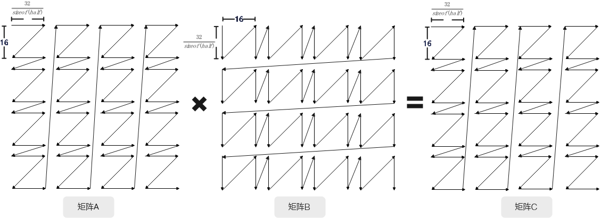
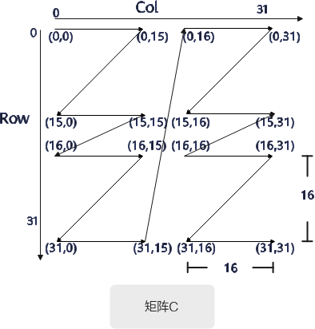

# 关键分形格式详解

矩阵分形存储格式是对多维Tensor在内存中数据排布格式的描述。

为了适配矩阵计算单元的物理读取路径，针对Ascend 950PR/Ascend 950DT，矩阵乘法C = A x B要求：左矩阵A使用Nz格式，右矩阵B使用Zn格式，结果矩阵C使用Nz格式，如图1所示：

**图1**矩阵乘法场景涉及的数据格式<a name="zh-cn_topic_0000002545089965_fig11172355102017"></a>


在具体的矩阵乘法场景中，各格式的详细定义与物理成因如下：

## ND格式（N-Dimension）<a name="zh-cn_topic_0000002545089965_section958745018719"></a>

- 定义： 通用的N维张量格式，即“线性格式”，数据在内存中是连续线性的。
- 场景： 通常存在于Global Memory（GM）中。在进行矩阵运算前，通常需要将其转换为NZ格式以适配Cube单元。
- 转换示例：从ND（GM）到Nz（L1 Buffer）的数据格式转换见图2，图中展示了一个具体的M=40，K=56的矩阵（数据类型为half），在从Global Memory（GM）搬运至L1 Buffer并转换为Nz格式时的内存排布变化：
    - 原始数据（ND格式）：
        - 左侧GM中存储的是原始矩阵，shape为40 x 56。
        - 数据呈线性连续排布（图中长箭头所示），遵循行主序（Row Major）规则。

    - 对齐与填充（Padding）：
        - 由于Cube单元的分形（Fractal）要求，目标矩阵必须能够被16 x 16的Block整除（假设数据类型为half，即32/sizeof（half）=16）。
        - M轴填充： 原始M=40不能被16整除，需向上补齐至48（16 x 3）。
        - K轴填充： 原始K=56不能被16整除，需向上补齐至64（16 x 4）。
        - 图中灰色区域即为补齐产生的无效数据（Padding），白色区域为原始有效数据。

    - 重排布（NZ格式）：
        - 右侧L1 Buffer中，数据被重组为3 x 4个分形块。
        - Z字流动： 每个16 x 16的小方块内部，以及方块之间，均按照特定的Z字形顺序存储（如图中折线箭头所示），完成了从“线性”到“分形”的物理映射，做好了进入Cube计算的准备。

**图2**ND（GM）到Nz（L1 Buffer）的数据转换<a name="zh-cn_topic_0000002545089965_fig1541710246162"></a>
-到-Nz-(L1-Buffer)-的数据转换.png "ND-(GM)-到-Nz-(L1-Buffer)-的数据转换")

## Zn格式（FRACTAL\_Zn） —— 右矩阵B<a name="zh-cn_topic_0000002545089965_section1934175314107"></a>

- **定义：**  大Z（外部行主序）+ 小n（内部列主序），见图3。

    **图3**Zn格式（以half类型为例）<a name="zh-cn_topic_0000002545089965_fig9884894817"></a>
    .png "Zn-格式(以half类型为例)")

- **物理位置：**
    - **L0B Buffer：**  作为右乘矩阵。
    - **L1 Buffer / GM：**  数据流转使用，一般用于保存离线处理好的右乘矩阵数据。

- **物理说明（Why）：**
    - **列读取需求：**  矩阵乘法需要取B的一列。若B为普通行主序，同一列的数据在内存中会相隔整整一行，导致地址跳跃。
    - **Zn的作用：**  Zn格式在分形内部强制按列存储。这意味着，B矩阵中逻辑上的一列数据，在L0B物理内存中被强行排在了一起，Cube单元只需线性读取即可天然获得B的列向量。

- **格式转换过程（How）：**（K，N）大小的矩阵被分为K1 \* N1个分形，按照行主序排布，形状如Z字形；每个分形内部有K0 \* N0个元素，按照列主序排布，形状如N字形，所以这种数据格式称为Zn格式。其中，（K0，N0）表示一个分形的大小，分形shape为（32B / sizeof（Datatype））x 16，大小为512字节。

    通过公式表达转换过程如下：

    ```
    (…, B, K, N)->pad->(…, B, K1 * K0, N1 * N0)->reshape->(…, B, K1, K0, N1, N0)->transpose->(…, B, K1, N1, K0, N0)
    ```

- **分形大小约束：**其中N0=16，而K0的大小取决于数据类型位宽，例如half类型下分形为16x16，int8下分形为32x16。

## Nz格式（FRACTAL\_Nz） —— 结果/通用矩阵C<a name="zh-cn_topic_0000002545089965_section363412741113"></a>

针对Ascend 950PR/Ascend 950DT，左矩阵A使用此格式。

- **定义：**  大N（外部列主序）+  小z（内部行主序），见图4。

    **图4**Nz格式<a name="zh-cn_topic_0000002545089965_fig583717713334"></a>
    

- **物理位置：**
    - **L0C Buffer：**  存储矩阵乘法的结果（分形固定为16x16）。
    - **L1 Buffer / GM：**  数据流转的通用中间格式（分形为16xK0，K0的大小取决于数据类型位宽）。
    - **L0A Buffer：**  仅Ascend 950PR/Ascend 950DT下使用，用于存储左矩阵（分形为16xK0，K0的大小取决于数据类型位宽）。

- **物理说明（Why）：**
    - Nz是Ascend架构内部的“中间标准格式”。它是对“线性数据（ND）”和“计算专用数据（Zn）”的一种折中。
    - **大N排布**（列主序Block）的设计通常是为了配合多核并行或后续算子（如Vector向量计算）在处理通道（Channel）维度数据时的便利性。

>**说明：**
>通常情况下，Nz格式在L0C Buffer和L1 Buffer中分别用于不同的场景：
>-   在L0C Buffer中，Nz格式用于存储矩阵乘法的结果。其分形形状为16x16，包含256个元素，这种结构非常适合Cube计算单元进行高效的矩阵乘法运算。
>-   在L1 Buffer中，Nz格式被采用以便于将数据搬运到L0B Buffer时，能够方便地转换为对应的Zn格式。此时，分形形状为16 x（32B / sizeof（Datatype）），大小为512字节。
>因此，当数据从L0C Buffer搬运到L1 Buffer时，其分形大小可能会发生变化。
>针对Ascend 950PR/Ascend 950DT，Nz格式在L0A Buffer中用于存储矩左矩阵。
