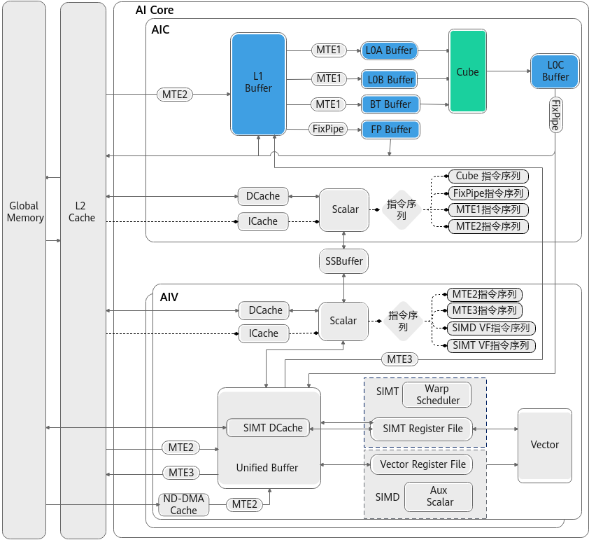

# 矩阵计算单元

针对Ascend 950PR/Ascend 950DT产品，矩阵计算单元架构图如下：

**图 1**  矩阵计算单元架构图  

矩阵计算关联的存储单元为：

<table><tbody><tr id="zh-cn_topic_0000002513373312_row1677933317161"><td class="cellrowborder" valign="top" width="16.09%">
L0A Buffer

</td>
<td class="cellrowborder" valign="top" width="83.91%">
AI Core内部物理存储单元，通常用于存储矩阵计算的左矩阵。

</td>
</tr>
<tr id="zh-cn_topic_0000002513373312_row15779113301616"><td class="cellrowborder" valign="top" width="16.09%">
L0B Buffer

</td>
<td class="cellrowborder" valign="top" width="83.91%">
AI Core内部物理存储单元，通常用于存储矩阵计算的右矩阵。

</td>
</tr>
<tr id="zh-cn_topic_0000002513373312_row5779133141613"><td class="cellrowborder" valign="top" width="16.09%">
L0C Buffer

</td>
<td class="cellrowborder" valign="top" width="83.91%">
AI Core内部物理存储单元，通常用于存储矩阵计算的结果，以及矩阵累加初始化值。

</td>
</tr>
<tr id="zh-cn_topic_0000002513373312_row67791332165"><td class="cellrowborder" valign="top" width="16.09%">
L1 Buffer

</td>
<td class="cellrowborder" valign="top" width="83.91%">
AI Core内部物理存储单元，空间相对较大，通常用于缓存矩阵计算的输入数据。 矩阵计算的输入一般需要从GM搬运到L1 Buffer，然后分别搬运到L0A Buffer和L0B Buffer。

</td>
</tr>
<tr id="zh-cn_topic_0000002513373312_row49201557161613"><td class="cellrowborder" valign="top" width="16.09%">
Fixpipe Buffer

</td>
<td class="cellrowborder" valign="top" width="83.91%">
AI Core内部物理存储单元，通常用于存储Fixpipe搬运过程中所需的量化参数等数据。

</td>
</tr>
<tr id="zh-cn_topic_0000002513373312_row14841436171717"><td class="cellrowborder" valign="top" width="16.09%">
BiasTable Buffer

</td>
<td class="cellrowborder" valign="top" width="83.91%">
偏置存储，AI Core内部物理存储单元，通常用于存储矩阵计算所需的Bias（偏置）数据。

</td>
</tr>
</tbody>
</table>
