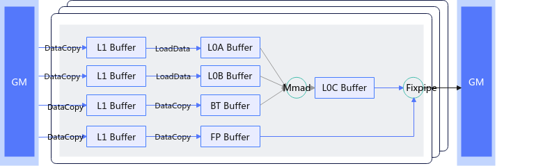

# 普通场景矩阵计算流程

Tensor API针对矩阵计算编程模型提供了Copy和Mmad两类接口，分别承载Cube核中各个通路的搬运能力和计算能力，如下图所示：

**图1**普通矩阵基础计算流程图

1. 通过Copy接口将A、B原始矩阵的Global Memory数据搬运到L1 Buffer中，（如果存在bias/随路量化，则同样通过Copy搬运到L1 Buffer中）。 （[矩阵计算的搬入](../data_movement/matrix_data_in_movement_overview.md)）

2. 通过Copy接口将A、B矩阵分别加载到L0A Buffer和L0B Buffer上准备计算，（如果存在bias/随路量化，则通过Copy将L1 Buffer中的bias数据/量化系数数据搬运到BT Buffer/FP Buffer上）。（[矩阵计算的搬入](../data_movement/matrix_data_in_movement_overview.md)）

3. 通过Mmad接口对L0A Buffer、L0B Buffer、BT Buffer上面的数据进行矩阵计算，并输出结果到L0C Buffer上。 （[Mmad计算](mmad计算.md)）

4. 通过Copy接口将L0C Buffer的数据进行处理并搬出到Global Memory，Copy接口可以利用FP Buffer数据进行如随路量化、Relu等操作。 （[矩阵计算的搬出](../data_movement/matrix_data_out_movement_overview.md)）
