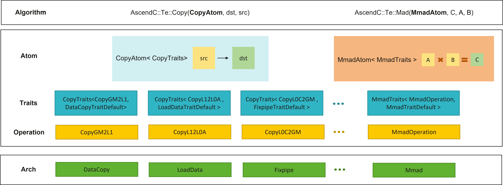

# Tensor API

Tensor API是一套基于Ascend C的C++模板抽象库，专为定义和操作层次化多维数据布局而设计。Tensor API提供**Layout**和**Tensor**对象，通过Layout统一表达硬件约束的复杂分形，为用户自动处理复杂的参数和索引计算，让开发者能以直观的方式操作数据，专注于算法逻辑。

Tensor API的核心抽象是Layout（层次化多维布局），它可以与数据指针组合来表示张量。这种布局表达方式足够强大，能够表示计算任务中所需的各种数据排列。在将复杂的硬件细节封装在底层的同时，通过模板参数暴露足够的控制点，让高级用户能够对硬件行为进行精细调优。基于Layout所描述的数据组织方式，Atom（原子操作）​ 进一步封装了底层硬件指令，它将操作类型和特征参数组合在一起，成为执行最小单元的计算或数据搬运操作的基础。

Tensor API当前仅支持Ascend 950PR/Ascend 950DT。

## Tensor API架构

Tensor API整体采用“张量描述 + 原子操作 + 硬件指令封装”的分层设计。上层接口面向算子开发者提供统一的Tensor、Copy和Mmad调用方式；中间层通过Layout、Tensor、Atom和Traits描述数据组织方式、存储位置、数据通路和编译期特征；底层再将这些描述映射到DataCopy、LoadData、Fixpipe、Mmad等硬件指令。

### 架构分层

- **基础构造层**：提供 `MakeShape`、`MakeStride`、`MakeCoord`、`MakeLayout`、`MakeFrameLayout`、`MakeMemPtr`、`MakeTensor` 等构造接口，用于描述张量形状、步长、坐标、布局、存储空间和数据指针。
- **布局与张量层**：`Layout` 负责表达张量的逻辑形状、物理步长和排布模式，`Tensor` 将 `Layout` 与具体内存位置绑定，使接口能够同时获得数据类型、存储层级和格式信息。
- **算法入口层**：`Copy` 和 `Mmad` 是面向用户的主要执行入口。用户先通过 `MakeCopy` 或 `MakeMmad` 构造对应Atom，再将Atom与Tensor传入算法接口。
- **特征配置层**：Traits用于描述编译期行为，例如数据通路、矩阵计算模式、转置行为、随路量化、随路Relu、Channel Split、Channel Merge等能力；运行时参数通过 `FixpipeParams`、`MmadParams` 等结构体绑定到Atom。
- **硬件封装层**：根据Tensor布局和Atom配置选择具体硬件指令，并完成底层指令参数推导，减少用户直接处理分形格式、地址偏移和指令字段的工作量。

### Atom抽象

将操作类型和特征参数组合，映射到昇腾处理器的硬件指令：

- **Atom**：原子操作对象
  - `CopyAtom`：数据搬运原子操作；
  - `MmadAtom`：矩阵乘加原子操作。
- **Traits**：特征配置，包含Operation和自定义Trait
  - `CopyTraits`：数据搬运特征配置；
  - `MmadTraits`：矩阵乘加特征配置。
- **Operation**：操作类型，指定数据通路
  - Cube 数据搬运：`CopyGM2L1`、`CopyL12L0A`、`CopyL12L0B`、`CopyL12L0ScaleA`、`CopyL12L0ScaleB`、`CopyL12BT`、`CopyL12FB`、`CopyL12UB`、`CopyL0C2GM`、`CopyL0C2UB`；
  - 矩阵计算：`MmadOperation`。

## 参考资源

### 文档

[Tensor API资料目录导览](docs/api/context/tensor_api_new/directory_guide.md)

### 测试和样例

本仓库提供[测试用例](../../../../tests/api/tensor_api)、[基础矩阵乘样例](../../../../examples/01_simd_cpp_api/00_introduction/02_matrix/matmul_tensor_api)和[MX 高性能矩阵乘样例](../../../../examples/01_simd_cpp_api/04_best_practices/01_matrix_compute_practices/matmul_mxfp4_tensor_api_high_performance)，方便快速了解功能用法并进行验证。
