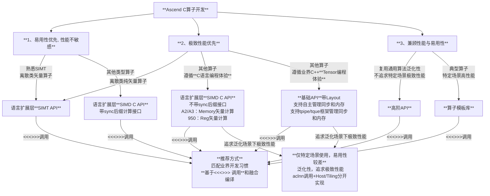

# Ascend C多层级编程API选择参考

欢迎使用[Ascend C](https://www.hiascend.com/cann/ascend-c)进行昇腾AI处理器算子开发。**Ascend C**作为一门面向多场景的现代编程语言，除了它最关键的特点**提供芯片完备编程能力支撑实现极致性能**之外，还提供多层级编程接口，让您可以根据项目需求、团队技能和性能模板，灵活选择对应层级API，从而在开发效率与运行性能之间取得完美平衡。

---

## 设计目标

Ascend C 的设计目标可概括为 **高性能、完备性、易编程、可调试和兼容性**，其核心致力于基于昇腾AI处理器能开发极致性能的算子。同时，为提升编程易用性，通过最小化扩展的方式适配C/C++语言标准，匹配业界基于指针的C语言和基于Tensor的C++语言开发习惯，实现开发体验与现有生态无缝衔接。

同时我们相信：
- **没有银弹**：不同场景对性能、开发效率等要求不同，单一接口无法最优适配所有场景；
- **渐进式学习**：新手可以从易用性接口入手，快速进行算法验证；专家可以向下钻取，精细调优，利用复杂接口和特性，榨干硬件全部能力；

基于此，我们定义了以下四个标准接口层级：

| 层级 | 抽象程度 | 目标用户 | 主要用途 |
|------|----------|----------|----------|
| 算子模板库(CATLASS/ATVOSS等) | 最高: 算子完整样例 | 算法开发人员 | 基于现有算子的实现自定义扩展实现实现特定场景高性能 |
| 高阶API | 较高：单核算法实现 | 算法开发人员 | 可复用业界通用算法单核实现，快速进行算法验证 |
| 基础API | 中等：基于Tensor的单指令抽象 | Tensor/Tile编程算子开发者| 基于Tensor/Tile编程模型开发算子，可实现极致性能 |
| 语言扩展层C API（SIMD&SIMT) | 最低: 基于指针计算 | 传统C语言算子开发者| 基于C语言指针和数组内存分配开发算子，可实现极致性能 |

---

## 层级详细介绍

### 语言扩展层C API（SIMD&SIMT)

**特点**
- 匹配业界传统的C语言算子开发习惯，如数组内存分配、指针计算接口、asc_xxx前缀的snake命名风格；
- SIMT API编程模型和编程接口遵循业界通用开发习惯；
- 推荐使用SIMD API提供易用的连续计算接口，可支撑大多数算子开发诉求，如：asc_add(__ubuf__ half* dst, __ubuf__ half* src0, __ubuf__ half* src1, uint32_t count);
- SIMD API为提升快速入门用户易用性，简化同步管理，同时提供带同步操作的sync接口，如：asc_add_sync(__ubuf__ half* dst, __ubuf__ half* src0, __ubuf__ half* src1, uint32_t count)；
- SIMD API基于芯片能力提供带repeat/stride计算接口，可极致性能诉求，如：asc_add(__ubuf__ half* dst, __ubuf__ half* src0, __ubuf__ half* src1, uint8_t repeat, uint8_t dst_block_stride, uint8_t src0_block_stride, uint8_t src1_block_stride, uint8_t dst_repeat_stride, uint8_t src0_repeat_stride, uint8_t src1_repeat_stride); 

**适用场景**
- 熟悉传统的C语言开发习惯的算子开发者；
- 熟悉SIMT的开发者可快速熟悉NPU算子编程；
- 开发部署环境下极致性能算子，榨干硬件极致性能；
- 算法开发者可基于带sync后缀的计算接口快速进行算法验证；

**示例**
- 带同步计算接口，快速实现的[SIMD Add算子示例](https://gitcode.com/cann/asc-devkit/blob/master/examples/00_introduction/01_add/c_api_sync_add/c_api_add.asc)
- 匹配业绩习惯，快速实现的[SIMT Add算子示例](https://gitcode.com/cann/asc-devkit/blob/master/examples/00_introduction/01_add/simt_add/add.asc)
 - 更多样例，请参考examples目录；

---

### 基础API：基于Tensor的单指令抽象

**特点**
- 基于Tensor和数据类型对NPU指令进行抽象；
- 提供与传统C++语言Queue类似的理念实现Tque/Tpipe框架来简化NPU的同步和内存管理，简化编程；
- 提供独立于Tque/Tpipe之外的内存和同步接口，支撑用户基于Tensor自主管理同步和内存；
- 扩展Tensor支持Layout，通过Layout统一表达各种数据格式，简化计算编程接口，匹配业界Tensor编程体验；

**适用场景**
- 熟悉业界基于C++ Tensor开发习惯的算子开发者；
- 开发部署环境下极致性能算子，榨干硬件极致性能；

**示例**
- 基于Tque/Tpipe自动管理内存和同步，快速实现[SIMD Add算子示例](https://gitcode.com/cann/asc-devkit/blob/master/examples/00_introduction/01_add/basic_api_tque_add/add.asc)
- 独立Tque/Tpipe，基于LocalMemoryAllocator自主管理同步，快速实现[SIMD Add算子示例](https://gitcode.com/cann/asc-devkit/blob/master/examples/00_introduction/01_add/basic_api_memory_allocator_add/add.asc)

---

### 高阶API：单核公共算法实现

**特点**
- 通用的算法的单核实现
- 一般有较好的泛化性能，特定场景下可支持实现极致性能；

**适用场景**
- 快速进行算法验证，不追求特定场景下极致性能；

**示例**
- [Softmax API 示例](https://gitcode.com/cann/asc-devkit/blob/master/examples/03_libraries/02_activation/softmax/softmax.asc)
- [Matmul API 示例](https://gitcode.com/cann/asc-devkit/tree/master/examples/03_libraries/01_matrix)

---

### 算子模板库：算子实现样例

**特点**
- 特定场景下的典型算子端到端完整实现；
- 一般不追求泛化性能，而是特定场景下

**适用场景**
- 对典型算子的自定义场景快速扩展；

**示例**
- Vector类算子模板库，请参考[ATVC](https://gitcode.com/cann/atvc) 和 [ATVOSS](https://gitcode.com/cann/atvoss);
- Cube类算子模板库，请参考[CATLASS](https://gitcode.com/cann/catlass);

---

## 如何快速选择对应层级API？

以下决策流程图可以帮助你快速定位：

也可以根据以下关键维度快速决策：

| 关键因素 | 推荐层级 | 理由 |
|----------|----------|------|
| **矢量算子开发，离散场景** | 语言扩展层SIMT API | 发挥SIMT离散场景优势，匹配业界SIMT开发习惯 |
| **复用传统算子C语言编程经验** | 语言扩展层SIMD&SIMT C API | 匹配传统C语言算子开发经验 |
| **复用业界Tensor编程经验** | 基础API(带Layout) | 匹配业界Tensor开发习惯 |
| **复用公共算法快速算法验证** | 高阶API | 高阶API提供了共同通用算法的较好泛化实现 |
| **典型算子自定义场景扩展** | 算子模板库 | 模板库提供提供典型算子特定场景最佳实践，并支撑自定义扩展 |

---

## 总结

Ascend C多层级接口的设计，旨在让您**永远使用最合适的编程范式，而不是被迫适应单一范式**。请开始您的算子编程之旅吧！如有疑惑，请参考Ascend C详细文档或社区示例，我们随时准备让NPU强大算力对您变得触手可及且高效易用！

---