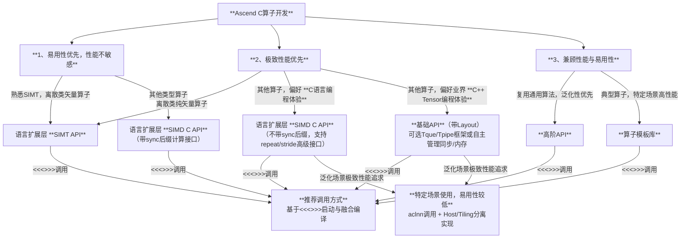

# Ascend C 多层级编程接口选择参考

欢迎使用 [Ascend C](https://www.hiascend.com/cann/ascend-c) 进行昇腾AI处理器算子开发。作为一门面向多场景的编程语言，Ascend C 不仅致力于**提供芯片完备的编程能力以实现极致性能**，同时通过多层级编程接口设计，让您能够根据项目需求、团队技能与性能目标，灵活选择最合适的 API，在开发效率与运行性能之间取得最佳平衡。

---

## 设计目标

Ascend C 的设计目标可概括为 **“高性能、完备性、易编程、可调试和兼容性”**，其核心使命是基于昇腾AI处理器开发极致性能的算子。为提升编程易用性，我们通过最小化扩展的方式适配C/C++语言标准，兼顾业界基于指针的C语言开发习惯与基于Tensor的C++编程范式，实现开发体验与现有生态的无缝衔接。

我们秉持以下核心理念：
- **没有银弹**：不同场景对性能、开发效率的要求各异，单一接口无法最优适配所有场景；
- **渐进式学习**：新手可从易用性接口入手快速验证算法，专家则可向下钻取、精细调优，借助复杂接口特性充分挖掘硬件潜能。

基于此，我们定义了四个标准接口层级：

| 层级 | 抽象程度 | 目标用户 | 主要用途 |
|------|----------|----------|----------|
| 算子模板库 (CATLASS/ATVOSS等) | 最高：算子完整样例 | 算法开发人员 | 基于现有算子实现进行自定义扩展，满足特定场景高性能需求 |
| 高阶API | 较高：单核算法实现 | 算法开发人员 | 复用业界通用单核算法实现，快速完成算法验证 |
| 基础API | 中等：基于Tensor的单指令抽象 | Tensor/Tile编程算子开发者 | 基于Tensor/Tile编程模型开发算子，兼顾性能与可编程性 |
| 语言扩展层C API (SIMD & SIMT) | 最低：基于指针计算 | 传统C语言算子开发者 | 沿用C语言指针与数组内存分配方式开发算子，追求极致性能 |

---

## 如何快速选择对应层级API？

以下决策流程图可帮助您快速定位最适合的API层级：

也可参考以下关键维度进行快速决策：

| 关键因素 | 推荐层级 | 理由 |
|----------|----------|------|
| **离散型矢量算子开发** | 语言扩展层 SIMT API | 充分发挥SIMT在离散场景的优势，匹配业界编程习惯 |
| **复用传统C语言算子开发经验** | 语言扩展层 SIMD & SIMT C API | 与C语言指针/数组内存分配方式无缝衔接 |
| **复用业界Tensor编程经验** | 基础API（带Layout） | 提供与现代C++ Tensor生态一致的编程体验 |
| **快速算法验证，复用公共算法** | 高阶API | 封装了通用算法的良好泛化实现，开发效率高 |
| **典型算子的自定义场景扩展** | 算子模板库 | 提供特定场景最佳实践，支持快速定制化开发 |

---

## 层级详细介绍

### 语言扩展层C API (SIMD & SIMT)

**特点**
- 匹配业界传统C语言算子开发习惯，支持数组内存分配、指针计算接口，采用 `asc_xxx` 前缀的 snake_case 命名风格；
- SIMT API 编程模型遵循业界通用开发习惯，降低学习曲线；
- SIMD API 提供易用的连续计算接口，可支撑绝大多数算子开发诉求，例如 `asc_add(__ubuf__ half* dst, __ubuf__ half* src0, __ubuf__ half* src1, uint32_t count)`；
- 为提升快速入门用户的易用性，SIMD API 简化同步管理，额外提供带 `_sync` 后缀的同步操作接口，如 `asc_add_sync(...)`；
- 面向极致性能场景，SIMD API 提供带 `repeat`/`stride` 参数的高级计算接口，支持灵活控制数据布局与计算模式。

**适用场景**
- 熟悉传统C语言开发习惯的算子开发者；
- 具备SIMT编程经验、希望快速迁移至NPU环境的开发者；
- 需要榨取硬件极致性能的生产环境算子开发；
- 希望借助带 `sync` 后缀的计算接口快速进行算法验证的开发者。

**示例**
- [SIMD Add算子示例（带同步计算接口）](https://gitcode.com/cann/asc-devkit/blob/master/examples/00_introduction/01_add/c_api_sync_add/c_api_add.asc)
- [SIMT Add算子示例（匹配业界习惯）](https://gitcode.com/cann/asc-devkit/blob/master/examples/00_introduction/01_add/simt_add/add.asc)
- 更多样例请参考 [examples目录](https://gitcode.com/cann/asc-devkit/tree/master/examples)

---

### 基础API：基于Tensor的单指令抽象

**特点**
- 基于Tensor与数据类型对NPU指令进行抽象，提供更高级的编程原语；
- 引入 `Tque`/`Tpipe` 框架，借鉴C++ `Queue` 的设计理念，简化NPU的同步与内存管理；
- 提供独立于 `Tque`/`Tpipe` 之外的内存分配与同步接口，支持开发者基于Tensor自主管理资源；
- 扩展Tensor支持 `Layout` 概念，通过统一的数据布局表达简化计算接口，与业界Tensor编程体验保持一致。

**适用场景**
- 熟悉业界基于C++ Tensor开发习惯的算子开发者；
- 需要在生产环境中开发极致性能算子、同时希望保持代码可维护性的场景。

**示例**
- [基于Tque/Tpipe自动管理内存与同步的SIMD Add算子示例](https://gitcode.com/cann/asc-devkit/blob/master/examples/00_introduction/01_add/basic_api_tque_add/add.asc)
- [基于LocalMemoryAllocator自主管理内存与同步的SIMD Add算子示例](https://gitcode.com/cann/asc-devkit/blob/master/examples/00_introduction/01_add/basic_api_memory_allocator_add/add.asc)

---

### 高阶API：单核公共算法实现

**特点**
- 封装通用的单核算法实现，提供良好的泛化性能；
- 在特定场景下，经过优化亦可实现接近极致的性能。

**适用场景**
- 快速验证算法可行性，对特定场景的极致性能要求不高；
- 希望复用成熟算法实现、缩短开发周期的场景。

**示例**
- [Softmax API 示例](https://gitcode.com/cann/asc-devkit/blob/master/examples/03_libraries/02_activation/softmax/softmax.asc)
- [Matmul API 示例](https://gitcode.com/cann/asc-devkit/tree/master/examples/03_libraries/01_matrix)

---

### 算子模板库：算子实现样例

**特点**
- 提供特定场景下典型算子的端到端完整实现，作为最佳实践参考；
- 通常针对特定场景进行极致优化，泛化性能并非首要目标。

**适用场景**
- 需要对典型算子进行自定义扩展，快速适配特定业务场景。

**示例**
- Vector类算子模板库：[ATVC](https://gitcode.com/cann/atvc)、[ATVOSS](https://gitcode.com/cann/atvoss)
- Cube类算子模板库：[CATLASS](https://gitcode.com/cann/catlass)

---

## 总结

Ascend C 多层级接口设计的核心理念是：让您**永远使用最合适的编程范式，而非被迫适应单一抽象**。无论您是追求极致性能的底层专家，还是希望快速验证算法的原型开发者，都能在 Ascend C 的层级化API生态中找到得心应手的工具。

立即开始您的算子编程之旅吧！如有疑问，欢迎参考 Ascend C 详细文档或社区示例，我们将持续致力于让NPU的强大算力对您变得触手可及、高效易用。