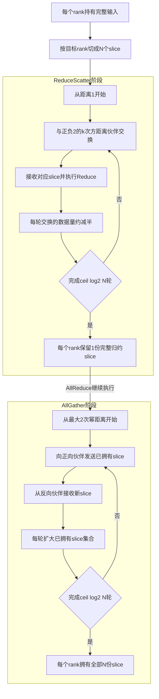
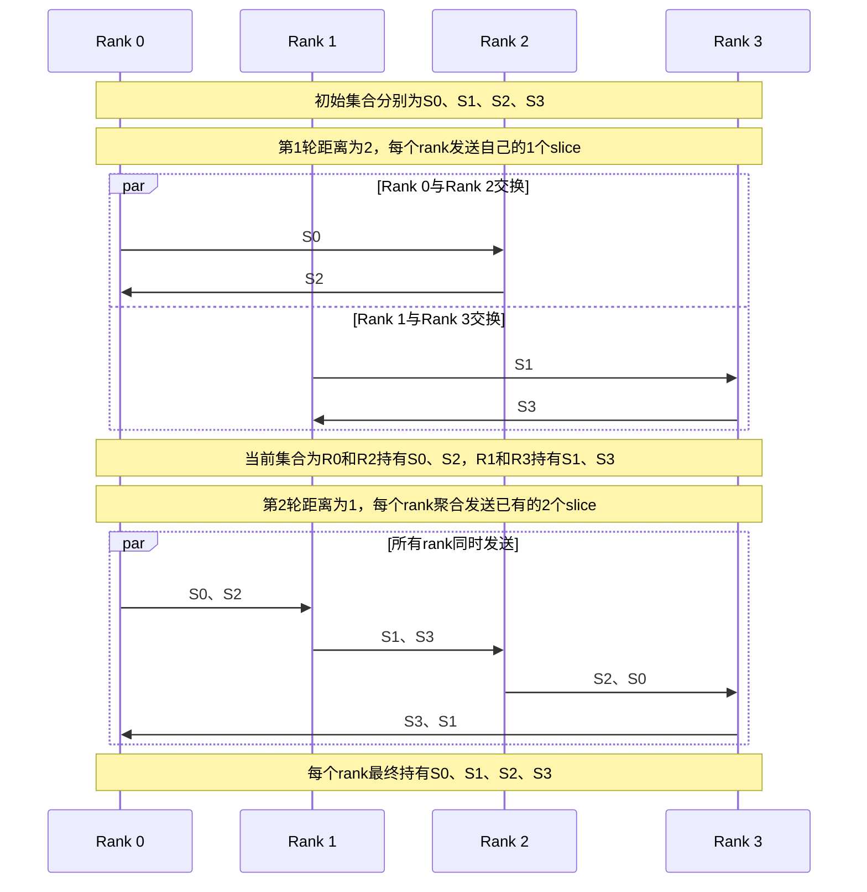

# 集合通信基础概念

本文记录HCCL算法迁移和KFC适配过程中需要反复使用的集合通信基础概念。概念解释以HCCL公开文档为主要依据；公开文档未直接定义的工程术语，单独标注其源码判定依据，避免将互联技术、协议、拓扑和算法混为一谈。

## UBX

### 核心定义

UBX在HCCL中不是独立通信协议，也不是集合通信算法。结合HCCL文档和当前源码，它表示一类基于UB互联、同时具有1DMesh直连通信面和CLOS交换通信面的复合组网场景。

HCCL公开文档明确将UB展开为Unified Bus，但当前资料没有给出UBX的正式英文展开。因此，文档和代码评审中应直接使用“UBX组网”或“UBX场景”，不应自行解释UBX缩写。

相关概念位于不同层次：

| 层次 | 概念 | 含义 |
| --- | --- | --- |
| 互联技术 | UB | Unified Bus，HCCL支持的高速互联技术 |
| 通信协议或语义 | `UB_CTP`、`UB_MEM`等 | 决定Channel如何传输数据或访问内存 |
| 拓扑 | 1DMesh、CLOS | 描述通信实体之间的连接关系 |
| 组网场景 | UBX | HCCL对UB Mesh和CLOS复合组网的工程称呼 |
| 算法 | Mesh1D、NHR、Concurrent、OmniPipe等 | 根据拓扑、数据量和执行引擎选择的通信任务编排方式 |

### 文档依据

HCCL文档给出了构成UBX概念的基础事实：

- HCCL仓`docs/zh/user_guide/hccl_intro.md`将UB定义为Unified Bus，并将其列为HCCL支持的高速通信链路。
- HCCL仓`docs/zh/user_guide/concepts.md`说明，AI Server通过灵衢总线交换设备连接形成超节点组网。
- HCCL仓`docs/zh/architecture/architecture-brief.md`将1DMesh和CLOS列为拓扑类型，并说明Channel基于Link实例化，UB Channel可对应Jetty连接。
- HCCL仓`docs/zh/user_guide/cluster_info_config/rank_table_config_a5.md`的拓扑示例同时包含使用`UB_CTP`的1DMesh直连边和CLOS交换边。

上述资料没有把UBX定义为新的协议枚举。拓扑文件中的协议字段仍是`UB_CTP`、`UB_MEM`等，拓扑字段仍是`1DMESH`或`CLOS`。

### HCCL源码中的工程判定

当前HCCL算法selector通常使用以下条件识别UBX路径：

```cpp
bool isUBX = topoInfo->level0Topo == Level0Shape::MESH_1D_CLOS && !topoInfo->level0PcieMix;
```

两个字段分别表达：

- `level0Topo == MESH_1D_CLOS`：当前层同时存在Mesh和CLOS通信能力。
- `level0PcieMix == false`：补充通信面不是PCIe-SW混合链路。

如果拓扑同为`MESH_1D_CLOS`，但`level0PcieMix == true`，HCCL会进入PCIe-SW定制组网分支，而不是UBX算法分支。因此，“Mesh加CLOS”是UBX的必要特征，但还必须排除PCIe混合场景。

`TopoMatchUBX`也不是协议协商器。它读取RankGraph中的拓扑实例，将同一批物理rank拆成Mesh子通信域和CLOS子通信域，供不同算法模板使用。两个子通信域是同一批rank的不同通信平面视图，不代表存在两套rank。

源码证据位于HCCL仓`src/ops/op_common/inc/alg_param.h`中的`Level0Shape`和`level0PcieMix`定义、`src/ops/all_gather/selector/all_gather_auto_selector.cc`中的UBX分支，以及`src/ops/op_common/topo/topo_match_ubx.cc`中的双通信域提取逻辑。

### 典型通信结构

```text
同一批rank
  |-- Mesh通信面：Device之间直接连接，适合直接访问对端
  |-- CLOS通信面：Device通过Fabric互通，提供交换路径和额外端口带宽
```

高性能组合算法可以将数据切成互不重叠的片段，让Mesh模板和NHR模板分别使用两个通信面。并发来自不同thread和Channel上的任务推进，不是UBX本身定义了一种新算法。

### 与相近概念的区别

- UBX不等于UB。UB是互联技术，UBX是基于UB能力形成的复合组网场景。
- UBX不等于`UB_CTP`。`UB_CTP`是Channel使用的协议，UBX不是协议字段。
- UBX不等于Jetty。Jetty是UB Channel底层的连接和队列资源。
- UBX不等于CLOS。CLOS只是UBX中的交换通信面。
- UBX不等于Mesh。Mesh只是UBX中的直连通信面。
- UBX不等于NHR或Concurrent。后两者是可以在UBX拓扑上运行的算法或组合算法。
- UBX与超节点组网相关，但两者不能在所有代码语境中直接画等号。超节点是系统组网范围概念，HCCL算法是否进入UBX分支仍由RankGraph及拓扑字段决定。

### 迁移和测试注意事项

迁移带有UBX命名的算法时，至少需要核对以下条件：

- selector是否同时检查`MESH_1D_CLOS`和`level0PcieMix`。
- `TopoMatchUBX`是否正确生成Mesh和CLOS两个子通信域。
- Channel申请是否选择预期的UB协议，并按remote rank保留所有需要的Channel。
- 多Jetty场景是否同步更新数据切分、thread、notify和Channel分区。
- host ST是否只验证选择和资源模型；真实双平面并发及带宽收益必须在UBX硬件上确认。

## NHR

### NHR是算法而不是物理拓扑

NHR是集合通信算法，全称为Nonuniform Hierarchical Ring，中文为“非均衡的层次环”。HCCL官方文档将它列为Server间和超节点间通信算法，并明确说明NHR同样适用于星型或胖树物理拓扑。因此，名称中的Ring描述算法构造出的逻辑通信关系，不表示硬件必须连接成物理环，也不表示RankGraph中存在一种名为NHR的拓扑类型。

需要区分以下对象：

| 对象 | 作用 |
| --- | --- |
| 物理拓扑 | 1DMesh、CLOS、星型或胖树等实际连接关系 |
| NHR逻辑通信图 | 算法根据rank编号和通信轮次生成的收发关系 |
| Channel | 将NHR逻辑收发关系映射到底层可用链路 |
| Jetty | UB Channel底层可能使用的连接和队列资源 |

多Jetty不会改变NHR的通信轮次和对端计算，只会把同一对端方向的数据进一步切到多个Channel并行传输。

### 核心思想

对于`N`个rank，NHR为不同数据片构建`N`棵生成树，并通过数据片编号重排，将多个逻辑slice尽量聚合为连续传输。生成树深度和通信步数都是`ceil(log2 N)`。相较通信步数为线性复杂度的普通Ring算法，NHR在rank数较多时可以降低启动时延；相较通常偏好2的整数次幂规模的RHD算法，NHR在非2次幂规模下仍能充分利用链路资源。

HCCL文档没有单独解释“Nonuniform”一词的词源。结合文档中的5-rank示意图和当前源码公式，可以将其理解为：在非2次幂规模下，各轮参与聚合的数据片数量和数据布局不完全对称。HCCL通过向上取整计算通信轮数，并按当前轮次计算slice数量和编号步长，使大部分数据仍可连续收发，少部分数据使用离散slice。该说明是基于文档和实现行为的工程解释，不应扩展成一种名为“非均衡环”的物理拓扑。

NHR建立Channel时，对每个rank按`1、2、4、...`的距离计算正向和反向通信伙伴：

```text
partnerPositive = rank + 2^k mod N
partnerNegative = rank - 2^k mod N
```

这些伙伴关系是逻辑通信需求。实际使用哪个物理端口、协议和Jetty，由RankGraph、Link和Channel申请结果决定。

### 集合通信流程

ReduceScatter和AllGather使用方向相反的NHR传播过程，AllReduce由两者顺序组合。



不同集合通信操作的含义如下：

- ReduceScatter从较短距离开始。第`k`轮向`rank - 2^k`发送，接收来自`rank + 2^k`的数据并归约；每轮通信的数据量大致减半，最后每个rank保留自己的完整归约slice。
- AllGather按相反顺序从较大距离开始。每轮发送当前已拥有的目标slice集合，同时接收新的slice，最后每个rank得到全部数据。
- AllReduce先执行NHR ReduceScatter，再执行NHR AllGather，所以总通信轮数为`2 * ceil(log2 N)`。

### 四rank AllGather示例

下面按照当前HCCL AICPU AllGather NHR公式展开4-rank示例。初始时Rank 0至Rank 3分别只拥有`S0`至`S3`。通信轮数为2。



示例中的箭头是某一轮算法生成的逻辑传输关系，不是固定物理连线。第一轮按距离2形成两组交换，第二轮按距离1形成单向循环；两轮关系叠加后构成深度为2的数据传播树。HCCL会根据可用Channel把这些逻辑传输映射到CLOS、星型、胖树或其他可达网络。

### 非2次幂规模

当rank数不是2的整数次幂时，NHR仍执行`ceil(log2 N)`轮。例如5个rank执行3轮。每轮仍按2的幂次计算通信距离，但slice数量通过取整公式调整，不再要求所有rank在每一轮发送完全对称的数据集合。数据片编号重排使大部分slice可以聚合发送，只有少部分通信需要离散slice。

这也是NHR区别于RHD的重要特征。HCCL文档明确指出，RHD在非2次幂规模下会引入额外通信步数和开销，而NHR在2次幂和非2次幂规模下均可充分利用链路资源。至于具体RHD实现是否采用预处理、收缩子集或收尾阶段，应以对应版本的RHD模板为准，不能仅由NHR名称推断。

### 复杂度与适用场景

设rank数为`p`，单次通信固定时延为`alpha`，单位数据传输耗时为`beta`，归约计算耗时为`gamma`。HCCL文档给出的核心复杂度为：

| 操作 | 通信轮数 | 主要特点 |
| --- | --- | --- |
| ReduceScatter | `ceil(log2 p)` | 数据量逐轮减小，并执行归约 |
| AllGather | `ceil(log2 p)` | 已拥有的数据集合逐轮扩大 |
| AllReduce | `2 * ceil(log2 p)` | ReduceScatter加AllGather |

NHR适合rank数较多、希望降低通信轮数，或者集群规模不是2的整数次幂且Pipeline不适用的场景。HCCL还会尝试让最大流量集中在物理位置相近的节点之间，以减少交换网络中的流量冲突。

### 文档与源码依据

- HCCL仓`docs/zh/user_guide/coll_algo_intro/NHR.md`给出NHR全称、生成树模型、通信步数、非2次幂支持和各集合通信操作的复杂度。
- HCCL仓`docs/zh/user_guide/coll_algo_intro/algo_intro.md`将NHR列为Server间和超节点间集合通信算法。
- HCCL仓`src/ops/op_common/executor/channel/channel_request.cc`中的`CalcNHRChannelConnect`按2的幂次距离计算正负方向伙伴。
- HCCL仓`src/ops/op_common/template/template_utils.cc`中的`GetNHRStepNum`计算`ceil(log2 rankSize)`。
- HCCL仓`src/ops/reduce_scatter/template/aicpu/ins_temp_reduce_scatter_nhr.cc`和`src/ops/all_gather/template/aicpu/ins_temp_all_gather_nhr.cc`分别实现缩减和扩散方向的每轮伙伴及slice计算。

## 资料边界

本文只采用当前HCCL文档可以直接证明的术语定义，并用HCCL源码补充工程判定。若后续正式产品资料给出UBX的标准英文展开或更严格的硬件定义，应以正式资料为准并更新本文。
