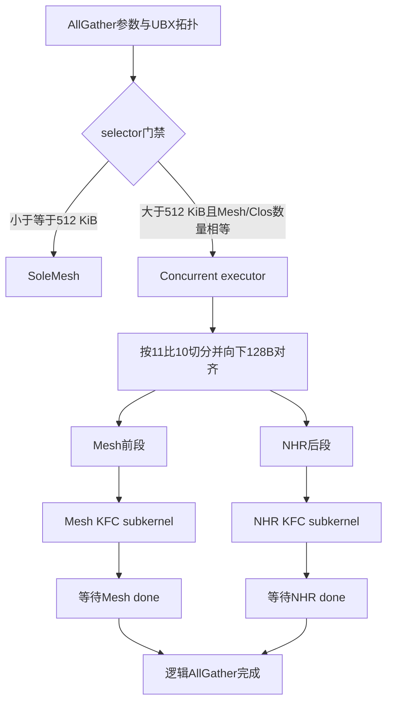
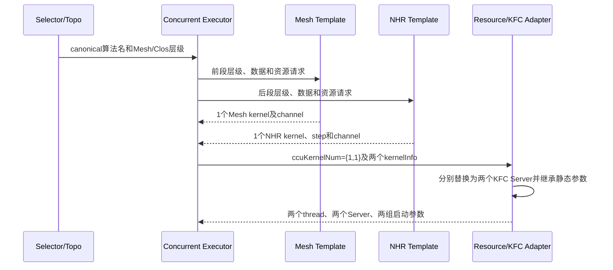
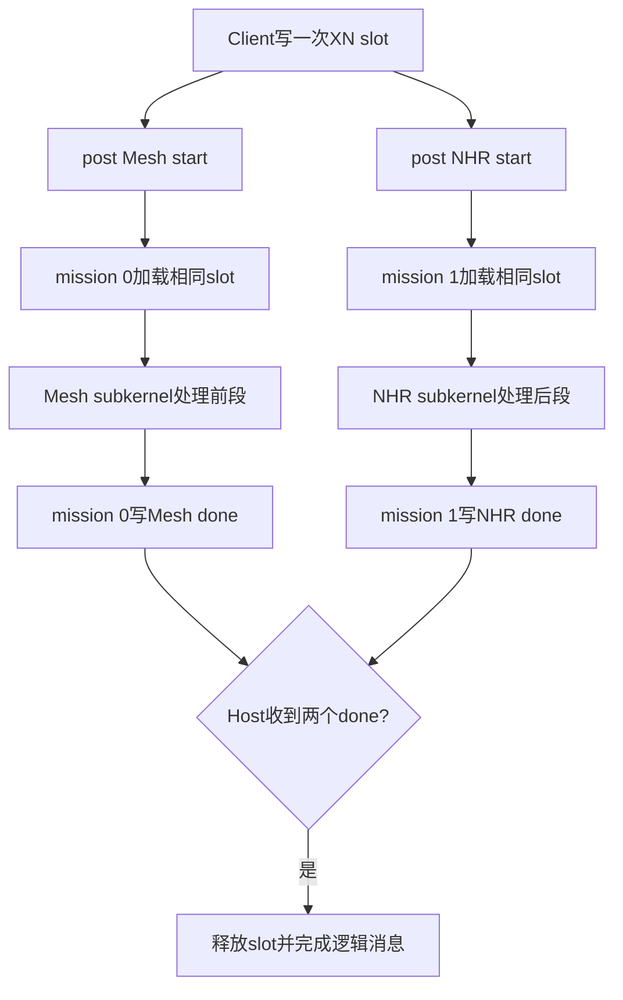
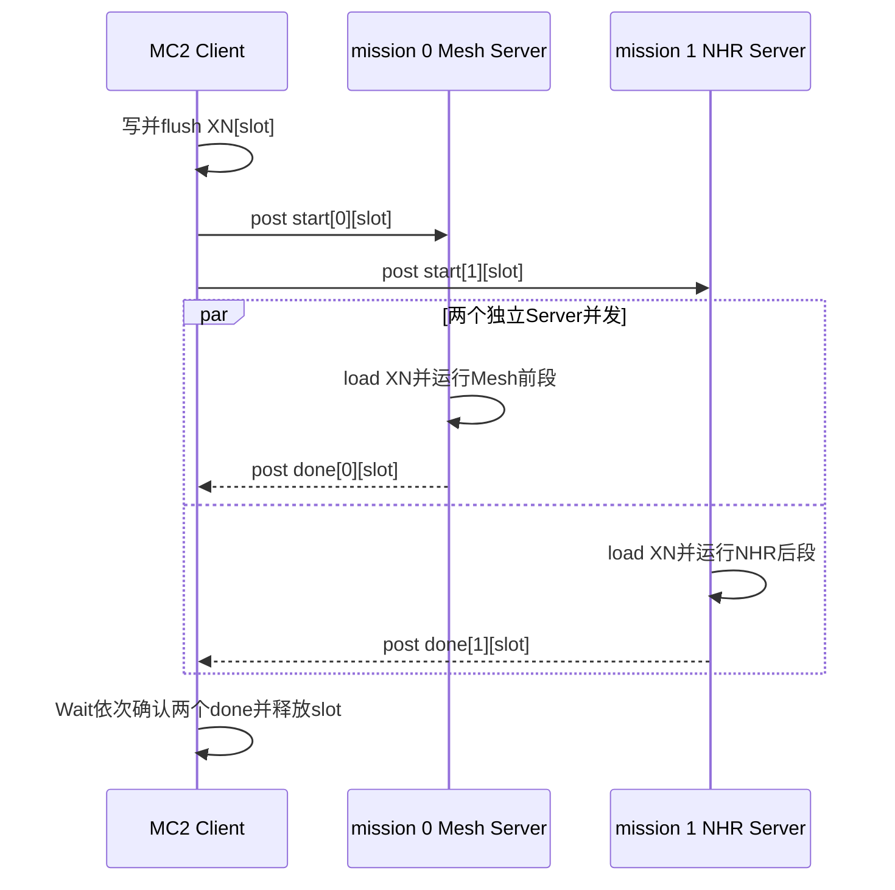
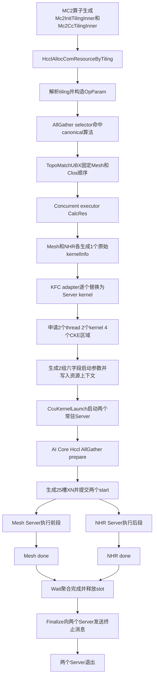
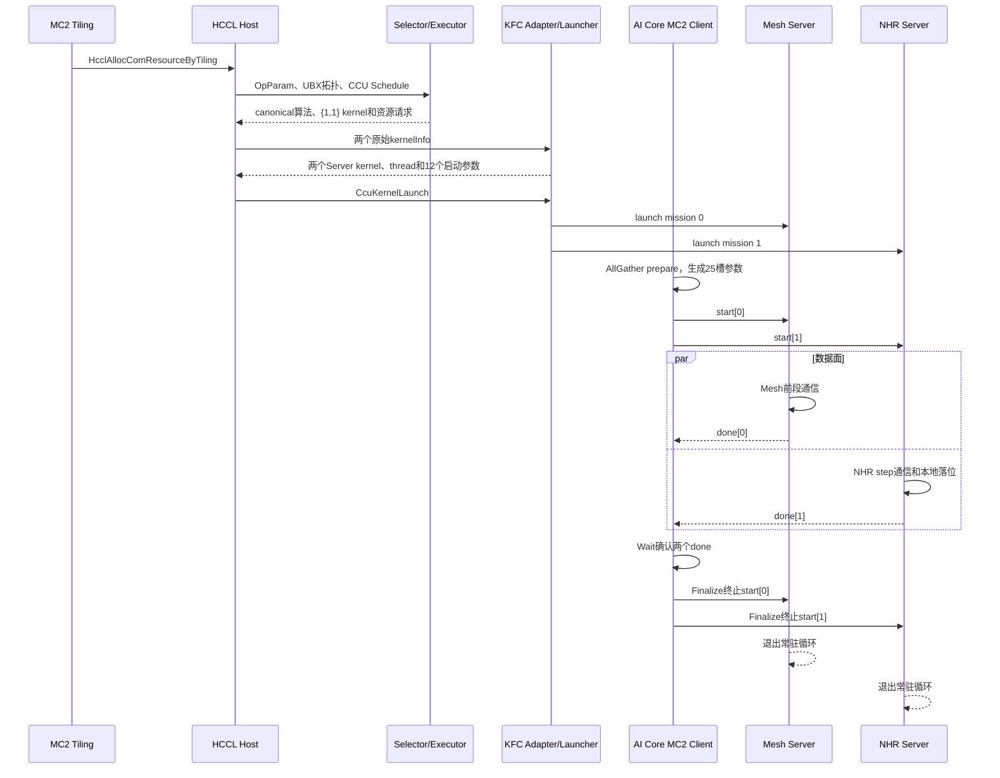

# CcuSchedAllGatherConcurMeshNHRMultiLink详细设计：Host双独立队列

## 文档定位

本文描述分支 `cc0806_2` 中 `CcuSchedAllGatherConcurMeshNHRMultiLink` 的实际实现。该算法历史名称为
`CcuAllGatherConcurrentMesh1DNHRMem`，历史名称只用于迁移追溯，生产代码统一使用canonical名称。

本文不是迁移计划，而是实现级详细设计，回答以下问题：

- 哪些行为从最新HCCL同步，哪些代码是asc-devkit MC2/CCU/KFC适配。
- Mesh和NHR为何必须保留为两个kernel、两个thread和两个KFC Server mission。
- 从MC2 tiling、Host资源构造、AI Core client提交，到两个CCU kernel结束的完整路径。
- 每个算法相关文件和函数的职责、约束及设计原因。
- 与 `ccuCurMisSyn` mission同步方案的差异和选择建议。

### 基线和范围

**表 1**  基线和范围

| 项目 | 基线 |
| --- | --- |
| asc-devkit分支 | `cc0806_2` |
| asc-devkit提交 | `c1f2a9327` |
| HCCL路径 | `../hccl` |
| HCCL HEAD | `52c9634afbe1d2f7e4e508f5efbe0ee34a2e1f18` |
| 目标架构 | `ascend950pr_9599`、`SocVersion=ASCEND950`、`__NPU_ARCH__=3510` |
| 通信引擎 | CCU Schedule，经MC2/KFC Server运行 |
| 不在范围 | `ascend610`、AICPU新入口、legacy `all_gather_op`、双die和跨Server |

### 代码来源标签

**表 2**  代码来源标签

| 标签 | 含义 |
| --- | --- |
| `[HCCL-SYNC]` | 从上述HCCL基线直接同步或保持完全相同的算法、拓扑、资源语义 |
| `[MC2-KFC]` | HCCL直接launch CCU kernel时不存在，为asc-devkit MC2/KFC机制新增 |
| `[HYBRID]` | 算法语义来自HCCL，但代码形态改为KFC template或可调用subkernel |
| `[TEST]` | 为验证selector、资源、启动参数、Server IR而新增的测试和stub |

`[HCCL-SYNC]` 不表示文件逐字复制。asc-devkit保留自身命名空间、编译宏、错误处理和KFC template类型时，
仍以语义同步为准。

## HCCL原算法与asc-devkit执行模型

### HCCL算法语义

目标算法把每rank的AllGather数据按CCU带宽比例拆为两段：

```text
meshSize = align_down(totalSize * 11 / 21, 128B)
nhrSize  = totalSize - meshSize
nhrBase  = base + meshSize
```

- Mesh template处理对齐后的前段，通过full-mesh channel与其他rank并发写数据。
- NHR MultiJetty template处理剩余后段，按NHR step在Clos channel上传递已拥有的slice。
- 当前HCCL基线的NHR `JETTY_NUM=1`。
- 两个template各产生一个CCU kernel，资源边界为 `ccuKernelNum={1,1}`。
- 两段地址不重叠；只有两段都完成，逻辑AllGather才完成。

### 为什么不能复用SoleMesh单kernel模型

`CcuSchedAllGatherSoleMesh` 只有一个Mesh template和一个kernel。目标算法的Clos/NHR后段拥有独立channel、
NHR step表、rank到channel映射和同步序列。把NHR串到Mesh subkernel后执行会改变HCCL的并发语义，也无法正确
表达两个template的资源申请。因此asc-devkit必须保留以下边界：

**表 3**  双kernel资源边界

| 资源 | Mesh mission 0 | NHR mission 1 |
| --- | --- | --- |
| 原始kernel | `CcuAllGatherMesh1DMem2MemKernel` | `CcuAllGatherNHR1DMultiJettyMem2MemKernel` |
| KFC subkernel | `CcuKfcAllGatherMesh1DMem2MemKernel` | `CcuKfcAllGatherNHR1DMultiJettyMem2MemKernel` |
| CCU thread | 独立 | 独立 |
| Server kernel | 独立常驻Server | 独立常驻Server |
| channel和静态参数 | Mesh rank/channel | NHR step/channel/rank映射 |
| 数据范围 | `[0, meshSize)` | `[meshSize, totalSize)` |

### 总体算法简化流程图

**图 1**  总体算法简化流程



### 算法泳道图

**图 2**  算法资源生成泳道



## selector、拓扑和双template设计

### selector门禁 `[HCCL-SYNC]`

`AllGatherAutoSelector::SelectCcuScheduleLevel0Algo` 在 `MESH_1D_CLOS` 时转入
`SelectCcuScheduleUBXAlgo`。后者只在以下条件选择目标算法：

- CCU Schedule路径；selector外层已经拒绝input/output overlap。
- 非PCIe/UB混合拓扑，即 `level0PcieMix == false`。
- Mesh实例数等于Clos实例数。
- `dataSize > 512 KiB`。
- `userRankSize <= 4`。

`dataSize <= 512 KiB` 保持选择 `CcuSchedAllGatherSoleMesh`。这样小消息不承担双Server固定开销，且不满足
并发资源前提的拓扑不会误入双kernel路径。

### `TopoMatchUBX::TopoForLayer0` `[HCCL-SYNC]`

函数按 `COMM_TOPO_1DMESH` 和 `COMM_TOPO_CLOS` 收集rank，而不是依赖topology instance输入顺序，最终固定：

```text
algHierarchyInfo.infos[0][0] = Mesh ranks
algHierarchyInfo.infos[0][1] = Clos ranks
```

缺失任一类型直接报错。固定顺序是必要条件，因为concurrent executor把索引0交给Mesh template、索引1交给
NHR template；顺序颠倒会造成channel和算法不匹配。

### `InsV2AllGatherConcurrentExecutor` `[HCCL-SYNC]/[HYBRID]`

**表 4**  Concurrent executor函数

| 函数 | 作用 | 为什么这样设计 |
| --- | --- | --- |
| `SetChannelsPerRank`两个重载 | AICPU template设置channel；CCU template跳过该接口 | 用类型特征兼容两类template，避免要求CCU template实现无意义的AICPU接口 |
| 构造函数 | 建立无状态executor实例 | 状态在 `InitCommInfo`/`Orchestrate` 中按调用填充 |
| `InitCommInfo` | 保存rank、dtype、count和层级信息 | 后续切分、对齐和template构造共享这些值 |
| `CalcAlgHierarchyInfo` | 调用 `TopoMatchUBX::MatchTopo` | selector只选算法，executor仍需形成可序列化的层级资源 |
| `CalcRes` | 分别构造Mesh/NHR template，计算并合并thread、notify、kernel/channel资源 | 两个template并行，资源必须累加且保留 `{1,1}` kernel边界 |
| `GenTemplateAlgParams` | 为单轮填input/output基址、offset、stride、slice和repeat参数 | 两个template使用相同结构，但数据offset与count不同 |
| `GetParallelDataSplit` | CCU使用11:10，AICPU保留37:25 | 带宽比例来自不同执行引擎，不能混用 |
| `PrepareResForTemplate` | 把总thread集合拆给两个template，记录跨template notify | 保留HCCL双template资源语义；KFC adapter随后将两个kernel映射为mission |
| `Orchestrate` | 恢复序列化资源，拆分kernel/channel集合并进入loop | fast launch阶段必须按 `ccuKernelNum` 还原两组资源 |
| `OrchestrateLoop` | 计算scratch、loop/tail、128B切分，前同步后交替下发两个template | 保持HCCL数据边界和并发顺序；两个template当前scratch multiplier均为0 |
| `REGISTER_EXECUTOR_BY_TWO_TEMPS` | 将canonical名称绑定到UBX、Mesh KFC template和NHR KFC template | asc-devkit不能注册HCCL直接launch template，必须注册KFC版本 |

`CalcRes` 的合并公式为：

```text
slaveThreadNum = mesh.slaveThreadNum + nhr.slaveThreadNum + 1
notifyNumOnMainThread = mesh.notifyNumOnMainThread + 1
notifyNumPerThread = mesh.notifyNumPerThread
                   + {nhr.notifyNumOnMainThread + 1}
                   + nhr.notifyNumPerThread
ccuKernelNum = {mesh.ccuKernelNum[0], nhr.ccuKernelNum[0]}
```

## NHR template和subkernel详细设计

### NHR KFC template `[HYBRID]`

文件 `ccu_temp_kfc_all_gather_nhr_1D_multi_jetty_mem2mem.cc` 以HCCL
`CcuTempAllGatherNHR1DMultiJettyMem2Mem` 为算法来源，但生成的是可被KFC adapter继承的kernel静态信息。

**表 5**  NHR KFC template函数

| 函数 | 作用 | HCCL对应语义及设计原因 |
| --- | --- | --- |
| 构造函数 | 保存param、当前rank、NHR子通信域，固定 `jettyNum_=1` | 同步最新HCCL `JETTY_NUM=1`，不沿用旧实现中的4 |
| `CalcRes` | 申请NHR MultiJetty channel，生成step信息并创建一个原始NHR kernelInfo | adapter需要先看到真实原始kernel，才能继承channel和静态元数据 |
| `CalcNhrInfo` | 计算 `ceil(log2(rankSize))` 个NHR step | 保持HCCL非均匀递归交换路径 |
| `GetStepInfo` | 为每步计算to/from rank、发送和接收slice集合 | subkernel按该表执行，无需CCU运行时动态推导复杂拓扑 |
| `RemoteRankIdToSubRank` | 把全局remote rank映射到子通信域rank | channel下标和NHR step使用子通信域语义 |
| `KernelRun` | 生成动态任务参数并下发原始kernel描述 | executor需要统一template接口；实际常驻执行由Server完成 |
| `CalcScratchMultiple` | 返回0 | Mem2Mem NHR不依赖额外scratch，仍保留executor通用接口 |

### NHR KFC subkernel `[HYBRID]`

`ccu_kernel_kfc_all_gather_nhr1d_multi_jetty_mem2mem.cc` 把HCCL直接launch kernel的核心算法改写为普通函数，
由 `DispatchKfcSubKernel` 传入动态XN参数和Server中固化的静态资源。

**表 6**  NHR KFC subkernel函数

| 函数 | 作用 | 为什么这样写 |
| --- | --- | --- |
| `InitResource` | 初始化event、local/remote地址、offset等CCU变量 | 每次dispatch需建立本轮上下文，但channel和step不重复生成 |
| `PreSync` | 所有NHR channel执行开始notify record/wait | 确保各rank开始读写前已进入一致轮次 |
| `PostSync` | 所有NHR channel执行结束notify record/wait | 防止下一轮复用地址时远端仍在访问本轮数据 |
| `WriteSlice` | 按jetty切片写远端并等待event mask | 同步HCCL per-jetty和last-jetty语义；当前jetty为1仍保留通用结构 |
| `RunStep` | 对一个NHR step执行pre-sync、发送拥有slice、post-sync | step元数据Host固化，CCU只做固定循环和通信原语 |
| `RunNhr` | 计算本rank输入offset和所有输出offset，依次执行step，最后拷贝本地slice | 远端传播与本地落位共同构成完整后段AllGather |
| `CcuKfcAllGatherNHR1DMultiJettyMem2MemKernel` | 绑定16个动态参数和静态channel/step，执行前同步、NHR和后同步 | 保持HCCL参数合同，同时满足KFC函数调用而非独立kernel launch |

HCCL原kernel中的 `ParseKernelArg`、`LoadArgs` 被Server统一的参数装载替代；`DoSendRecvSlices`、
`DoRepeatAllGatherNHRSingleStep`、`DoRepeatAllGatherNHR` 分别映射为 `WriteSlice`、`RunStep`、`RunNhr`。
这是代码形态变化，不是算法变化。

HCCL直接launch template中的 `GetNHRStepNum` 已折叠到 `CalcNhrInfo`，`PrepareLaunchArgs` 和 `FastLaunch` 被
共享XN准备及常驻Server dispatch替代，`GetThreadNum` 和 `GetRes` 则由asc-devkit template基类及资源序列化路径
承担。这些函数没有机械复制，原因是MC2生命周期与HCCL直接launch生命周期不同。

### 复用的Mesh KFC数据面 `[HYBRID]`

Mesh前段复用已由SoleMesh迁移完成的代码，而不是新增另一套实现：

- `CcuTempKfcAllGatherMesh1DMem2Mem` 构造函数保存param/rank/层级；`CalcRes` 申请full-mesh channel并生成一个
  原始Mesh kernelInfo；`KernelRun` 生成动态任务；`CalcScratchMultiple` 返回0。
- `InitResource` 初始化Mesh context和event；`LoadArgs` 绑定本轮input/output、offset、slice和 `goSize`。
- `PreSync`/`PostSync` 在所有Mesh channel上执行轮次前后notify。
- `DoAllGatherWrite` 向一个remote rank写前段slice；`DoAllGatherWait` 等待所有写完成；`DoAllGather` 组织远端写和
  本地slice落位。
- `CcuKfcAllGatherMesh1DMem2MemKernel` 是Server调用入口。Concurrent算法只改变传入的 `meshSize` 和地址范围，
  不改变SoleMesh已验证的Mesh通信顺序。

## MC2/KFC双kernel适配

本章代码均为 `[MC2-KFC]`，HCCL原仓直接launch两个CCU kernel，不存在这些协议和常驻Server层。

### MC2 tiling和Host资源入口

- `HcclAllocComResourceByTiling`/`HcclAllocComResourceByTilingImpl` 是E2E入口，解析MC2 tiling并按通信引擎路由。
- `BuildTagsAndValidate` 校验tiling列表、算法注册和context tag；`AllocComResourceByTilingCcu` 分配CCU context并
  调用算法选择及资源构造。
- `PrepareParamForAllGather` 把 `Mc2CcTilingInner` 转为AllGather `OpParam`；`InitOpParamByTiling` 补齐stream、tag、
  engine和执行模式。
- `SelectCcuAlgorithm` 调用生产selector并取得canonical名称；`FillCcuAlgorithmInfo` 把名称和枚举写入context。
- `PrepareCcuAlgorithmResource` 计算层级和算法资源；`ProcessCcuTiling` 串起单个tiling的选择、记录和申请。
- `CcuSelectAlg` 处理整个tiling列表并建立KFC cache identity；目标算法额外执行单tiling、单算法门禁。
- `HcclAllocComResourceByTiling` 最终返回包含两个thread、两个Server kernel、XN/CKE地址和两组启动参数的
  `OpResCtx`，不经过legacy `all_gather_op`。

### 公共协议和cache身份

`kfc_server_protocol.h` 定义：

- `KFC_SERVER_PROTOCOL_VERSION=2`，隔离与旧单mission cache布局。
- 每个Server六个启动参数：`xnAddr, ckeAddr, dieNum, missionNum, missionIndex, token`。
- `KFC_SERVER_MAX_MISSION_NUM=2` 和四个信号区域。
- `KfcNhrStepInfo`，承载Host预计算的NHR静态step。
- `GetKfcServerMissionNum`，目标算法返回2，其余KFC算法返回1。
- `GetKfcServerRole`，mission 0绑定Mesh，mission 1绑定NHR。

`BuildKfcServerCacheHash` 把协议版本、`algTag`、canonical算法名、mission数、有序role和opId全部加入FNV
hash。同一opId下SoleMesh和Concurrent不能共享Server，因为其kernel数、静态资源和信号协议不同。

### 资源申请、替换和启动

**表 7**  资源申请和启动函数

| 文件/函数 | 作用 | 设计原因 |
| --- | --- | --- |
| `AllocCcuOpResCtx` | CKE从2个512B区域扩为4个区域 | 两个mission各需独立start/done，避免抢同一信号 |
| `AcquireAlgResources` | 按mission生成两组六字段启动参数 | 每个常驻Server知道共享地址、自己的index和共同token |
| `CcuSelectAlg` | 禁止Concurrent与其他tiling混入同一context，构造带协议hash的tag | 当前共享25槽ABI只定义单一Concurrent AllGather逻辑 |
| `UpdateCcuCtxTokenOnReuse` | cache复用时更新每组六字段中的token | 两个Server必须访问同一轮有效buffer token |
| `HcclGetThread` | KFC路径保留 `slaveThreadNum+1` 个thread | 旧逻辑强制折叠为1会使第二个kernel无执行载体 |
| `HcclAllocAlgResourceCcu` | 首次资源申请后更新所有mission token | 与cache复用路径保持相同合同 |
| `GetLaunchMissionNum` | 校验mission数、12个args、thread和kernel数量 | launch前阻止半套资源导致只执行一个数据段 |
| `LogKernelLaunchArgs` | 按mission记录各组六字段 | 诊断role/index/地址错配 |
| `CcuKernelLaunch` | 按index依次launch两个常驻Server | launch动作顺序执行，但两个Server常驻后由独立start并发工作 |

### KFC adapter

**表 8**  KFC adapter函数

| 函数 | 作用 | 设计原因 |
| --- | --- | --- |
| `InheritKfcServerKernelArg` | 把原始Mesh/NHR kernel的channel、rank、role、opParam和NHR step映射复制到Server arg | Server dispatch只有动态XN不够，NHR拓扑元数据必须在注册阶段固化 |
| `CcuTempKfcServer::CalcRes` | 校验原始kernel数等于mission数，逐个替换为 `CcuKfcServerKernel`，设置一个slave thread | 旧实现只替换 `back()` 会遗漏Mesh前段，是双kernel适配的核心修正 |
| `CcuTempKfcServer::KernelRun` | 调用Server kernel的template入口 | 保持框架统一接口，Server实际为常驻循环 |
| `CcuTempKfcServer::CalcScratchMultiple` | 透传无额外scratch语义 | Server控制面不占用算法scratch |

### Server函数

**表 9**  Server函数

| 函数 | 作用 | `cc0806_2`实际行为 |
| --- | --- | --- |
| `ParseKernelArg` | 绑定注册期静态kernel arg | 两个Server各得到自己的role和channel集合 |
| `InitResource` | Server资源初始化占位 | 当前无新增硬件资源申请，符合Host优先原则 |
| `LoadArgs` | 装载六个启动参数 | 字段顺序与 `AcquireAlgResources` 严格一致 |
| `CompArgs` | 按 `missionIndex` 计算本mission start/done区域基址 | mission 0用区域0/1，mission 1用区域2/3 |
| `WaitTurnStartSig` | 轮询start，命中1后清零 | 每mission独占地址，不存在相互抢信号 |
| `SetTurnEndSig` | 向本mission done写1 | Host分别观察两个完成点 |
| `LoadFuncParamFromMemory` | 从共享XN槽一次加载32个参数 | 25个参数适配单die槽，两个mission读取同一份只读数据 |
| `DispatchKfcSubKernel` | 用opId和静态role选择Mesh或NHR subkernel | 同一AllGather opId必须靠role区分两个数据面 |
| `MissionPreSync`/`MissionPostSync` | mission同步扩展点 | 本分支为空函数，明确不承担任何同步语义 |
| `KfcServerGenCircularQueue` | 独立等待、加载、dispatch、done并推进64槽 | 两个Server均走此函数，各自维护相同节奏的独立游标 |
| `SlaveKfcServerGenCircularQueue` | 早期mission同步脚手架 | `CcuKfcServerKernel`不调用它，不属于本分支有效运行路径 |
| `CcuKfcServerKernel` | Server入口，依次解析、装载、计算地址并进入普通循环 | 不按role分叉队列，Mesh和NHR控制结构完全相同 |

### 25槽动态XN ABI

**表 10**  25槽动态XN ABI

| 索引 | 字段 | 消费者 |
| --- | --- | --- |
| 0 | `opId` | 两个mission dispatch |
| 1-4 | Mesh input、output、rank output offset、slice size | Mesh |
| 5-8 | Mesh `goSize[0..3]` | Mesh |
| 9 | Mesh input/output equal | Mesh |
| 10-14 | NHR input、output、slice、per-jetty、last-jetty size | NHR |
| 15 | NHR `repeatNumInv` | NHR |
| 16-19 | NHR input/output slice stride和repeat stride | NHR |
| 20 | NHR input/output equal | NHR |
| 21-24 | NHR `goSize[0..3]` | NHR |

`CcuPrepareForConcurrentAllGatherM2M` 从MC2 `CommonPrepareParamCcu` 生成该布局。它在Host/AI Core client侧完成
11:10切分、128B对齐、repeat offset和stride计算，使CCU Server只消费固定ABI，不在特殊硬件上实现复杂参数
推导。

## Host双独立队列机制

### 四区域布局

每个区域有64个8B槽，共512B：

**表 11**  Host双独立队列信号区域

| 区域 | 地址 | Host行为 | CCU行为 |
| --- | --- | --- | --- |
| 0 | `ckeAddr + 0*512 + slot*8` | post Mesh start | mission 0等待并清零 |
| 1 | `ckeAddr + 1*512 + slot*8` | 等待并清零Mesh done | mission 0写done |
| 2 | `ckeAddr + 2*512 + slot*8` | post NHR start | mission 1等待并清零 |
| 3 | `ckeAddr + 3*512 + slot*8` | 等待并清零NHR done | mission 1写done |

两个mission共享XN槽，但不共享信号槽，也不执行mission间同步。Host是逻辑完成聚合者。

### 双kernel核心流程图

**图 3**  Host双独立队列双kernel核心流程



### 双kernel核心泳道图

**图 4**  Host双独立队列双kernel核心泳道



两个start由同一个client函数顺序写出，不代表两个kernel串行；常驻Server分别观察独立地址，第二个start写出后可
同时运行。这里不承诺硬件上达到理想重叠，实际并行度必须真机测量。

### Client函数

**表 12**  Host双独立队列Client函数

| 函数 | 作用 | Host双队列特有行为 |
| --- | --- | --- |
| `CcuPrepareForOp` | 按算法枚举选择参数prepare | 目标算法把 `ccuUsedXnNum_` 设为25 |
| `CcuPrepareForConcurrentAllGatherM2M` | 生成Mesh/NHR共享XN ABI | 复杂计算留在可编程性更高的client侧 |
| `GetKfcMissionNum` | 目标算法返回2 | 控制后续start/done循环，其余算法保持1 |
| `GetCommitCkeAddr` | 计算指定mission的start地址 | 使用区域 `mission*2` |
| `GetWaitCkeAddr` | 计算指定mission的done地址 | 使用区域 `mission*2+1` |
| `CcuSendMsg` | 写并flush一次XN，然后循环post两个start | 参数不复制，信号独立 |
| `Wait` | working core依次等待两个done；其他core观察共享finish counter | 只有两个mission均完成才复用64槽 |
| `Finalize` | 写 `INVALID_U64` 并向两个start区域post | 两个Server各自看到终止消息后退出，无需相互传播 |

### 64槽和终止语义

Host、Mesh Server、NHR Server各自按每轮加1推进slot，到64后回绕。Host只有收到两个done后才把slot标记为
可用，因此正常执行时两个Server不会读取被提前覆盖的XN。

`Finalize` 先等待普通消息完成，再在当前slot的参数0写 `INVALID_U64`，分别post两个start。Server加载该值后
退出循环且不写done；client也不等待终止done。这与现有KFC终止合同一致。

## 从MC2 tiling到双kernel结束的E2E设计

### E2E流程图

**图 5**  Host双独立队列E2E流程



### E2E泳道图

**图 6**  Host双独立队列E2E泳道



## 文件和函数归属总表

### 生产代码

**表 13**  生产代码来源和作用

| 文件 | 标签 | 算法相关内容 |
| --- | --- | --- |
| `all_gather/selector/all_gather_auto_selector.cc` | `[HCCL-SYNC]` | UBX阈值、rank和Mesh/Clos等量门禁 |
| `op_common/topo/topo_match_ubx.cc` | `[HCCL-SYNC]` | 按拓扑类型固定Mesh/NHR层级顺序 |
| `all_gather/executor/ins_v2_all_gather_concurrent_executor.cc` | `[HCCL-SYNC]/[HYBRID]` | 双template资源、11:10切分、canonical KFC注册 |
| `all_gather/template/ccu/ccu_temp_kfc_all_gather_nhr_1D_multi_jetty_mem2mem.{cc,h}` | `[HYBRID]` | NHR channel、step和原始kernel静态信息 |
| `all_gather/template/ccu/kernel/ccu_kernel_kfc_all_gather_nhr1d_multi_jetty_mem2mem.{cc,h}` | `[HYBRID]` | HCCL NHR数据面改造成KFC subkernel |
| 两级 `CMakeLists.txt` | `[MC2-KFC]` | 把NHR KFC template/kernel加入生产构建 |
| `common/kfc_server_protocol.h` | `[MC2-KFC]` | mission、role、启动参数、协议版本和NHR step ABI |
| `common/kfc_server_config.h` | `[MC2-KFC]` | cache identity覆盖算法和双mission布局 |
| `common/hccl_alloc_ctx_res.{cc,h}` | `[MC2-KFC]` | 算法枚举、4区域、两组Server参数、混合context门禁 |
| `common/hccl_mc2.cc` | `[MC2-KFC]` | 双mission资源校验、日志和Server launch |
| `op_common/op_common.cc` | `[MC2-KFC]` | 双thread保留及每mission token更新 |
| `kfc_server/template/ccu/ccu_temp_kfc_server.cc` | `[MC2-KFC]` | 两个原始kernel到两个Server的逐一替换 |
| `kfc_server/template/ccu/kernel/ccu_kernel_kfc_server.{cc,h}` | `[MC2-KFC]` | role dispatch和双独立循环 |
| `common/kfc_server_message.h` | `[MC2-KFC]` | 25槽client/Server共享参数下标 |
| `ccu/hccl_ccu_v0_prepare.h` | `[MC2-KFC]` | client侧11:10切分和25槽参数生成 |
| `impl/platform_v310/hccl_ccu_v0.{h,_def.h}` | `[MC2-KFC]` | 双start、双done、64槽和Finalize |
| `common/hccl_inner_def.h` | `[MC2-KFC]` | device可见canonical算法枚举 |
| `impl/adv_api/tiling/hccl/hccl_tiling.cpp` | `[MC2-KFC]` | MC2 tiling算法allowlist |

Mesh KFC template和subkernel已由SoleMesh迁移提供，本次不复制文件；本算法通过role和分段参数复用它们。

### 测试代码

**表 14**  测试代码和验证目标

| 文件/函数或用例 | 标签 | 验证内容 |
| --- | --- | --- |
| `all_gather_mc2_host_testcase.cpp` 的UBX selector用例 | `[TEST]` | 512 KiB边界、等量/不等量拓扑、canonical名称 |
| `KfcCacheSeparatesSoleMeshAndConcurrentMeshNhr` | `[TEST]` | 协议cache不串用、mission role正确 |
| `ConcurrentMc2TilingBuildsAndLaunchesTwoKfcMissions` | `[TEST]` | 从tiling得到2 thread、2 kernel、`{1,1}`、12 args和2次launch |
| `ConcurrentAllGatherRejectsMixedMc2Context` | `[TEST]` | 共享ABI尚不支持混合context |
| `hcomm_ccu_stub.cc` 的launch record函数 | `[TEST]` | 捕获每次launch的thread、kernel和六字段参数 |
| `hccl_op_common_stub.cc` | `[TEST]` | 测试环境模拟双mission资源和token更新 |
| `ccu_kfc_server_adapter.{cc,h}` | `[TEST]` | 把生产Server kernel转换为可检查IR |
| `device/shim/ccu_kernel_alg_base.h` | `[TEST]` | 为NHR subkernel补齐context和GroupCopy shim |
| `device/all_to_all_link_stub.cc` | `[TEST]` | 解决device专项目标的相邻subkernel链接依赖 |
| `mc2_ccu/CMakeLists.txt` | `[TEST]` | 将AllGather NHR和Server源码纳入device测试目标 |
| `test_ccu_mc2.cpp` | `[TEST]` | Host/device算法枚举值和map一致 |

## 验证边界、风险和门禁

**表 15**  风险和验证门禁

| 风险 | 现有控制 | 仍需验证 |
| --- | --- | --- |
| 只启动一个kernel导致半段缺失 | kernel/mission/thread/args数量强校验 | 真机完整结果 |
| 两个Server槽号漂移 | Host只有收齐两个done才复用槽 | 64槽回绕和长稳 |
| NHR静态元数据错配 | adapter按mission继承，role进入cache hash | rank 2/4真机数据 |
| start/done开销翻倍 | CCU端无mission同步，控制简单 | 与mission-sync方案A/B性能 |
| 一个mission异常导致Host永久等 | 运行时/硬件异常机制 | 故障注入和超时行为 |
| stride或tail边界错误 | client固定ABI和Host参数检查 | 非零stride、128B边界、tail |
| 编译/IR通过被误认为正确 | 文档明确结论边界 | CCU真机正确性、并行证据和性能 |

当前分支已有Host/device专项和目标架构构建结果；这些只能证明资源、协议及IR可生成，不能证明真实CCU上的数据
正确性、并行度、稳定性和性能。

## 与mission同步分支对比及选择建议

**表 16**  两个分支的核心差异

| 维度 | `cc0806_2` Host双独立队列 | `ccuCurMisSyn` CCU mission同步 |
| --- | --- | --- |
| Host start/done | 两个start、等待两个done | 一个HostStart、等待一个HostDone |
| CCU内部同步 | 无，两个mission相互独立 | owner/worker经MissionStart/MissionDone握手 |
| 四区域语义 | Mesh start/done、NHR start/done | Host start/done、mission start/done |
| 队列owner | Host聚合逻辑完成 | mission 0拥有Host队列和逻辑完成 |
| 终止 | Host分别通知两个Server | Host通知owner，owner传播给worker |
| CCU控制复杂度 | 低 | 较高，增加HBM轮询和依赖 |
| Host控制负担 | 较高 | 较低 |
| 故障定位 | 可独立观察两个done | Host只见逻辑done，需结合内部状态 |
| cache协议 | 版本2 | 版本3 |

选择建议：

1. 默认工程基线优先选 `cc0806_2`。它符合“Host优先、CCU硬件侧保持简单”的约束，双mission无相互依赖，
   在尚无充分真机数据时风险更可控。
2. 只有真机证据表明双start/双done的Host负担或尾延迟是主要瓶颈，并且mission同步的HBM轮询、寄存器和稳定性
   通过长稳验证时，才选择 `ccuCurMisSyn`。
3. 两个分支必须使用各自协议版本和cache identity，不能复用Server资源，也不能只替换client或只替换Server。
4. 最终选择应比较相同rank、dtype、消息大小、repeat和stride下的带宽、P50/P99时延、64槽长稳、Finalize退出
   和异常恢复，而不是仅比较Host UT或device IR数量。
