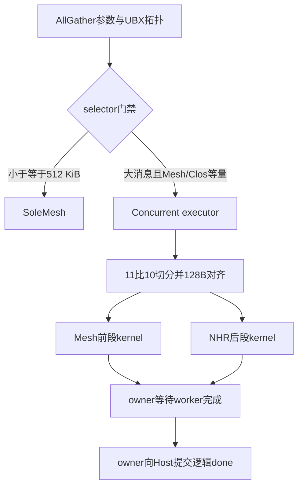
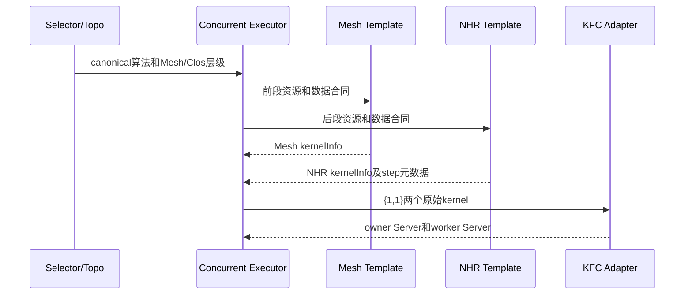
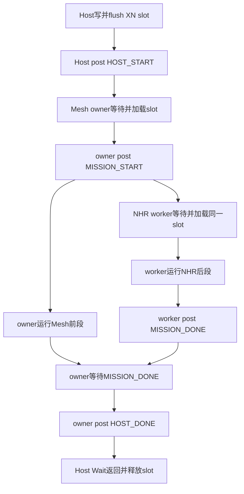
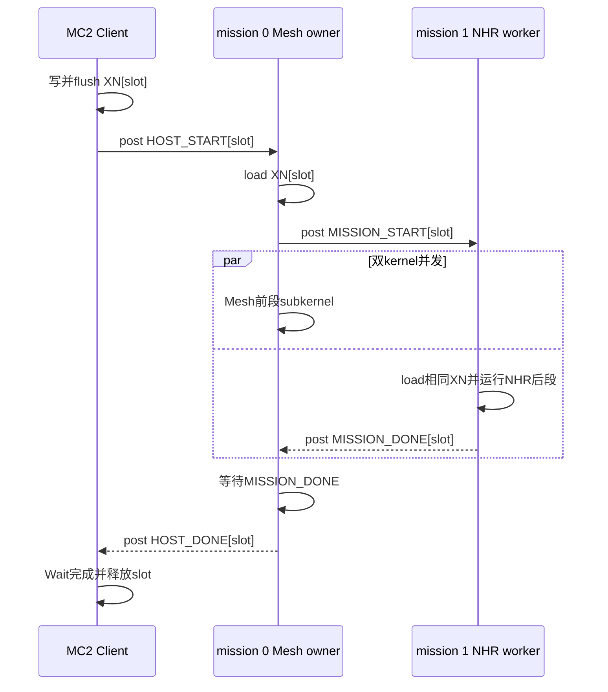
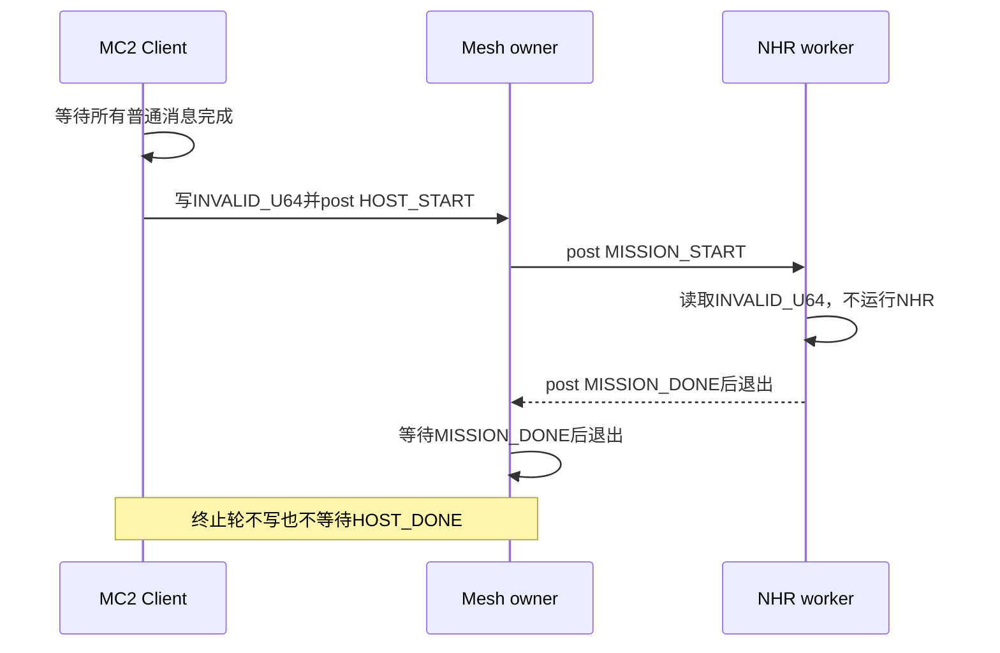
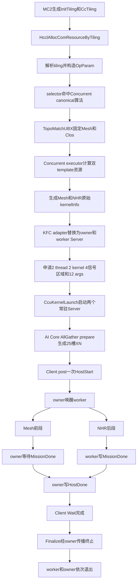
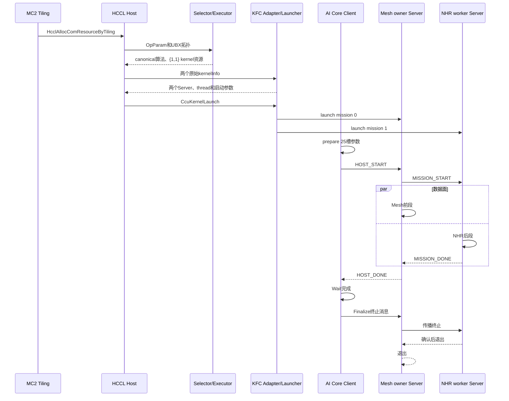

# CcuSchedAllGatherConcurMeshNHRMultiLink详细设计：CCU mission同步

## 文档定位

本文描述分支 `ccuCurMisSyn` 中 `CcuSchedAllGatherConcurMeshNHRMultiLink` 的实际实现。该算法历史名称为
`CcuAllGatherConcurrentMesh1DNHRMem`，生产注册、selector、枚举和测试只使用canonical名称。

本分支保留两个CCU kernel、两个thread和两个常驻KFC Server，但取消“Host双独立队列”原则：mission 0作为
owner消费Host队列，并通过共享HBM信号唤醒mission 1 worker；Host只提交一次start并等待一个逻辑done。

本文是实现级详细设计，覆盖代码来源、函数职责、资源和参数合同、双kernel核心机制，以及从MC2 tiling到两个
kernel完成并退出的E2E路径。

### 基线和范围

**表 1**  基线和范围

| 项目 | 基线 |
| --- | --- |
| asc-devkit分支 | `ccuCurMisSyn` |
| asc-devkit提交 | `902c69ad0` |
| 方案来源分支 | `cc0806_2`，提交 `c1f2a9327` |
| HCCL路径 | `../hccl` |
| HCCL HEAD | `52c9634afbe1d2f7e4e508f5efbe0ee34a2e1f18` |
| 目标架构 | `ascend950pr_9599`、`SocVersion=ASCEND950`、`__NPU_ARCH__=3510` |
| 通信引擎 | CCU Schedule，经MC2/KFC Server运行 |
| 不在范围 | `ascend610`、legacy `all_gather_op`、AICPU新入口、双die和跨Server |

### 代码来源标签

**表 2**  代码来源标签

| 标签 | 含义 |
| --- | --- |
| `[HCCL-SYNC]` | 从上述HCCL基线同步的算法、拓扑、selector或资源语义 |
| `[MC2-KFC]` | HCCL直接launch kernel时不存在，为asc-devkit MC2/KFC机制新增 |
| `[HYBRID]` | HCCL算法语义转换为KFC template或Server可调用subkernel |
| `[TEST]` | 为Host资源、生产Server IR和协议合同新增的验证代码 |

## 算法语义和双kernel边界

### 从HCCL同步的核心语义 `[HCCL-SYNC]`

每rank的数据按CCU Mesh和Clos带宽11:10拆分，Mesh段向下对齐128B：

```text
totalSize = count * dataTypeSize
meshSize  = align_down(totalSize * 11 / 21, 128B)
nhrSize   = totalSize - meshSize
nhrOffset = meshSize
```

- Mesh template通过full-mesh channel处理 `[0, meshSize)`。
- NHR MultiJetty template通过Clos channel处理 `[meshSize, totalSize)`。
- NHR `JETTY_NUM=1`，step数为 `ceil(log2(rankSize))`。
- 两个template各产生一个原始CCU kernel，`ccuKernelNum={1,1}`。
- 两段可以并发，但逻辑AllGather必须等两段均结束。

mission同步只改变两个常驻Server如何接收和聚合一轮任务，不改变数据切分、channel、NHR step和subkernel算法。

### 为什么仍然是双kernel

**表 3**  双kernel资源和角色边界

| 资源 | mission 0：Mesh owner | mission 1：NHR worker |
| --- | --- | --- |
| 原始kernel | `CcuAllGatherMesh1DMem2MemKernel` | `CcuAllGatherNHR1DMultiJettyMem2MemKernel` |
| KFC subkernel | `CcuKfcAllGatherMesh1DMem2MemKernel` | `CcuKfcAllGatherNHR1DMultiJettyMem2MemKernel` |
| thread/Server | 独立 | 独立 |
| 静态资源 | Mesh channel/rank | NHR channel、step、rank映射 |
| 动态参数 | XN索引1-9 | XN索引10-24 |
| 控制职责 | Host入口、worker协调、Host出口 | 跟随owner并回告完成 |

不能把NHR合入Mesh Server串行执行：这会丢失HCCL双template资源边界和并发性能语义。mission同步是在两个
kernel之外增加控制握手，不是把两个kernel合并为一个。

### 算法简化流程图

**图 1**  总体算法简化流程



### 算法泳道图

**图 2**  算法资源生成泳道



## selector、拓扑和executor函数

### selector和拓扑 `[HCCL-SYNC]`

**表 4**  selector和拓扑函数

| 函数 | 作用 | 设计原因 |
| --- | --- | --- |
| `AllGatherAutoSelector::SelectCcuScheduleLevel0Algo` | `MESH_1D_CLOS` 转入UBX选择 | 不影响普通 `MESH_1D` 的SoleMesh路径 |
| `AllGatherAutoSelector::SelectCcuScheduleUBXAlgo` | 拒绝PCIe mix；512 KiB及以下选SoleMesh；大消息、Mesh/Clos等量且rank不超过4时选Concurrent | 双kernel固定开销只用于收益和资源条件成立的场景 |
| `TopoMatchUBX::TopoForLayer0` | 按topology type收集Mesh和Clos rank，固定放入索引0/1 | executor按固定索引绑定两个template，不能依赖输入实例顺序 |

selector外层仍拒绝input/output overlap；不满足门禁时保持既有fallback或 `NOT_MATCH`，不会返回未迁移的
Parallel/Pipeline算法。

### Concurrent executor `[HCCL-SYNC]/[HYBRID]`

**表 5**  Concurrent executor函数

| 函数 | 作用 | 为什么需要 |
| --- | --- | --- |
| `SetChannelsPerRank`两个重载 | AICPU template设置channel，CCU template直接成功 | 用类型特征兼容两种template接口 |
| 构造函数 | 创建executor | 调用相关状态稍后初始化 |
| `InitCommInfo` | 保存rank、dtype、count、type size和层级 | 为资源和切分提供统一输入 |
| `CalcAlgHierarchyInfo` | 执行 `TopoMatchUBX::MatchTopo` | 把物理拓扑转为两个template使用的层级信息 |
| `CalcRes` | 分别计算Mesh/NHR资源并合并thread、notify、kernel/channel | 双template资源不能压扁为一个kernel |
| `GenTemplateAlgParams` | 生成每轮数据基址、offset、stride、slice和repeat | 两段共用结构但offset/count不同 |
| `GetParallelDataSplit` | CCU选择11:10，AICPU保留37:25 | 不同执行引擎使用对应带宽模型 |
| `PrepareResForTemplate` | 按两个template拆分thread和跨template notify | 保持HCCL资源公式，随后映射为两个mission |
| `Orchestrate` | 恢复序列化资源并按 `ccuKernelNum` 拆分两组kernel | fast launch必须保留 `{1,1}` 边界 |
| `OrchestrateLoop` | 计算128B切分、loop/tail和scratch，前同步后交替下发 | 保持HCCL数据语义；两个KFC template当前scratch为0 |
| `REGISTER_EXECUTOR_BY_TWO_TEMPS` | canonical名称绑定UBX、Mesh KFC和NHR KFC template | asc-devkit使用KFC版本，不直接launch HCCL原kernel |

资源合并公式保持HCCL含义：

```text
slaveThreadNum = mesh.slaveThreadNum + nhr.slaveThreadNum + 1
notifyNumOnMainThread = mesh.notifyNumOnMainThread + 1
notifyNumPerThread = mesh.notifyNumPerThread
                   + {nhr.notifyNumOnMainThread + 1}
                   + nhr.notifyNumPerThread
ccuKernelNum = {mesh.ccuKernelNum[0], nhr.ccuKernelNum[0]}
```

## NHR KFC数据面

### NHR template `[HYBRID]`

`CcuTempKfcAllGatherNHR1DMultiJettyMem2Mem` 源自HCCL NHR template语义，但输出供KFC adapter继承的静态
kernelInfo。

**表 6**  NHR KFC template函数

| 函数 | 作用 | 设计原因 |
| --- | --- | --- |
| 构造函数 | 保存param、rank和NHR子通信域，固定jetty为1 | 同步最新HCCL，不沿用旧值4 |
| `CalcRes` | 申请NHR channel，生成step/rank映射并创建一个原始NHR kernelInfo | 先保留真实资源，再由adapter替换控制入口 |
| `CalcNhrInfo` | 生成所有NHR step | 复杂拓扑推导放在Host注册期 |
| `GetStepInfo` | 计算每步to/from rank及tx/rx slice集合 | CCU只消费固定表，减少硬件侧控制复杂度 |
| `RemoteRankIdToSubRank` | 全局rank转子通信域rank | channel和step使用同一rank空间 |
| `KernelRun` | 按template接口生成动态任务 | 与executor接口兼容，实际执行入口是常驻Server |
| `CalcScratchMultiple` | 返回0 | Mem2Mem NHR无需额外scratch |

### NHR subkernel `[HYBRID]`

**表 7**  NHR KFC subkernel函数

| 函数 | 作用 | 与HCCL原kernel的关系 |
| --- | --- | --- |
| `InitResource` | 初始化event、地址和offset变量 | 对应原kernel资源初始化 |
| `PreSync` | 所有NHR channel开始notify握手 | 对应原 `PreSync` |
| `PostSync` | 所有NHR channel结束notify握手 | 对应原 `PostSync` |
| `WriteSlice` | 按jetty写远端并等待event mask | 对应原 `DoSendRecvSlices` 的写与event部分 |
| `RunStep` | 执行一个step的前同步、slice传播和后同步 | 对应原 `DoRepeatAllGatherNHRSingleStep` |
| `RunNhr` | 计算offset、依次执行step、最后放置本地slice | 对应原 `DoRepeatAllGatherNHR` |
| `CcuKfcAllGatherNHR1DMultiJettyMem2MemKernel` | 绑定16个动态参数和静态channel/step后运行完整NHR | HCCL独立kernel入口改为Server可调用函数 |

HCCL原 `ParseKernelArg` 和 `LoadArgs` 被通用KFC Server的静态arg绑定及XN加载替代。数据传输顺序和同步语义
保持不变。

HCCL直接launch template的 `GetNHRStepNum` 已折叠到 `CalcNhrInfo`，`PrepareLaunchArgs`/`FastLaunch` 被共享XN
准备和常驻Server dispatch替代，`GetThreadNum`/`GetRes` 由asc-devkit template基类及序列化资源路径承担。
因此这是生命周期适配，不是遗漏HCCL函数。

### 复用的Mesh KFC数据面 `[HYBRID]`

- `CcuTempKfcAllGatherMesh1DMem2Mem` 构造函数保存param/rank/层级；`CalcRes` 申请Mesh channel并生成一个原始
  kernelInfo；`KernelRun` 生成动态任务；`CalcScratchMultiple` 返回0。
- Mesh subkernel的 `InitResource` 初始化context/event，`LoadArgs` 绑定前段input/output、offset、slice和
  `goSize`。
- `PreSync`/`PostSync` 执行所有Mesh channel的轮次前后notify。
- `DoAllGatherWrite` 写一个remote rank，`DoAllGatherWait` 等待通信，`DoAllGather` 组织远端写和本地slice落位。
- `CcuKfcAllGatherMesh1DMem2MemKernel` 是owner Server调用入口。mission同步只包围该调用，不修改Mesh通信算法。

## 公共MC2/KFC适配

以下内容为 `[MC2-KFC]`。它们在两个分支中基本相同，是把HCCL直接launch转换为MC2常驻Server的基础。

### MC2 tiling和Host资源入口

- `HcclAllocComResourceByTiling`/`HcclAllocComResourceByTilingImpl` 是E2E入口，解析MC2 tiling并按通信引擎路由。
- `BuildTagsAndValidate` 校验tiling列表、算法注册和context tag；`AllocComResourceByTilingCcu` 分配CCU context并
  调用算法选择及资源构造。
- `PrepareParamForAllGather` 把 `Mc2CcTilingInner` 转为AllGather `OpParam`；`InitOpParamByTiling` 补齐stream、tag、
  engine和执行模式。
- `SelectCcuAlgorithm` 调用生产selector并取得canonical名称；`FillCcuAlgorithmInfo` 把名称和枚举写入context。
- `PrepareCcuAlgorithmResource` 计算层级和算法资源；`ProcessCcuTiling` 串起单个tiling的选择、记录和申请。
- `CcuSelectAlg` 处理整个tiling列表并建立协议版本3的KFC cache identity；目标算法执行单tiling、单算法门禁。
- 返回的 `OpResCtx` 包含两个thread、两个Server kernel、XN/CKE地址和两组启动参数，不经过legacy
  `all_gather_op`。

### 协议、资源和cache

**表 8**  公共协议和资源函数

| 文件/函数 | 作用 | 设计原因 |
| --- | --- | --- |
| `kfc_server_protocol.h` | 定义六字段启动参数、最多2 mission、role、`KfcNhrStepInfo` 和协议版本3 | Host、Server和cache共享单一合同；版本3隔离mission同步ABI |
| `GetKfcServerMissionNum` | Concurrent返回2，其余返回1 | 单mission算法继续走旧路径 |
| `GetKfcServerRole` | index 0为Mesh，index 1为NHR | role在注册期固定，运行时无需猜测 |
| `BuildKfcServerCacheHash` | hash协议版本、algTag、算法名、mission数、有序role和opId | 防止SoleMesh、双队列和mission同步Server串用 |
| `AllocCcuOpResCtx` | 分配四个512B信号区域 | Host一对加mission一对，区域数量与双队列方案相同但语义不同 |
| `AcquireAlgResources` | 生成两组六字段启动参数 | 两个Server共享XN/CKE/token但拥有不同mission index |
| `CcuSelectAlg` | 禁止Concurrent与其他tiling混合并生成cache tag | 当前25槽布局只定义该逻辑消息 |
| `UpdateCcuCtxTokenOnReuse` | cache复用时更新两组token | 避免第二个Server持有旧buffer token |
| `HcclAllocAlgResourceCcu` | 首次申请后更新所有mission token | 首次与复用路径合同一致 |
| `HcclGetThread` | KFC保留 `slaveThreadNum+1` 个thread | 两个Server必须各占一个CCU thread |

### KFC adapter和launcher

**表 9**  KFC adapter和launcher函数

| 函数 | 作用 | 设计原因 |
| --- | --- | --- |
| `InheritKfcServerKernelArg` | 继承原始kernel channel、rank、role、opParam和NHR step映射 | 动态XN只放每轮参数，拓扑资源在Server注册期固化 |
| `CcuTempKfcServer::CalcRes` | 校验kernel数等于mission数，逐个替换为Server，并设置一个slave thread | 修复旧逻辑只替换最后一个kernel导致Mesh未执行的问题 |
| `CcuTempKfcServer::KernelRun` | 提供统一template运行入口 | 接入既有executor/KFC框架 |
| `CcuTempKfcServer::CalcScratchMultiple` | 返回控制面无额外scratch | 不改变两个数据面scratch核算 |
| `GetLaunchMissionNum` | 校验mission、12个args、thread和kernel数量 | 启动前阻止不完整双kernel资源 |
| `LogKernelLaunchArgs` | 分mission打印六字段参数 | 排查index、地址、token错配 |
| `CcuKernelLaunch` | 顺序启动两个常驻Server | 启动顺序不等于任务串行；Server常驻后由内部握手并发 |

### 25槽共享XN ABI

**表 10**  25槽共享XN ABI

| 索引 | 字段 | 消费者 |
| --- | --- | --- |
| 0 | opId | owner和worker dispatch |
| 1-4 | Mesh input、output、output offset、slice size | Mesh owner |
| 5-8 | Mesh `goSize[0..3]` | Mesh owner |
| 9 | Mesh input/output equal | Mesh owner |
| 10-14 | NHR input、output、slice、per-jetty和last-jetty size | NHR worker |
| 15 | NHR `repeatNumInv` | NHR worker |
| 16-19 | NHR slice/repeat strides | NHR worker |
| 20 | NHR input/output equal | NHR worker |
| 21-24 | NHR `goSize[0..3]` | NHR worker |

`CcuPrepareForConcurrentAllGatherM2M` 在AI Core MC2 client侧完成11:10切分、128B对齐、repeat offset、默认或
非零stride和 `goSize` 计算。两个Server在同一轮读取同一个只读XN槽，避免复制参数和引入一致性问题。

## mission同步双kernel机制

### 角色和四区域信号ABI `[MC2-KFC]`

`kfc_server_message.h` 新增 `KfcServerSignalRegion`：

**表 11**  mission同步信号区域

| 区域 | 地址 | 写方 | 读方 | 含义 |
| --- | --- | --- | --- | --- |
| 0 `HOST_START` | `ckeAddr + 0*512 + slot*8` | Host | Mesh owner | 新逻辑消息可执行 |
| 1 `HOST_DONE` | `ckeAddr + 1*512 + slot*8` | Mesh owner | Host | Mesh和NHR均已完成 |
| 2 `MISSION_START` | `ckeAddr + 2*512 + slot*8` | Mesh owner | NHR worker | worker读取同一slot并开始 |
| 3 `MISSION_DONE` | `ckeAddr + 3*512 + slot*8` | NHR worker | Mesh owner | worker完成或已确认终止 |

每区域64个8B槽。`KFC_SERVER_PROTOCOL_VERSION` 从2提升为3，并通过static assert保证四区域与最多2 mission
的布局一致。

### Server函数级设计 `[MC2-KFC]`

**表 12**  mission同步Server函数

| 函数 | 作用 | mission同步行为和原因 |
| --- | --- | --- |
| `ParseKernelArg` | 绑定注册期静态arg | role决定owner、worker或默认路径 |
| `InitResource` | 资源初始化占位 | 不新增硬件资源申请，控制新增仅使用已有HBM和Load/Store |
| `LoadArgs` | 装载六个启动参数 | 两个Server得到同一共享地址和各自index |
| `CompArgs` | 计算Host start/done和mission start/done基址 | 两个role都掌握内部握手地址；只有owner消费Host地址 |
| `WaitTurnStartSig` | 轮询信号1并清零 | 同时用于HostStart、MissionStart和MissionDone |
| `SetTurnEndSig` | 写信号值 | 同时用于MissionStart、MissionDone和HostDone |
| `MissionPreSync` | Mesh role写MissionStart；NHR role等MissionStart | owner在运行Mesh前先唤醒worker，保留并发 |
| `MissionPostSync` | Mesh role等MissionDone；NHR role写MissionDone | owner只有拿到worker完成证据才向Host完成 |
| `LoadFuncParamFromMemory` | 从当前XN槽加载32个参数 | 两端在握手后读取同一slot |
| `DispatchKfcSubKernel` | 用opId和静态role分派Mesh/NHR | 相同opId由role区分两个数据面 |
| `KfcServerGenCircularQueue` | 默认单mission算法旧循环 | `DEFAULT` role仍走该函数，不受新协议影响 |
| `MasterKfcServerGenCircularQueue` | owner等待Host、加载参数、唤醒worker、运行Mesh、等worker、写HostDone并推进槽 | 集中管理Host可见完成和槽复用 |
| `SlaveKfcServerGenCircularQueue` | worker等待owner、加载同槽、运行NHR、回告并推进槽 | 不读取Host信号，避免两个Server竞争HostStart |
| `CcuKfcServerKernel` | 按静态role选择master、slave或默认循环 | 新机制只作用于目标双kernel算法，单mission算法不回归 |

### 正常轮次核心流程图

**图 3**  mission同步双kernel正常轮次流程



### 正常轮次核心泳道图

**图 4**  mission同步双kernel正常轮次泳道



owner在Mesh dispatch之前发送 `MISSION_START`，因此内部同步不会把NHR强制排到Mesh之后。owner完成Mesh较早时
等待worker；worker较早时MissionDone保留在HBM中，owner随后读取并清零。

### 终止和64槽回绕

`Finalize` 的 `INVALID_U64` 也使用同一握手：

**图 5**  mission同步终止轮次泳道



owner和worker各自维护 `paramAddr`、`queueIdx`，每次内部握手完成后同时加1，到64回到 `xnAddr`。Host只有收到
owner的 `HOST_DONE` 才复用slot；而owner写HostDone前已经确认worker完成，因此槽生命周期由owner统一闭合。

## Client单start/单done设计

**表 13**  mission同步Client函数

| 函数 | 作用 | 相对双队列分支的变化 |
| --- | --- | --- |
| `CcuPrepareForOp` | 为目标算法选择25槽prepare | 不变 |
| `CcuPrepareForConcurrentAllGatherM2M` | 生成Mesh/NHR共享参数 | 不变，控制协议不侵入数据合同 |
| `GetCommitCkeAddr` | 返回区域0的HostStart slot | 移除mission index和mission循环 |
| `GetWaitCkeAddr` | 返回区域1的HostDone slot | Host只观察owner聚合后的逻辑完成 |
| `CcuSendMsg` | 写一次XN并post一次HostStart | 不再向NHR Server直接post |
| `Wait` | 只轮询一个HostDone | worker尚未完成时owner不会写该done |
| `Finalize` | 写终止参数并只post owner | owner负责传播和等待worker退出确认 |

Host侧简化的代价是CCU新增一次MissionStart写、一次MissionDone写和对应HBM轮询。该权衡必须通过真机A/B测试
判断，不能从Host调用次数直接推导总性能更好。

## 从MC2 tiling到双kernel结束的E2E设计

### E2E流程图

**图 6**  mission同步E2E流程



### E2E泳道图

**图 7**  mission同步E2E泳道



## 文件和函数归属总表

### 生产代码

**表 14**  生产代码来源和作用

| 文件 | 标签 | 作用 |
| --- | --- | --- |
| `all_gather/selector/all_gather_auto_selector.cc` | `[HCCL-SYNC]` | UBX选择和消息/rank门禁 |
| `op_common/topo/topo_match_ubx.cc` | `[HCCL-SYNC]` | Mesh/Clos稳定排序 |
| `all_gather/executor/ins_v2_all_gather_concurrent_executor.cc` | `[HCCL-SYNC]/[HYBRID]` | 双template资源、切分和KFC注册 |
| `all_gather/template/ccu/ccu_temp_kfc_all_gather_nhr_1D_multi_jetty_mem2mem.{cc,h}` | `[HYBRID]` | NHR channel、step和静态kernelInfo |
| `all_gather/template/ccu/kernel/ccu_kernel_kfc_all_gather_nhr1d_multi_jetty_mem2mem.{cc,h}` | `[HYBRID]` | NHR Server可调用subkernel |
| AllGather template/kernel `CMakeLists.txt` | `[MC2-KFC]` | 新代码进入生产构建 |
| `common/kfc_server_protocol.h` | `[MC2-KFC]` | 协议版本3、mission、role、step ABI |
| `common/kfc_server_config.h` | `[MC2-KFC]` | 双mission cache身份 |
| `common/hccl_alloc_ctx_res.{cc,h}` | `[MC2-KFC]` | 枚举、4区域、双启动参数和context门禁 |
| `common/hccl_mc2.cc` | `[MC2-KFC]` | 两个Server资源校验和launch |
| `op_common/op_common.cc` | `[MC2-KFC]` | 双thread和每mission token |
| `kfc_server/template/ccu/ccu_temp_kfc_server.cc` | `[MC2-KFC]` | 两个原始kernel逐一替换为Server |
| `kfc_server/template/ccu/kernel/ccu_kernel_kfc_server.{cc,h}` | `[MC2-KFC]` | master/slave/default队列和role dispatch |
| `common/kfc_server_message.h` | `[MC2-KFC]` | 25槽参数和四信号区域枚举 |
| `ccu/hccl_ccu_v0_prepare.h` | `[MC2-KFC]` | 25槽参数生成 |
| `impl/platform_v310/hccl_ccu_v0.{h,_def.h}` | `[MC2-KFC]` | Host单start/单done和Finalize |
| `common/hccl_inner_def.h` | `[MC2-KFC]` | device算法枚举 |
| `impl/adv_api/tiling/hccl/hccl_tiling.cpp` | `[MC2-KFC]` | MC2算法allowlist |

Mesh KFC subkernel沿用SoleMesh迁移成果；本算法以新的分段参数和Mesh role调用它，没有复制一套Mesh实现。

### 分支特有测试 `[TEST]`

**表 15**  mission同步分支特有测试

| 文件/用例 | 验证内容 |
| --- | --- |
| `ConcurrentMissionSyncUsesFourFixedSignalRegions` | 协议版本3及HostStart/HostDone/MissionStart/MissionDone固定枚举 |
| `concurrent_owner_and_worker_generate_mission_sync_ir` | 捕获生产owner/worker IR，检查Load/Store/While结构差异 |
| `KfcServerTestRole` 和 `KfcServerKernelConfig::role` | 测试adapter可分别注册owner与worker |
| `CaptureKfcServerKernel` 的role绑定 | 测试配置与生产 `KfcServerRole` 数值一致 |

公共Host用例还覆盖selector阈值、cache隔离、2 thread、2 kernel、`{1,1}`、12个Server参数、相同token、两次
Server launch和混合context拒绝。`hcomm_ccu_stub.cc` 记录每次launch；`hccl_op_common_stub.cc` 模拟双mission
资源；device shim和link stub使生产Server/NHR源码进入IR专项目标。

## 验证结果和结论边界

**表 16**  当前验证结果和边界

| 目标 | 当前分支记录 | 结论边界 |
| --- | --- | --- |
| `mc2_client` | 构建通过 | client/Server协议进入生产构建 |
| `ascendc_ut_adv_api_hccl_ccu_mc2` | 30/30通过 | 公共资源和枚举回归 |
| `ascendc_ut_adv_api_hccl_ccu_mc2_host` | 37/37通过 | selector、资源、双mission和信号ABI |
| `ascendc_ut_adv_api_hccl_ccu_mc2_device` | 19/19通过 | owner/worker生产IR可生成 |
| `ascendc_ut_adv_api_hccl_cc_algorithm_ascend950pr_9599_AIC` | 86/86通过 | 目标架构算法编译回归 |
| 真实CCU | 未执行 | 不声明数据正确性、稳定性、并行度和性能通过 |

必须在真机覆盖rank 2/4、512 KiB阈值、128B边界、支持dtype、tail、多repeat、默认/非零stride、64槽回绕、
长时间运行、Finalize退出、owner先完成/worker先完成两种时序和故障场景。

## 风险和门禁

**表 17**  风险和验证门禁

| 风险 | 控制或门禁 |
| --- | --- |
| owner先写HostDone导致worker仍在访问slot | `MasterKfcServerGenCircularQueue` 必须先完成 `MissionPostSync` |
| worker读错slot | owner/worker每轮内部握手后同步递增并在64回绕；真机长稳确认 |
| 终止只退出owner | 终止也发送MissionStart并等待MissionDone |
| 单mission算法误入新路径 | 只有Mesh/NHR静态role走master/slave，DEFAULT走旧循环 |
| worker异常使owner永久等待 | 依赖运行时/硬件异常机制，必须做故障和超时验收 |
| 内部HBM轮询抵消Host收益 | 与 `cc0806_2` 同条件A/B测试 |
| CCU寄存器或指令资源增加 | device IR/编译检查加真机注册门禁 |
| 旧协议Server cache复用 | 协议版本3进入cache hash |
| Host/device UT被误当作正确性 | 完整结果、并行证据和性能只由真机验收 |

## 与Host双队列分支对比及选择建议

**表 18**  两个分支的核心差异

| 维度 | `cc0806_2` Host双独立队列 | `ccuCurMisSyn` mission同步 |
| --- | --- | --- |
| Host start/done | 两个start、等待两个done | 一个HostStart、等待一个HostDone |
| CCU mission关系 | 相互独立 | mission 0 owner等待mission 1 worker |
| 四区域语义 | Mesh start/done、NHR start/done | Host start/done、mission start/done |
| 逻辑完成聚合 | Host | Mesh owner |
| 终止传播 | Host分别通知两个Server | owner通知worker并等待确认 |
| CCU控制复杂度 | 低 | 较高，多一次内部往返握手 |
| Host负担 | 较高 | 较低 |
| 独立可观测性 | Host可分别看到两个done | Host只看到聚合done |
| 协议版本 | 2 | 3 |

选择建议：

1. 在“Host优先、特殊CCU硬件尽量简单”的工程约束下，默认选择 `cc0806_2`。它没有mission间依赖，故障域和
   控制流更直接。
2. 当真机证明Host双start/双done是明确瓶颈，并且本分支的内部HBM轮询、寄存器占用、长稳和异常退出全部满足
   门禁时，选择 `ccuCurMisSyn` 可获得单一Host完成点和更内聚的槽生命周期。
3. 两个分支的client、Server和cache协议必须成套使用，不能混搭版本2和版本3。
4. 最终决策应比较相同rank、dtype、消息大小、repeat和stride下的带宽、P50/P99时延、64槽长稳、Finalize、
   故障恢复和双kernel实际并行证据，不能只看Host API调用次数或IR静态数量。
