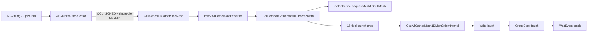
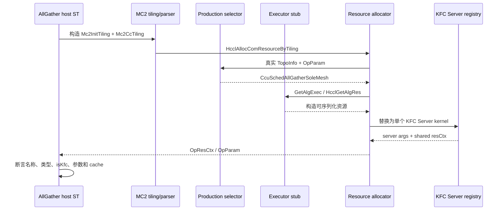

# CcuSchedAllGatherSoleMesh 迁移方案与实施结果

## 1. 文档目的

本文记录将 HCCL 最新 `CcuSchedAllGatherSoleMesh` 同步到 asc-devkit MC2/KFC Server 架构的方案、实际实现和验证结果。

## 2. 基线与范围

| 项目 | 基线 |
| --- | --- |
| HCCL 仓 | `/mnt/c/data/gitcodes/hccl` |
| HCCL 分支与 revision | `master`，`94b7a598443d` |
| HCCL 更新状态 | 已执行 `git pull --ff-only`，与 `origin/master` 一致 |
| asc-devkit 仓 | `/mnt/c/data/gitcodes/asc-devkit` |
| asc-devkit 分支与 revision | `cc0806_2`，`97d5ca108aeed3471820dd6517f29d0cb0a2c789` |
| 目标芯片 | Ascend 950PR / Ascend 950DT |
| 统一调用名 | `ascend950pr_9599` |
| 架构 | `SocVersion=ASCEND950`，`__NPU_ARCH__=3510` |
| 引擎 | CCU，MC2 KFC Server 路径 |
| 拓扑范围 | 单层、单 die、`MESH_1D` |

明确不包含：双 die、`MESH_1D_CLOS`/UBX、多层/跨框、NHR、AIV、DPU、HalfAllToAllV，以及 CCU device 仿真结论。

实施前按 skill 要求更新了 HCCL。更新到 `94b7a598443d` 的增量只涉及 AllToAllV 和 AICPU task cache clear，与本次 CCU AllGather 无关；因此 AllGather 同步基线未发生二次漂移。

## 3. 名称结论

HCCL 最新 canonical 注册名准确为：

```text
CcuSchedAllGatherSoleMesh
```

不是 `CCUSchedAllGatherSolMesh`。重命名来自 HCCL 提交 `6375b0b8 refactor: unify collective op algorithm registration naming`。

| 层次 | 历史名称 | HCCL 最新名称/实现 |
| --- | --- | --- |
| 注册算法名 | `CcuAllGatherMesh1DMem2Mem` | `CcuSchedAllGatherSoleMesh` |
| Executor | `InsV2AllGatherSoleExecutor` | 未改名 |
| 原生 template | `CcuTempAllGatherMesh1DMem2Mem` | 未改名 |
| 原生 kernel | `CcuAllGatherMesh1DMem2MemKernel` | 未改名 |
| asc-devkit KFC template | `CcuTempKfcAllGatherMesh1DMem2Mem` | 本地适配类，保留 |
| asc-devkit KFC 子 kernel | `CcuKfcAllGatherMesh1DMem2MemKernel` | 本地适配类，保留 |

结论：必须同步对外注册名和所有字符串合同，但不应为了表面一致强制重命名 HCCL 未改名的 template/kernel 类，也不能用 HCCL 原生 kernel 覆盖 KFC 子 kernel。

## 4. 两套执行链的本质差异

### 4.1 HCCL 原生执行链



### 4.2 asc-devkit 当前 KFC 执行链

```mermaid
flowchart LR
    A[Mc2InitTiling + Mc2CcTiling] --> B[HcclAllocComResourceByTiling]
    B --> C[AllGatherAutoSelector]
    C --> D[InsV2AllGatherSoleExecutor]
    D --> E[CcuTempKfcAllGatherMesh1DMem2Mem]
    E --> F[生成原始 CCU kernel 资源]
    F --> G[CcuTempKfcServer 替换末端 kernel]
    G --> H[CcuKfcServerKernel 常驻队列]
    H --> I[DispatchKfcSubKernel 按 opId 分派]
    I --> J[CcuKfcAllGatherMesh1DMem2MemKernel]
```



asc-devkit 的设计不是“一次 AllGather 注册一个独立 CCU kernel”，而是一个 MC2 context 注册一个常驻 KFC Server。Server 根据有序 opId 集合生成 dispatch IR，再从共享队列接收每条 mission 的动态参数。因此迁移必须保留以下本地机制：

- `kfc_server_config.h` 的 opId 和 cache hash。
- `CcuTempKfcServer` 对原算法末端 kernel 的继承与替换。
- `DispatchKfcSubKernel` 中基于 `CCU_IF` 的设备 IR 分支。
- `CcuPrepareForAllGatherM2M` 与 KFC 子 kernel 的参数顺序合同。

## 5. 最新 HCCL 变化分类

### 5.1 必须同步

1. canonical 注册名从 `CcuAllGatherMesh1DMem2Mem` 改为 `CcuSchedAllGatherSoleMesh`。
2. `CCU_MS` 和 `CCU_SCHED` 的语义分离：本目标是 schedule/Mem2Mem 算法，不得继续伪装成 MS 算法。
3. rank event 每 16 rank 分组，正确生成最后一组 event mask。
4. 数据阶段保持 `Write -> GroupCopy -> WaitEvent`，避免逐 rank 串行等待。
5. `sliceSize == 0` 时仍完成前后同步，但不做数据搬运。
6. rank、channel 数以及 `rankId` 合法性检查。
7. input/output 相同时不应执行破坏性的重复本地复制。
8. tiling、algorithm map、forced algorithm、测试期望和文档中的名称合同。

### 5.2 需要按 KFC 合同适配，不能直接复制

HCCL 原生 kernel 支持最多 16 个 repeat 的一次 kernel 内展开，并使用 15 个动态参数；asc-devkit 当前由 MC2 client 将 repeat 拆成多条 mission，每条 mission 使用 10 个动态字段。二者的执行粒度不同。

| HCCL 原生参数 | KFC mission 对应关系 | 第一阶段处理 |
| --- | --- | --- |
| input | XN1 | client 已加当前 repeat 输入偏移 |
| output | XN2 | client 已加当前 repeat 输出偏移 |
| token | KFC Server 固定参数 | Server 统一传入 |
| current rank input offset | 已折入 XN1 | 不再单独传递 |
| current rank output offset | XN3 | 按 rank 和 stride 计算 |
| tmp repeat num | `CommitMsgInner` 拆 mission | 单 mission 内不循环 repeat |
| input repeat stride | 已折入 XN1 | 不再单独传递 |
| output repeat stride | 已折入 XN2 | 不再单独传递 |
| normal slice size | XN4 | 单 mission 的真实 slice size |
| last slice size | client 侧确定本 mission 大小 | 不再单独传递 |
| is input/output equal | XN9 | client 比较当前 mission 输入地址与本 rank 输出 slice 地址 |
| 4 个 GroupCopy goSize | XN5-XN8 | 原顺序传入 |

`CommitMsgInner` 对 `handleRepeatCnt_` 循环，每个 repeat 设置 `ccuParam_.repeatIndex`，调用 `CcuPrepareForAllGatherM2M` 后发送一条队列消息。此时 input/output 地址已经加上 repeat offset，不能再把 HCCL 的 `AG_UNROLL_NUM=16` 原样放入 KFC 子 kernel，否则同一 repeat 会被重复执行。

### 5.3 当前范围内不迁移

- `CcuMSAllGatherSoleMesh` 及其非 Mem2Mem template。
- 双 die 的 `CcuSchedAllGatherSoleMesh2Die`。
- UBX/Clos、NHR、多 link、多层和 960 专用分支。
- 已由 HCCL HEAD 回退的 cost model 代码。
- `CalcChannelRequestMesh1DFullMesh` 所需的跨框 flatten 依赖闭包。

### 5.4 当前 KFC 实现与 HCCL 最新实现的差距

HCCL 相关性能和正确性演进可追溯到 `8f02c9d4`、`3470bdd0`、`314e08ef`、`72b350cb`、`3b8897de` 和 `5149f461` 等提交。迁移时应以当前 HEAD 源码为最终事实，不按单个历史提交整包复制。

| 能力 | asc-devkit 当前状态 | 第一阶段动作 |
| --- | --- | --- |
| 每 16 rank 一个 event | 已具备 | 增加 rank 17 和上限测试 |
| Write、GroupCopy、Wait 三阶段 | 单 mission 已具备 | 与 HCCL 单 repeat 逐段复核 |
| 零 slice 前后同步 | 已具备 | 增加 count 0 测试 |
| rank/channel 合法性检查 | 已具备且比原生检查更严格 | 保留并补错误路径测试 |
| input/output 相等时跳过本地 copy | 已新增 XN9 显式传递 equality | 子 kernel 在 XN9 为 1 时跳过本地 GroupCopy |
| normal/last slice | 固定 AllGather mission 只有一个等长 slice | 保持 client 侧合同，补边界测试 |
| repeat/stride | client 拆成逐 repeat mission 并提前计算地址 | 不在子 kernel 重复展开 |
| 最多 16 repeat 的批量 Write/Copy/Wait | 未具备 | 第二阶段协议级优化 |
| 真实生产 selector ST | 已新增，直接编译并调用 `AllGatherAutoSelector` | 已覆盖 SCHED、MS fallback 和拓扑/overlap 拒绝 |
| 真实生产 executor/template ST | host 资源流仍使用 executor 桩 | 生产构建验证编译链接闭包，device 行为留待真机 |

## 6. 第一阶段实施方案

### 6.1 注册名与类型合同

全链路使用 `CcuSchedAllGatherSoleMesh`，删除生产代码、tiling 和测试断言中的旧字符串。内部 `AlgorithmType` 建议同步改为可识别的新符号，并显式固定数值为 `1`：

```cpp
CcuSchedAllGatherSoleMesh = 1
```

host 和 device 侧两个重复枚举必须同时更新，但不得顺带重排其他算法值。`algorithmType=1` 是现有 MC2 host/device 合同，名称同步不能造成 ABI 数值变化。

### 6.2 Selector

`AllGatherAutoSelector` 按以下规则收敛：

1. `SelectCcuMsAlgo` 对本算法返回 `NOT_MATCH`。
2. 复用 `AutoSelectorBase` 已有 `CCU_MS -> CCU_SCHED` fallback。
3. `SelectCcuScheduleAlgo` 只在 `topoLevelNums == 1`、`level0Topo == MESH_1D`、`level0MeshType == SINGLE_DIE`、input/output 非 overlap 时返回 `CcuSchedAllGatherSoleMesh`。
4. 多层、双 die、Clos/UBX 和 overlap 均返回 `NOT_MATCH`，不得以 schedule Mesh 算法兜底。
5. forced `algConfig=CcuSchedAllGatherSoleMesh` 必须走真实资源检查；旧 forced 名称不保留隐式 alias。

这一调整修复了当前 asc-devkit 在 `CCU_MS` 和 `CCU_SCHED` 两条路径都返回 Mem2Mem 算法的语义偏差。

### 6.3 Executor 与 KFC template

- `REGISTER_EXEC_V2` 的注册 token 改为 `CcuSchedAllGatherSoleMesh`。
- executor 继续使用 `InsV2AllGatherSoleExecutor`。
- template 继续使用 `CcuTempKfcAllGatherMesh1DMem2Mem`，保留 KFC placeholder 和末端 kernel 替换。
- `CalcRes` 继续申请一个逻辑 AllGather CCU kernel、`rankSize - 1` 条 peer channel 和对应 XN/CKE/event 资源。
- 检查 template 传入 KFC Server 的 kernel 名称校验，确保新注册名不影响原始 kernel 类型识别。

### 6.4 Channel helper 决策

HCCL 最新普通 Mesh 路径使用 `CalcChannelRequestMesh1DFullMesh`，asc-devkit KFC template 当前使用 `CalcChannelRequestMesh1D`。

第一阶段保留 `CalcChannelRequestMesh1D`，原因是当前限定单层、单 die，两个 helper 在有效范围内应得到同一组 full-mesh peer channel；直接迁移 `CalcChannelRequestMesh1DFullMesh` 会引入跨框统一选层及 `ProcessFlattenLink` 等双 die/多层依赖，超出本次范围。

该决策不是永久差异。若后续放开多层、跨框或双 die，必须完整迁移 `CalcChannelRequestMesh1DFullMesh` 的依赖闭包，并删除当前等价性假设。

### 6.5 KFC 子 kernel 数据面

以“单 mission 与 HCCL 单次 repeat 等价”为标准审核和整理 `CcuKfcAllGatherMesh1DMem2MemKernel`：

1. 校验 `rankSize > 0`、`rankId < rankSize`、`channelCount + 1 == rankSize`。
2. 按 16 rank 一组创建 event，并正确计算尾组 mask；覆盖 rank 17 以证明跨 event 分组。
3. `PreSync` 交换本 rank output 地址与 token。
4. 先向所有远端 rank 下发非阻塞 Write。
5. 对本 rank 执行 GroupCopy；input/output 同地址时必须跳过或证明 no-op 安全。
6. 最后批量 WaitEvent。
7. `sliceSize == 0` 时只执行 `PreSync/PostSync`。
8. 保持 XN1-XN8 原顺序不变，新增 XN9 传递 `isInputOutputEqual`；client、Server dispatch 与子 kernel 三处顺序一致。

第一阶段不在子 kernel 内新增 repeat 循环，也不分配 `16 * eventNum` 个 event。

### 6.6 KFC Server 与 cache

- `DispatchKfcSubKernel` 的 AllGather 分支保持以 `BuildKfcOpId` 结果匹配，并将 10 个 AllGather 参数传给子 kernel。
- `BuildKfcServerCacheHash` 继续覆盖 `algTag` 和有序 opId 列表，算法改名后验证 cache tag 变化符合预期。
- 一个 MC2 context 内多 primitive 仍共享一个 KFC Server，不能为 AllGather 恢复已删除的独立 `kfc_server_op.cc/.h`。
- 不新增 `all_gather_op.cc/.h` legacy host 入口；测试从 MC2 tiling 开始。

## 7. 逐文件修改清单

### 7.1 生产代码

| 文件 | 计划修改 |
| --- | --- |
| `impl/adv_api/detail/hccl/cc/src/ops/all_gather/selector/all_gather_auto_selector.cc` | 区分 MS/SCHED，收紧拓扑门禁，返回新名称 |
| `impl/adv_api/detail/hccl/cc/src/ops/all_gather/executor/ins_v2_all_gather_sole_executor.cc` | 注册名改为新名称，继续绑定 KFC template |
| `impl/adv_api/detail/hccl/cc/src/common/hccl_alloc_ctx_res.h` | 更新 `AlgorithmType` 符号和 `algorithmMap` key，数值保持 1 |
| `impl/adv_api/detail/hccl/impl/platform_v310/hccl_ccu_v0_def.h` | 同步 device 侧 `AlgorithmType` 符号，数值保持 1 |
| `impl/adv_api/tiling/hccl/hccl_tiling.cpp` | `REGISTERED_CCU_ALGORITHMS` 改用新名称，保证进入 version 101 tiling |
| `impl/adv_api/detail/hccl/cc/src/ops/all_gather/template/ccu/ccu_temp_kfc_all_gather_mesh_1D_mem2mem.{h,cc}` | 审核资源、channel 和 kernel replacement 合同；不机械覆盖 |
| `impl/adv_api/detail/hccl/cc/src/ops/all_gather/template/ccu/kernel/ccu_kernel_kfc_all_gather_mesh1d_mem2mem.{h,cc}` | 同步单 mission 数据面正确性增强 |
| `impl/adv_api/detail/hccl/cc/src/ops/kfc_server/template/ccu/kernel/ccu_kernel_kfc_server.cc` | 审核 AllGather dispatch 参数顺序和新 opId 配置可达性 |
| `impl/adv_api/detail/hccl/cc/src/common/kfc_server_config.h` | 审核名称变更后的 opId/cache 合同，无必要不改编码格式 |
| `impl/adv_api/detail/hccl/ccu/hccl_ccu_v0_prepare.h` | XN1-XN8 保持原序，新增 XN9 传递地址相等标志 |
| `impl/adv_api/detail/hccl/impl/platform_v310/hccl_ccu_v0.h` | AllGather 使用动态 XN 数从 9 增至 10，repeat 仍拆为逐 mission |

### 7.2 测试与桩

至少同步以下旧名称使用点：

```text
tests/api/adv_api/tiling/test_hccl_tiling.cpp
tests/api/adv_api/hccl/ccu/test_ccu_mc2.cpp
tests/api/adv_api/hccl/ccu/stub/hccl_proxy/hccl_op_common_stub.cc
tests/api/adv_api/hccl/cc/st/algorithm/utils/src/mc2_ccu/hccl_op_common_stub.cc
```

新增 AllGather 专项 CCU host ST：

```text
tests/api/adv_api/hccl/cc/st/algorithm/testcase/mc2_ccu/host/all_gather_mc2_host_testcase.cpp
```

并将其接入：

```text
tests/api/adv_api/hccl/cc/st/algorithm/testcase/mc2_ccu/CMakeLists.txt
```

## 8. ST 方案

### 8.1 测试真实性分层

当前 `mc2_ccu` host ST 的 `hccl_op_common_stub.cc` 会替代统一入口 `ExecuteSelector` 和 executor `CalcRes`。它适合验证 MC2/KFC 公共资源合同，但不能证明生产 executor、template 和 kernel replacement 在 CCU 上执行。新增目标同时直接编译并调用真实 `AllGatherAutoSelector`，因此生产 selector 的条件分支不依赖固定算法名桩。

因此测试必须拆为两类：

1. 公共合同测试：允许使用现有桩，验证 tiling 解析、opId、cache、workspace、XN/CKE、Server 共享和参数序列化。
2. 生产 selector 测试：直接调用真实 `AllGatherAutoSelector`，验证 `CCU_SCHED` 命中、`CCU_MS` fallback、双 die 和 overlap 拒绝。executor/template/KFC 子 kernel 由 `mc2_client` 生产构建验证编译链接闭包，device 行为留给真机。

### 8.2 MC2 E2E host 流程



### 8.3 必测用例

| 类别 | 用例与断言 |
| --- | --- |
| 名称 | auto selector 和 forced selector 均得到 `CcuSchedAllGatherSoleMesh`；旧名不再可用 |
| 引擎 | `CCU_SCHED` 直接命中；`CCU_MS` 对本算法先不匹配再 fallback 到 SCHED |
| 拓扑 | 单层单 die Mesh1D 成功；双 die、多层、Clos/UBX、overlap 拒绝 |
| rank/资源 | rank 2、4、8、16、17；验证 MC2 rankSize、单 Server 注册和资源序列化 |
| 数据边界 | host ST 不执行 CCU 数据面，count、对齐、stride 留待硬件测试 |
| repeat | host ST 不执行 CCU mission 消费，逐 repeat 地址与吞吐留待硬件测试 |
| 资源 | `algorithmType == 1`、`isKfc == true`、只注册一个 KFC Server kernel |
| Server 参数 | `xnAddr`、`ckeAddr`、`dieNum`、`missionNum`、`missionIndex`、`token` 六项顺序 |
| opId/cache | AllGather dtype 进入 opId；相同配置共享，不同有序 op 集不错误复用 |
| 错误路径 | null/空 tiling、非法 engine、未注册算法、rank/channel 不一致 |

CCU 无仿真器时，这些用例只能声明 host 控制面通过，不能声明 CCU device 数据正确性通过。

### 8.4 硬件验证

在 Ascend 950 CCU 硬件上补充：

- rank 2/4/8/16/17及支持上限的数据正确性。
- input/output 分离和相同地址场景。
- count 0、尾块、非对齐大小、非零 stride、多 repeat。
- 与 HCCL 原生 `CcuSchedAllGatherSoleMesh` 对比结果。
- 首包时延、带宽和多 repeat 吞吐；确认第一阶段没有明显性能回退。

## 9. 覆盖率方案

只采集本次 AllGather 相关 ST，AICPU 和其他 CCU 算法不得污染计数。生产库必须使用 `--coverage` 插桩；测试执行前先清零计数。

覆盖目标：

```text
impl/adv_api/detail/hccl/cc/src/ops/all_gather/selector/all_gather_auto_selector.cc
impl/adv_api/detail/hccl/cc/src/ops/op_common/selector/auto_selector_base.cc
impl/adv_api/detail/hccl/cc/src/ops/op_common/selector/selector_registry.cc
impl/adv_api/detail/hccl/cc/src/common/hccl_alloc_ctx_res.cc
impl/adv_api/detail/hccl/cc/src/common/hccl_mc2.cc
tests/api/adv_api/hccl/cc/st/algorithm/testcase/mc2_ccu/host/all_gather_mc2_host_testcase.cpp
```

交付物：

```text
coverage.info
html/index.html
line_coverage.tsv
test.log
coverage_summary.txt
```

`line_coverage.tsv` 列出每个文件的准确 covered/uncovered 行号。CCU device kernel 因无仿真器未纳入 host 覆盖率分母，不能把该报告解释成 device kernel 覆盖率。

最终报告位于：

```text
build/coverage/ccu_sched_all_gather_sole_mesh/
```

专项过滤器为：

```text
AllGatherProductionSelectorTest.*:RankBoundaries/AllGatherMc2HostTest.*
```

共执行 10 个 AllGather host 专项用例，全部通过。`coverage.info` 包含 5 个生产文件和 1 个专项测试文件，
行覆盖率为 `44.8% (594/1325)`，函数覆盖率为 `56.5% (74/131)`。为避免测试文件自身的 100% 覆盖抬高
产品代码指标，另生成 `production_coverage.info` 和 `html_production/`；仅统计 5 个生产文件时，行覆盖率为
`38.2% (452/1183)`，函数覆盖率为 `43.0% (43/100)`。

覆盖报告刻意不包含 CCU device kernel、executor 和 template：专项 host ST 直接验证生产 selector，但 MC2 资源构造仍使用
executor 桩，且当前没有 CCU 仿真器。`line_coverage.tsv` 提供 1325 个可执行行的准确文件、行号、命中次数和
covered/uncovered 状态。

## 10. 第二阶段：repeat 聚合性能优化

若要达到 HCCL 原生 `AG_UNROLL_NUM=16` 的跨 repeat 批处理能力，需要单独立项，不能只改子 kernel：

1. 修改 MC2 client/KFC 消息协议，使一条 mission 描述最多 16 个 repeat。
2. 增加 repeat 数、input/output repeat stride、normal/last slice 和地址相等标志等字段，或定义等价的紧凑描述。
3. 调整 XN 使用量、队列 slot 布局、`CCU_PARAM_NUM_PER_DIE` 和 Server 参数加载。
4. KFC 子 kernel 按 HCCL 顺序批量执行所有 Write、GroupCopy、所有 Wait。
5. event 数扩展为 `unrollNum * ceil(rankSize/16)`，验证资源上限。
6. 升级 cache key/协议版本，防止旧 client 与新 Server IR 混用。
7. 对队列深度、mission 背压、repeat > 16、尾 repeat 和硬件性能单独验证。

该阶段的主要风险是协议兼容、XN/CKE/event 资源膨胀和重复执行。第一阶段完成后，可基于硬件性能数据决定是否实施。

## 11. 实施顺序

1. 再次确认 HCCL HEAD 未变化；若变化，先重做增量差异分类。
2. 同步 canonical 名称、tiling allowlist 和两个 `AlgorithmType` 合同。
3. 修正 selector 的 MS/SCHED 语义和单层单 die门禁。
4. 更新 executor 注册，保留 KFC template/server 链。
5. 审核并修正 KFC 单 mission 子 kernel 数据面。
6. 更新公共合同桩和旧 UT 期望。
7. 新增生产选择链 AllGather MC2 CCU host ST。
8. 构建 `mc2_client`、tiling UT 和 CCU host ST，执行 `git diff --check`。
9. 生成逐文件逐行覆盖率报告。
10. 执行完整构建与 `bash build.sh --pkg`。
11. 在 Ascend 950 CCU 硬件完成数据正确性和性能验证。

## 12. 验收标准

- 全部生产注册和测试合同使用 `CcuSchedAllGatherSoleMesh`，旧名称仅允许出现在历史映射文档中。
- selector 仅在单层、单 die、Mesh1D、非 overlap 条件下选择目标算法。
- `algorithmType` 数值保持 1，host/device 定义一致。
- MC2 tiling version 101 能识别新名称。
- 生产 selector 由专项 ST 直接验证；executor、KFC template 和 Server dispatch 由生产构建验证编译链接闭包。
- KFC 子 kernel 的单 mission 设计与 HCCL 单 repeat 对齐；rank 17 event mask 仍需 CCU 真机验证。
- CCU host ST 全部通过，并输出逐文件逐行 LCOV 报告。
- `mc2_client`、相关 UT/ST、完整构建和 run 包构建通过。
- CCU 硬件数据正确性与性能结论作为真机准入项，不属于本轮 host ST 完成条件。
- 未实施第二阶段前，文档明确保留“跨 repeat 批处理性能可能低于 HCCL 原生实现”的差异。

## 13. 主要风险与控制措施

| 风险 | 后果 | 控制措施 |
| --- | --- | --- |
| 新名称未同步 tiling allowlist | 仍生成旧 tiling version，CCU 新路径不可达 | tiling UT 断言 version 101 |
| 把 schedule 算法注册到 CCU_MS | 引擎语义错误，后续 selector 扩展冲突 | MS 返回不匹配，使用既有 fallback |
| 原样复制 HCCL 15 参数 kernel | repeat 被 client 与 kernel 双重执行 | 第一阶段只做单 mission 等价 |
| 只跑固定算法名桩 | ST 通过但生产 selector/template 不可达 | 新增真实选择链目标 |
| enum 改名时发生重编号 | host/device 协议错配 | 两侧显式固定值 1 |
| 机械迁移 full-mesh helper | 引入双 die/跨框未验证依赖 | 第一阶段保留单层等价 helper |
| 将 host ST 描述成 device E2E | 形成错误质量结论 | 硬件验证与 host ST 分开报告 |

## 14. 已采纳决策

本轮实施采用以下两项边界：

1. 接受第一阶段保留 `CalcChannelRequestMesh1D`，以单层单 die ST 证明与 HCCL full-mesh helper 在本范围内等价。
2. 接受跨 16 repeat 的批处理优化作为第二阶段独立改造，第一阶段先完成名称、选择链、单 mission 正确性和测试闭环。

## 15. 实施与验证结果

### 15.1 已完成实现

- canonical 名称已贯通 tiling allowlist、selector、executor 注册、host/device `AlgorithmType`、算法映射和 ST；
  `algorithmType` 数值保持为 1。
- `CCU_MS` 不直接选择 schedule 算法，复用公共 `CCU_MS -> CCU_SCHED` fallback。
- selector 只接受单层、单 die、`MESH_1D`、非 overlap；双 die、多层和 overlap 用例均拒绝目标算法。
- AllGather 动态 XN 数由 9 增至 10；XN9 携带 input 与本 rank output slice 是否同址，KFC 子 kernel 在同址时跳过
  本地 `GroupCopy`。AllReduce 复用 AllGather 阶段时显式传入同址标志 1。
- `mc2_ccu` 测试子目录已接入父级 CMake；新增 `all_gather_mc2_host_testcase.cpp`，覆盖真实生产 selector 和
  MC2/KFC Server host 资源构造。
- rank 2、4、8、16、17 的 host 资源构造均通过。rank 17 只证明跨 event 分组规模下的 host 资源构造，不证明
  CCU event mask 已在硬件执行。

### 15.2 自动化验证

| 验证项 | 结果 |
| --- | --- |
| AICPU HCCL 算法回归 | `86/86` 通过 |
| MC2 CCU host ST | `22/22` 通过 |
| AllGather 专项 host ST | `10/10` 通过 |
| AllGather 相关集合覆盖率 | 行 `44.8% (594/1325)`；函数 `56.5% (74/131)` |
| 仅生产文件覆盖率 | 行 `38.2% (452/1183)`；函数 `43.0% (43/100)` |
| `bash build.sh --pkg -j4` | 通过 |

最终安装包：

```text
路径：build_out/cann-asc-devkit_9.2.0_linux-x86_64.run
生成时间：2026-08-17 15:09:12 +0800
大小：11735689 bytes
SHA256：8ef023b8c97b5861ee84d5d54e5d4e2124e46e23955540e4584455e782b68763
```

构建存在非阻断环境告警：依赖检查读取到 runtime/metadef 9.1 元数据，而实际构建路径为
`/home/houyu/Ascend/cann-9.2.0`。该告警没有导致编译或打包失败。

### 15.3 尚未验证

- CCU device 代码未在仿真器执行，因为当前没有 CCU 仿真器。
- `Write -> GroupCopy -> WaitEvent`、尾 event mask、XN9 跳过本地复制的设备 IR 行为尚未在 Ascend 950 硬件验证。
- count 0、in-place、非对齐大小、repeat/stride、rank 17 及支持上限的数据正确性尚未完成硬件 E2E。
- 与 HCCL 原生实现的带宽、时延和最多 16 repeat 批处理性能尚未完成真机对比。
