# MC2集合通信ST测试框架设计

## 文档目的

本文用于串讲asc-devkit集合通信ST的新测试框架，重点说明以下三部分：

- AICPU MC2端到端测试框架如何从算子tiling进入本仓通信实现。
- AllGather ST如何覆盖Sole Mesh、NHR、Parallel和Concurrent双template算法。
- CCU host ST如何验证MC2资源分配、KFC Server配置、opId、缓存隔离和启动参数。

本文同时说明桩替代了哪些硬件或运行时能力、哪些生产代码被真实执行、哪些结论不能由当前ST推出，并给出覆盖率报告的统计口径和产物位置。

本文基于asc-devkit `cc0806_2`分支提交`58431d84d`编写。当前验证记录为AICPU主目标85/85通过，其中AllGather测试18/18通过。临时恢复rebase后缺失的CMake入口和链接桩，并按最新tiling合同修正测量fixture后，CCU host测试12/12通过。临时源码改动不属于最终文档patch，当前仓内接入缺口见“构建与执行”章节。

## 核心结论

新的AICPU ST已经不再从已删除的`xx_op.h`或`HcclAllGather`host接口起步，而是构造真实的`Mc2InitTilingInner`和`Mc2CcTilingInner`，调用产品代码`HcclAllocComResourceByTiling`完成算法选择和资源准备，再模拟MC2算子kernel与AICPU通信server之间的启动、launch和完成同步。

AllGather的“多kernel”在当前实现中应准确理解为：一次MC2 AICPU入口、一个Concurrent executor、Mesh和NHR两个template，以及多个AICPU TS thread组成的任务图。它不是算子侧连续launch两个独立的AICPU入口kernel。

CCU host ST的真实性边界与AICPU不同。它真实执行`hccl_mc2.cc`和`hccl_alloc_ctx_res.cc`中的MC2 host公共流程，但使用桩替代拓扑计算、算法selector、executor资源计算、CCU kernel注册和硬件内存。它能够证明host资源与配置合同，不证明CCU设备IR和硬件数据面正确。

**表 1**  当前测试状态

| 测试层 | 当前用例 | 已验证结果 | 能证明的核心结论 |
| --- | ---: | --- | --- |
| AICPU主ST | 85 | 85/85通过 | 本仓AICPU算法、任务模型和语义检查整体可运行 |
| AllGather ST | 18 | 18/18通过 | MC2 tiling入口、算法命中、双template任务图和AllGather符号语义正确 |
| CCU host ST | 12 | 本轮测量12/12通过 | MC2 host资源、KFC opId、Server共享与隔离逻辑符合断言 |
| CCU device或硬件ST | 不在本轮范围 | 未执行 | 当前不能证明CCU IR和硬件执行正确 |

## 测试目标

### AICPU MC2端到端目标

- 证明ST从MC2 tiling起步，而不是绕过MC2直接调用算法内部函数。
- 证明`HcclAllocComResourceByTiling`解析tiling并进入AICPU资源分配分支。
- 证明本仓selector、executor registry、template和Hcomm任务接口可达。
- 证明`OpResCtx.algInfo[].opParam`能够被MC2算子侧读取和补全运行期参数。
- 证明启动通知、AICPU执行和完成通知按MC2协议形成闭环。
- 证明多rank、多thread任务能够生成一致的全局依赖图。
- 证明最终输出具有AllGather数据来源语义，而不仅是接口返回成功。

### AllGather算法目标

- 覆盖512KiB阈值两侧的Sole Mesh和Concurrent选择。
- 覆盖2、3、4、5、6、8、9等实际构造出的rank规模。
- 覆盖单层Mesh、跨server NHR、多层Parallel Mesh+NHR和UBX Concurrent场景。
- 覆盖小数据、大数据、分段loop和尾块路径。
- 覆盖`int8_t`、`uint8_t`、`fp8_e8m0_t`、`fp8_e5m2_t`、`int16_t`、`uint16_t`、`half`、`bfloat16_t`、`int32_t`、`uint32_t`、`float`、`int64_t`、`uint64_t`、`double`对应的HCCL枚举路径。
- 对Concurrent用例额外验证算法名和活跃task queue数量。
- 对open executor用例证明产品`LaunchOpenOpParamDataImpl`入口可达。

### CCU host目标

- 验证`OpResCtx`中的workspace、scratch、XN和CKE资源独立申请。
- 验证AllToAllV、AllToAll和AllReduce的算法类型写入。
- 验证多个primitive共享一个KFC Server资源上下文。
- 验证KFC opId编码opType、输入类型、输出类型和reduceType。
- 验证不同primitive集合不会错误复用同一个Server cache。
- 验证`kfcServerArgs`携带队列地址、die信息、rank信息和token。
- 验证`CCU_MS`和`CCU_SCHED`两种tiling engine值可被公共入口识别。
- 验证MC2资源入口的空指针错误处理。

## 测试范围

**表 2**  测试范围与排除项

| 维度 | 本轮范围 | 明确排除 |
| --- | --- | --- |
| 调用入口 | MC2 tiling和`HcclAllocComResourceByTiling` | 已删除的`xx_op.h`host op入口 |
| AICPU | selector、executor、template、Hcomm任务、任务图和语义 | AICPU真实硬件时延、带宽和固件行为 |
| CCU | host资源、KFC配置、opId、cache和参数合同 | CCU硬件执行、设备IR时序和真实链路数据搬运 |
| 拓扑 | 当前用例中的单die、Mesh、NHR、多层和UBX模拟拓扑 | 双die |
| Jetty | 第一阶段单Jetty可达路径 | 真实多Jetty端到端执行 |
| 算法 | AllGather及CCU host中的AllReduce、AllToAll、AllToAllV配置 | HalfAllToAllV |
| 校验 | 返回值、算法名、task queue、依赖图、内存语义、配置字段 | 性能收益、功耗、拥塞和真实故障恢复 |

## 总体架构

**图 1**  ST分层架构

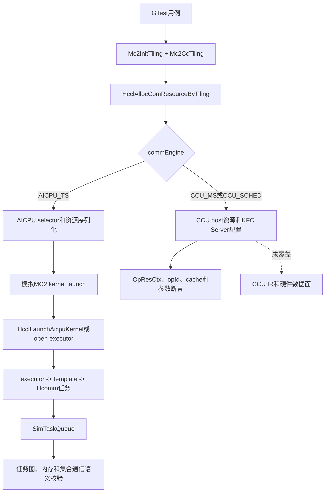

**表 3**  关键代码对象

| 层次 | 文件或函数 | 作用 |
| --- | --- | --- |
| AllGather用例 | `tests/api/adv_api/hccl/cc/st/algorithm/testcase/all_gather_aicpu_testcase.cc` | 构造topology、tiling、buffer和多rank执行环境 |
| MC2公共入口 | `impl/adv_api/detail/hccl/cc/src/common/hccl_mc2.cc` | 校验输入、解析tiling、识别engine并分配资源 |
| MC2资源准备 | `impl/adv_api/detail/hccl/cc/src/common/hccl_alloc_ctx_res.cc` | 从tiling构造`OpParam`，执行selector和资源准备 |
| AICPU入口 | `impl/adv_api/detail/hccl/cc/src/ops/op_common/template/aicpu/kernel_launch.cc` | 反序列化资源、获取executor并执行`Orchestrate` |
| open executor | `impl/adv_api/detail/hccl/cc/src/aicpu_kfc/framework/device/aicpu_kfc/decoupler/comm_kfc_open_kernel_executor.cc` | open协议下恢复资源并执行本地registry和task cache |
| AllGather selector | `impl/adv_api/detail/hccl/cc/src/ops/all_gather/selector/all_gather_auto_selector.cc` | 根据拓扑、数据量和engine选择算法 |
| Concurrent executor | `impl/adv_api/detail/hccl/cc/src/ops/all_gather/executor/ins_v2_all_gather_concurrent_executor.cc` | 合并并拆分Mesh/NHR资源，按37:25切分数据 |
| Mesh template | `impl/adv_api/detail/hccl/cc/src/ops/all_gather/template/aicpu/ins_temp_all_gather_mesh_1D.cc` | 生成Mesh LocalCopy、Read和同步任务 |
| NHR template | `impl/adv_api/detail/hccl/cc/src/ops/all_gather/template/aicpu/ins_temp_all_gather_nhr.cc` | 生成NHR多轮传播、末步读取和PostCopy任务 |
| 仿真运行时 | `tests/api/adv_api/hccl/cc/st/algorithm/utils/src/sim_world` | 建立rank、stream、notify、channel和task queue模型 |
| Hcomm桩 | `tests/api/adv_api/hccl/cc/st/algorithm/utils/src/hccl_proxy/hccl_stub.cc` | 把Hcomm调用转换为带地址和依赖信息的`TaskStub` |
| ACL Runtime桩 | `tests/api/adv_api/hccl/cc/st/algorithm/utils/src/hccl_proxy/aclrt_stub.cc` | 保存kernel参数并转入产品AICPU入口 |
| 任务验证器 | `tests/api/adv_api/hccl/cc/st/algorithm/utils/src/hccl_verifier` | 成图、检查内存冲突并传播集合通信语义 |
| CCU host用例 | `tests/api/adv_api/hccl/cc/st/algorithm/testcase/mc2_ccu/host/all_to_all_v_mc2_host_testcase.cpp` | 验证host资源、KFC配置、opId和cache |

## AICPU MC2端到端框架

### 新旧入口差异

旧ST从`xx_op.h`中的独立host op接口发起通信。该入口在主线中已经删除，而且它无法证明MC2算子tiling、资源上下文和launch协议正确。

新ST新增以下机制：

- `AllGatherMc2Tiling`把`Mc2InitTilingInner`和`Mc2CcTilingInner`放入同一块连续内存。
- `BuildAllGatherMc2Tiling`写入版本、通信算子数量、offset、engine、dtype、opType、groupName和可选算法名。
- 每个模拟rank调用真实`HcclAllocComResourceByTiling`获取`OpResCtx`。
- `SimulateMc2AllGatherLaunch`从`OpResCtx.algInfo[0].opParam`读取资源阶段生成的`OpParam`。
- 测试只补充真实运行期才由算子kernel提供的buffer、count、dtype、stream和comm字段。
- 测试模拟算子kernel向AICPU server发送启动通知，再调用`aclrtLaunchKernelWithConfig`。
- ACL Runtime桩不返回空成功，而是把参数转交给产品`HcclLaunchAicpuKernel`或`LaunchOpenOpParamDataImpl`。
- 最后模拟算子kernel等待AICPU server完成通知，并对所有rank的任务队列成图校验。

### E2E流程

**图 2**  AICPU MC2 E2E流程图

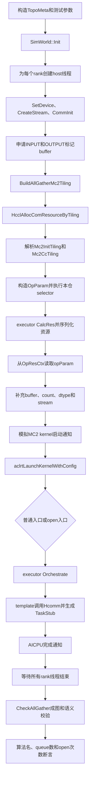

### E2E泳道

**图 3**  AICPU MC2 E2E泳道图

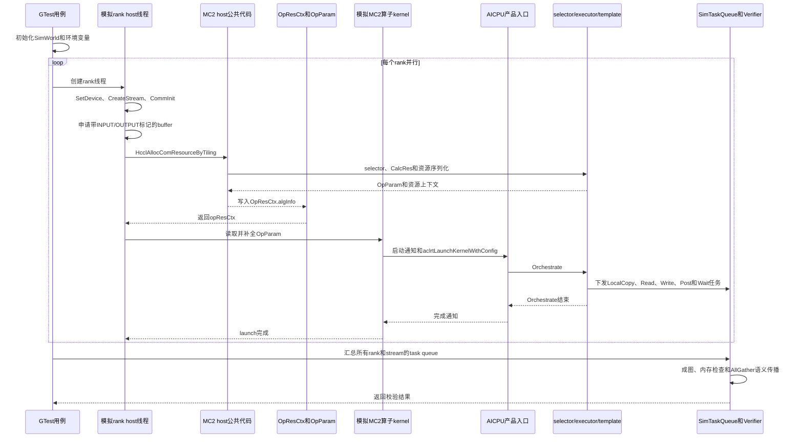

### 启动与完成同步

测试没有直接调用`executor->Orchestrate`。`SimulateMc2AllGatherLaunch`先调用`GetMainThreadInfo`取得资源阶段创建的主thread和notify数量，再通过`HcclThreadExportToCommEngine`取得导出thread。

启动方向使用`HcommThreadNotifyRecordOnThread(opThread, exportedMainThread, notifyNum - 1)`，完成方向使用`HcommThreadNotifyWaitOnThread(opThread, 0, timeout)`。对应的Hcomm桩分别生成`TaskStubLocalPostTo`和`TaskStubLocalWaitFrom`，因此同步关系进入最终任务图，而不是在测试中被无条件跳过。

**图 4**  MC2启动与完成同步

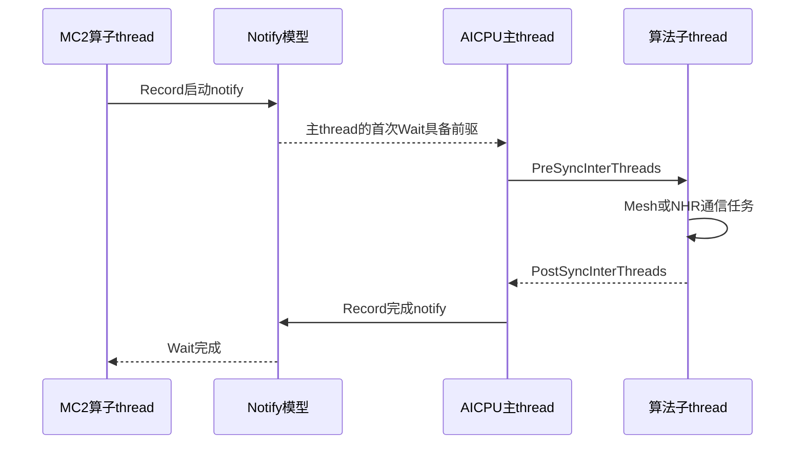

### ACL Runtime launch桩

`aclrtKernelArgsInit`创建`ArgsBuffer`，`aclrtKernelArgsAppend`按真实`OpParam`大小复制参数。`aclrtLaunchKernelWithConfig`解析该参数并记录`algName`。

普通模式调用产品`HcclLaunchAicpuKernel`。open模式反序列化`param->resCtx`，复制`OpParam`及变长参数，调用产品`LaunchOpenOpParamDataImpl`。因此ACL Runtime本身是桩，但桩后的算法入口、registry和executor是产品代码。

### SimulateMc2AllGatherLaunch定位与外部关系

`SimulateMc2AllGatherLaunch`位于`tests/api/adv_api/hccl/cc/st/algorithm/testcase/all_gather_aicpu_testcase.cc`，是ST专用的MC2算子kernel职责模拟函数。真实系统中，MC2算子kernel会从资源上下文取得通信参数，补充本次算子的动态buffer和数据描述，通知AICPU Server开始工作，提交AICPU kernel，并等待通信完成。CPU ST无法执行该device kernel，因此由此函数复现上述控制面合同。

该函数处于资源准备和算法验证之间，外部关系如下：

- 上游`RunAllGatherAicpuA5`先构造buffer和tiling，并调用产品`HcclAllocComResourceByTiling`完成selector、`CalcRes`及`OpResCtx`生成。
- 本函数接收上游返回的`opResCtxPtr`以及本次运行的stream、comm、buffer、count、dtype和rank数，不重新执行算法选择或资源计算。
- 本函数通过ACL Runtime桩进入产品`HcclLaunchAicpuKernel`或`LaunchOpenOpParamDataImpl`，没有直接调用executor内部函数。
- 启动和完成同步经过Hcomm桩进入`SimTaskQueue`，因此算子thread与AICPU主thread之间的依赖可以参与后续成图。
- 函数返回后，外层`RunAllGatherAicpuA5`负责汇总所有rank的返回值和任务队列，再执行`CheckAllGather`、算法名、活跃queue数量及open入口次数断言。

**图 5**  SimulateMc2AllGatherLaunch外部关系简图

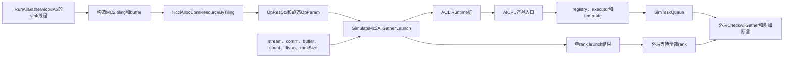

图5中只有`SimulateMc2AllGatherLaunch`是测试侧的算子kernel职责替身。`HcclAllocComResourceByTiling`、AICPU入口、registry、executor和template是被测产品流程；ACL Runtime、Hcomm和任务队列是测试基础设施。

### SimulateMc2AllGatherLaunch内部流程

函数内部完成“读取资源参数、补动态参数、启动同步、提交AICPU入口、等待完成”五类工作。它不负责创建通信域、选择算法、计算资源、汇总多rank结果或执行最终AllGather语义校验。

**图 6**  SimulateMc2AllGatherLaunch内部简化流程

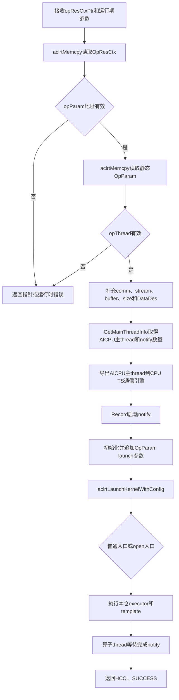

补充动态参数时，`inputSize`按`sendCount * dataTypeSize`计算，`outputSize`再乘`rankSize`，`DataDes.strideCount`设置为`sendCount`。这些字段对应真实算子kernel在每次launch时才能确定的数据面信息，而`algName`、`resCtx`、`ctxSize`、`opThread`和资源thread等内容来自上游资源准备阶段。

`GetMainThreadInfo`从算法资源中取得AICPU主thread和主thread上的notify数量。随后`HcclThreadExportToCommEngine`把该thread导出给CPU TS侧的算子thread使用。启动notify使用主thread最后一个notify槽位，即`notifyNumOnMainThread - 1`；完成等待固定使用算子thread的notify槽位0，与普通产品入口末尾记录的完成notify对应。

**图 7**  SimulateMc2AllGatherLaunch详细泳道图

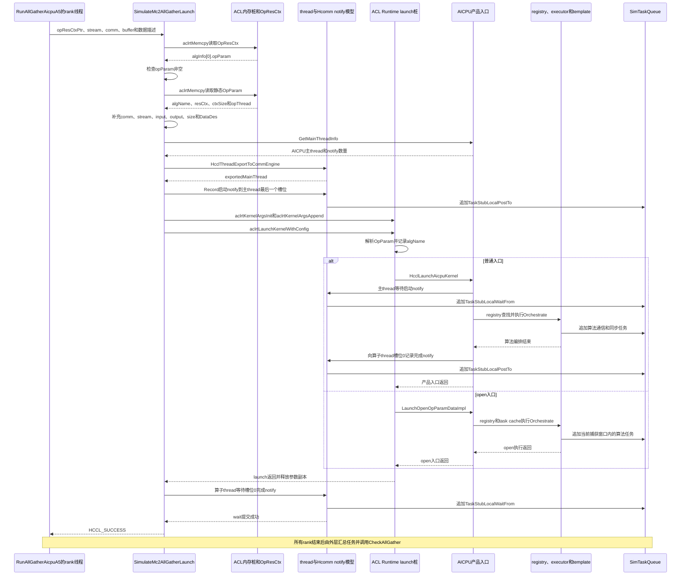

普通入口形成“算子thread启动Post -> AICPU主thread启动Wait -> 算法任务 -> AICPU主thread完成Post -> 算子thread完成Wait”的闭环。open入口依赖常驻KFC Server的生命周期，Server初始wait不在当前ST捕获窗口，因此open用例只断言入口次数和算法命中，并关闭`CheckAllGather`；不能根据该用例单独宣称open路径的完整任务图语义已经验证。

### 任务图和语义校验

Hcomm桩将通信调用转换为以下任务：

- `HcommLocalCopyOnThread`生成`TaskStubLocalCopy`。
- `HcommReadOnThread`生成`TaskStubRead`。
- `HcommWriteOnThread`生成`TaskStubWrite`。
- Reduce接口生成对应的LocalReduce、ReadReduce或WriteReduce任务。
- 远端Notify生成`TaskStubPost`和`TaskStubWait`。
- thread间Notify生成`TaskStubLocalPostTo`和`TaskStubLocalWaitFrom`。

每个任务保留rank、stream、对端rank、channel、源切片、目的切片、dtype和reduce op等信息。`SimTaskQueue`按super pod、server、device和stream保存任务。

**图 8**  任务图校验流程

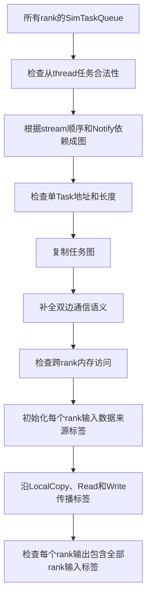

这里的“语义正确”是符号数据来源正确，不是CPU实际填充随机值后逐字节比对。它能发现切片偏移、长度、rank来源、覆盖关系和依赖错误，但不能发现真实硬件计算单元或DMA实现中的位级错误。

## AllGather ST设计

### 通用执行器

`RunAllGatherAicpuA5`统一执行所有AllGather场景：

- 根据`TopoMeta`计算实际rank数。
- 设置AICPU展开和open入口相关环境变量。
- 为每个rank启动独立host线程，模拟多rank并发提交。
- 通过MC2 tiling分配资源并执行模拟launch。
- 汇总任务队列并调用`CheckAllGather`。
- 可选检查预期算法名、Concurrent活跃queue数量和open入口次数。

### 用例覆盖

**表 4**  AllGather用例覆盖

| 用例分组 | 用例数量 | 实际拓扑或rank | 数据规模 | 主要目的 |
| --- | ---: | --- | --- | --- |
| UBX阈值与Concurrent | 3 | 单server 4rank | 512KiB、600KiB | Sole/Concurrent阈值、双template和open入口 |
| 单层Mesh | 5 | 2、3、4、5、8rank | 100个元素 | Mesh直连、多rank和多dtype |
| NHR | 6 | 2、3、4、6、8rank | 100个元素、1Gi个元素 | 非2次幂、不同dtype、大数据分段 |
| Parallel Mesh+NHR | 4 | 2x2、2x3、3x3 | 100个元素、300Mi个元素 | 多层并行、loop和尾块 |

代码中名为`st_all_gather_a5_aicpu_mesh_1d_6rank_int16_small_data_test`的用例实际`TopoMeta`为`{0,1,2,3,5}`，只包含5个rank。当前ST因此没有真正覆盖单层Mesh 6rank，该问题应在后续用例修正中处理。

### 核心断言

**表 5**  AllGather断言与故障检出能力

| 断言 | 实现 | 可检出的错误 |
| --- | --- | --- |
| 每个rank返回成功 | `rankResults` | 初始化、资源分配、launch和编排错误 |
| 集合通信语义正确 | `CheckAllGather` | 数据来源、slice、依赖、内存覆盖和通信对端错误 |
| 算法名正确 | `GetAicpuLaunchAlgNames` | selector未命中或错误转发到其他算法 |
| Concurrent具备多thread任务 | 活跃queue数量至少为4 | 双template资源未拆分或子thread未下发任务 |
| open入口真实到达 | `GetOpenExecutorLaunchCount` | 测试只走普通入口、open bridge未执行 |

### Concurrent双template关键流程

4rank、600KiB用例强制模拟UBX Concurrent拓扑并期望命中`AicpuAllGatherConcurMeshNHR`。`CalcRes`分别计算Mesh和NHR资源，再把thread、notify和channel请求合并。`Orchestrate`从反序列化资源中重新拆分两套template资源。

`GetParallelDataSplit`在AICPU TS模式使用`MESH_BW_AICPU=37`和`CLOS_BW_AICPU=25`，数据比例为37:25。`OrchestrateLoop`按该比例切分数据、scratch和loop，并交替调用两个template的`KernelRun`。

**图 9**  Concurrent双template任务生成流程

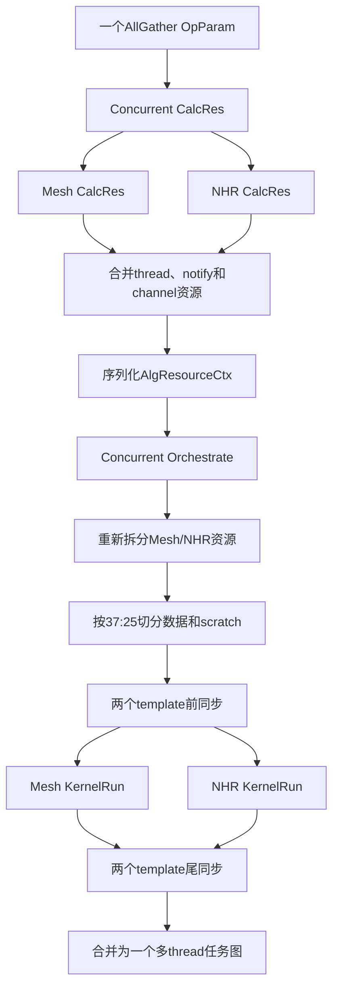

### Concurrent泳道

**图 10**  Concurrent双template泳道图

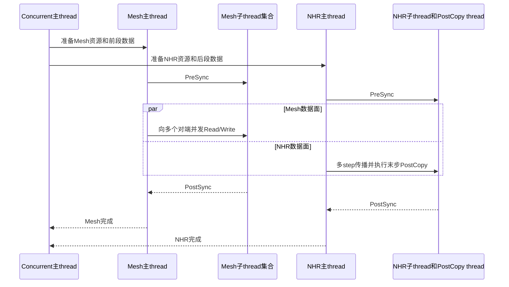

`expectMultiKernel`当前只检查每个rank至少4个活跃queue，证明多thread任务图存在，但没有精确断言Mesh和NHR各自的thread数量、每条channel的任务数或37:25切分后的确切字节边界。覆盖率能够证明相关分支被执行，不能替代这些更细粒度的行为断言。

### open executor用例

`st_all_gather_a5_aicpu_ubx_4rank_concurrent_mc2_open_executor_e2e_test`设置`HCCL_ST_USE_OPEN_EXECUTOR=1`，由ACL Runtime桩调用产品`LaunchOpenOpParamDataImpl`。该用例断言每个rank进入open入口一次。

该用例关闭`CheckAllGather`，原因是常驻KFC Server的初始thread wait不在当前任务捕获窗口。完整AllGather语义由相同4rank、600KiB参数的普通Concurrent E2E用例负责。串讲时应将二者视为互补证据，不能把open用例单独描述为完整数据语义E2E。

## 打桩设计

打桩原则是替代当前CPU测试环境无法提供的运行时和硬件能力，同时保留算法决策、资源结构、地址关系和任务依赖。桩不能直接返回成功后丢弃参数，否则测试只会覆盖控制流外壳。

**表 6**  主要桩及真实性边界

| 桩文件 | 替代对象 | 保留的真实信息 | 未模拟内容 |
| --- | --- | --- | --- |
| `aclrt_stub.cc` | ACL Runtime | stream、参数大小、完整`OpParam`和产品AICPU入口调用 | 真实device kernel装载和调度 |
| `hccl_stub.cc` | Hcomm和HCCL运行时 | rank、thread、notify、channel、地址、slice、dtype和reduce op | 驱动、链路传输和硬件错误码 |
| `sim_communicator.cc` | 通信域 | rank到拓扑位置、context和资源管理 | 多进程通信域和真实网络发现 |
| `topo_model.cc` | RankGraph拓扑 | Mesh、NHR、Parallel和测试UBX逻辑视图 | 真实Fabric探测和链路状态变化 |
| `channel_stub.cc` | Channel创建 | 本地/远端rank和channel描述 | 真实Jetty资源、拥塞和带宽 |
| `mc2_ccu/cann_host_bridge_stub.cc` | 安装版HCCL bridge | 强制不转发，避免绕开本仓公共代码 | 安装版HCCL兼容路径 |
| `mc2_ccu/hccl_op_common_stub.cc` | CCU selector和executor依赖 | 固定算法映射、资源序列化、cache复用和kernel注册计数 | 生产selector拓扑判断和真实executor `CalcRes` |
| `hcomm_ccu_stub.cc` | CCU资源和kernel注册 | token派生、注册次数和资源句柄关系 | CCU编译器、IR下发和设备执行 |

### 如何判断是否真实模拟

**图 11**  桩边界判断流程

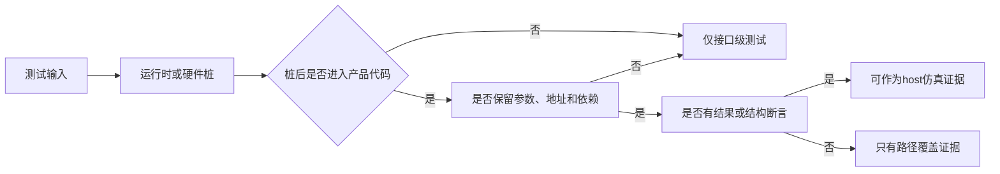

AICPU AllGather满足“桩后进入产品executor、保留任务信息、执行图和语义断言”。CCU host满足“桩后进入产品MC2公共资源代码、保留资源和配置字段、执行结构断言”，但不满足“进入生产selector和设备kernel执行”。

## CCU host ST设计

### host流程

CCU host用例构造8rank单server拓扑，并设置`HCCL_OP_EXPANSION_MODE=CCU_MS`。用例可以直接测试细分函数，也可以从`HcclAllocComResourceByTiling`进入完整host公共流程。图12对应单tiling的`AllocatesAllToAllVResourceFromTiling`用例；多配置共享和cache隔离用例从`CcuSelectAlg`起步，不经过当前拒绝多tiling的外层门禁。

**图 12**  CCU host E2E流程图

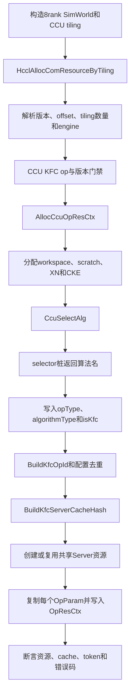

### host泳道

**图 13**  CCU host资源准备泳道图

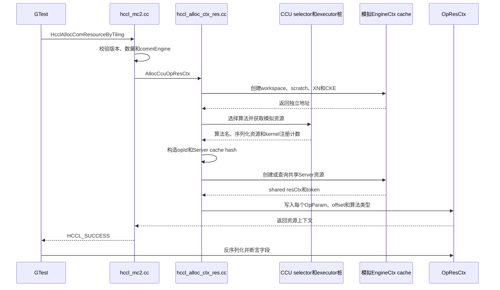

### KFC opId和Server cache

`BuildKfcOpId`使用低7bit编码opType，bit 8开始编码输入类型，bit 16开始编码reduceType，bit 24开始编码输出类型。AllToAll系列从`all2AllVDataDes`读取输入和输出类型，AllReduce和ReduceScatter额外编码reduceType。

`BuildKfcServerCacheHash`对首个算法tag和有序opId列表计算FNV-1a hash。一个MC2 context中的多个primitive先完成选择，再共同创建一个常驻Server资源。不同primitive集合得到不同cache tag，避免只按首个primitive错误复用。

**图 14**  KFC配置共享和隔离

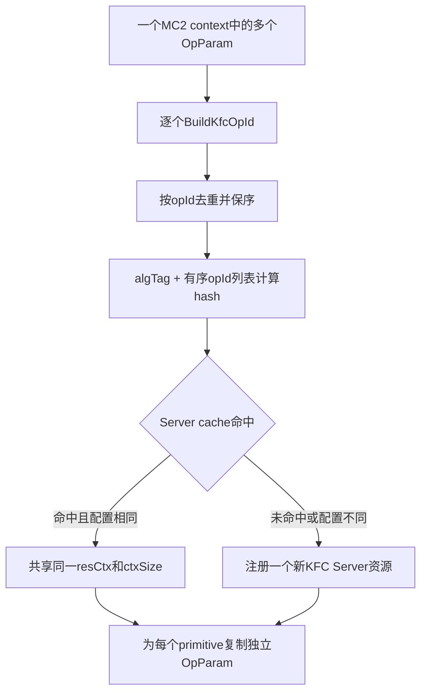

### CCU host用例覆盖

**表 7**  CCU host用例

| 用例 | 覆盖点 |
| --- | --- |
| `AllocCcuOpResCtxInitializesQueueResources` | workspace、XN、CKE、rank和资源地址独立性 |
| `SelectsAllToAllVMesh1D` | AllToAllV算法类型和一次Server注册 |
| `MultipleAllToAllVConfigsShareOneServer` | 同一context中多个配置共享Server资源 |
| `OpIdContainsAllToAllVMessageIdentity` | opType、sendType和recvType位域 |
| `FixedAllToAllSelectsSingleDieKfcAlgorithm` | 固定AllToAll算法类型 |
| `AllReduceSelectsSingleDieKfcAlgorithm` | AllReduce算法类型 |
| `ReduceOperationParticipatesInKfcOpId` | AllReduce和ReduceScatter的reduceType防碰撞 |
| `MultiConfigCacheDoesNotReuseSingleConfigServer` | 单配置与多配置Server cache隔离 |
| `AllocatesAllToAllVResourceFromTiling` | 从MC2 tiling到`OpResCtx`的公共入口 |
| `KfcServerArgsUseAllocatedQueueAndToken` | XN、CKE、die、rank和CCL token参数 |
| `AcceptsBothCcuTilingEngineValues` | `CCU_MS`和`CCU_SCHED`识别 |
| `ValidatesNullInputs` | comm、stream和tiling空指针错误路径 |

### CCU host当前接入状态

当前源码中存在`testcase/mc2_ccu/CMakeLists.txt`，其设计目标名为`ascendc_ut_adv_api_hccl_ccu_mc2_host`和`ascendc_ut_adv_api_hccl_ccu_mc2_device`。但是当前`tests/api/adv_api/hccl/cc/st/algorithm/CMakeLists.txt`没有定义这两个变量，`testcase/CMakeLists.txt`也没有执行`add_subdirectory(mc2_ccu)`。

临时恢复父级CMake入口后，最新代码还缺少以下3个host链接桩：

- `CollAlgExecRegistryV2::IsRegistered`：外层CCU MC2入口检查tiling指定的算法是否已注册。
- `HcommIsSupportHcommBatchTransferOnThread`：资源序列化时记录当前host是否支持batch transfer。
- `LaunchOpenOpParamDataImpl`：链接公共MC2代码时需要提供open executor符号。

覆盖率测量期间为这3个符号提供了最小host桩，最终已撤回。该事实说明当前默认`--adv_test_two`和AICPU主目标不会重新构建或执行这12个CCU host用例；若仅恢复`add_subdirectory`，目标还会在链接阶段失败。

本轮还发现rebase后的tiling合同发生了两点变化：

- `GetForcedAlgName`把不含`=`的非空`algConfig`解释为强制算法名。旧fixture中的`"default"`会被当成算法名并返回`HCCL_E_NOT_SUPPORT`；直接测试`CcuSelectAlg`时应将`algConfig`留空，才能进入selector桩。
- 外层`HcclAllocComResourceByTiling`会执行`CheckCcuAlgorithmsRegistered`，要求CCU tiling显式携带已注册算法名。AllToAllV E2E fixture应写入`CcuAlltoAllVMesh1D`，否则返回`HCCL_E_ALG_NOT_SUPPORTED`。

按上述最新合同调整测量fixture后，CCU host 12/12通过。当前外层MC2 client还拒绝`tilingNum > 1`，所以多配置Server共享与cache隔离用例直接调用`CcuSelectAlg`，不是外层多tiling E2E。要把CCU host纳入提交门禁，需要正式恢复父级CMake、补齐3个链接桩并更新fixture；本次文档任务不提交这些框架修复。

## 新增用例方法

### 新增AICPU MC2 E2E用例

1. 在算法testcase文件中构造`Mc2InitTilingInner`和一个或多个`Mc2CcTilingInner`，保证offset指向同一连续对象内的实际位置。
2. 设置正确的`commEngine`、`opType`、dtype、groupName和可选`algConfig`。
3. 用`TopoMeta`表达目标super pod、server和device布局，不要只修改rankSize变量。
4. 每个rank独立执行SetDevice、CreateStream和CommInit。
5. 使用`BUFFER_INPUT_MARK`和`BUFFER_OUTPUT_MARK`申请buffer，让验证器识别内存角色。
6. 调用`HcclAllocComResourceByTiling`，不要直接调用selector或executor替代E2E入口。
7. 从`OpResCtx.algInfo[index].opParam`读取产品生成的`OpParam`，只补充运行期动态字段。
8. 通过启动Notify、`aclrtLaunchKernelWithConfig`和完成Notify模拟MC2 launch协议。
9. 对所有rank线程执行`join`后再读取全局task queue。
10. 至少断言返回值、目标算法名和集合通信语义；多thread算法还应断言thread或queue结构。

### 新增AllGather算法场景

新增场景时优先补齐以下维度，而不是重复同一成功路径：

- selector阈值的前一字节、等于阈值和后一字节。
- 2次幂和非2次幂rank。
- 单loop、多loop、整块和尾块。
- 不同元素宽度导致的对齐边界。
- forced algorithm接受、fallback和未注册错误。
- input/output overlap等selector拒绝路径。
- 普通AICPU入口和open executor入口。
- Concurrent的Mesh/NHR准确thread数量、channel分段和37:25字节范围。

### 新增CCU host算法

1. 在tiling builder中设置opType、engine、输入类型、输出类型和reduceType。
2. 在host桩的算法映射中增加目标算法名，仅用于隔离公共框架测试。
3. 在生产`algorithmMap`和KFC允许列表中完成对应注册；另设非桩测试证明生产注册可达。
4. 验证`opType[]`、`algorithmType[]`、`isKfc[]`和`algInfo[].opParam`。
5. 验证`BuildKfcOpId`不会与已有dtype、输出类型或reduceType组合碰撞。
6. 以单配置、多配置、重复配置和顺序变化验证Server cache共享与隔离。
7. 反序列化资源并逐项检查`kfcServerArgs`、channel、token和kernel数量。
8. 为null、空tiling、混合engine、不支持op和单rank补充错误用例。
9. host ST通过后，仍需在具备CCU硬件的环境执行device和E2E验证。

## 覆盖率设计

### 统计口径

覆盖率只统计本次相关ST实际驱动的asc-devkit生产文件，不把全仓未参与模块纳入分母，也不把测试文件和第三方库计入主指标。

报告拆分为两个独立数据集：

- AICPU AllGather：只运行`ST_ALL_GATHER_AICPU_TEST.*`的18个用例。
- CCU host：只运行`CcuMc2AllToAllVTest.*`的12个用例。

每次采集前使用`lcov --zerocounters`清理旧计数，避免其他85项ST或历史运行污染结果。采集后使用`lcov --extract`保留对应生产目录，再由`genhtml`生成逐文件源码视图。HTML中每个可执行代码行都会显示执行次数，能够精确区分已覆盖行和未覆盖行。

**图 15**  精确覆盖率采集流程

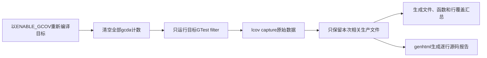

### 实测结果与产物

AllGather 18项用例的生产代码行覆盖率为57.6%，函数覆盖率为58.7%。该分母只包含11个指定生产文件，不包含测试、桩、第三方库、ReduceScatter、AllReduce、AllToAll和DPU文件。

**表 8**  AICPU AllGather逐文件覆盖率

| 生产文件 | 行覆盖 | 函数覆盖 |
| --- | ---: | ---: |
| `comm_kfc_open_kernel_executor.cc` | 42/88（47.7%） | 5/7（71.4%） |
| `common/hccl_alloc_ctx_res.cc` | 272/628（43.3%） | 26/46（56.5%） |
| `common/hccl_mc2.cc` | 59/270（21.9%） | 5/25（20.0%） |
| `ins_v2_all_gather_concurrent_executor.cc` | 205/217（94.5%） | 9/9（100.0%） |
| `ins_v2_all_gather_parallel_executor.cc` | 252/282（89.4%） | 12/24（50.0%） |
| `ins_v2_all_gather_sequence_executor.cc` | 0/116（0.0%） | 0/5（0.0%） |
| `ins_v2_all_gather_sole_executor.cc` | 87/90（96.7%） | 10/10（100.0%） |
| `all_gather_auto_selector.cc` | 17/97（17.5%） | 1/8（12.5%） |
| `ins_temp_all_gather_mesh_1D.cc` | 161/206（78.2%） | 12/15（80.0%） |
| `ins_temp_all_gather_nhr.cc` | 286/302（94.7%） | 22/23（95.7%） |
| `kernel_launch.cc` | 97/269（36.1%） | 9/17（52.9%） |
| 合计 | 1478/2565（57.6%） | 111/189（58.7%） |

Sequence executor为0%并不表示NHR template未运行。当前NHR和Parallel场景由Sole、Parallel和Concurrent executor组织，NHR template本身达到286/302行；`ins_v2_all_gather_sequence_executor.cc`没有被这18项用例选择，必须作为明确的executor覆盖缺口保留。

CCU host 12项用例的生产代码行覆盖率为48.5%，函数覆盖率为52.6%。该口径只包含MC2公共入口、公共资源流程和KFC配置头文件。

**表 9**  CCU host逐文件覆盖率

| 生产文件 | 行覆盖 | 函数覆盖 |
| --- | ---: | ---: |
| `common/hccl_alloc_ctx_res.cc` | 337/628（53.7%） | 29/46（63.0%） |
| `common/hccl_mc2.cc` | 76/270（28.1%） | 6/25（24.0%） |
| `common/kfc_server_config.h` | 44/45（97.8%） | 5/5（100.0%） |
| 合计 | 457/943（48.5%） | 40/76（52.6%） |

**表 10**  覆盖率产物

| 产物 | 说明 |
| --- | --- |
| `build_out/mc2_st_coverage/aicpu_allgather/coverage.info` | AllGather 18项用例的LCOV数据 |
| `build_out/mc2_st_coverage/aicpu_allgather/html/index.html` | AllGather逐文件源码报告，每行显示执行次数 |
| `build_out/mc2_st_coverage/aicpu_allgather/line_coverage.tsv` | 2565条生产代码行的文件、行号、命中次数和覆盖状态 |
| `build_out/mc2_st_coverage/aicpu_allgather/test.log` | AllGather 18/18过滤运行日志 |
| `build_out/mc2_st_coverage/ccu_host/coverage.info` | CCU host 12项用例的LCOV数据 |
| `build_out/mc2_st_coverage/ccu_host/html/index.html` | CCU host逐文件源码报告，每行显示执行次数 |
| `build_out/mc2_st_coverage/ccu_host/line_coverage.tsv` | 943条生产代码行的文件、行号、命中次数和覆盖状态 |
| `build_out/mc2_st_coverage/ccu_host/test.log` | CCU host 12/12过滤运行日志 |
| `build_out/mc2_st_coverage/coverage_summary.txt` | 两个数据集的文件、函数、行覆盖率和测量约束汇总 |

`line_coverage.tsv`每一行均包含`covered`或`uncovered`、仓内相对文件路径、准确行号和命中次数。HTML报告在同一行展示源码，因此可以从汇总下钻到“哪个文件的哪一行是否执行”。解读覆盖率时必须结合断言强度：代码行执行过不等于行为正确；相反，selector桩返回了目标算法名，也不能证明生产CCU selector已执行。

## 测试机制与用例文件索引

以下路径均相对于asc-devkit仓根目录。索引区分生产机制、测试机制和测试用例，便于串讲时明确“哪些文件被测”和“哪些文件负责模拟”。

### AICPU MC2产品机制文件

**表 11**  AICPU MC2 E2E生产机制核心文件

| 机制层次 | 文件路径 | 在E2E流程中的作用 |
| --- | --- | --- |
| MC2公共入口 | `impl/adv_api/detail/hccl/cc/src/common/hccl_mc2.cc` | 解析`Mc2InitTilingInner`和`Mc2CcTilingInner`，校验engine并进入通信资源分配流程 |
| MC2资源准备 | `impl/adv_api/detail/hccl/cc/src/common/hccl_alloc_ctx_res.cc` | 从tiling构造`OpParam`，执行selector、executor资源计算和`OpResCtx`序列化 |
| MC2资源接口 | `impl/adv_api/detail/hccl/cc/src/common/hccl_alloc_ctx_res.h` | 定义AICPU和CCU资源准备阶段使用的公共函数与结构合同 |
| AICPU launch入口 | `impl/adv_api/detail/hccl/cc/src/ops/op_common/template/aicpu/kernel_launch.cc` | 从launch参数恢复`OpParam`和算法资源，查找executor并调用`Orchestrate` |
| AICPU launch接口 | `impl/adv_api/detail/hccl/cc/src/ops/op_common/template/aicpu/kernel_launch.h` | 声明普通AICPU入口和主thread资源查询接口 |
| open executor入口 | `impl/adv_api/detail/hccl/cc/src/aicpu_kfc/framework/device/aicpu_kfc/decoupler/comm_kfc_open_kernel_executor.cc` | 在open模式下恢复资源，进入本地registry和task cache执行路径 |

### AICPU MC2测试机制文件

**表 12**  AICPU MC2 E2E测试框架核心文件

| 机制层次 | 文件路径 | 作用 |
| --- | --- | --- |
| ST总构建入口 | `tests/api/adv_api/hccl/cc/st/algorithm/CMakeLists.txt` | 定义AICPU主目标、公共目录和产品源码根路径 |
| 用例构建入口 | `tests/api/adv_api/hccl/cc/st/algorithm/testcase/CMakeLists.txt` | 将AllGather等AICPU用例编入主ST目标 |
| 测试工具构建入口 | `tests/api/adv_api/hccl/cc/st/algorithm/utils/CMakeLists.txt` | 接入测试工具源码目录 |
| 测试工具源码入口 | `tests/api/adv_api/hccl/cc/st/algorithm/utils/src/CMakeLists.txt` | 组装仿真世界、Hcomm代理、验证器和AICPU目标 |
| AICPU产品源码接入 | `tests/api/adv_api/hccl/cc/st/algorithm/utils/src/aicpu/CMakeLists.txt` | 编译MC2公共入口、selector、executor、template、kernel launch和open executor |
| AllGather E2E用例 | `tests/api/adv_api/hccl/cc/st/algorithm/testcase/all_gather_aicpu_testcase.cc` | 构造MC2 tiling、多rank环境、buffer和模拟launch，并触发结果校验 |
| AllToAll AICPU用例 | `tests/api/adv_api/hccl/cc/st/algorithm/testcase/all_to_all_mesh1d_aicpu_testcase.cc` | 验证本地registry、channel阈值和peer分组轮次 |
| MC2 AICPU task cache用例 | `tests/api/adv_api/hccl/cc/st/algorithm/testcase/mc2_aicpu_task_cache_testcase.cc` | 验证task cache计划、tag、容量、命中、淘汰和失败回退 |
| AllReduce用例 | `tests/api/adv_api/hccl/cc/st/algorithm/testcase/all_reduce_testcase.cc` | 验证AllReduce算法边界、分段和任务语义 |
| AllToAllV用例 | `tests/api/adv_api/hccl/cc/st/algorithm/testcase/alltoallv_testcase.cc` | 验证AllToAllV数据描述、切片和任务语义 |
| ACL Runtime launch桩 | `tests/api/adv_api/hccl/cc/st/algorithm/utils/src/hccl_proxy/aclrt_stub.cc` | 保存kernel参数，转入产品`HcclLaunchAicpuKernel`或open executor入口 |
| 通信域与Hcomm桩 | `tests/api/adv_api/hccl/cc/st/algorithm/utils/src/hccl_proxy/hccl_stub.cc` | 模拟通信域接口，将Hcomm操作转换成可验证任务 |
| Hcomm内部接口桩 | `tests/api/adv_api/hccl/cc/st/algorithm/utils/src/hccl_proxy/hcclinner_stub.cc` | 补齐内部Hcomm资源、thread和notify接口 |
| channel桩 | `tests/api/adv_api/hccl/cc/st/algorithm/utils/src/aicpu/channel_stub.cc` | 模拟AICPU channel申请和资源计算 |
| 动态Hcomm接口桩 | `tests/api/adv_api/hccl/cc/st/algorithm/utils/src/aicpu/dlhcomm_function_stub.cc` | 将动态Hcomm函数绑定到ST实现 |
| AICPU拓扑匹配桩 | `tests/api/adv_api/hccl/cc/st/algorithm/utils/src/aicpu/topo_match_aicpu_stub.cc` | 为用例构造的拓扑提供匹配与资源信息 |
| 仿真世界 | `tests/api/adv_api/hccl/cc/st/algorithm/utils/src/sim_world/sim_world.cc` | 建立super pod、server、rank和设备模型 |
| 仿真任务队列 | `tests/api/adv_api/hccl/cc/st/algorithm/utils/src/sim_world/sim_task_queue.cc` | 按rank和stream保存算法下发的任务 |
| 仿真任务对象 | `tests/api/adv_api/hccl/cc/st/algorithm/utils/src/sim_world/sim_task.cc` | 表达LocalCopy、Read、Write、Reduce、Post和Wait任务 |
| 仿真通信域 | `tests/api/adv_api/hccl/cc/st/algorithm/utils/src/hccl_proxy/communicator/sim_communicator.cc` | 模拟rank通信域及其thread、channel资源 |
| 仿真thread | `tests/api/adv_api/hccl/cc/st/algorithm/utils/src/hccl_proxy/communicator/sim_thread.cc` | 模拟主thread和算法子thread的任务提交 |
| 仿真channel | `tests/api/adv_api/hccl/cc/st/algorithm/utils/src/hccl_proxy/communicator/sim_channel.cc` | 保存通信对端、链路类型和channel关系 |
| 拓扑模型 | `tests/api/adv_api/hccl/cc/st/algorithm/utils/src/hccl_proxy/topo_model/topo_model.cc` | 把`TopoMeta`转换成selector可读取的拓扑信息 |
| 验证入口 | `tests/api/adv_api/hccl/cc/st/algorithm/utils/src/hccl_verifier/hccl_verifier.cc` | 汇总任务队列并发起单任务、任务图、内存和语义校验 |
| 通用检查器 | `tests/api/adv_api/hccl/cc/st/algorithm/utils/src/hccl_verifier/checker.cc` | 组织集合通信检查步骤并返回验证结果 |
| 任务图生成器 | `tests/api/adv_api/hccl/cc/st/algorithm/utils/src/hccl_verifier/task_graph_generator/task_graph_generator.cc` | 根据stream顺序和notify依赖生成全局任务图 |
| rank内存检查 | `tests/api/adv_api/hccl/cc/st/algorithm/utils/src/hccl_verifier/mem_conflict_check/check_rank_mem.cc` | 检查跨rank读写地址、长度和访问范围 |
| 任务图修整 | `tests/api/adv_api/hccl/cc/st/algorithm/utils/src/hccl_verifier/mem_conflict_check/task_graph_revamp.cc` | 补全通信双边关系，形成可做语义传播的任务图 |
| AllGather语义检查 | `tests/api/adv_api/hccl/cc/st/algorithm/utils/src/hccl_verifier/semantics_check/allgather_semantics_checker.cc` | 验证每个rank输出是否包含全部rank的输入来源标签 |

上述5个测试源文件共同组成当前AICPU主目标的85项用例。其中`all_gather_aicpu_testcase.cc`采用本文重点讲解的MC2 tiling到AICPU launch端到端机制；其他文件分别验证本地注册、task cache或已有算法任务语义，不能统一描述为已经从MC2 tiling起步。

### AllGather分算法文件

AllGather的18项AICPU用例共用`tests/api/adv_api/hccl/cc/st/algorithm/testcase/all_gather_aicpu_testcase.cc`，并未按算法拆成多个测试源文件。下表通过用例名前缀标识该文件中的算法测试段。

**表 13**  AllGather分算法生产文件与测试用例位置

| 算法或场景 | 生产算法文件 | 共用测试文件中的用例标识 | 当前覆盖状态 |
| --- | --- | --- | --- |
| 公共selector | `impl/adv_api/detail/hccl/cc/src/ops/all_gather/selector/all_gather_auto_selector.cc` | 全部`ST_ALL_GATHER_AICPU_TEST`用例 | 18项用例均经过selector |
| `AicpuAllGatherSoleMesh` | `impl/adv_api/detail/hccl/cc/src/ops/all_gather/executor/ins_v2_all_gather_sole_executor.cc`；`impl/adv_api/detail/hccl/cc/src/ops/all_gather/template/aicpu/ins_temp_all_gather_mesh_1D.cc` | `st_all_gather_a5_aicpu_ubx_4rank_512kb_selects_sole_mesh_test`；`st_all_gather_a5_aicpu_mesh_1d_*` | 覆盖512KiB阈值及2、3、4、5、8rank Mesh场景 |
| `InsAllGatherNHR` | `impl/adv_api/detail/hccl/cc/src/ops/all_gather/executor/ins_v2_all_gather_sole_executor.cc`；`impl/adv_api/detail/hccl/cc/src/ops/all_gather/template/aicpu/ins_temp_all_gather_nhr.cc` | `st_all_gather_a5_aicpu_nhr_*` | 覆盖2、3、4、6、8rank及大数据分段 |
| `InsAllGatherParallelMesh1DNHR` | `impl/adv_api/detail/hccl/cc/src/ops/all_gather/executor/ins_v2_all_gather_parallel_executor.cc`；Mesh和NHR两个template文件 | `st_all_gather_a5_aicpu_parallel_nhr_mesh1d_*` | 覆盖2x2、2x3、3x3拓扑及大数据尾块 |
| `InsAllGatherParallelMesh1DNHRUBX` | `impl/adv_api/detail/hccl/cc/src/ops/all_gather/executor/ins_v2_all_gather_parallel_executor.cc`；Mesh和NHR两个template文件 | 无独立强制命名用例 | 生产注册存在，当前18项用例没有算法名断言证据 |
| `AicpuAllGatherConcurMeshNHR` | `impl/adv_api/detail/hccl/cc/src/ops/all_gather/executor/ins_v2_all_gather_concurrent_executor.cc`；`impl/adv_api/detail/hccl/cc/src/ops/all_gather/template/aicpu/ins_temp_all_gather_mesh_1D.cc`；`impl/adv_api/detail/hccl/cc/src/ops/all_gather/template/aicpu/ins_temp_all_gather_nhr.cc` | `st_all_gather_a5_aicpu_ubx_4rank_concurrent_mesh_nhr_e2e_test`；`st_all_gather_a5_aicpu_ubx_4rank_concurrent_mc2_open_executor_e2e_test` | 覆盖普通入口、open入口和多thread任务生成 |
| `InsAllGatherMeshNhrDPU` | `impl/adv_api/detail/hccl/cc/src/ops/all_gather/executor/ins_v2_all_gather_sequence_executor.cc`；`impl/adv_api/detail/hccl/cc/src/ops/all_gather/template/aicpu/ins_temp_all_gather_nhr_dpu.cc` | 当前无对应AICPU MC2用例 | DPU不在本轮范围，Sequence executor覆盖率为0/116行 |

表13中的“Mesh和NHR两个template文件”分别指`ins_temp_all_gather_mesh_1D.cc`和`ins_temp_all_gather_nhr.cc`。用例文件中的`st_all_gather_a5_aicpu_mesh_1d_6rank_int16_small_data_test`当前实际构造5rank，这也是表15保留的测试缺口。

### CCU host测试机制文件

**表 14**  CCU host机制与算法用例文件

| 机制层次 | 文件路径 | 作用或覆盖内容 |
| --- | --- | --- |
| CCU目标构建文件 | `tests/api/adv_api/hccl/cc/st/algorithm/testcase/mc2_ccu/CMakeLists.txt` | 同时定义host和device目标；当前父级`testcase/CMakeLists.txt`未接入该目录 |
| CCU host算法用例 | `tests/api/adv_api/hccl/cc/st/algorithm/testcase/mc2_ccu/host/all_to_all_v_mc2_host_testcase.cpp` | 12项host用例，覆盖AllToAllV、AllToAll、AllReduce、opId、cache、queue资源和异常入口 |
| MC2公共入口 | `impl/adv_api/detail/hccl/cc/src/common/hccl_mc2.cc` | 真实解析CCU tiling并进入host资源分配 |
| CCU资源准备 | `impl/adv_api/detail/hccl/cc/src/common/hccl_alloc_ctx_res.cc` | 真实执行`AllocCcuOpResCtx`、`CcuSelectAlg`和KFC Server资源组织 |
| KFC配置机制 | `impl/adv_api/detail/hccl/cc/src/common/kfc_server_config.h` | 构造KFC opId并维护多primitive配置和cache key |
| host bridge桩 | `tests/api/adv_api/hccl/cc/st/algorithm/utils/src/mc2_ccu/cann_host_bridge_stub.cc` | 禁止转发到外部CANN bridge，确保测试留在本仓调用链 |
| selector和executor桩 | `tests/api/adv_api/hccl/cc/st/algorithm/utils/src/mc2_ccu/hccl_op_common_stub.cc` | 提供固定算法映射、模拟executor和CCU kernel注册计数 |
| CCU Hcomm桩 | `tests/api/adv_api/hccl/cc/st/algorithm/utils/src/hccl_proxy/hcomm_ccu_stub.cc` | 模拟CCU资源、kernel注册及相关Hcomm接口 |
| ACL Runtime桩 | `tests/api/adv_api/hccl/cc/st/algorithm/utils/src/hccl_proxy/aclrt_stub.cc` | 模拟host/device内存、拷贝和运行时资源操作 |
| KFC仿真世界 | `tests/api/adv_api/hccl/cc/st/algorithm/utils/src/sim_world/ccu_kfc_sim_world.cc` | 保存KFC Server和CCU资源的仿真状态 |
| CCU仿真世界 | `tests/api/adv_api/hccl/cc/st/algorithm/utils/src/sim_world/ccu_sim_world.cc` | 模拟CCU kernel、资源句柄和注册行为 |

`tests/api/adv_api/hccl/cc/st/algorithm/testcase/mc2_ccu/device/`下存在device测试源码，但没有CCU仿真器，本轮只验证host目标，不能将该目录描述为已执行或已通过。

## 构建与执行

### AICPU主目标

```bash
cd /mnt/c/data/gitcodes/asc-devkit
source /home/houyu/Ascend/cann/set_env.sh
cmake --build build \
  --target ascendc_ut_adv_api_hccl_cc_algorithm_ascend950pr_9599_AIC \
  -- -j4
```

直接运行AllGather子集：

```bash
build/tests/api/adv_api/hccl/cc/ut/algorithm/testcase/\
ascendc_ut_adv_api_hccl_cc_algorithm_ascend950pr_9599_AIC \
  --gtest_filter='ST_ALL_GATHER_AICPU_TEST.*'
```

### CCU host目标

恢复父级CMake入口、3个缺失链接桩并更新tiling fixture后的命令为：

```bash
cmake --build build \
  --target ascendc_ut_adv_api_hccl_ccu_mc2_host \
  -- -j4

build/tests/api/adv_api/hccl/cc/ut/algorithm/testcase/mc2_ccu/\
ascendc_ut_adv_api_hccl_ccu_mc2_host
```

本轮在临时兼容环境中实测12/12通过。当前HEAD缺少该目标的父级CMake接入，直接执行上述build命令会报告目标不存在；即使只恢复父级入口，仍会因3个缺失链接桩失败。该状态是测试基础设施缺口，不能用临时测量结果替代正式CI门禁。

### 覆盖率重现

生产静态库需要显式加入`--coverage`。仅设置`ENABLE_GCOV=ON`只会插桩部分测试对象，不能生成有效的生产代码覆盖率。

```bash
source /home/houyu/Ascend/cann/set_env.sh
cmake -S . -B build \
  -DENABLE_GCOV=ON \
  -DCMAKE_CXX_FLAGS=--coverage
```

每个数据集按“重建目标、清零、过滤运行、采集、提取、生成HTML”的顺序执行。AllGather过滤命令为：

```bash
lcov --zerocounters --directory build \
  --ignore-errors mismatch,source,inconsistent,negative

build/tests/api/adv_api/hccl/cc/ut/algorithm/testcase/\
ascendc_ut_adv_api_hccl_cc_algorithm_ascend950pr_9599_AIC \
  --gtest_filter='ST_ALL_GATHER_AICPU_TEST.*'
```

CCU host必须再次清零，再单独执行：

```bash
lcov --zerocounters --directory build \
  --ignore-errors mismatch,source,inconsistent,negative

build/tests/api/adv_api/hccl/cc/ut/algorithm/testcase/mc2_ccu/\
ascendc_ut_adv_api_hccl_ccu_mc2_host \
  --gtest_filter='CcuMc2AllToAllVTest.*'
```

采集命令使用`lcov --capture`，随后使用`lcov --extract`只保留表8或表9中的生产文件。`genhtml --show-details --legend`生成逐行源码视图；从最终`coverage.info`的`DA:<line>,<hits>`生成`line_coverage.tsv`，其中`hits > 0`标记为`covered`，`hits = 0`标记为`uncovered`。

## 未覆盖项与风险

**表 15**  当前未覆盖项

| 未覆盖项 | 原因 | 风险 | 后续建议 |
| --- | --- | --- | --- |
| AICPU真实硬件执行 | 当前为CPU任务模型 | 驱动、固件、DMA和时序问题无法发现 | 增加上板MC2 E2E |
| open executor完整任务图语义 | 初始常驻thread wait不在捕获窗口 | open路径只证明入口可达 | 扩展捕获窗口或提供Server生命周期fixture |
| 真实多Jetty Concurrent | 第一阶段仍受channel数量门禁约束 | 多Jetty资源拆分和thread公式未验证 | 第二阶段补多Jetty资源与E2E |
| Concurrent精确37:25切分断言 | 当前只断言活跃queue数量 | 比例或offset错误可能依赖语义校验间接发现 | 直接检查两段slice边界和总和 |
| 单层Mesh 6rank | 用例名为6rank，实际只有5rank | 6rank Mesh路径没有证据 | 修正`TopoMeta`为6个元素 |
| AICPU错误路径 | 主要为成功场景 | tiling版本、offset、混合engine和空资源校验不足 | 增加参数化负向用例 |
| AllGather Sequence executor | 18项用例未选择该executor，覆盖率为0/116行 | Sequence组织逻辑发生回归时当前ST无法发现 | 增加明确强制或命中Sequence executor的E2E用例 |
| 生产CCU selector | host测试使用固定映射桩 | 真实拓扑条件和优先级错误无法发现 | 新增链接生产selector的host测试 |
| 生产CCU executor `CalcRes` | host测试返回`MockInsCollAlgBase` | channel、token和kernel资源请求错误无法发现 | 拆分最小依赖并链接真实executor |
| 外层CCU多tiling E2E | `CheckCcuAlgorithmsRegistered`当前拒绝`tilingNum > 1` | 多primitive共享只在内部函数层得到验证 | 框架开放多tiling后从`HcclAllocComResourceByTiling`补E2E |
| KFC `DispatchKfcSubKernel` IR | 没有CCU仿真器 | opId分支和参数索引未执行 | 在CCU硬件运行device ST |
| CCU数据语义 | host只检查结构 | AllToAllV实际搬运错误无法发现 | 上板后做多rank结果校验 |
| CCU host自动门禁 | rebase后父级CMake、3个链接桩和fixture合同未同步 | 默认CI不会构建或运行12项host用例 | 一并恢复target变量、`add_subdirectory`、链接桩和tiling fixture |
| 双die | 用户明确排除 | 双die selector和资源未验证 | 后续独立迭代 |
| HalfAllToAllV | 用户明确排除 | 该op的KFC配置和数据面未验证 | 后续独立迭代 |
| 性能 | ST为功能模型 | 无法证明37:25带宽收益 | 使用硬件profiling和基线对比 |

## 串讲建议

建议按以下顺序讲解：

1. 先说明为什么旧`xx_op.h`入口不能继续作为MC2 ST起点。
2. 展示图2和图3，强调tiling、资源、launch和完成同步都进入测试。
3. 展示图5至图7，解释`SimulateMc2AllGatherLaunch`如何替代MC2算子kernel的控制面职责，并区分函数内外边界。
4. 展示图8，解释ST校验的是任务图和符号数据语义，而不是只看返回值。
5. 展示图9和图10，纠正“多kernel等于两次入口launch”的误解。
6. 展示表6，说明哪些是产品代码、哪些是桩，以及桩保留了什么信息。
7. 展示图12至图14，说明CCU host只能证明资源与KFC配置合同。
8. 展示覆盖率HTML中的具体源文件和行执行次数，用数据证明当前ST实际走到了哪些生产代码。
9. 最后展示表15，明确没有硬件仿真器时不能宣称CCU device E2E通过。

## 参考文件

- `docs/cc_algorithm/ubx_aicpu_allgather_concur_sd.md`：Concurrent算法、37:25切分和第一阶段多Jetty边界。
- `docs/cc_algorithm/ubx_multi_kernel_algorithm_migration.md`：多template迁移方案和MC2适配背景。
- `docs/cc_algorithm/cc-concept.md`：UBX、NHR、Jetty和相关概念。
- `docs/cc_algorithm/cc_iter1_completion.md`：迭代1历史构建和测试记录。
