# UBX AICPU AllGather Concurrent迁移方案串讲

## 文档目的

本文说明如何把HCCL中的`InsAllGatherConcurrentMesh1DNHR`迁移到asc-devkit，并适配MC2 AICPU KFC Server调用框架。算法在HCCL中的当前名称为`AicpuAllGatherConcurMeshNHR`，旧名称仅用于建立历史对应关系。

本文重点回答以下问题：

- 哪些修改是HCCL算法更新和性能增强后的重新同步。
- 哪些修改是asc-devkit为了执行双template任务图而做的MC2框架适配。
- 每个新增或修改函数的职责是什么。
- MC2算子从tiling、资源准备、KFC消息下发到Mesh和NHR两个AICPU算法子任务结束的端到端流程是什么。
- Mesh和NHR如何并发，NHR内部的通信thread和PostCopy thread如何进一步并发。
- `37:25`切分定义在哪个文件和函数，如何落实到数据与scratch布局。

实施范围为MC2、AICPU、UBX、单die和第一阶段单Jetty可达路径。本文不覆盖CCU、双die、HalfAllToAllV，也不宣称真实多Jetty已经完成端到端闭环。

本文代码基线为asc-devkit `cc0806_2`分支的`1690ebc33aa1`和HCCL仓的`4b5e0ea26707`。迁移主体提交为`73d3ee053`，HCCL公共Channel能力补充同步提交为`1690ebc33`。

## 核心结论

本次迁移的“多kernel”应准确理解为：一次MC2 AICPU通信入口、一个Concurrent executor、Mesh和NHR两个算法template，以及多个AICPU TS thread组成的任务图。它不是MC2算子连续launch两个独立的AICPU入口kernel。

```text
一次KFC open消息
  -> 一次LaunchOpenOpParamDataImpl
  -> 一个AicpuAllGatherConcurMeshNHR executor
  -> Mesh template任务图 + NHR template任务图
  -> 多个AICPU TS thread并发执行
```

迁移没有修改`CommKfcAicpuServer`的分发协议，也没有为AllGather增加第二条server消息。现有MC2 open server、资源反序列化、本地executor registry和`RunWithMc2TaskCache`已经能承载多thread任务图。本次生产代码的主要工作是同步HCCL的Concurrent/NHR性能实现，并保证双template的channel、thread、notify、scratch和运行期状态在MC2资源序列化边界两侧一致。

## 名称与执行对象

**表 1**  算法名称与执行对象

| 历史名称 | 当前名称 | 实际角色 |
| --- | --- | --- |
| `InsAllGatherMesh1D` | `AicpuAllGatherSoleMesh` | 单Mesh template算法，作为已迁移参照 |
| `InsAllGatherConcurrentMesh1DNHR` | `AicpuAllGatherConcurMeshNHR` | Mesh和NHR双template并发算法 |
| `InsTempAllGatherMesh1D` | 名称未变 | Mesh算法template |
| `InsTempAllGatherNHR` | 名称未变 | NHR算法template |

“单template”不等于“单thread”。例如4rank下，Sole Mesh本身也会使用3个thread分别访问3个远端rank。Concurrent的新增点是把Mesh和NHR两套template及其thread集合放进同一任务图，并对数据和资源做互不重叠的分区。

## 基础概念

### UB、UBX与CLOS

HCCL仓`docs/zh/user_guide/hccl_intro.md`将UB定义为Unified Bus，并将其列为HCCL支持的高速通信链路。UBX不是HCCL公开文档定义的新协议，也不是集合通信算法；结合HCCL文档和源码，它表示同时具有1DMesh直连通信面和CLOS交换通信面的UB复合组网场景。

**表 2**  UBX相关概念层次

| 概念 | 层次 | 在本算法中的作用 |
| --- | --- | --- |
| UB | 互联技术 | 提供高速设备互联能力 |
| `UBC_CTP` | Channel协议 | AICPU NHR路径使用的网络语义协议 |
| 1DMesh | 拓扑通信面 | Mesh template使用每个远端rank的直连Channel |
| CLOS | 拓扑通信面 | NHR template使用经Fabric建立的Channel |
| UBX | 组网场景 | 同一批rank同时具有Mesh和CLOS两种通信面 |

当前`SelectAicpuAlgo`用`level0Topo == MESH_1D_CLOS`识别双通信面，但函数本身没有显式检查`level0PcieMix`。NHR template的`CalcRes`只有在`!level0PcieMix`时才进入UBX多Jetty Channel路径，否则退回普通NHR Channel申请。因此，本文讨论的UBX高性能路径要求`level0PcieMix == false`，不能把selector命中本身等同于已经进入UBX多Jetty路径。`TopoMatchUBX`把同一批物理rank转换为两个算法视图，不会生成两套物理rank。

**图 1**  4个rank的UBX双通信面示意图

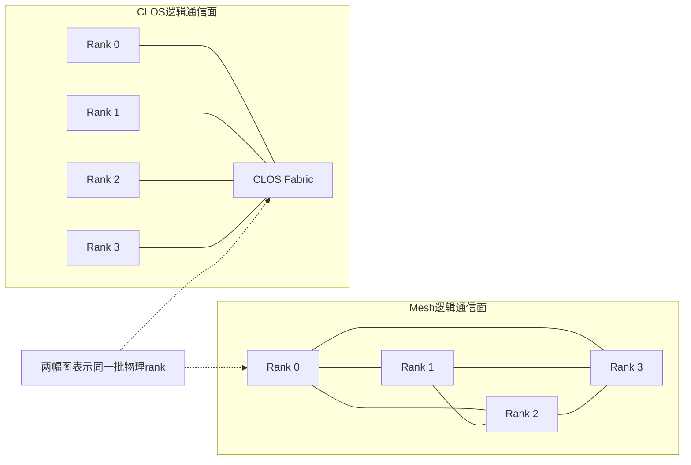

### Channel与Jetty

HCCL仓`docs/zh/architecture/architecture-brief.md`将Channel定义为两端Endpoint之间的数据通道，并指出Channel包含同步Notify；其硬件实现示例包括RoCE QP和UB Jetty连接。因此，Jetty位于UB Channel的底层连接和队列资源层，不是rank、算法步骤或拓扑类型。

“多Jetty”表示同一对通信rank之间存在多条可同时使用的UB Channel。算法仍与同一个NHR对端通信，但会把发往该对端的数据按`portGroupSize`切成多个不重叠分片，由多个channel和thread并行搬运。多Jetty不改变NHR伙伴计算和`ceil(log2 N)`通信轮数。

### NHR

HCCL仓`docs/zh/user_guide/coll_algo_intro/NHR.md`将NHR展开为Nonuniform Hierarchical Ring，中文为“非均衡的层次环”。NHR是集合通信算法，不是物理拓扑。它可以运行在CLOS、星型或胖树等可提供所需Channel的物理网络上。

对于`N`个rank，NHR AllGather执行`ceil(log2 N)`轮。第`step`轮的逻辑距离、收发伙伴和slice集合由当前源码`InsTempAllGatherNHR::GetStepInfo`计算：

```text
deltaRank = 2 ^ (nSteps - 1 - step)
recvFrom = rank - deltaRank mod N
sendTo   = rank + deltaRank mod N
```

每轮发送当前已经拥有的slice并接收新的slice，最终每个rank得到全部`N`份数据。非2次幂rank规模下，每轮slice数量可能不完全对称，源码通过向上取整公式和slice编号重排保持算法可执行。

### 四个rank的NHR简化示例

下面用4个rank和4份数据slice说明NHR AllGather的核心思想。设Rank 0至Rank 3初始分别持有`A`、`B`、`C`、`D`。4是2的幂，因此通信轮数为`ceil(log2 4) = 2`。每一轮都发送本轮开始时已经拥有的全部数据集合，而不是只发送最初的本地slice。

第一轮的逻辑距离为2，形成两组互换：Rank 0与Rank 2交换，Rank 1与Rank 3交换。轮结束后，Rank 0和Rank 2各拥有`{A,C}`，Rank 1和Rank 3各拥有`{B,D}`。第二轮的逻辑距离为1，每个rank向编号加1的rank发送，并从编号减1的rank接收，形成`Rank 0 -> Rank 1 -> Rank 2 -> Rank 3 -> Rank 0`的有向环。每个rank接收另外两份slice后都拥有`{A,B,C,D}`。

**图 2**  4个rank的NHR AllGather简化数据传播图

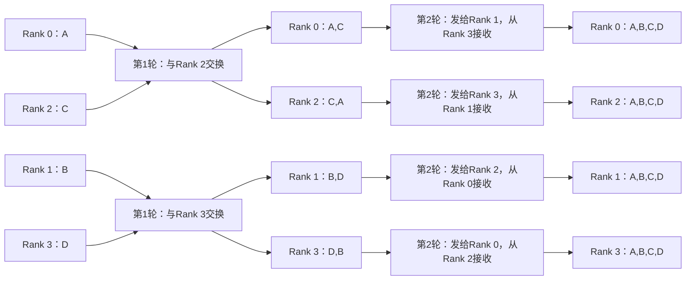

**图 3**  4个rank的NHR AllGather概念泳道图

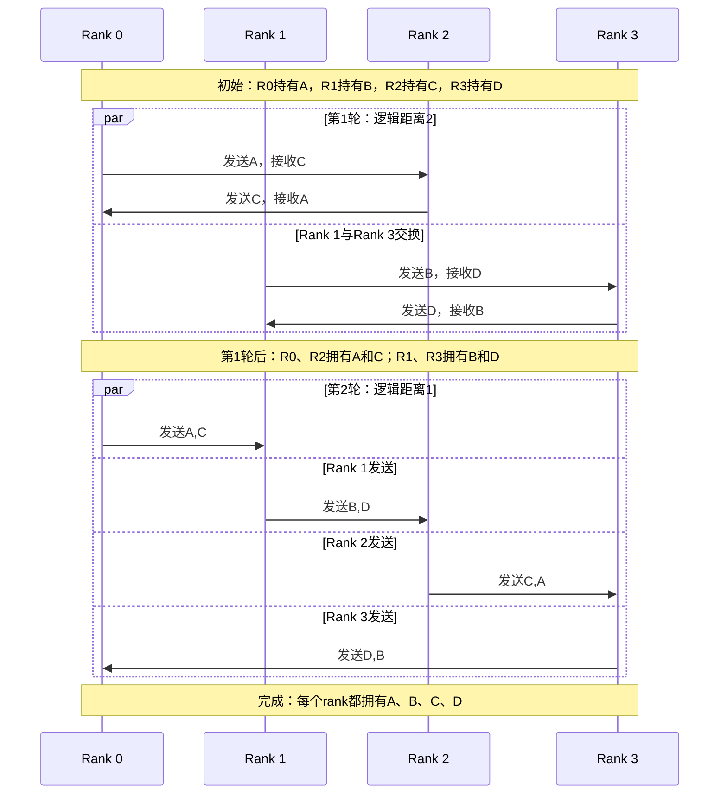

这张泳道图只表达算法的逻辑通信关系，不代表物理链路一定是Rank编号相邻的直连链路。实际HCCL执行时，`GetStepInfo`根据NHR拓扑和rank重排结果确定伙伴；Channel、Jetty和Thread负责把同一逻辑发送映射到真实通信资源。对于非2次幂的rank数，轮数仍取向上取整，但每轮参与交换的slice集合可能不对称。

### 八个rank的NHR简化示例

8个rank时，初始数据依次为`A`至`H`，通信轮数为`ceil(log2 8) = 3`。逻辑距离按`4 -> 2 -> 1`递减，每轮发送的数据量则按`1 -> 2 -> 4`份slice递增。每轮完成后，单个rank拥有的slice数翻倍，最终从1份增长到8份。

**图 4**  8个rank的NHR AllGather数据增长过程

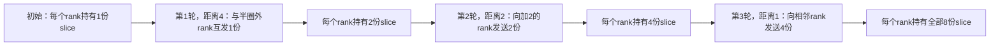

以Rank 0为例，其数据集合变化为：

```text
初始：{A}
第1轮从Rank 4接收：{A,E}
第2轮从Rank 6接收：{A,E,G,C}
第3轮从Rank 7接收：{A,B,C,D,E,F,G,H}
```

**图 5**  8个rank的NHR AllGather概念泳道图

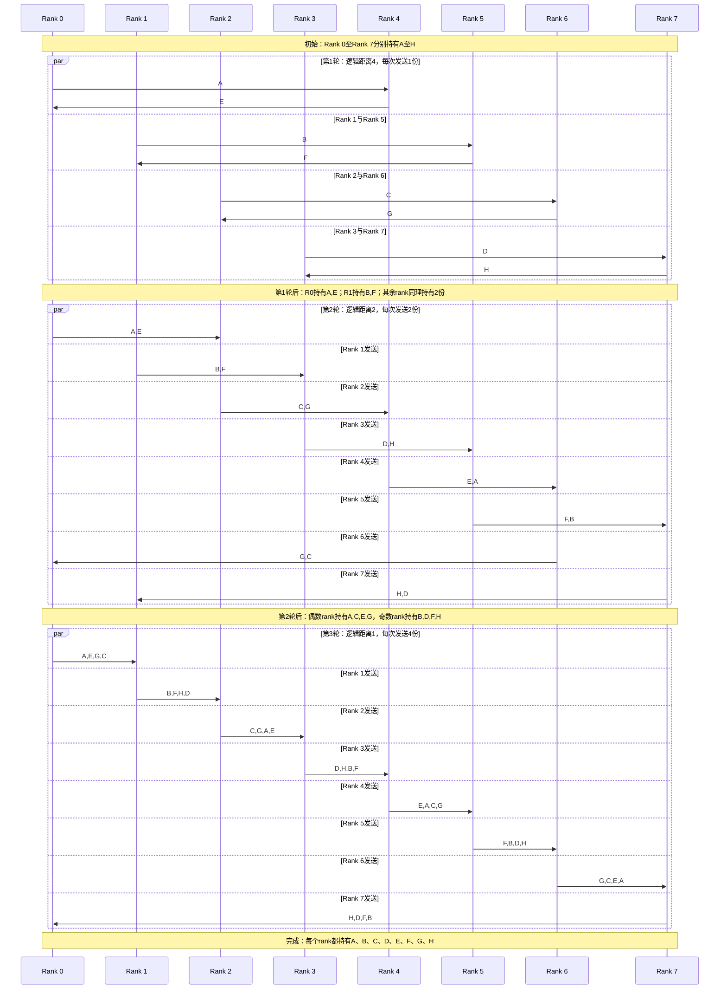

**图 6**  8个rank的NHR AllGather简化数据传播图

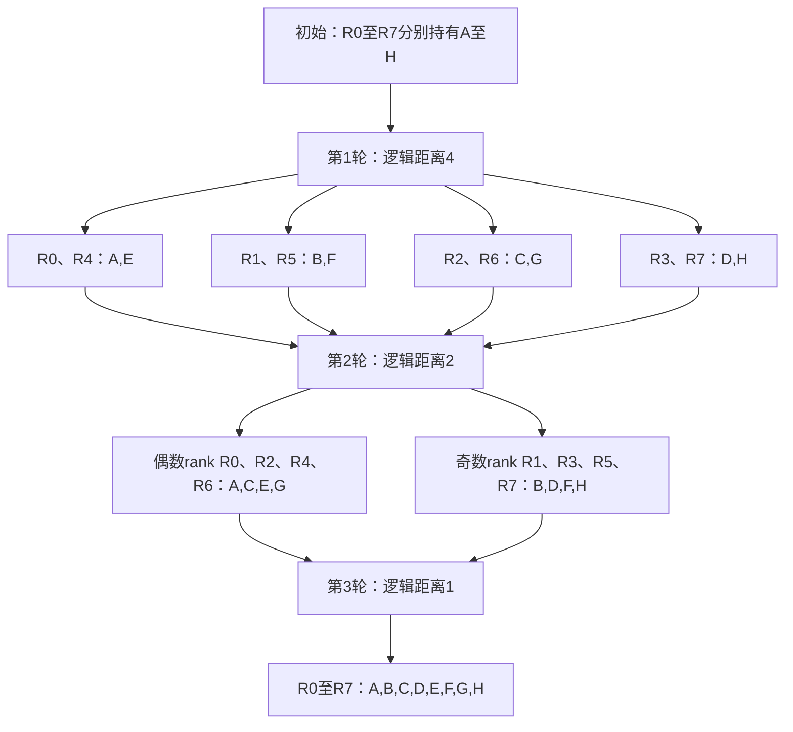

上图从数据集合合并的角度简化了8个rank的传播过程：

- 第1轮中，相距4的rank互发本地slice，形成`{A,E}`、`{B,F}`、`{C,G}`、`{D,H}`四个二元集合。
- 第2轮中，`Rank 0 -> Rank 2 -> Rank 4 -> Rank 6 -> Rank 0`和`Rank 1 -> Rank 3 -> Rank 5 -> Rank 7 -> Rank 1`两个有向环分别传播二元集合，形成偶数rank持有的`{A,C,E,G}`和奇数rank持有的`{B,D,F,H}`。
- 第3轮中，8个rank按`Rank 0 -> Rank 1 -> ... -> Rank 7 -> Rank 0`的有向环发送四元集合。相邻rank的奇偶集合互补，因此每个rank接收一次后便获得全部8份slice。

从4个rank和8个rank的例子可以归纳出NHR AllGather的学习要点：通信轮数随rank数呈对数增长；逻辑距离逐轮减半；单rank已拥有的数据量逐轮翻倍；发送伙伴是`rank + deltaRank`，接收伙伴是`rank - deltaRank`。只有当加、减逻辑距离指向同一rank时才表现为两两互换，其他轮次通常是有向环或多个有向环，不能一概画成pairwise交换。

### Template、Thread与Notify

HCCL架构文档将AICPU TS通信引擎描述为AICPU运行通信kernel、TS调度task。Thread是承载LocalCopy、Channel Read/Write和Notify等任务的执行上下文；不同Thread通过ThreadNotify同步。

本算法有三层并发和同步：

- Concurrent executor层：Mesh主thread和NHR主thread之间执行前同步与尾同步。
- Template层：Mesh和NHR分别管理内部主从thread同步。
- NHR性能层：最后一步通信thread与PostCopy thread并行。

## 迁移修改分类

迁移代码以asc-devkit提交`73d3ee053`为主体，随后提交`1690ebc33`把`CalcChannelRequestNhrMultiJetty`及其依赖进一步同步为当前HCCL实现。

本节按修改动机分类，而不是按文件机械分类。同一文件可能同时包含两类修改：与HCCL当前算法逐项对齐的代码归入“算法和公共依赖同步”；为适应asc-devkit MC2资源序列化、对象重建和ST入口而增加的代码归入“MC2多template适配”。

### HCCL算法更新和性能增强同步

**表 3**  HCCL算法更新和性能增强同步清单

| 文件 | 同步内容 | 性质 |
| --- | --- | --- |
| `ops/all_gather/selector/all_gather_auto_selector.cc` | 同步当前算法名和UBX大数据选择结果 | 算法选择同步 |
| `ops/all_gather/executor/ins_v2_all_gather_concurrent_executor.cc/.h` | 同步双template资源校验、`37:25`切分、scratch修复和错误传播 | Concurrent算法同步 |
| `ops/all_gather/template/aicpu/ins_temp_all_gather_nhr.cc/.h` | 同步多channel数据分片、`2C` thread、末步直达output、DMA Read/Batch Write和PostCopy并发 | NHR性能同步 |
| `ops/op_common/executor/channel/channel.cc/.h` | 同步NHR多Jetty Channel枚举、协议和CLOS/端口过滤、内存释放修复 | HCCL公共依赖同步 |
| `ops/op_common/template/template_utils.cc/.h` | 同步Jetty数计算、按port group切分和拓扑连通性判断 | HCCL公共依赖同步 |
| `ops/all_gather/executor/ins_v2_all_gather_sole_executor.cc` | 将Sole Mesh注册名改为当前HCCL名称 | 名称同步 |

说明：`ins_temp_all_gather_mesh_1D.cc`不是本轮HCCL增强重新同步的算法文件。Concurrent直接复用此前已迁移成功的Mesh template。本轮只通过公共基类接口和executor资源分区让它与NHR template协同工作。

### asc-devkit MC2多template适配

**表 4**  asc-devkit MC2多template适配清单

| 文件或模块 | 适配内容 | 原因 |
| --- | --- | --- |
| `ops/op_common/template/alg_v2_template_base.h` | 在`InsAlgTemplateBase`回补`channelsPerRank_`、`SetchannelsPerRank`和`CalcDataSplitByPortGroup` | 最新HCCL已将这些能力下沉到`CommonAlgTemplateBase`；asc-devkit尚未同步该基类重构，需要在现有基类等价桥接 |
| Concurrent executor的`PrepareResForTemplate` | 把统一thread数组切成Mesh和NHR两组，并建立template间notify | 一次资源上下文需要承载两套template任务 |
| Concurrent executor的`Orchestrate` | 从序列化资源恢复层次、thread、channel，清理运行期map并分别注入两个template | open server只保存统一的`AlgResourceCtxSerializable`，不能复用资源计算阶段的template对象状态 |
| Concurrent executor的`OrchestrateLoop` | 切分数据、scratch和loop，交替向不同thread集合下发两个template任务 | 保证两个任务图可在同一次入口中重叠执行 |
| NHR template的`KernelRun` | 从运行期channel map再次执行`SetchannelsPerRank` | MC2执行阶段会重建NHR template，需要恢复资源计算阶段得到的Jetty数；这是asc-devkit相对当前HCCL源码保留的生命周期适配 |
| MC2 open executor ST桥接 | 反序列化真实资源并调用产品`LaunchOpenOpParamDataImpl` | 验证本地registry、task cache和双template executor可达 |

本次没有修改以下MC2生产框架，因为主线能力已经满足要求：

- `CommKfcAicpuServer::Orchestrate`的消息循环。
- `LaunchOpenOpParamDataImpl`的本地executor查找。
- `RunWithMc2TaskCache`的capture、hit和回放流程。
- `AlgResourceCtxSerializable`对thread、channel、拓扑和scratch的序列化格式。
- CCU KFC Server及`DispatchKfcSubKernel`。

### ST与拓扑模拟适配

**表 5**  ST与拓扑模拟适配清单

| 文件 | 适配内容 | 验证目标 |
| --- | --- | --- |
| `all_gather_aicpu_testcase.cc` | 增加512KiB边界、600KiB Concurrent和MC2 open E2E | selector、算法名、任务图和open入口 |
| `topo_model/topo_model.cc` | 在测试开关下为同一批rank构造Mesh和CLOS两个实例 | 让`TopoMatchUBX`真实得到两个子通信域 |
| `aicpu/channel_stub.cc` | 为NHR生成第一阶段单Jetty CLOS channel | 与当前Concurrent等量门禁匹配 |
| `hccl_proxy/aclrt_stub.cc` | 记录算法名，并可转入产品`LaunchOpenOpParamDataImpl` | 验证一次launch进入MC2 open executor |
| `task_cache_test_stub.h`及相关stub | 记录open executor次数和cache事件 | 提供E2E可观测性 |
| ST相关`CMakeLists.txt` | 链接open executor、channel和cache依赖 | 确保测试使用产品实现而不是空桩 |

## 关键函数职责

### MC2 tiling与资源准备

`Mc2CcTilingConfig::GetTiling(Mc2InitTiling&)`位于`impl/adv_api/tiling/hccl/hccl_tiling.cpp`。它初始化MC2公共tiling，保存版本、queue数、通信block数和每个CC tiling的offset表。

`Mc2CcTilingConfig::GetTiling(Mc2CcTiling&)`把`groupName`、`algConfig`、`opType`、数据类型和`commEngine`写入通信tiling，并通过`UpdateMc2InitTiling`把该tiling相对公共tiling的offset登记到表中。

`GetOpParam`位于`impl/adv_api/detail/hccl/cc/src/common/hccl_alloc_ctx_res.cc`。它根据tiling构造静态`OpParam`，调用selector，写入`algName`，再调用`GetOpParamResCtx`申请和序列化算法资源。

`GetOpParamResCtx`从本地`CollAlgExecRegistryV2`取得Concurrent executor，再进入`HcclGetAlgRes`。后者依次调用`CalcAlgHierarchyInfo`和`CalcRes`，申请thread、notify、channel及CCL scratch，并生成`AlgResourceCtxSerializable`。

`AllocOpParamMemory`把包含算法名和资源指针的`OpParam`复制到设备侧，并把设备地址写入`OpResCtx.algInfo[i].opParam`。该地址同时作为后续KFC open消息中的`opParamKey`。

### Selector与拓扑

`AllGatherAutoSelector::SelectAicpuAlgo`位于`ops/all_gather/selector/all_gather_auto_selector.cc`。当前自动选择Concurrent的必要条件为：

- AICPU执行路径。
- 单层拓扑。
- `level0Topo == MESH_1D_CLOS`。
- Mesh和CLOS实例rank数相等。
- `userRankSize <= 4`。
- 单rank数据量严格大于512KiB。

等于512KiB时选择`AicpuAllGatherSoleMesh`；超过阈值才选择`AicpuAllGatherConcurMeshNHR`。需要特别注意，当前selector没有把`level0PcieMix == false`列为Concurrent命中条件，这与NHR template进入UBX多Jetty分支的条件不同。该差异属于现有HCCL/asc-devkit代码事实，后续扩展PCIe mix测试时必须单独确认fallback语义。

`TopoMatchUBX::MatchTopo`位于`ops/op_common/topo/topo_match_ubx.cc`。它读取RankGraph中的TopoInstance，并生成：

```text
algHierarchyInfo.infos[0][0] = Mesh子通信域rank
algHierarchyInfo.infos[0][1] = CLOS子通信域rank
```

Concurrent executor依赖该顺序把第一个子通信域交给Mesh template，把第二个子通信域交给NHR template。

当前`TopoForLayer0`按RankGraph返回的TopoInstance顺序写入`algHierarchyInfo`，没有按`CommTopo`重新排序。因此，资源提供方必须保证Mesh实例在前、CLOS实例在后。ST的`TopoModel::InitTopoInstsMap`在`HCCL_ST_UBX_CONCURRENT_TOPO=1`时显式登记实例`{0, SERVER_CLOS_INSTID}`，就是为了固定该顺序。若真实RankGraph不能保证顺序，应在后续框架改造中按拓扑类型构造两个明确的子通信域，不能继续依赖实例编号偶然有序。

`CalcAlgHierarchyInfo`是Concurrent executor到`TopoMatchUBX::MatchTopo`的桥接函数。文件末尾的`REGISTER_EXECUTOR_BY_TWO_TEMPS`把`AicpuAllGatherConcurMeshNHR`、`TopoMatchUBX`、`InsTempAllGatherMesh1D`和`InsTempAllGatherNHR`绑定成一个注册项。双template注册宏在主线已经存在，本轮只同步新算法名和具体算法实现。

### Channel申请

`CalcChannelRequestMesh1DWithPriorityTopo`为每个Mesh远端rank选择一条优先属于1DMesh拓扑的Channel。

`CalcChannelRequestNhrMultiJetty`先调用`CalcNHRChannelConnect`计算NHR所需伙伴，再遍历RankGraph的net layer和Link。AICPU路径期望`UBC_CTP`，AIV路径期望`UB_MEM`。它不会只取第一条Link，而是把同一NHR对端符合条件的CLOS Channel全部加入结果。

`ProcessLinksForChannelMutiJetty`负责逐Link过滤：

- 协议必须匹配当前执行引擎。
- `GetTopoTypeByLink`必须判定为CLOS。
- `IsPortEqual`必须满足当前隔离模式的EID端口规则。
- 合格Link被转换为`HcclChannelDesc`并保留。

`GetTopoTypeByLink`通过Endpoint匹配Link所属TopoInstance。同步后的实现对所有返回路径释放临时`endPointDescs`，修复了原有内存泄漏。

`IsEndPointEqual`比较Endpoint协议、地址类型和EID；PCIe没有可按UB方式比较的EID，因此PCIe分支只比较协议和地址类型。`IsPortEqual`读取EID的端口字节：隔离模式选择端口值相同且不为127的Link，非隔离模式选择端口值同为127的Link。Link数量小于8时，`ProcessLinksForChannelMutiJetty`为兼容旧资源形态关闭隔离筛选。

`CalcChannelsPerRank`分别支持`HcclChannelDesc`数组和运行期channel map，用于计算任一远端rank拥有的最大Channel数。`CalcDataSplitByPortGroupCommon`按`portGroupSize`分配元素数量，最后一条Channel接收余数。`IsAllConnetedWithTopo`根据当前net layer的实例rank数判断指定拓扑是否覆盖整个本地通信域，NHR `CalcRes`用它计算端口隔离策略。

### Concurrent executor资源计算

`InsV2AllGatherConcurrentExecutor::CalcRes`执行以下工作：

- 校验`algHierarchyInfo`至少包含Mesh和CLOS两个子通信域。
- 分别构造Mesh和NHR template并调用各自`CalcRes`。
- 把两套template的slave thread和notify需求累加。
- 额外申请一个thread，使NHR主thread能够作为Mesh主thread之外的第二个template主thread。
- 分别申请Mesh和NHR channel，再按“Mesh在前、NHR在后”拼进统一资源。
- 保留`temp0Channels.size() == temp1Channels.size()`门禁。

4rank、第一阶段单Jetty时，典型thread布局为：

```text
Mesh template: 3个thread，分别服务3个远端rank
NHR template:  2个thread，1个通信thread + 1个PostCopy thread
总计:          5个thread
```

`PrepareResForTemplate`重新调用两个template的`GetRes`计算边界，把统一`threads_`切成`tmp0Threads_`和`tmp1Threads_`。`tmp0Threads_[0]`是整个Concurrent的主thread，`tmp1Threads_[0]`是NHR主thread。函数同时记录两个template之间前同步和尾同步使用的notify索引。

`Orchestrate`从`AlgResourceCtxSerializable`恢复资源，重新构造两个template，并把统一channel数组拆成两个`remoteRank -> channels`映射。第一阶段仍以`rankSize - 1`作为Mesh channel段长度，因此只有等量门禁允许的单Jetty资源形态是安全可达的。

`SetchannelsPerRank`根据运行期channel map重新计算`channelsPerRank_`。这是MC2适配中的关键状态恢复：`CalcRes`阶段的template对象已经销毁，open server执行时创建的是新对象，不能依赖旧对象中的Jetty数。

`GenTemplateAlgParams`为每次loop生成template数据参数，把统一输入、输出和CCL Buffer转换为当前数据段的`dataOffset`、`dataCountPerLoop`和`scratchOffset`。它保留AllGather的`outputSliceStride`，因此Mesh和NHR处理的是每个rank输出slot内相同位置的前段或后段，而不是把不同rank的完整slot分给不同template。

### 37:25数据与scratch切分

比例常量定义在：

```text
文件：impl/adv_api/detail/hccl/cc/src/ops/all_gather/executor/ins_v2_all_gather_concurrent_executor.cc
常量：MESH_BW_AICPU = 37
常量：CLOS_BW_AICPU = 25
```

`GetParallelDataSplit`在AICPU TS路径计算：

```text
meshRatio = 37 / (37 + 25)
nhrRatio  = 25 / (37 + 25)
```

`OrchestrateLoop`把比例落实为整数元素数：

```text
totalCount0 = floor(dataCount * 37 / 62)
totalCount0再向下对齐到HCCL_MIN_SLICE_ALIGN
totalCount1 = dataCount - totalCount0
NHR起始字节偏移 = totalCount0 * dataTypeSize
```

因此余数和对齐损失都归NHR段，最终仍满足无重叠、无遗漏和完整覆盖。

**图 7**  37:25数据切分和输出布局

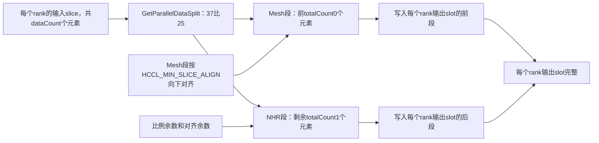

scratch不是简单按字节直接乘`37:25`。`OrchestrateLoop`先取得两个template的`CalcScratchMultiple`，再对“比例乘scratch倍数”向上取整，按整数block划分scratch。NHR的大小使用：

```text
scratchSizeforTemp1 = maxTmpMemSize - scratchSizeforTemp0
```

这是从HCCL同步的重要修复。旧实现使用`scratchMemBlockSize - scratchSizeforTemp0`，可能缩小甚至错误计算NHR scratch。

### Mesh template

`InsTempAllGatherMesh1D::GetThreadNum`在多rank场景返回`rankSize - 1`，即每个远端rank对应一个thread。

`LocalDataCopy`把本rank输入放入正确的output slot；不允许直接访问对端output时，还会把本地slice放入CCL scratch，供远端读取。

`RunAllGatherMesh`遍历所有远端rank，为每个远端构造收发slice。当前AICPU实现使用`SendRecvRead`：每个thread通过对应Mesh Channel读取远端slice到本地output的目标slot。多个远端rank使用不同thread，因此可以并发。

**图 8**  Mesh template算法流程

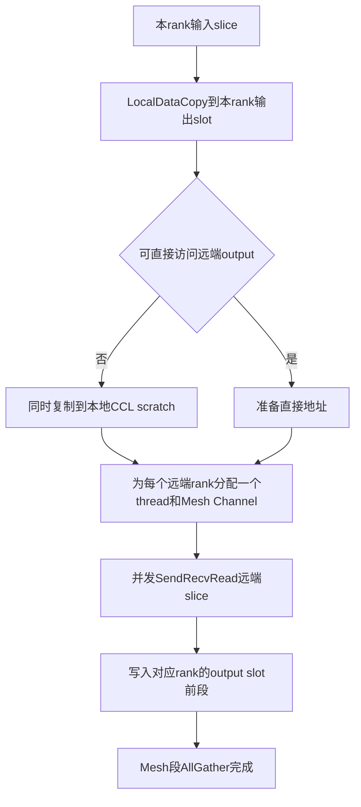

### NHR template

`InsTempAllGatherNHR::CalcRes`在UBX场景调用`CalcChannelRequestNhrMultiJetty`，保留`UBC_CTP` Channel，计算`channelsPerRank_`，再按Jetty数申请thread和notify。

`GetThreadNum`返回`2 * channelsPerRank_`。设`C = channelsPerRank_`，前`C`个thread负责每个Jetty的NHR通信，后`C`个thread用于最后一步与`PostLocalCopy`重叠。`GetRes`为每个slave thread申请两个notify：一个用于template内部主从同步，另一个用于末步通信与PostCopy同步。

`PrepareDataSplitForMultiChannel`调用`CalcDataSplitByPortGroup`，按每条Channel的`portGroupSize`权重切分当前NHR数据段。最后一个Channel接收整除余数，保证所有Jetty分片无遗漏。

`KernelRun`从实际channel map恢复Jetty数，准备数据切分，完成内部前同步，然后逐`channelIdx`执行`LocalDataCopy -> RunAllGatherNHR -> PostLocalCopy`，最后执行内部尾同步。

`GetStepInfo`计算当前NHR轮次的收发伙伴、发送slice和接收slice。`RunAllGatherNHR`循环`ceil(log2 N)`轮，`RunStepNHR`根据协议选择DMA Read或Batch Write。

`RunLastStepReadToOutput`是本轮同步的主要性能增强：最后一步满足条件时，通信thread直接把尚未拥有的slice读到output；同时启动独立PostCopy thread，把此前已经位于本地scratch中的slice复制到output。两部分写入互不重叠的slice集合。

与末步优化直接相关的辅助函数如下：

- `CanReadLastStepToOutput`检查当前不是DMA Read、没有远端内存直访、目标为真实output且output与CCL Buffer不同。
- `CanSkipOwnSliceCopy`判断本rank自己的slice是否已经位于最终output位置，可以避免重复复制。
- `CalcSliceInfo`统一计算普通slice和tail slice在当前Jetty分片内的size、partial offset及scratch offset。
- `BuildStepSlices`按普通步骤或末步直达模式构造发送源、发送目标、接收源和接收目标四组`DataSlice`。
- `IsLastStepReadSlice`记录末步已经直达output的slice，使`PostLocalCopy`跳过这些slice。
- `LocalDataCopy`只复制当前`channelIdx`负责的本rank局部数据到scratch。
- `PostLocalCopy`只复制当前Jetty负责且尚未直达output的slice。
- `GetNotifyIdxMainToSub`和`GetNotifyIdxSubToMain`为NHR内部全部通信和PostCopy thread生成前、尾同步notify索引。

**图 9**  NHR template算法流程

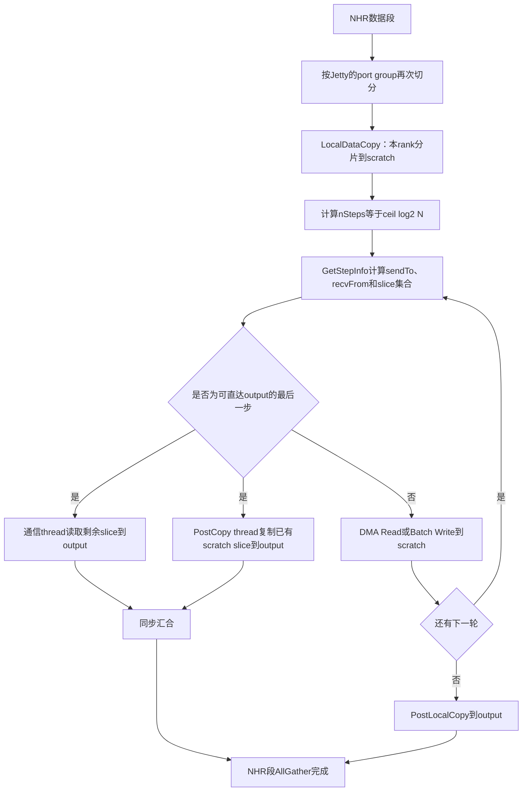

### MC2 KFC Server复用点

`HcclImpl::InitV2`位于`impl/adv_api/detail/hccl/impl/platform_v310/hccl_aicpu.h`。它保存公共tiling基址和`OpResCtx`，并以`OpResCtx.workspace`作为AI Core与常驻AICPU KFC Server之间的消息区。

`HcclImpl::SetCcTilingV2`根据通信tiling中的`opType`登记tiling offset，并从`OpResCtx.algInfo`找到同一offset对应的`opParamKey`。随后`HcclImpl::AllGather`通过`CommonPrepareImpl`组装AllGather参数，`SendMsgToServer`把动态input、output、count、dtype、stride、repeat和`opParamKey`写入`HcclMsg`。

`CommKfcAicpuServer::AddOpContext`位于`comm_kfc_aicpu_server.cc`。Server启动时遍历`OpResCtx.algInfo`，调用`LoadOpenOpParamData`读取静态`OpParam`，再调用`AcquireOpenResCtx`反序列化或复用完整算法资源，形成以`opParamKey`索引的`ServerExecCtx`。

`CommKfcAicpuServer::Orchestrate`处理运行期消息。它按`opParamKey`匹配`ServerExecCtx`，等待AI Core Commit计数，调用`FormatOpParamFromMsg`把动态地址和shape覆盖到静态参数，再调用`LaunchOpenAicpuKernelServer`。每个repeat完成后，Server更新`finishedTurnCnt`，解除AI Core侧`Wait`。

`LaunchOpenOpParamDataImpl`位于`comm_kfc_open_kernel_executor.cc`。AllGather不在Cann bridge白名单中，因此它使用本地registry按`opType + algName`取得Concurrent executor，并以`executor->Orchestrate`作为`RunWithMc2TaskCache`的cache miss回调。这条既有通路天然允许一个executor向多个TS thread下发任务，本轮无需改变KFC消息格式或Server dispatch数量。

## 端到端调用流程

### 总流程图

**图 10**  MC2 tiling到AllGather完成的端到端流程

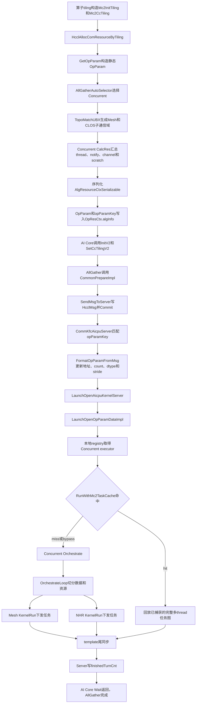

### 端到端泳道图

**图 11**  MC2 AllGather Concurrent端到端泳道图

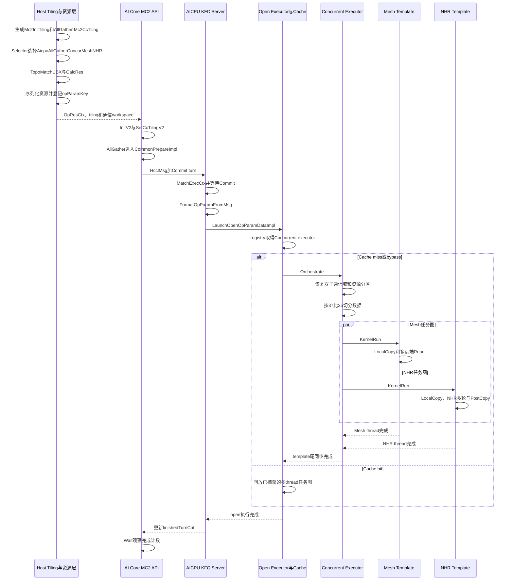

## 多template并发细化

### 并发执行流程图

**图 12**  双template任务下发和设备并发流程

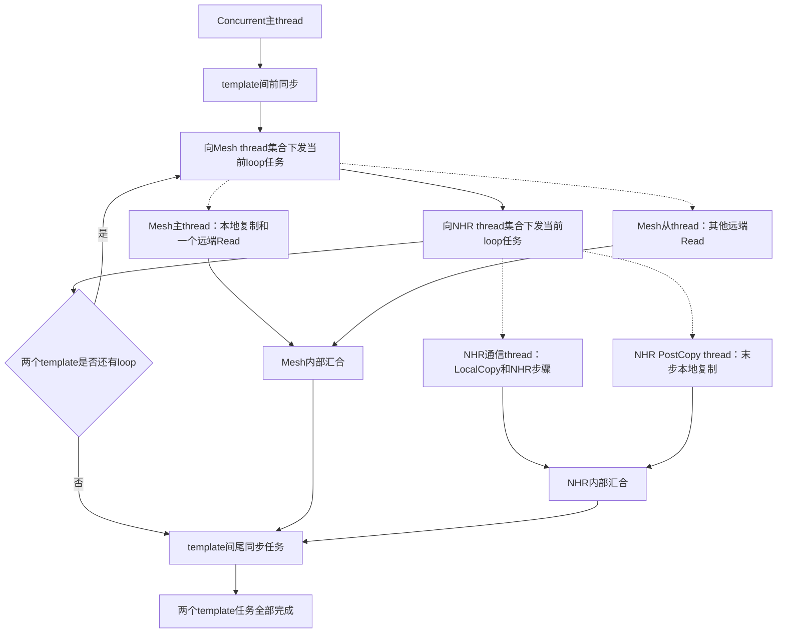

图中的实线主路径表示AICPU C++侧的任务下发顺序，虚线表示任务被放入不同TS thread。设备执行时，Mesh thread集合与NHR thread集合可重叠推进；尾同步只有在两个集合都完成后才能通过。

### 资源分区图

**图 13**  双template统一资源的拆分关系

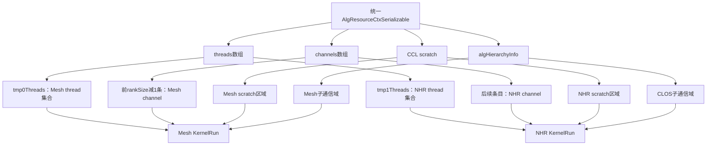

### 双template与NHR末步泳道图

**图 14**  Mesh、NHR及PostCopy并发泳道图

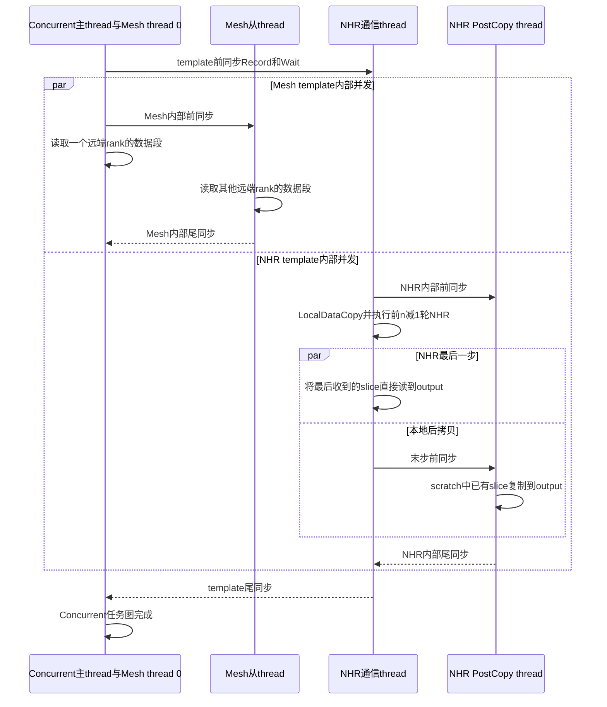

`OrchestrateLoop`在C++控制流中先调用Mesh `KernelRun`，再调用NHR `KernelRun`，并在多loop时交替调用。但这些函数主要是向各自的TS thread下发任务；调用返回不表示对应设备任务已经完成。因此，C++调用顺序和设备执行串并行不能画等号。真正的依赖关系由thread归属和前、尾Notify决定。

## Cache行为

`LaunchOpenOpParamDataImpl`对AllGather直接从asc-devkit本地`CollAlgExecRegistryV2`取得executor，不走Cann bridge。它调用`RunWithMc2TaskCache`：

- cache miss时，启动capture并调用Concurrent `Orchestrate`，捕获Mesh、NHR及所有Notify任务。
- cache hit时，不重新调用executor，直接回放完整多thread任务图。
- bypass时，直接调用executor但不发布cache。
- capture或执行失败时，清理未完成tag，防止后续命中半份任务图。

因此，多template适配不需要在KFC Server增加“两次kernel dispatch”。需要保证的是cache摘要能够区分算法名、shape、层次、thread、notify、channel和资源上下文，并且HCOMM capture覆盖所有参与thread。

## 第一阶段多Jetty边界

产品`CalcChannelRequestNhrMultiJetty`已经与HCCL当前实现一致，可以返回同一NHR对端的多条合格CLOS Channel；NHR template也已经具备按Jetty切数据和使用`2C` thread的实现。但是Concurrent executor仍保留：

```text
temp0Channels.size() == temp1Channels.size()
```

Mesh侧当前每个远端只选择一条Channel。因此该门禁使Concurrent成功路径实际仍限制为NHR单Jetty。与此同时，`Orchestrate`仍用固定`rankSize - 1`切分Mesh和NHR channel段。直接解除门禁会产生以下风险：

- NHR的额外Channel被误分到Mesh channel map。
- thread和notify已经按错误Jetty数完成切分。
- `channelsPerRank_`恢复时机晚于`PrepareResForTemplate`。
- cache捕获的任务图与资源摘要可能不一致。

所以本文把“双template并发”与“真实多Jetty”严格区分：前者已完成并通过ST，后者仍需第二阶段重构channel段元数据、资源公式和多Jetty E2E后才能开放。

## ST验证链

`RunAllGatherAicpuA5`位于`tests/api/adv_api/hccl/cc/st/algorithm/testcase/all_gather_aicpu_testcase.cc`。它为每个模拟rank创建通信域、stream和输入输出buffer，真实调用`HcclAllGather`，最后检查算法名、open入口次数、活跃task queue数量和AllGather任务图语义。

当前关键用例为：

**表 6**  AllGather Concurrent关键ST用例

| 用例 | 数据量 | 主要断言 |
| --- | --- | --- |
| `st_all_gather_a5_aicpu_ubx_4rank_512kb_selects_sole_mesh_test` | 512KiB | 命中`AicpuAllGatherSoleMesh` |
| `st_all_gather_a5_aicpu_ubx_4rank_concurrent_mesh_nhr_e2e_test` | 600KiB | 命中Concurrent、每rank至少4个活跃queue、`CheckAllGather`通过 |
| `st_all_gather_a5_aicpu_ubx_4rank_concurrent_mc2_open_executor_e2e_test` | 600KiB | 每rank进入一次产品`LaunchOpenOpParamDataImpl` |

open executor用例不重复执行最终成图校验，因为常驻KFC Server的初始thread wait位于该用例的任务捕获窗口之外。完整数据语义由同参数的普通Concurrent E2E验证；open用例负责证明资源反序列化、本地registry、task cache runner和Concurrent `Orchestrate`可达。两者合起来构成当前ST证据链。

已记录的第一阶段验收结果为：

- `mc2_client`构建通过。
- HCCL checker 107/107通过。
- `--adv_test_two`常规测试412/412和HCCL checker 107/107通过。
- 9.2.0 run包生成成功。
- `git diff --check`通过。

这些结果证明单die、单Jetty模拟资源下的双template任务图和MC2 open调用链正确，不等价于真实UBX硬件带宽收益或多Jetty上板验证。

## 串讲建议

方案串讲时建议按以下逻辑展开：

- 先说明UBX提供同一批rank的Mesh和CLOS双通信面，NHR是算法，Jetty是Channel底层资源。
- 再说明Concurrent不是两个host入口kernel，而是一次open入口中的两个template任务图。
- 展示`CalcRes`如何把两套资源合并，`Orchestrate`如何在MC2反序列化后重新拆分。
- 展示`37:25`如何把每个rank的slice分为互不重叠的Mesh前段和NHR后段。
- 展示Mesh多远端并发、NHR多轮传播和末步PostCopy并发。
- 最后说明MC2 KFC Server和task cache无需新增第二次dispatch，以及第一阶段真实多Jetty仍受等量门禁约束。

## 参考资料

- HCCL仓`docs/zh/architecture/architecture-brief.md`：RankGraph、Channel、Jetty、Thread和Notify概念。
- HCCL仓`docs/zh/user_guide/hccl_intro.md`：UB即Unified Bus。
- HCCL仓`docs/zh/user_guide/coll_algo_intro/NHR.md`：NHR全称、生成树模型、通信步数和非2次幂支持。
- HCCL仓`docs/zh/user_guide/hccl_env/HCCL_ALGO.md`：NHR适用场景。
- asc-devkit仓`docs/cc_algorithm/cc-concept.md`：UBX、NHR及相近概念边界。
- asc-devkit仓`docs/cc_algorithm/ubx_multi_kernel_algorithm_migration.md`：迁移实施、测试命令和验收记录。
