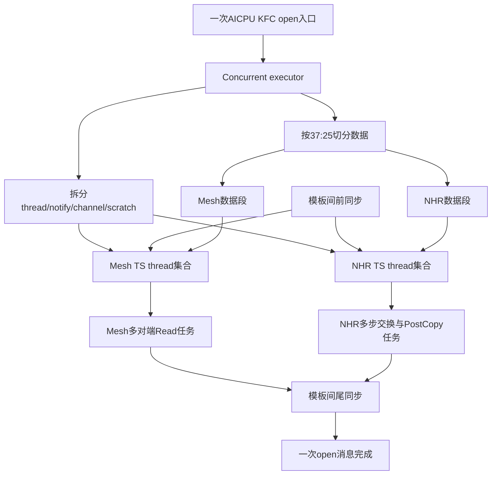
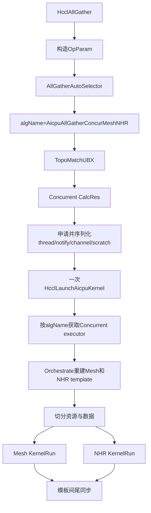
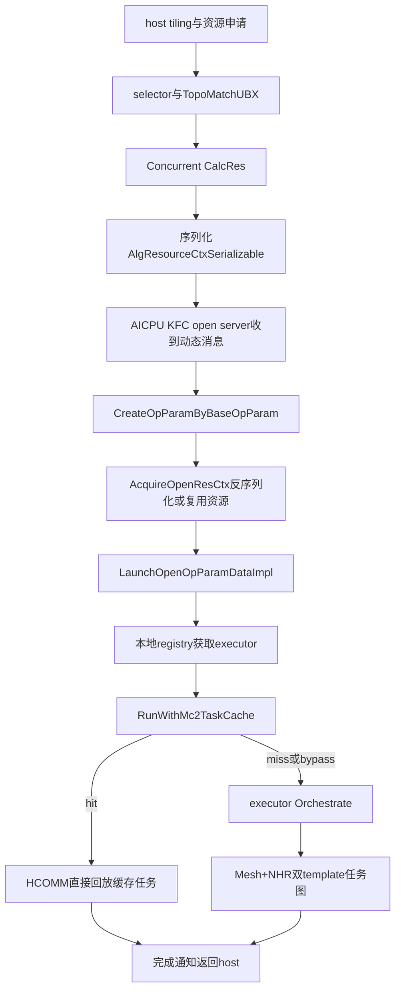

# UBX多Kernel算法迁移与验证记录

## 需求

将HCCL中的AICPU AllGather算法`AicpuAllGatherConcurMeshNHR`迁移到asc-devkit，并适配现有MC2 AICPU KFC open server调用框架。迁移需同步HCCL的Concurrent executor、NHR性能优化和相关公共能力，并通过真实selector、资源申请、open server、executor和双template任务图完成端到端ST。

本文同时记录迁移设计和第一阶段实施结果。实施范围限定为AllGather、AICPU、UBX、MC2和单die，不考虑双die，不迁移HalfAllToAllV，也不扩展CCU算法。

## 第一阶段实施结论

第一阶段已完成，结论如下：

- `AicpuAllGatherConcurMeshNHR`已从HCCL同步到asc-devkit的MC2 AICPU本地执行链，源提交为`4b5e0ea26707d3dbc28c31b34c7aca5bea9bd308`。
- selector、executor注册名和Sole Mesh名称已分别统一为`AicpuAllGatherConcurMeshNHR`和`AicpuAllGatherSoleMesh`，代码中不再残留两个旧名称。
- Concurrent executor已同步资源校验、AICPU `37:25`数据切分、scratch余量修复和子template错误传播。
- NHR template已同步按channel分段、通信thread与PostCopy thread并行、DMA Read/Batch Write、末步直达output和传输错误传播等性能实现。
- `channelsPerRank_`和按port group切分能力已下沉到现有AICPU template公共基类；运行期channel map会恢复template状态。
- `CalcChannelRequestNhrMultiJetty`接口已接入，但第一阶段实现有意只为每个NHR对端申请一条CLOS channel，同时保留Mesh/NHR channel总数相等检查。因此本阶段只支持HCCL当前可达的单Jetty路径，不能据此宣称支持真实多Jetty。
- KFC适配只涉及MC2 AICPU open executor。没有修改CCU、`DispatchKfcSubKernel`或KFC Server的CCU dispatch。
- 普通Concurrent E2E完成selector、资源申请、AICPU launch、Concurrent executor、双template多thread任务图和`CheckAllGather`语义校验。
- MC2 open executor E2E会反序列化真实`AlgResourceCtxSerializable`，调用产品`LaunchOpenOpParamDataImpl`，并进入本地registry、task cache runner和Concurrent `Orchestrate`。该用例逐rank断言open executor入口被调用；由于常驻KFC Server的初始thread wait不在本用例捕获窗口内，它不重复执行`CheckAllGather`。完整任务图和结果语义由同参数的普通Concurrent E2E负责验证。

第一阶段验收结果为：`mc2_client`编译通过，HCCL checker 107/107通过，`--adv_test_two`中的常规测试412/412及HCCL checker 107/107通过，9.2.0 run包生成成功，`git diff --check`通过。详细命令、日志和产物见“实际构建与验收结果”。

## 分析基线

| 项目 | 分支 | 提交 |
| --- | --- | --- |
| HCCL源仓`../hccl` | `master` | `4b5e0ea26707d3dbc28c31b34c7aca5bea9bd308` |
| asc-devkit目标仓 | `cc0806_2` | `6768ea9798d64b545dc457fbffc01aa1ba074947` |
| asc-devkit主线基线 | `trunk/master` | `c1693623cc896b7ea3244bb19abb944ca8ff0ac8` |

HCCL工作区干净且当前HEAD与`origin/master`一致。`cc0806_2`直接基于上述`trunk/master`，因此本文所称“相对master”均指`trunk/master..cc0806_2`。

算法名称已经更新，迁移时必须使用新名称：

| 旧名称 | HCCL当前名称 | 角色 |
| --- | --- | --- |
| `InsAllGatherMesh1D` | `AicpuAllGatherSoleMesh` | 已迁移的单template参照算法 |
| `InsAllGatherConcurrentMesh1DNHR` | `AicpuAllGatherConcurMeshNHR` | 第一阶段已迁移的Mesh+NHR双template算法 |

selector返回值、executor注册名、强制算法配置、日志和ST断言必须统一为新名称。除非存在已发布接口的兼容要求，否则不同时注册新旧名称，避免同一算法出现两套cache tag和测试口径。

## 核心结论

1. 用户所称“多kernel”在当前源码中的准确含义是：一次AICPU通用入口launch、一个Concurrent executor、Mesh和NHR两个template、多条AICPU TS thread上的任务图。它不是host连续启动两个独立AICPU入口kernel。
2. `AicpuAllGatherSoleMesh`是单template算法，但Mesh template本身可使用多个TS thread；“单template”不等于“单thread”。
3. `AicpuAllGatherConcurMeshNHR`把同一份AllGather数据按带宽权重切为不重叠的Mesh段和NHR段，再把thread、notify、channel和scratch资源分区，使两套任务在不同TS thread上重叠执行。
4. asc-devkit的`trunk/master`已经包含旧版Concurrent executor、旧版NHR、`TopoMatchUBX`和双template注册框架。因此本次不是从零新增多template框架，而是同步HCCL新语义、补齐资源状态恢复和E2E可观测性。
5. asc-devkit主线已经具备MC2专用AICPU task cache，并已接入KFC open server。不能机械复制HCCL通用task cache文件；应复用现有`RunWithMc2TaskCache`，补充双template任务捕获和回放验证。
6. 当前HCCL Concurrent实现尚未形成真实多Jetty闭环：它请求NHR多Jetty channel，却又要求Mesh和NHR的channel描述总数相等；而Mesh侧当前每个对端只取一条channel。该条件把成功路径实际约束为NHR单Jetty。
7. 当前HCCL还有一个被上述等量条件掩盖的状态问题：`CalcRes`中的NHR对象根据channel计算`channelsPerRank_`，`Orchestrate`却重新构造NHR对象，未从反序列化后的channel map恢复该值。解除channel等量限制前必须先修复这一点。
8. HCCL当前通过`CommonAlgTemplateBase`统一承载`channelsPerRank_`、`SetchannelsPerRank`和按port group切分数据的能力，asc-devkit仍把这些能力局部放在Mesh template中。迁移NHR前必须先形成公共能力，但不应照搬HCCL对所有`KernelRun`签名的改动，否则会波及大量既有template。
9. asc-devkit现有ST拓扑模型不能直接构造有效UBX E2E。模型会为2D布局挂载CLOS实例ID，但没有给该实例填充rank集合；必须修复模拟rank graph和channel生成后再写Concurrent主链用例。

因此采用分阶段实施：第一阶段严格迁移HCCL当前可达的单Jetty Concurrent路径并完成E2E，现已完成；第二阶段只有在修正资源分区并增加多Jetty ST后，才允许解除channel等量限制。当前不得宣称支持真实多Jetty。

## 执行模型

### Sole Mesh与Concurrent的区别

| 维度 | `AicpuAllGatherSoleMesh` | `AicpuAllGatherConcurMeshNHR` |
| --- | --- | --- |
| host入口launch | 1次 | 1次 |
| executor | Sole executor | Concurrent executor |
| template | 1个Mesh | Mesh+NHR两个 |
| 子通信域 | Mesh通信域 | Mesh通信域和CLOS通信域 |
| 数据范围 | 单template处理全部数据 | Mesh处理前段，NHR处理后段 |
| thread资源 | Mesh内部thread集合 | 两个template的thread集合加模板间协调thread |
| channel资源 | Mesh对端channel | Mesh channel段和NHR channel段 |
| scratch | 单template使用 | 按比例切成不重叠区域 |
| 同步 | Mesh内部主从同步 | template内部同步加模板间前/尾同步 |

双template任务图如下：



Concurrent executor在C++中交替调用两个`KernelRun`，但生成的通信任务被投递到不同TS thread，因此任务可并发；不能用C++调用的先后顺序推断设备侧串行。

## HCCL当前实现

### Selector命中条件

HCCL当前selector仅在以下条件同时满足时自动选择`AicpuAllGatherConcurMeshNHR`：

- AICPU执行路径。
- `topoLevelNums == 1`。
- `level0Topo == MESH_1D_CLOS`。
- `level0PcieMix == false`。
- Mesh和CLOS通信域rank数相等。
- `userRankSize <= MAX_RANK_NUM_FOR_CONCURRENT_ALGO`，当前为最多4 rank。
- 单rank数据量严格大于512 KiB。

数据量等于512 KiB时选择`AicpuAllGatherSoleMesh`。PCIe mix、非等规模Mesh/CLOS和大于4 rank的路径不得误命中Concurrent。

### 资源计算

`TopoMatchUBX`应产生两个有序子通信域：

```text
algHierarchyInfo.infos[0][0] = Mesh ranks
algHierarchyInfo.infos[0][1] = CLOS ranks
```

Concurrent `CalcRes`分别调用Mesh和NHR template的`CalcRes`，然后合并资源：

```text
slaveThreadNum = mesh.slaveThreadNum + nhr.slaveThreadNum + 1
notifyNumOnMainThread = mesh.notifyNumOnMainThread + 1
notifyNumPerThread = mesh.notify列表
                   + [nhr.notifyNumOnMainThread + 1]
                   + nhr.notify列表
channels[0] = Mesh channel描述 + NHR channel描述
```

额外的一个thread和notify用于两个template主thread之间的启动与汇合。实施时需检查`algHierarchyInfo.infos[0].size() >= 2`、thread总数、notify向量长度和channel边界，禁止依赖`vector::at`或迭代器越界来暴露资源错误。

### 数据和scratch切分

AICPU TS路径按`37:25`切分数据。Mesh段向下按`HCCL_MIN_SLICE_ALIGN`对齐，余数全部归NHR段，满足：

```text
meshCount + nhrCount = dataCount
meshRange与nhrRange不重叠
meshRange并nhrRange覆盖完整输入
```

scratch按两个template的`CalcScratchMultiple`和数据比例切分。必须同步HCCL修复：

```text
nhrScratchSize = maxTmpMemSize - meshScratchSize
```

旧代码使用`scratchMemBlockSize - meshScratchSize`会错误缩小或下溢NHR区域。还需校验两个template的`maxCountPerLoop`非0、所有offset和乘法无溢出、loop末块不越过各自数据段。

### NHR性能更新

HCCL新NHR相对asc-devkit旧实现包含以下有效更新：

- 使用`CalcChannelRequestNhrMultiJetty`并按协议筛选UBC CTP channel。
- 由channel计算`channelsPerRank_`，thread数量扩展为`2 * channelsPerRank_`。
- 每个Jetty独立切分数据和offset，分别处理普通slice与tail slice。
- 每个Jetty使用独立通信thread；另一组thread用于末步通信与`PostLocalCopy`并行。
- 根据链路协议选择DMA Read或Batch Write。
- 在满足条件时将NHR末步直接读到output，跳过已落到output的数据再次复制。
- 对thread、channel key和channel下标增加边界检查，数据传输调用传播错误码。

这些更新应按asc-devkit命名空间、基础类签名和CANN兼容宏适配迁移，不能整文件覆盖。

### HCCL调用链



## asc-devkit迁移前状态

### 相对trunk/master的事实

`cc0806_2`相对`trunk/master`在AllGather AICPU算法层只修改了selector中的无关CCU收敛逻辑；AICPU `SelectAicpuAlgo`、Concurrent executor、NHR template、Mesh template和AllGather AICPU ST均与master相同。当前仍使用旧算法名：

- `InsAllGatherMesh1D`
- `InsAllGatherConcurrentMesh1DNHR`

旧版Concurrent和NHR已经存在，但缺少HCCL当前的资源校验、`37:25`切分、scratch修复、NHR多Jetty helper及末步复制优化。

### 已具备的公共框架

以下能力已经位于`trunk/master`，本次应复用而不是重复实现：

- `REGISTER_EXECUTOR_BY_TWO_TEMPS`双template注册框架。
- `TopoMatchUBX`和`AlgResourceCtxSerializable`的层级、thread、notify、channel序列化。
- MC2 AICPU KFC open server的动态消息处理和资源上下文缓存。
- `CreateOpParamByBaseOpParam`对AllGather的input、output、count、dtype和`strideCount`更新。
- AllGather不走Cann bridge，直接从asc-devkit本地`CollAlgExecRegistryV2`获取executor。
- `RunWithMc2TaskCache`及MC2专用task cache key、manager、clear和通信域生命周期清理。

当前AllGather open路径为：



## 相对master的已实施修改

### 必须新增或同步

| 层次 | 修改点 | 目的 |
| --- | --- | --- |
| 名称 | selector和注册统一为`AicpuAllGatherSoleMesh`、`AicpuAllGatherConcurMeshNHR` | 与HCCL当前名称一致，避免registry和cache tag分裂 |
| Selector | 同步HCCL当前UBX、PCIe mix、512 KiB、rank上限和fallback条件 | 只在有完整资源的场景命中Concurrent |
| Concurrent executor | 同步层级检查、子template错误码、thread/CCU资源边界、`37:25`权重和scratch修复 | 保证双template资源和数据切分正确 |
| Template公共基类 | 在`InsAlgTemplateBase`中补充`channelsPerRank_`、默认`SetchannelsPerRank`和数据切分helper，Mesh移除重复实现 | 让CalcRes对象和Orchestrate重建对象使用统一Jetty状态模型 |
| Channel公共层 | 增加并适配`CalcChannelRequestNhrMultiJetty`及其依赖 | 为NHR生成目标协议和Jetty channel描述 |
| NHR template | 同步多channel数据切分、`2C` thread/notify、Batch传输、DMA Read和末步直达output优化 | 迁移HCCL当前性能实现 |
| Mesh依赖 | 只同步Concurrent实际依赖的公共签名、错误传播和必要helper | 避免破坏已通过的Sole Mesh路径 |
| TopoMatchUBX | 按拓扑类型稳定生成Mesh在前、CLOS在后的两个通信域，并补充数量校验 | 避免依赖rank graph实例返回顺序 |
| 资源恢复 | Orchestrate从`tmp1LinkMap_`计算NHR `channelsPerRank_`，再调用`GetRes`和切thread | 修复多Jetty下CalcRes对象与Orchestrate对象状态不一致 |
| 资源序列化 | 验证两个子通信域、有序channel段、全部thread/notify和scratch信息可完整反序列化 | open server重建相同任务图 |
| CMake | 保持目标为`mc2_client`，确认新增helper和测试stub进入实际编译单元 | 防止源码存在但未链接 |
| ST拓扑与channel模型 | 给CLOS实例填充完整rank集合，生成Mesh/CLOS链路，并支持可配置Jetty数 | 构造真实可用的`MESH_1D_CLOS`模拟资源 |
| ST可观测性 | 增加算法命中、资源布局、双template任务和cache事件的可观测stub | 证明E2E不是只调用内部helper |

### 主线已有但需要验证或增强

| 能力 | 当前状态 | 本次动作 |
| --- | --- | --- |
| AICPU KFC open server | 已支持AllGather本地executor | 验证新算法名能从序列化参数到registry完整透传 |
| 动态OpParam更新 | 已更新count、dtype、stride和地址 | 增加repeat/stride下Concurrent结果和cache tag测试 |
| Open资源上下文缓存 | 已反序列化完整`AlgResourceCtxSerializable` | 增加双子通信域、channel顺序和thread数量断言 |
| MC2 task cache | 已覆盖AllGather，key含算法名、shape和资源摘要 | 增加Concurrent miss/hit/bypass/evict E2E及多thread捕获检查 |
| 强制算法配置 | 已支持通过`algConfig`强制注册算法 | 将新名称用于定向E2E，同时保留自动selector用例 |
| 通信域清理 | 已有cache evict路径 | 增加destroy/resume后旧tag不可命中的验证 |

### 本次不需要修改

- 不增加第二次`HcclLaunchAicpuKernel`或第二个open server消息。
- 不增加独立的“MultiKernel op”；算法仍注册为AllGather executor。
- 不修改CCU KFC Server的`DispatchKfcSubKernel`，它属于CCU IR dispatch，不参与AICPU双template任务展开。
- 不给Concurrent executor增加全局`HcommBatchModeStart/End`；open runner已经统一管理batch和cache生命周期。
- 不全量引入HCCL `CommonAlgTemplateBase`并批量修改全部AICPU、AIV和CCU template的`KernelRun`签名；本次在asc-devkit现有`InsAlgTemplateBase`内做向后兼容的最小公共化。
- 不把AllGather切换到Cann bridge；E2E必须继续命中asc-devkit本地registry。
- 不复制HCCL的`aicpu_task_cache_policy/key/utils/comm_manager`四套实现覆盖现有MC2 cache。
- 不接入双die、DPU、AIV、CCU或HalfAllToAllV代码。

## 迁移实施设计

### 第一步：名称和选择闭环

先统一Sole Mesh和Concurrent的新名称，再检查所有旧名引用。自动选择和强制算法都必须得到同一个注册名。selector应先完成拓扑和资源能力判断，再返回Concurrent，避免出现“已选择但executor未注册”或`CalcRes`失败后静默走安装版HCCL的情况。

建议在迁移期为selector增加可测试的命中记录，至少包含执行引擎、拓扑、rank数、数据字节数和最终算法名。该记录用于ST断言，不以人工读取日志作为唯一验收方式。

### 第二步：双template executor同步

以asc-devkit现有Concurrent executor为骨架，逐项迁移HCCL有效修改：

1. `CalcRes`和`Orchestrate`检查两个子通信域存在且顺序正确。
2. 检查两个template的`CalcRes`返回值。
3. 合并thread和notify前验证计数关系，切分时使用显式区间。
4. AICPU TS使用`37:25`数据权重。
5. 修复NHR scratch为总scratch减去Mesh scratch。
6. 检查对齐值、scratch乘数、最大loop count和offset计算。
7. AICPU channel不沿用CCU fast-launch分支。
8. 保持模板间一次前同步、一次尾同步；每个template内部同步由template负责。

### 第三步：公共template能力

HCCL当前的`InsAlgTemplateBase`继承`CommonAlgTemplateBase`，后者提供Jetty状态和通用数据切分。asc-devkit没有`CommonAlgTemplateBase`，且已有大量template的`KernelRun`使用`const TemplateResource&`。若整层照搬，会触发大量与本需求无关的签名修改和回归。

建议采用向后兼容的最小方案：

1. 在asc-devkit现有`InsAlgTemplateBase`增加受保护成员`channelsPerRank_{1}`。
2. 增加默认虚函数`SetchannelsPerRank`，从运行期channel map计算并校验每个remote rank的channel数。
3. 增加默认`CalcDataSplitByPortGroup`，复用现有`CalcDataSplitByPortGroupCommon`。
4. Mesh template删除同名成员和重复helper，继续继承公共实现，并运行Sole Mesh全量回归。
5. NHR在`CalcRes`阶段从channel描述计算Jetty数，在`Orchestrate`阶段从实际channel map重新设置Jetty数。
6. 保留asc-devkit现有`const TemplateResource&`签名；当前NHR性能逻辑只读资源，不需要为此修改其他template。

这样既吸收HCCL公共化思路，又把改动限制在AICPU指令式算法基类及两个AllGather template，不影响AIV和CCU继承体系。

### 第四步：NHR和channel性能路径

迁移`CalcChannelRequestNhrMultiJetty`时应复用asc-devkit的channel创建、协议转换和CANN版本兼容层。对每个NHR目标rank必须满足：

- channel数量相同且大于0。
- channel顺序稳定，可由`channelIdx`在不同rank间表示同一Jetty组。
- 协议、port group、remote rank、handle和远端内存均进入资源序列化和cache摘要。
- `channelsPerRank_ <= MAX_JETTY_NUM`，超限必须返回错误，不能只打印日志后继续。

NHR `KernelRun`应在使用thread前根据实际channel map恢复`channelsPerRank_`。推荐把“从channel map恢复并校验Jetty数”收敛为template公共接口，在Concurrent `Orchestrate`分割完`tmp1LinkMap_`后调用，然后再执行`PrepareResForTemplate`。这样`CalcRes`和`Orchestrate`使用同一资源公式：

```text
nhrThreadNum = 2 * channelsPerRank
nhrSlaveThreadNum = nhrThreadNum - 1
```

若第一阶段保留HCCL的channel等量门禁，仍应实现上述恢复和校验，使状态正确且为第二阶段解除门禁做好准备。

### 第五步：多Jetty分阶段策略

第一阶段保持HCCL当前约束：Mesh和NHR channel描述总数相等。它只能证明单Jetty Concurrent正确，但与当前上游可达行为一致。

第一阶段实现中，`CalcChannelRequestNhrMultiJetty`复用按CLOS优先拓扑申请channel的能力，每个NHR对端只返回一条channel。Concurrent按`rankSize - 1`切分Mesh和NHR channel段，运行期据此恢复两个template的`channelsPerRank_`。这个资源顺序和线程切分仅对当前单Jetty约束成立。

第二阶段满足以下门禁后才移除等量检查：

- channel段边界不再用固定`rankSize - 1`猜测，而由CalcRes记录或由协议/子通信域可靠重建。
- 在根据运行期channel map恢复`channelsPerRank_`后重新计算和切分thread、notify资源；当前第一阶段在资源切分后恢复，只能用于单Jetty状态校验。
- thread、notify和channel数量使用同一Jetty数计算。
- NHR每个Jetty处理的数据段无重叠、无遗漏，tail切分正确。
- task cache能捕获并回放所有Jetty thread任务。
- 真实UBX环境确认多Jetty链路资源与host ST模型一致。

未满足这些条件时保留等量检查并在日志中明确“不支持该多Jetty资源形态”，不能静默降为第一条channel，否则会浪费链路且cache任务图与资源不一致。

## Task Cache适配

### 复用边界

HCCL最新普通入口的cache流程为`Lookup -> Start -> Orchestrate -> EnforceLaunchTask -> End`，命中时直接`Execute`。asc-devkit的实际MC2 open路径已经由`RunWithMc2TaskCache`实现等价生命周期，并额外处理batch flush/restart、容量限制和失败清理。

本次不把HCCL普通`kernel_launch.cc`实现直接搬到open server，否则会造成嵌套batch、重复capture或重复清理。只有非open AICPU路径也被本需求纳入时，才单独评估抽取公共runner；本次E2E以KFC open路径为准。

### Cache key要求

现有MC2 cache摘要已经包含`algName`、op shape、comm、topology、`algHierarchyInfo`、thread、notify、全部channel和CCL内存，原则上可区分双template任务图。迁移后必须用ST验证以下字段变化会形成不同tag：

- `AicpuAllGatherSoleMesh`与`AicpuAllGatherConcurMeshNHR`。
- count、dtype、`strideCount`和repeat形成的有效span。
- 两个子通信域的rank和顺序。
- Mesh/NHR channel数量、顺序、协议、handle和port group。
- thread和notify切片。
- 通信域或资源上下文变化。

`37:25`是由算法名、shape和资源共同决定的确定性任务图，不建议把浮点比例本身单独写入key；若后续比例可配置，则配置值必须进入key。

### 多thread捕获风险

Concurrent的核心cache风险不是key冲突，而是HCOMM是否在一次capture中记录所有TS thread上的Mesh、NHR、模板间notify和末步PostCopy任务。必须通过ST stub记录任务所属thread和先后依赖，验证：

- 首次miss确实执行一次Concurrent `Orchestrate`并发布完整任务图。
- 第二次hit不再调用executor，但回放后的每个thread任务集合与miss一致。
- 地址变化、shape和资源不变时可使用新地址回放。
- hit回放仍包含模板间前同步和尾同步。
- start、execute、end或executor失败时清理tag，不能留下半份任务图。

## E2E ST方案

### ST框架必须补齐的能力

现有`all_gather_aicpu_testcase.cc`只调用`HcclAllGather`并检查最终task graph语义，没有断言具体算法名，也没有Concurrent UBX用例。现有`mc2_aicpu_task_cache_testcase.cc`主要直接验证cache helper/runner，不能证明selector到双template任务图的完整链路。

需要对ST框架增加以下可观测点：

- selector最终算法名及是否来自强制配置。
- `TopoMatchUBX`产生的两个有序子通信域。
- `AlgResourceRequest`和反序列化后`AlgResourceCtxSerializable`的thread、notify和channel布局。
- 本地registry命中次数和Cann bridge调用次数。
- Concurrent executor、Mesh template和NHR template的展开次数。
- task cache lookup/start/end/execute/clear及tag。
- 每个模拟任务的thread、channel、src/dst range和notify依赖。

迁移前`TopoMeta`只有三维位置描述，UBX `MESH_1D_CLOS`依赖同一server内同时存在Mesh和CLOS实例。第一阶段ST已补齐CLOS实例的rank集合，并通过`HCCL_ST_UBX_CONCURRENT_TOPO`显式启用UBX Concurrent模拟拓扑，避免改变既有非UBX用例行为。

第一阶段ST框架已完成以下改造：

- 为每个server的CLOS实例填入该实例覆盖的完整rank集合。
- 保证每个目标rank看到一个覆盖预期rank的Mesh实例和一个CLOS实例。
- 为同一rank pair分别生成可由priority topo选择的Mesh链路和CLOS链路，而不是两条不可区分的同协议链路。
- 在topology计算后断言`level0Topo == MESH_1D_CLOS`、两个实例rank数相等且`level0PcieMix == false`。
- 在channel stub中实现`CalcChannelRequestNhrMultiJetty`，按第一阶段约束为每个NHR对端生成一条CLOS channel。

ST没有继续依靠物理ID启发式拼出UBX。显式开关下，拓扑模型为4 rank用例构造完整Mesh和CLOS实例，channel stub分别按优先拓扑生成两组通信资源；非Concurrent用例保持原模型。

### E2E主链用例

每个主链用例必须执行以下真实路径：

```text
HcclAllGather
  -> tiling/OpParam
  -> AllGatherAutoSelector
  -> TopoMatchUBX
  -> Concurrent CalcRes
  -> 资源申请与序列化
  -> AICPU KFC open server消息
  -> 动态OpParam更新
  -> 资源反序列化/缓存
  -> 本地executor registry
  -> RunWithMc2TaskCache
  -> Mesh+NHR双template任务图或cache replay
  -> AllGather结果语义检查
```

普通Concurrent E2E同时断言算法名为新名称、至少四个task queue活跃、双template任务图可被`CheckAllGather`验证。MC2 open executor E2E逐rank断言产品open入口执行；本地bridge策略另有registry ST断言`UseCannBridge`为false，防止转发到安装版HCCL。

### Selector矩阵

| 场景 | 预期 |
| --- | --- |
| UBX、2/3/4 rank、512 KiB | `AicpuAllGatherSoleMesh` |
| UBX、2/3/4 rank、512 KiB+1 | `AicpuAllGatherConcurMeshNHR` |
| UBX、超过4 rank、大数据 | 不命中Concurrent |
| `MESH_1D` | `AicpuAllGatherSoleMesh`或对应HCCL当前分支，不命中Concurrent |
| `CLOS` | NHR类算法，不命中Concurrent |
| Mesh/CLOS rank数不等 | 不命中Concurrent |
| PCIe mix | 不命中Concurrent |
| 强制新算法且资源合法 | 强制配置被接受，进入Concurrent完整链路 |
| 强制新算法但资源不合法 | 明确fallback或返回不支持，不能越界 |

### 算法和数据矩阵

- rank：2、3、4；4 rank为主要UBX性能形态，3 rank覆盖非2次幂NHR步骤。
- dtype：FP16、FP32和至少一种整数类型。
- 数据：阈值边界、普通大数据、触发多loop的数据、非对齐tail。
- 地址：普通out-of-place、地址变化后的cache replay；in-place/overlap应验证cache bypass。
- stride/repeat：默认stride、显式stride、repeat大于1。
- 单Jetty：第一阶段所有E2E必须覆盖。
- 多Jetty：第二阶段至少覆盖每rank 2条和上限Jetty数，并包含超限失败用例。

### 任务图断言

对cache miss展开后的任务图检查：

- Mesh和NHR数据区间无重叠、无遗漏，总长度等于输入count。
- 两个scratch区间无重叠且均位于CCL buffer内。
- Mesh channel只被Mesh thread使用，NHR channel只被NHR thread使用。
- thread集合不重叠，template主thread和同步notify索引合法。
- 模板间前同步发生在两套通信任务之前，尾同步等待两套任务完成。
- NHR每一步的send/recv rank、slice编号和NHR公式一致。
- NHR末步直达output时，PostCopy不会再次覆盖同一slice。
- 所有DataSlice的src/dst范围合法，最终`CheckAllGather`成功。

### Cache矩阵

| 场景 | 预期断言 |
| --- | --- |
| 第一次执行 | lookup miss，start一次，executor一次，end一次，发布tag |
| 同shape/资源第二次执行 | lookup hit，execute一次，executor为0，结果正确 |
| 仅input/output地址变化 | tag相同，以新地址正确回放 |
| count/dtype/stride/算法名变化 | tag变化，不能错误hit |
| channel顺序、Jetty数、thread或notify变化 | resource digest变化 |
| overlap/in-place、对称内存、OFFLOAD、不支持协议 | cache bypass，executor正常展开 |
| lookup/start失败 | 清理并fallback到executor |
| execute失败 | 清理并返回错误，不在同次调用静默重展开 |
| executor/end失败 | 清理半成品tag并返回错误 |
| 通信域destroy/resume | 对应tag被evict，后续重新capture |

第一阶段没有为Concurrent重复实现整张cache矩阵。现有`Mc2AicpuTaskCacheTest`覆盖AllGather cache plan、shape/resource tag、miss/hit、容量bypass以及lookup/start/execute/executor/end失败清理；Concurrent open E2E证明新算法实际进入同一个`RunWithMc2TaskCache`入口。多Jetty任务捕获和回放仍属于第二阶段验收范围。

## 实施顺序

1. 固化HCCL源提交和本方案范围，生成逐文件语义diff清单。
2. 统一Sole Mesh和Concurrent新名称，先完成selector/registry窄测试。
3. 公共化`channelsPerRank_`和数据切分helper，回归Sole Mesh。
4. 迁移channel helper并修复ST的UBX rank graph、链路和channel模型。
5. 同步NHR性能实现并增加template级数据切分、thread和末步复制测试。
6. 同步Concurrent executor，修复scratch和运行期`channelsPerRank_`恢复。
7. 验证资源序列化前后两个子通信域、channel顺序和thread/notify完全一致。
8. 接入KFC open E2E，先关闭cache验证真实双template展开。
9. 开启cache验证miss、hit、bypass、失败清理和通信域evict。
10. 保持等量channel门禁完成第一阶段验收。
11. 仅在多Jetty资源、任务图、cache和真实UBX验证均通过后进入第二阶段并解除门禁。

## 计划中的构建与验收门禁

实施完成后的验证顺序为：

```bash
source "${ASCEND_HOME_PATH}/set_env.sh"
cmake --build build --target mc2_client -- -j4
cmake --build build --target <all-gather-aicpu-st-target> -- -j4
<all-gather-aicpu-st-binary> --gtest_filter='*AllGather*ConcurMeshNHR*'
bash build.sh --pkg -j4
```

验收门禁如下：

- `mc2_client`编译通过且新增源码确实进入目标。
- AllGather AICPU完整ST通过。
- Concurrent selector边界、强制算法和fallback用例通过。
- KFC open E2E证明本地registry、双template任务图和结果正确。
- cache miss/hit/bypass/clear/evict用例通过。
- package构建通过并记录产物路径与SHA256。
- `git diff --check`通过。
- 真实UBX上板至少验证第一阶段单Jetty路径；多Jetty能力只能在第二阶段门禁完成后声明。

## 实际构建与验收结果

### 环境与版本

| 项目 | 实际值 |
| --- | --- |
| asc-devkit分支 | `cc0806_2` |
| asc-devkit迁移基线 | `6768ea9798d64b545dc457fbffc01aa1ba074947` |
| HCCL源提交 | `4b5e0ea26707d3dbc28c31b34c7aca5bea9bd308` |
| CANN环境 | `/home/houyu/Ascend/cann/set_env.sh`，9.2.0 |
| 执行范围 | MC2 AICPU、UBX、单die、单Jetty |
| 排除范围 | CCU、双die、真实多Jetty、HalfAllToAllV |

### 执行命令

产品库窄目标：

```bash
source /home/houyu/Ascend/cann/set_env.sh
cmake --build build --target mc2_client -- -j4
```

结果：`[100%] Built target mc2_client`。

全量`adv_test_two`批次：

```bash
source /home/houyu/Ascend/cann/set_env.sh
bash build.sh --adv_test_two -j4
```

完整批次结果：常规adv API测试412/412通过；HCCL checker 107/107通过，共6个suite，耗时166728 ms。日志保存在`/tmp/cc_iter1_adv_test_two.log`。

最后一处资源错误传播修复后，又单独重编并重跑HCCL checker目标，107/107通过，共6个suite，耗时168110 ms：

```bash
source /home/houyu/Ascend/cann/set_env.sh
cmake --build build --target ascendc_ut_adv_api_hccl_cc_algorithm_ascend950pr_9599_AIC -- -j4
```

其中本次新增的两个Concurrent主链用例为：

```text
ST_ALL_GATHER_AICPU_TEST.st_all_gather_a5_aicpu_ubx_4rank_concurrent_mesh_nhr_e2e_test
ST_ALL_GATHER_AICPU_TEST.st_all_gather_a5_aicpu_ubx_4rank_concurrent_mc2_open_executor_e2e_test
```

两者均通过。512 KiB边界用例同时确认`AicpuAllGatherSoleMesh`，600 KiB用例确认`AicpuAllGatherConcurMeshNHR`。

run包构建：

```bash
source /home/houyu/Ascend/cann/set_env.sh
bash build.sh --pkg -j4
sha256sum build_out/cann-asc-devkit_9.2.0_linux-x86_64.run
```

结果：device `mc2_server`、host `mc2_client`和CPack全部通过，产物为：

```text
/mnt/c/data/gitcodes/asc-devkit/build_out/cann-asc-devkit_9.2.0_linux-x86_64.run
size: 8732075 bytes
SHA256: fd04b6ae601cbd8a173cc29b26f479f71652447edf6bbc5407f30726a2fabe2c
```

最终打包日志保存在`/tmp/cc_iter1_pkg_final.log`。首次打包受外网FetchContent和已应用JSON patch的旧ExternalProject状态影响；复用本地缓存离线重配device工程后重试成功：

```bash
source /home/houyu/Ascend/cann/set_env.sh
cmake -S cmake/device -B build/device_build -DFETCHCONTENT_FULLY_DISCONNECTED=ON
bash build.sh --pkg -j4
```

CPack会清理其staging目录；若随后在同一build目录重跑ST，需重新执行mockcpp子工程安装，恢复CMake cache中记录的静态库路径：

```bash
cmake --install build/tests/mockcpp-prefix/src/mockcpp-build
```

打包使用仓内/CANN安装目录已有makeself，没有下载新副本。最终执行`git diff --check`，退出码为0。

### ST覆盖边界

| 验证项 | 第一阶段结果 |
| --- | --- |
| 512 KiB selector边界 | 通过，选择Sole Mesh |
| 600 KiB UBX Concurrent selector | 通过，选择Concurrent Mesh+NHR |
| 双template多thread任务图 | 通过，每rank至少4个活跃queue |
| 普通Concurrent结果语义 | 通过，执行`CheckAllGather` |
| MC2 open资源反序列化和本地executor | 通过，每rank进入产品`LaunchOpenOpParamDataImpl` |
| MC2 cache通用生命周期与失败路径 | 通过，随107项HCCL checker执行 |
| open executor完整成图校验 | 未重复执行，常驻server的初始wait超出该用例捕获窗口 |
| 真实多Jetty | 不在第一阶段范围，未宣称支持 |
| 真实UBX硬件上板 | 本次为ST仿真，未执行上板验证 |

## 风险与决策

| 风险 | 处理决策 |
| --- | --- |
| 把多template误实现为多入口launch | 保持一次KFC open消息和一次通用AICPU入口 |
| 新旧算法名混用 | selector、registry、强制配置、cache和ST一次性统一 |
| HCCL多Jetty表面支持但状态未恢复 | 先修复`channelsPerRank_`恢复，分阶段解除等量门禁 |
| 直接覆盖Mesh导致已迁移算法回归 | 只迁移Concurrent依赖的Mesh公共修改并回归Sole Mesh |
| 复制HCCL cache造成嵌套batch | 复用MC2 `RunWithMc2TaskCache`，以E2E补强 |
| ST只验证helper或最终返回码 | 强制覆盖selector、资源、open server、双template和结果语义 |
| ST拓扑名义为UBX但模型实际不是 | 在调用前断言rank graph的Mesh/CLOS实例和channel协议 |
| 公共基类同步导致大量template签名变化 | 只向后兼容地公共化Jetty状态和helper，保留现有`KernelRun`签名 |
| cache只捕获主thread任务 | 比对miss任务图与hit回放的全部thread、notify和channel |
| 误引入范围外代码 | 明确排除双die、CCU、AIV、DPU和HalfAllToAllV |

第一阶段的迁移结论以“源码同步完成、调用链可达、普通Concurrent结果语义通过、AICPU KFC open executor进入本地registry和task cache、构建打包通过”五项证据共同给出。真实多Jetty的cache任务完整回放和UBX上板验证保留为第二阶段门禁，不能从本阶段结果外推。
