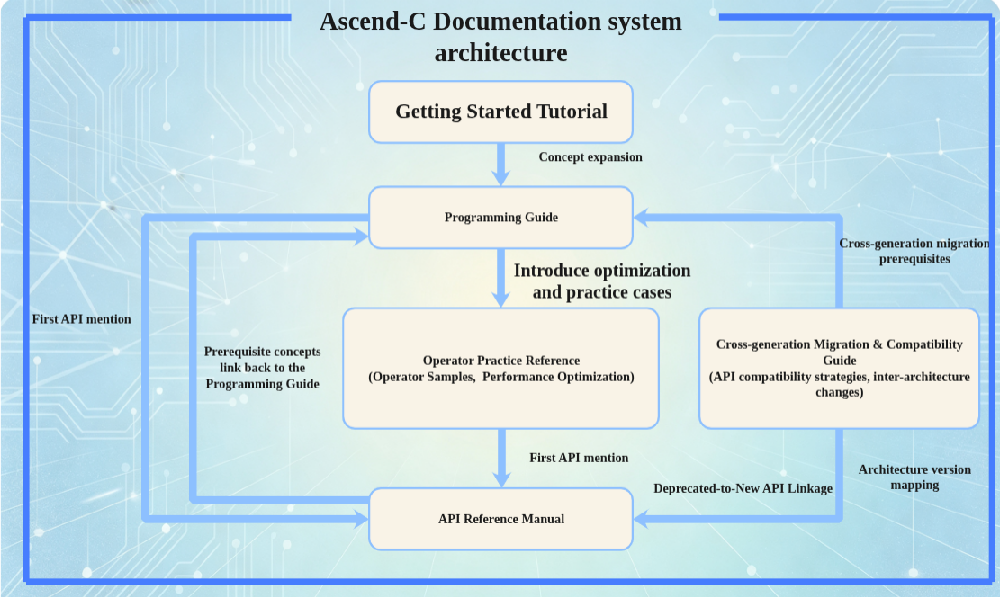

# Ascend C Documentation Design Principles

## Design Goals

Ascend C documentation is the sole official entry point for developers using Ascend NPUs for operator development. Documentation quality directly impacts developer efficiency across the entire "understanding → onboarding → mastery" pipeline.

This design document defines Ascend C documentation requirements across three dimensions:

| Dimension | Core Question | Verification Standard |
|-----------|--------------|----------------------|
| **Discoverability** | Can developers find the information they need within 3 steps? | Every multi-choice fork has a decision tree/comparison table; five documents are interlinked and navigable; terminology is unified and searchable |
| **Readability** | Once found, can it be understood without ambiguity? | Easily confused concepts are distinguished on first occurrence; constraints are prominent and standalone; complex parameters have diagrams; no reverse-order reading |
| **Completeness** | After understanding, is the information sufficient to complete the task? | Hardware parameters are backed by specifications; zero constraint omissions; examples cover multiple levels; version differences are explicitly annotated |

---

## Documentation System Architecture

The Ascend C documentation system consists of **five** core documents, connected through cross-references to form a navigable documentation network.

The documentation system architecture diagram is shown below:

**Core Navigation Logic**: Each document is both a **link initiator** (when first mentioning content managed by another document, it links to it) and a **link receiver** (when another document mentions content this document is responsible for, it links back).

**Five-document Positioning and Navigation Principles**:

| Document | Responsible for Clarifying | What Other Documents Get from Here | Outbound Link Directions |
|----------|---------------------------|-----------------------------------|-------------------------|
| **Getting Started Tutorial** | Ascend C overview, environment setup, quick-start hands-on (HelloWorld, first operator) | Other documents can link to the tutorial as a zero-basis entry point | In-depth programming concepts → link to Programming Guide; first API mention → link to API Reference Manual |
| **Programming Guide** | Core concepts: programming models, programming paradigms, compilation & execution, hardware architecture, advanced programming | Other documents **link back** to the Programming Guide when encountering programming concepts | First API mention → link to API Reference Manual; first optimization/practice topic → link to Operator Practice Reference; architecture version differences → link to Cross-generation Migration Guide |
| **API Reference Manual** | Each interface's parameter definitions, usage constraints, code examples, inter-API relationships | The Programming Guide and Operator Practice Reference **link to** the API Reference Manual for interface details when mentioning an API | Prerequisite concepts → link back to Programming Guide; cross-version API differences → link to Cross-generation Migration Guide |
| **Operator Practice Reference** | How to write operators, how to optimize performance, how to debug, typical cases | Practice and optimization content mentioned briefly in the Programming Guide **links to** the Operator Practice Reference for expansion | First API usage → link to API Reference Manual; programming concepts → link back to Programming Guide; architecture-dependent optimizations → link to Cross-generation Migration Guide |
| **Cross-generation Migration & Compatibility Guide** | API compatibility strategies, inter-architecture changes, specific migration steps | Any document involving version differences, API deprecation/addition **links to** the Migration Guide for migration paths | Concept definitions → link back to Programming Guide; post-migration new APIs → link to API Reference Manual |

**Supplementary Notes**:
- The sample repository (`asc-devkit/examples/`) **is not part of** the Ascend C documentation system, but code examples in the five documents may link to the sample repository
- Technical appendices (glossary, principles, syntax restrictions) are included in the Programming Guide as shared knowledge infrastructure

---

## Discoverability

### Three-layer Navigation System

The documentation provides three layers of navigation covering different usage scenarios:

| Navigation Layer | Format | Applicable Scenario | Design Requirement |
|-----------------|--------|--------------------|--------------------|
| **Global Layer** | Directory tree + full-text search | Know what you're looking for | Directory depth ≤ 5 levels; search covers code/parameters/concept names |
| **Decision Layer** | Decision trees / comparison tables / selection guides | Know the requirement but not which option | Every multi-choice technical approach must have a decision tree or comparison table to guide developer selection |
| **Association Layer** | Bidirectional cross-references + related APIs section | Found A but need to understand related B | Five documents interlinked to form a navigable network |

**Required locations for decision trees / selection tables**:
- Programming Guide: SIMD/SIMT selection, API level selection, programming paradigm selection chapter openings
- API Reference Manual: Reduce series, Matmul series, DataCopy series API family openings
- Operator Practice Reference: Operator openings with multiple implementation approaches
- Each comparison table provides a **default recommendation** ("If unsure, prefer X") + **common wrong choice scenarios** ("Encountering XXX error may be because you chose A instead of B")

### Five-document Link Interconnection

The five core documents are connected through links to form a navigable network. **Link direction follows the principle of "whoever mentions content managed by another document adds the link"**:

**Link Relationships (10 link rules)**:

| Link Rule | Initiator | Links To | Trigger Condition | Description |
|-----------|-----------|----------|-------------------|-------------|
| L0 | Getting Started Tutorial | Programming Guide | Tutorial mentions programming concepts requiring depth | Tutorial only covers quick-start; in-depth concepts link to Programming Guide |
| L1 | Programming Guide | API Reference Manual | First introduction of new API name | Add link where API name first appears in concept explanation |
| L2 | Programming Guide | Operator Practice Reference | First introduction of practice/optimization topic | Programming Guide mentions briefly, links to Practice Reference for expansion |
| L3 | Programming Guide | Cross-generation Migration Guide | Mentioning architecture version differences / deprecated APIs | See Cross-generation Migration & Compatibility Guide |
| L4 | Operator Practice Reference | API Reference Manual | First use of API in practice case | Add link where API first appears in sample code |
| L5 | Operator Practice Reference | Programming Guide | First introduction of programming concept | Link to authoritative explanation when practice involves programming model concepts |
| L6 | Operator Practice Reference | Cross-generation Migration Guide | Mentioning cross-architecture optimization differences | Link when optimization approach varies by architecture version |
| L7 | API Reference Manual | Programming Guide | First introduction of programming concept | "Prerequisites" section links to concept introduction chapter |
| L8 | API Reference Manual | Cross-generation Migration Guide | Annotating API version differences / deprecation information | API page annotates version range and links |
| L9 | Cross-generation Migration Guide | API Reference Manual | Migration target uses new API | Legacy API → new API mapping table links to new API details |
| L10 | Cross-generation Migration Guide | Programming Guide | Migration involves programming concept changes | Architecture change mapping links to concept explanation |

**Link Rules**:
- Links are added on the **first occurrence** of a concept/API; subsequent occurrences are not re-linked
- Concept references in API pages use inline links near the reference (not centralized at page bottom)
- **Note direction**: Operator Practice Reference → API Reference Manual (to look up interface details); the API Reference Manual does not need reverse links to Operator Practice Reference
- All complete code examples in the documentation reference the sample repository at: https://gitcode.com/cann/asc-devkit/tree/master/examples

### Unified Terminology Entry

Establish a **unified terminology mapping table** (independent appendix file) shared by all documents:

| Mapping Content | Format | Location |
|----------------|--------|----------|
| Terminology Mapping Table | Four-column mapping: abstract concept ↔ hardware unit ↔ programming model ↔ interface name | Independent appendix file; overview chapter links to it |
| Product Model Mapping Table | Product name ↔ chip name ↔ architecture codename | Programming Guide overview chapter |
| Synonym Index | Multiple names for the same concept → authoritative explanation page | Appendix or index page |

**Writing Requirements**:
- Any code name / abbreviation on **first occurrence** must be annotated with full name in parentheses and linked to the mapping table
- The same concept may use different-level names in different documents, but must have an equivalence relationship in the terminology mapping table

### File Responsibility Focus

Each file has a clear single responsibility. Overview files serve as **navigation pages**:

| File Type | Responsibility | Prohibited |
|-----------|---------------|------------|
| Overview/Summary File | Navigation: topic list + 1-2 sentence summary + sub-chapter links | Expanding technical details, extensive code |
| Concept Introduction File | Explanation: concept definition + principles + constraints + relationships | Repeating content already in other files (use references instead) |
| Operation Guide File | Steps: code snippets + operation steps + caveats | Concept definitions (link to concept files) |
| API Reference Page | Reference: prototype + parameters + constraints + examples + related APIs | Programming model explanations (link to Programming Guide) |
| Migration Guide File | Steps: change list + mapping table + verification steps | Programming model explanations (link to Programming Guide), repeating existing migration content (use references) |

**Split and Dedup Rules**:
- Overview file length: navigation tables/links should occupy ≥ 60%
- If a file covers more than 3 unrelated topics, split into multiple sub-files
- Detailed description of the same content appears only once (authoritative version); other locations use "See Chapter X for details"
- Hardware architecture description is unified into a single file; separate SIMD/SIMT versions describing different halves are not allowed

---

## Readability

### Explicit Distinction of Easily Confused Concepts

Similar-named or hierarchically confusable concepts must be **explicitly distinguished** using comparison tables or relationship diagrams. Distinction is placed at the **first position where confusion may occur**, not deferred.

**Distinction Scope**: Based on Section 3.3 "Unified Terminology Entry" as the baseline; every terminology group must provide distinction on first occurrence during document writing.

**Distinction Format Selection**:
- Same function, different level names (e.g., DMA/MTE/DataCopy) → Terminology mapping table
- Different concepts easily conflated (e.g., SPMD/SIMD/SIMT) → Hierarchy diagram
- Computation location / performance differences (e.g., MemBase/RegBase) → Comparison table + scenario recommendation
- Different names from industry concepts (e.g., gap/stride) → Concept mapping table

**Writing Principle**: For concepts that can be equivalently mapped to industry concepts, provide a concept mapping table; for concepts that differ from industry conventions, focus on explaining the differences (do not give only AscendC names without industry correspondence).

### Constraint Visibility and Prominence

All hardware-level constraints must be prominently annotated at the **first definition** of a concept, not deferred to later chapters or exposed only through runtime errors.

**Three Elements of Constraint Information** (all required):
- **Constraint Value**: Specific value or range (e.g., "32-byte aligned", "half type ≥ 128 elements") — vague descriptions like "appropriate size" or "sufficient space" are not acceptable
- **Constraint Type**: Address alignment / data type restriction / element count range / format restriction / read-only semantics / timing requirements
- **Violation Consequence**: Compilation error / runtime out-of-bounds / incorrect results / performance degradation — developers need to know whether an error is caused by violating this constraint

**Format and Location**:

| Document Type | Location | Format |
|--------------|----------|--------|
| API Reference Page | After function prototype, before parameter description | Independent "Constraints and Limitations" paragraph, not scattered in small text within parameter descriptions |
| Programming Guide - Concept Chapter | Concurrently with concept introduction | Constraints in the same section as the concept, not supplemented separately later |
| Programming Guide - Programming Paradigm Chapter | Before code examples | Preconditions/constraints placed before code snippets; state constraints first, then provide code |

### Complex Parameter Diagrams

Complex parameters (involving memory layout, dimension mapping, stride calculation) use diagrams instead of pure text:

| Parameter Type | Diagram Format |
|---------------|---------------|
| stride/offset type | Memory layout diagram (annotating each step offset) |
| Dimension mapping type | Dimension transformation mapping diagram (e.g., [K,N]→[N,K] transpose) |
| Format type (ND/NZ) | Memory layout comparison diagram for two formats |
| mask type | Element-to-bit-mask diagram |
| Data flow type | Input → Processing → Output flow diagram |

**Judgment Standard**: If a parameter requires more than 3 sentences of pure text to explain → a diagram is required. Diagrams and text descriptions must be consistent (no diagram showing 4x16 fractal while text says 16x16).

### Focused Code Snippets

Each programming paradigm / key flow provides concise code snippets + complete sample links:

| Requirement | Description |
|------------|-------------|
| Focused | Only show code relevant to the current explanation; use `// ... other initialization` for unrelated parts |
| Understandable | Each snippet accompanied by 2-3 lines of text explaining what it does |
| Traceable | Snippet ends with link to complete sample in the sample repository |
| Keyword Annotated | Ascend C-specific keywords (`__aicore__`, `__ubuf__`, `__simd_vf__`, etc.) must have inline comments |
| Parameter Coverage | Cover common parameter combinations, not just a single usage |

### Prerequisites and Forward References

Each concept/API provides prerequisite context on first occurrence, ensuring **no reverse-order reading**:

- API reference pages start with a "Prerequisites" section: concepts to understand before using this API (linked to Programming Guide)
- Operator Practice Reference starts with a "Prerequisites" section: knowledge base and prerequisite sample links needed before reading
- Programming Guide chapters are ordered by learning path: basic concepts → programming models → programming paradigms → performance optimization (not flat by functional modules)
- When concept B depends on concept A, A appears first or B has a clear reference link

### Host-side and Kernel-side Separation

API documentation must clearly label and separate Host-side and Kernel-side:

- Each API page labels the applicable side: Host-side / Kernel-side / Host+Kernel
- Host-side APIs (Tiling computation, workspace allocation) and Kernel-side APIs (computation interfaces, data transfer) are displayed in separate sections
- Programming Guide has a Host/Kernel division panorama diagram
- Concepts involving cross-side data passing (workspace/Tiling) provide end-to-end call chain diagrams

---

## Completeness

### Zero Constraint Omissions

All implicit constraints must be explicitly documented, not left to runtime assertions or compilation errors:

| Constraint Category | Coverage Requirement | Common Omissions |
|--------------------|--------------------|------------------|
| Data type restrictions | Each API lists the complete supported data type list | half type minimum element count, bf16 support missing |
| Address alignment | Specify alignment bytes and alignment direction | 32B alignment only in assert |
| Element count range | Specify minimum, maximum, alignment granularity | "8 elements" constraint undocumented |
| Format restrictions | ND/NZ/FRACTAL format support status | Format switch offset calculation differences |
| Usage mode restrictions | Differences between direct-call/engineering/debug modes | PipeBarrier only available in specific modes |
| API combination restrictions | Mutually exclusive APIs / required pairing APIs | Documentation-recommended combinations actually unsupported |

**Operational Requirement**: Extract constraint information from specification documents and assert code, centrally display at first definition.

### Layered Example Coverage

Each API / programming paradigm provides examples:

**Example Level Definitions**:

| Level | Purpose | Length | Requirement |
|-------|---------|--------|------------|
| **Minimal** | Minimal runnable example | <30 lines core code | Single function, copy-and-compile-and-run |
| **Standard** | Typical usage example | 50-150 lines | Covers core parameter combinations |
| **Advanced** | Advanced example | >150 lines | Combined with other APIs, performance optimization techniques |

**Specific Requirements by Document**:
- API Reference Manual: Each API has at least 1 minimal runnable example (Minimal), covering common parameter combinations in the example
- Programming Guide: Each programming paradigm has at least 1 Minimal example + sample repository complete example link
- Operator Practice Reference: Each operator practice case has at least 1 Standard usage example and 1 Advanced usage example
- Examples can be directly copied, compiled, and run (including CMakeLists.txt reference, data generation instructions, expected output)

### API Association and Combination Usage

Each API page includes a **Related APIs section** explaining combination usage relationships and prohibitions between APIs within the same version. Cross-version migration relationships are handled by the "Cross-generation Migration Completeness" section.

Includes: mutually exclusive APIs (independent warning box) + functionally similar API selection guide

**Requirements**:
- Mutually exclusive combinations marked with independent warning boxes (e.g., "BatchMatmul and SetQuantVector combination not supported")
- Functionally similar API families provide selection decision trees
- API Reference Manual provides API relationship overview diagram (high-level API → low-level API encapsulation hierarchy)

### Cross-generation Migration Completeness

The Cross-generation Migration & Compatibility Guide must cover complete migration paths, ensuring developers are not blocked by documentation gaps during architecture upgrades:

**Required Migration Elements**:

| Migration Element | Coverage Requirement | Consequence if Missing |
|------------------|--------------------|-----------------------|
| Architecture change list | List all differences affecting programming between two architecture versions | Only API-level differences listed, missing constraint/performance differences |
| API compatibility strategy | Clearly state which APIs are cross-version available, deprecated, or newly added | Deprecated APIs lack replacement guidance |
| Per-API migration mapping table | Legacy API → new API one-to-one mapping, including parameter and constraint differences | Only new API name given without parameter mapping |
| Post-migration verification steps | How to verify functional correctness and performance baseline after migration | Missing performance regression verification instructions |
| Compilation option changes | Compilation parameter differences across architecture versions | Macro definition / compilation option changes not documented |

**Operational Requirements**:
- Each migration mapping entry (legacy API → new API) in the Cross-generation Migration Guide must link to the corresponding old and new API detail pages in the API Reference Manual
- Architecture change descriptions involving programming concept changes must link back to the corresponding concept chapter in the Programming Guide
- In the API Reference Manual, each API page with cross-version differences must annotate and link to the corresponding entry in the Cross-generation Migration Guide

### Version Constraint Annotation Specification

Content involving version differences across all five documents must use a unified annotation format, ensuring developers can identify applicable scope at a glance:

**Annotation Format**: `[Applicable Version: xxx]` + `> **Note**: xxx`

| Annotation Scenario | Format | Example |
|--------------------|--------|---------|
| API page version scope | `[Applicable Version: 2201+]` / `[Applicable Version: 3510+]` / `[Applicable Version: All versions]` | `DataCopy → [Applicable Version: All versions]` |
| API deprecated | `> **Deprecated** (since vX.X), see alternative → Migration Guide` | `asc_mmad → Deprecated, see Migration Guide` |
| Constraint varies by version | `> **Version Difference**: 2201 requires 32B alignment; 3510 requires 512B alignment` | `src_stride → See Migration Guide for version differences` |
| Performance optimization varies by version | `[Applicable Version: 2201 only]` / `[Applicable Version: 3510 only]` | `IBShare → [Applicable Version: 2201 only]` |

**Operational Requirements**:
- Hardware parameters/constraints involving version differences in the Programming Guide annotated with `[Applicable Version: xxx]` next to parameter values
- Each API page in the API Reference Manual annotated with `[Applicable Version: xxx]` at the top; deprecated APIs marked with `> **Deprecated**`
- Version-specific optimization approaches in the Operator Practice Reference annotated with `[Applicable Version: xxx only]` in the title or opening
- Each entry in the Cross-generation Migration Guide uses unified format; do not invent new formats

---
