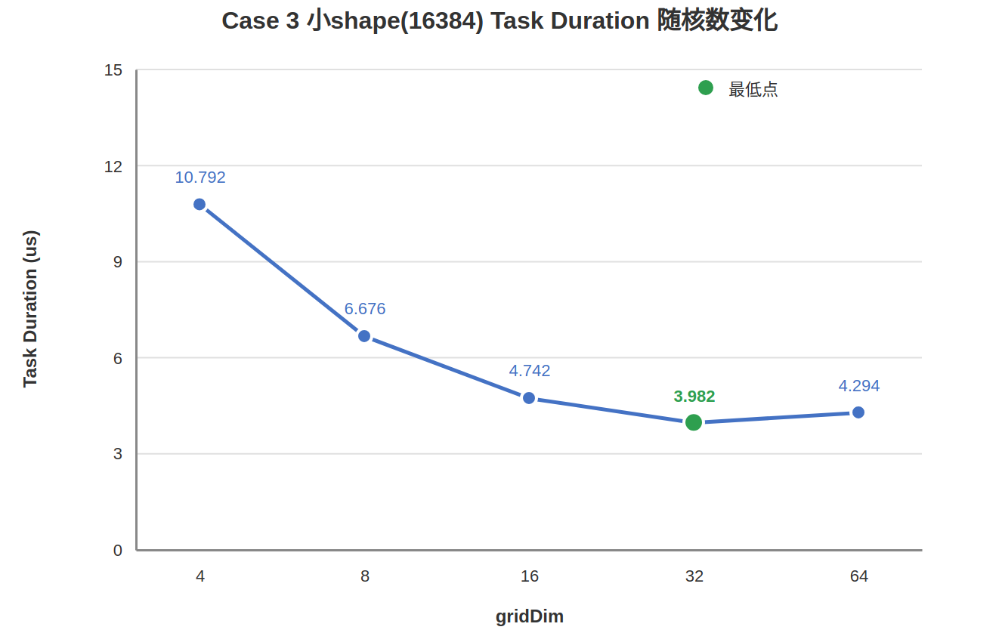

# gridDim配置优化

【优先级】高

【描述】SIMT编程模式下，`gridDim.x`决定本次任务启动多少个block（逻辑核），这些逻辑核最终要落到硬件实际存在的Vector Core（物理核）上执行。gridDim配置不当会直接影响算子的调度开销与计算并行度：逻辑核数远超物理核数时，超出的逻辑核必须排队等待物理核空闲，调度等待开销随之上升；逻辑核数不足时，物理核闲置、单核工作量翻倍，计算并行度不够。因此gridDim应结合物理核数与数据规模来设置。

以Ascend 950PR/Ascend 950DT为例，实测环境运行时物理核（Vector Core）数量为64。逻辑核与物理核的关系会影响调度开销：当`gridDim.x ≤ 64`时，所有逻辑核可以一次占满物理核并行执行；当`gridDim.x > 64`时，超出64的逻辑核必须等待前面的逻辑核执行完、让出物理核后才能被调度，等待开销会随超出的逻辑核数量增加而上升。

物理核数可以在运行期通过`aclrtGetDeviceInfo`查询：

```cpp
#include "acl/acl.h"

int32_t device_id = 0;
int64_t physical_aiv_core_num = 0;
aclError ret = aclrtGetDeviceInfo(
    static_cast<uint32_t>(device_id),
    ACL_DEV_ATTR_VECTOR_CORE_NUM,
    &physical_aiv_core_num);
if (ret == ACL_SUCCESS) {
    printf("Physical AIV (Vector Core) num: %ld\n", physical_aiv_core_num);
}
```

下面以Gather为例，对比大shape（`[1024,2048]`=2097152个元素）下不同gridDim配置的性能差异。

【反例】把gridDim绑死到元素总数，启动远超物理核数的逻辑核，导致大量逻辑核排队等待。

```cpp
// 最朴素写法：每个线程只处理1个元素，无for循环
// 要求 gridDim.x * blockDim.x == 元素总数(本样例 1024 * 2048 == 2097152)
__global__ __launch_bounds__(INDEX_WIDTH) void gather_naive_kernel(
    float* input, uint32_t* index, float* output,
    uint32_t input_total_length, uint32_t index_total_length)
{
    uint32_t global_idx = blockIdx.x * blockDim.x + threadIdx.x;

    uint32_t gather_idx = index[global_idx];
    if (gather_idx >= input_total_length) {
        gather_idx = 0;
    }
    output[global_idx] = input[gather_idx];
}

// gridDim.x * blockDim.x = 1024 * 2048 = 2097152，恰好等于元素总数
gather_naive_kernel<<<1024, INDEX_WIDTH, 0, stream>>>(
    input_device, index_device, output_device,
    input_total_length, index_total_length);
```

上述实现让每个线程用全局线程号`blockIdx.x * blockDim.x + threadIdx.x`定位唯一一个元素，因此gridDim被"线程号=元素号"这条隐式约束绑死为`元素总数 / 单核线程数 = 2097152 / 2048 = 1024`，核数被数据规模决定。1024个逻辑核中只有64个能一次占满物理核，其余960个逻辑核必须排队等待物理核空闲后才能被调度，调度等待开销很高。该实现的性能数据如下：

| gridDim.x | Task Duration(us) |
| :-------: | :---------------: |
|   1024    |      75.834       |

【正例】解耦逻辑核数与元素总数，把gridDim设为物理核数，每核改用stride循环处理一段元素。

```cpp
// 优化写法：每个block跨步处理一段元素，逻辑核数固定为物理核数
__global__ __launch_bounds__(MAX_THREAD_NUM) void gather_strided_kernel(
    float* input, uint32_t* index, float* output,
    uint32_t input_total_length, uint32_t index_total_length)
{
    uint32_t rows_per_block = index_total_length / gridDim.x;
    uint32_t index_start = blockIdx.x * rows_per_block;

    for (uint32_t local_idx = threadIdx.x; local_idx < rows_per_block; local_idx += blockDim.x) {
        uint32_t gather_idx = index[index_start + local_idx];
        if (gather_idx >= input_total_length) {
            gather_idx = 0;
        }
        output[index_start + local_idx] = input[gather_idx];
    }
}

// 逻辑核数固定为最大物理核数64，每block仍取硬件上限2048线程
gather_strided_kernel<<<64, MAX_THREAD_NUM, 0, stream>>>(
    input_device, index_device, output_device,
    input_total_length, index_total_length);
```

上述实现的gather语义与反例完全相同，唯一变化的变量是把逻辑核数从1024降到物理核数64。核数降下来后，每个block负责的元素数`rows_per_block = 元素总数 / gridDim.x`随之从2048增大到`2097152 / 64 = 32768`，block内的`blockDim.x`个线程以`blockDim.x`为步长跨步循环遍历这一段（每个线程stride循环`32768 / 2048 = 16`次），既不漏元素，相邻线程访问的也是相邻地址（访存合并友好）。该实现在大shape下的性能数据如下：

| gridDim.x | Task Duration(us) |
| :-------: | :---------------: |
|    64     |      56.902       |

从Task Duration看，逻辑核数从1024降到64后执行耗时从75.834us下降到56.902us，下降约25.0%，整体性能提升约1.33倍。gather读写总量和每block线程数都没有变化，提升完全来自唯一变化的变量——逻辑核数，分两部分体现：一是**调度开销下降**，1024核中有960个逻辑核要排队等待，而64核一次占满物理核无需等待；二是**访存延迟更容易被掩盖**，gather是memory-bound，每核工作量从2048增加到32768后，同一时刻的访存请求更多，某个线程的GM请求未返回时硬件可调度同block内其他就绪线程发起各自请求，多个请求的等待相互重叠。

需要注意的是，核数并非越少越好。若把核数继续降到32（仅用一半物理核），Task Duration反而升到110.419us，比64核慢约94%，甚至比1024核的75.834us还慢。三种核数配置的对比如下：

| 写法 | gridDim.x | Task Duration(us) | 说明 |
| :--: | :-------: | :---------------: | ---- |
| strided | 32 | 110.419 | 逻辑核 < 物理核，并行度不足 |
| **strided** | **64** | **56.902** | **逻辑核 = 物理核，最优** |
| naive | 1024 | 75.834 | 逻辑核 ≫ 物理核，排队等待 |


上面大shape的结论是"逻辑核数=物理核数最优"。但这条经验不能直接照搬到小shape：当数据量很小、每核工作量很少时，启动更多核带来的调度头开销会反超有效计算的收益。下面以小shape（`[8,2048]`=16384个元素）为例，对比同一stride写法下不同gridDim配置的性能差异。

【反例】小shape下沿用"打满物理核"的经验，把gridDim直接设为最大物理核数64。

```cpp
// kernel与大shape正例完全相同(gather_strided_kernel)，只把shape换成小shape 16384
// 直接套用"打满物理核"的经验，gridDim=64
gather_strided_kernel<<<64, MAX_THREAD_NUM, 0, stream>>>(
    input_device, index_device, output_device,
    input_total_length, index_total_length);
```

上述实现把小shape也打满64个物理核，每核工作集只有`16384 / 64 = 256`个元素，远小于每block的2048线程。此时计算本身耗时很短，64核启动带来的调度头开销在总耗时中占比反而升高。该实现在小shape下的性能数据如下：

| gridDim.x | Elements per block | Task Duration(us) |
| :-------: | :----------------: | :---------------: |
|    64     |        256         |       4.294       |

【正例】小shape下不照搬"打满物理核"，而是设置多档核数实测，取Task Duration最低点。

```cpp
// kernel不变，仅扫描不同gridDim，用msprof Task Duration找最低点
// 小shape(16384)实测：4 / 8 / 16 / 32 / 64核，最低点在32核
gather_strided_kernel<<<32, MAX_THREAD_NUM, 0, stream>>>(
    input_device, index_device, output_device,
    input_total_length, index_total_length);
```

上述实现的kernel与线程数都不变，只把gridDim从4扫到64，逐档实测。小shape下Task Duration随核数变化呈"先降后升"的谷形，最低点落在32核（物理核数的一半），而非打满的64核：

| gridDim.x | Elements per block | Task Duration(us) | 说明 |
| :-------: | :----------------: | :---------------: | ---- |
|     4     |        4096        |      10.792       | 核数太少，单核工作量重 |
|     8     |        2048        |       6.676       | 继续加核仍明显收益 |
|    16     |        1024        |       4.742       | 核数偏少，单核工作量偏重 |
|  **32**   |      **512**       |     **3.982**     | **最低点，最优核数** |
|    64     |        256         |       4.294       | 打满物理核，头开销反超 |



从Task Duration看，4 → 8 → 16 → 32核时耗时持续下降（10.792 → 6.676 → 4.742 → 3.982us），说明小核数下单核计算量过大、增加核数仍有收益；但32 → 64核时耗时反而从3.982us升到4.294us，变慢约7.8%——多核场景下每个核的任务量很小、计算时间很短，启动更多核的调度开销会显著影响整体性能。因此小shape的最优核数为32，比大shape打满64核的结论要小。与大shape对照可见，"最优核数"随shape缩小而变化，数据量越小最优核数越偏离物理核上限，必须按实际shape实测，不能照搬大shape的经验值。

【总结】SIMT算子的gridDim配置应结合物理核数与数据规模来设置。一般原则是：

- **大shape优先匹配物理核数**：逻辑核数尽量等于物理核数，既避免逻辑核不足导致单核工作量过重，也避免逻辑核超过物理核排队等待。
- **小shape需实测核数**：当数据量较小、每核工作量很小时，启动更多核带来的调度头开销会反超有效计算收益，最优核数不一定是最大物理核数，应设置不同核数用msprof Task Duration找最低点。数据量越大，最优核数越靠近物理核数。
- **线程数也应按每核实际工作量设置**：每block线程数不必固定在硬件上限。当每核处理的元素数小于线程上限时，stride循环边界会让多出的线程完全空转，把线程数调到每核实际元素数即可去掉空转、性能更优。
