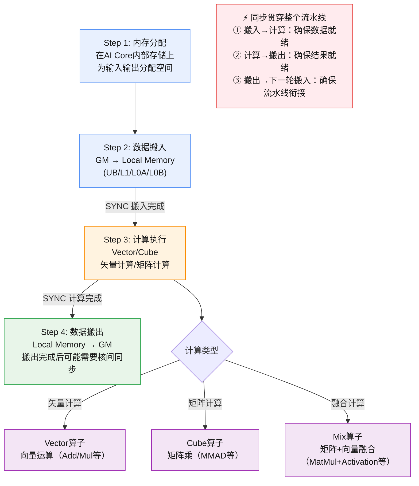
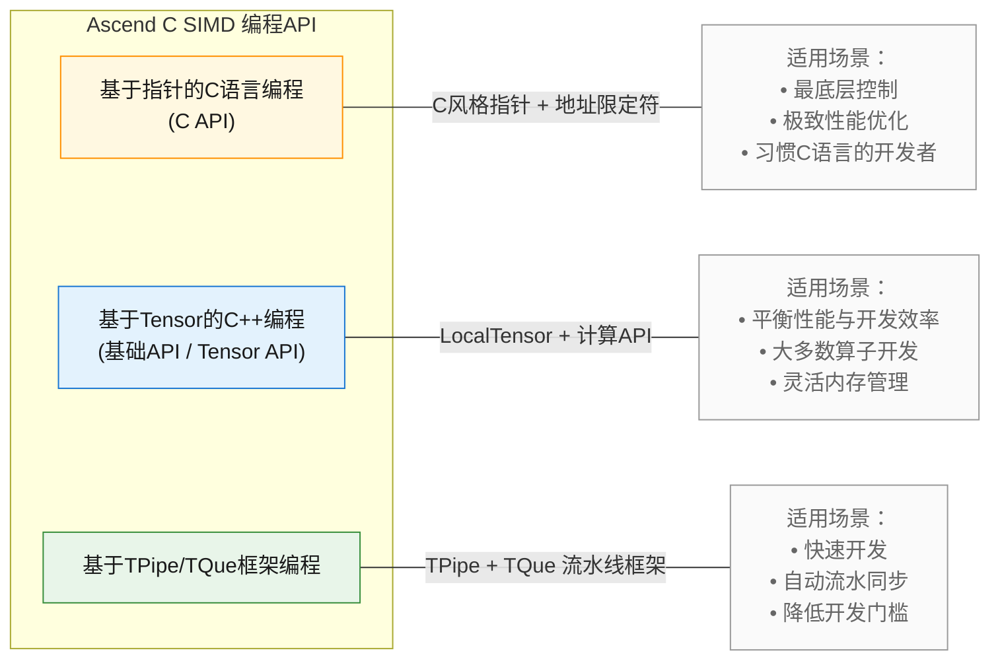
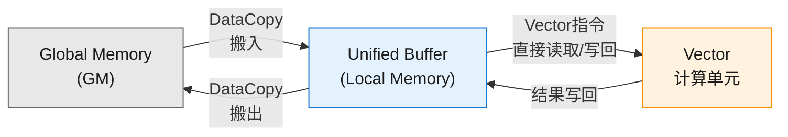
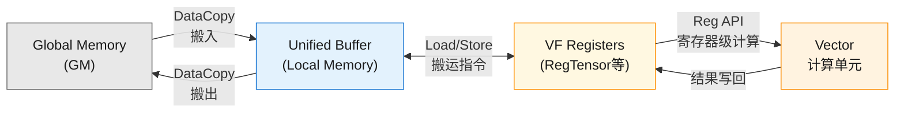

# SIMD编程模型概述

在[编程模型概述](../编程模型概述.md)中，我们已经了解了SIMD（Single Instruction Multiple Data）编程范式的定位——它面向昇腾AI Core的矢量计算和矩阵计算单元，采用"单指令处理多数据"的并行模式，是Ascend C最经典、最成熟的编程范式。本文将展开介绍SIMD编程的核心流程、支持的算子类型与能力范围、以及Ascend C提供的多种SIMD编程API，帮助开发者快速建立对SIMD编程体系的整体认知，并选择最适合自身业务场景的编程方式。

## SIMD核函数编程四步法

SIMD核函数的开发过程可以归纳为**四个关键步骤**：内存分配、数据搬运、计算执行、数据搬出。无论是矢量计算、矩阵计算还是融合计算，这四个步骤构成了所有SIMD算子的基础骨架。**同步**作为贯穿整个流程的核心机制，存在于相邻步骤之间的衔接处——确保"前一步完成、后一步才能开始"，是保证计算正确性的关键前提。下面通过一张流程图展示这一过程：

这四个步骤的具体含义如下：

- **Step 1 内存分配**：根据算子需求，在AI Core内部的各级存储（Unified Buffer、L1 Buffer、L0 Buffer等）上分配输入、输出及中间结果的存储空间。根据[抽象硬件架构](抽象硬件架构.md)的描述，AI Core内部拥有多级存储层次，合理利用各级存储的容量与带宽是性能优化的基础。

- **Step 2 数据搬入**：通过DMA搬运单元，将待处理数据从Global Memory搬运至AI Core内部的Local Memory（UB用于矢量计算、L1/L0用于矩阵计算）。此步骤涉及MTE2搬运流水线。**数据搬入完成后，必须插入同步事件，确保搬运数据全部就绪后，计算单元才能开始读取数据。**

- **Step 3 计算执行**：在Local Memory上执行具体的计算操作。根据算子类型的不同，计算可能由Vector单元（矢量计算）、Cube单元（矩阵计算）或两者协同（融合计算）完成。**计算执行完成后，同样需要插入同步事件，确保所有计算结果已写入Local Memory，然后才能启动数据搬出操作。**

- **Step 4 数据搬出**：将计算结果从Local Memory搬回Global Memory（MTE3搬运流水线），**数据搬出完成后，同样插入同步实践，确保所有计算结果已搬回Global Memory，才能启动新一轮数据搬入操作；搬出完成后，如果涉及多核协作或需要保证后续核间数据一致性，还需要进行核间同步。**

> **同步——SIMD编程的核心课题**
>
> 同步不是某一个步骤的附属操作，而是**贯穿整个流水线的关键机制**。AI Core内部存在多条异步并行流水线（MTE2搬入、Vector/Cube计算、MTE3搬出），它们之间的时序协调完全依赖同步指令。同步发生在以下关键衔接点：
>
> | 同步位置 | 同步目的 | 典型同步方式 |
> |---------|---------|------------|
> | 搬入完成 → 计算开始 | 确保输入数据搬入Local Memory后再进行计算 | `asc_sync_notify/wait`、`SetFlag/WaitFlag`、TQue的`EnQue/DeQue` |
> | 计算完成 → 搬出开始 | 确保计算结果全部写入Local Memory后再进行数据搬出 | 同上 |
> | 搬出完成 → 流水线循环 | 确保上次计算结果搬回Global Memory后再进行下一次数据的搬入 | 同上 |
> | 核间搬出完成 → 多核协作 | 确保所有核的计算结果已写回GM | 核间同步原语 |
>
> 正确的同步控制是SIMD编程中**最容易出错**的环节——同步不足会导致数据竞争和计算错误，同步过多则会降低流水线并行度、影响性能。开发者需要根据所选编程API（C指针编程、C++ Tensor编程或TPipe/TQue框架编程）的不同同步管理方式，合理设计同步策略。

> [!NOTE]
> 关于同步机制的详细原理，请参考[同步机制](抽象硬件架构.md)章节；关于各存储层次的详细说明，请参考[内存层级](抽象硬件架构.md)章节。

## SIMD编程支持的能力范围

SIMD编程范式覆盖昇腾AI Core上的三大类算子，每一类算子对应不同的计算单元和数据通路，其编程流程也与"四步法"中的步骤紧密关联：

| 算子类型 | 计算单元 | 主要存储层次 | 典型场景 | 四步法要点 |
|---------|---------|------------|---------|-----------|
| **矢量算子（Vector）** | Vector计算单元 | GM ↔ UB | Add、Mul、Reduce等逐元素/归约运算 | 内存分配在UB上；搬运GM↔UB；Vector指令计算 |
| **矩阵算子（Cube）** | Cube计算单元 | GM ↔ L1 ↔ L0A/L0B ↔ L0C | MatMul（MMAD）、矩阵乘累加 | 涉及多级存储；需协调MTE1/MTE2/MTE3/FIX多条流水线 |
| **融合算子（Mix）** | Cube + Vector 协同 | 全部存储层次 | MatMul + BiasAdd + Activation等 | 需在搬入→Cube计算、Cube→Vector衔接、Vector→搬出等各环节插入同步 |

### 矢量计算场景

矢量计算是SIMD编程中最基础也最常用的场景，数据通路由Global Memory到Unified Buffer再到Vector计算单元构成。典型算子包括：

- **逐元素运算**：Add、Sub、Mul、Div等
- **归约运算**：WholeReduceSum、BlockReduceMax等
- **数据转换**：Cast、Transpose等
- **逻辑运算**：Compare、Select等

矢量计算场景下，编程四步法简化为：UB内存分配 → GM→UB数据搬入 → **同步（确保数据就绪）** → Vector指令计算 → **同步（确保结果就绪）** → UB→GM数据搬出。这是入门SIMD编程的最佳起点。

### 矩阵计算场景

矩阵计算利用CubeCore的矩阵乘单元，数据通路涉及更多存储层级。由于数据需要从GM搬入L1，再从L1搬入L0A/L0B，经过Cube计算后存入L0C，最后通过Fixpipe搬出到L1或GM，编程过程需要协调更多的搬运流水线。

### 融合计算场景

融合计算将矩阵计算与矢量计算组合在一起，例如先执行MatMul（Cube单元），再对结果执行BiasAdd和ReLU（Vector单元）。这种场景需要在**多个环节**插入同步：Cube计算完成后同步确保矩阵结果就绪（Cube→Vector衔接）、Vector计算完成后同步确保矢量结果就绪（计算→搬出衔接）、以及搬出后可能的核间同步。融合计算的同步设计是最复杂但也最能发挥AI Core整体性能的编程方式。

## SIMD编程API体系

Ascend C为SIMD编程提供了**三种层次的编程API**，从底层到高层分别满足不同开发者的需求。开发者可以根据自身的性能要求和开发效率偏好，选择最适合的编程方式。

### 基于指针的C语言编程（C API）

C API提供纯C风格的接口，通过地址限定符（`__gm__`、`__ubuf__`、`__cbuf__`等）描述不同层级的存储空间，通过指针直接操作内存地址。这种方式最接近底层硬件，提供了最精细的控制粒度。

**核心特征：**

| 维度 | 说明 |
|------|------|
| 编程风格 | 纯C语言，使用地址限定符区分存储层级 |
| 内存管理 | 通过数组声明或`asc_get_phy_buf_addr`手动分配，地址限定符指定存储位置 |
| 同步控制 | 提供三种粒度：精细同步（`asc_sync_notify/wait`）、全流水同步（`asc_sync`）、接口内建同步（`*_sync`后缀接口） |
| 计算接口 | `asc_add`、`asc_copy_gm2ub`等C风格接口，参数为指针地址 |
| 适用场景 | 追求极致性能、需要最精细控制、习惯C语言开发的场景 |

C API是Ascend C SIMD编程中**最底层的接口**，适合对性能极度敏感或有C语言开发习惯的开发者。详细的C API编程说明请参考[C指针编程](C指针编程/C指针编程概述.md)章节。

### 基于Tensor的C++编程（基础API / Tensor API）

基于Tensor的C++编程使用`LocalTensor`这一数据结构抽象片上存储，开发者通过构造`LocalTensor`并调用计算API完成算子开发。这是Ascend C最经典的编程方式，在开发效率和控制灵活性之间取得了良好的平衡。

**核心特征：**

| 维度 | 说明 |
|------|------|
| 编程风格 | C++，使用`LocalTensor`抽象存储，通过TPosition标识存储位置 |
| 内存管理 | 支持两种方式：`LocalMemAllocator`线性分配（简化开发）和`LocalTensor`构造函数直接指定地址（极致性能） |
| 同步控制 | 使用`SetFlag/WaitFlag`手动插入同步事件，需要开发者自行管理事件ID和同步时序 |
| 计算接口 | `Add`、`DataCopy`等C++接口，参数为`LocalTensor`对象 |
| 适用场景 | 大多数算子开发场景，平衡开发效率与性能，需要灵活内存管理 |

基于Tensor的编程方式可以进一步分为**静态Tensor编程**和**基于TPipe/TQue框架编程**两种路径。静态Tensor编程跳过TPipe框架的初始化开销，直接构造`LocalTensor`，适合追求极致性能的场景。详细的C++ Tensor编程说明请参考[C++ Tensor编程](C++-Tensor编程/C++-Tensor编程概述.md)章节。

### 基于TPipe/TQue框架编程

TPipe/TQue框架在C++ Tensor编程之上提供了更高层的抽象：通过`TPipe`统一管理内存和事件资源，通过`TQue`队列实现任务间的数据传递和自动同步。开发者只需要按照"CopyIn → Compute → CopyOut"的固定范式编写算子逻辑，框架自动处理Double Buffer、流水线同步等复杂逻辑。

**核心特征：**

| 维度 | 说明 |
|------|------|
| 编程风格 | C++，遵循固定的编程范式（CopyIn/Compute/CopyOut） |
| 内存管理 | `TPipe.InitBuffer`统一分配，`AllocTensor/FreeTensor`申请释放 |
| 同步控制 | `EnQue/DeQue`自动管理数据依赖和流水线同步 |
| 计算接口 | 与C++ Tensor编程相同的计算API |
| 适用场景 | 快速开发、入门学习、算子功能验证，不希望深入理解同步机制的场景 |

TPipe/TQue框架是开发效率最高的SIMD编程方式，特别适合初学者快速上手和功能验证。详细的TPipe/TQue编程说明请参考[TPipe&TQue框架编程](TPipe&TQue框架编程/TPipe-TQue概述.md)章节。

### 三种编程方式的对比与选择

下表从多个维度对比三种编程方式，帮助开发者做出选择：

| 对比维度 | C指针编程 | C++ Tensor编程 | TPipe/TQue框架编程 |
|---------|----------|---------------|------------------|
| **编程语言** | C | C++ | C++ |
| **数据抽象** | 指针 + 地址限定符 | LocalTensor | LocalTensor + TQue队列 |
| **内存管理** | 完全手动 | 手动（支持线性分配器） | 框架自动管理 |
| **同步管理** | 三种粒度可选 | SetFlag/WaitFlag手动 | EnQue/DeQue自动 |
| **运行时开销** | 最低 | 无框架初始化开销 | 有TPipe初始化开销（约数百纳秒） |
| **开发难度** | 高（需理解底层硬件） | 中高（需理解同步机制） | 低（框架封装复杂度） |
| **性能上限** | 最高 | 高 | 高（框架开销很小） |
| **灵活度** | 最高 | 高 | 受框架约束 |
| **推荐场景** | 极致性能/底层控制 | 大多数算子开发 | 快速开发/入门学习 |

> [!TIP]
> **如何选择？**
> - 如果你是**初学者**或需要**快速验证功能**：从**TPipe/TQue框架编程**开始。
> - 如果你有**一定经验**且需要**平衡性能与开发效率**：选择**C++ Tensor编程**。
> - 如果你追求**极致性能**或有**C语言开发习惯**：选择**C指针编程**。

## Membase矢量计算与Regbase矢量计算

在SIMD编程中，矢量计算是最高频的操作类型。根据计算过程中数据存放位置的不同，Ascend C提供了**Membase矢量计算**和**Regbase矢量计算**两种编程模式。理解两者的原理和差异，有助于开发者为自己的业务场景选择最合适的方式。

### Membase矢量计算

**Membase（基于内存）矢量计算**是指所有计算操作直接在Local Memory（Unified Buffer）上完成。计算API的输入和输出均为LocalTensor（指向UB中的数据），Vector计算单元直接从UB读取数据、执行运算、将结果写回UB。

**Membase矢量计算的工作流程：**

1. 将数据从Global Memory搬运到Unified Buffer
2. 调用Membase计算API（如`Add`、`Mul`），这些API直接在UB上的LocalTensor之间操作
3. 计算结果仍然存放在UB的LocalTensor中
4. 将结果从UB搬运回Global Memory

**特征：**
- 数据在UB上完成计算，中间结果也在UB暂存
- API参数为`LocalTensor`，无需开发者管理寄存器
- 编程简洁，适合大多数矢量计算场景
- 每次计算操作涉及UB的读/写，存在内存访问开销

### Regbase矢量计算

**Regbase（基于寄存器）矢量计算**将数据从Unified Buffer加载到VF寄存器（VF Reg）中进行计算，计算完成后将结果从寄存器存回UB。这种方式将数据搬运和计算过程交给开发者自主控制，实现了更高的灵活性和性能。

**Regbase矢量计算的工作流程：**

1. 将数据从Global Memory搬运到Unified Buffer
2. 通过`LoadAlign`/`LoadUnAlign`指令，将UB中的数据加载到Reg矢量计算寄存器（RegTensor）
3. 在寄存器上调用Reg计算API（如`AscendC::Reg::Add`）完成计算
4. 通过`StoreAlign`/`StoreUnAlign`指令，将计算结果从寄存器存回UB
5. 将结果从UB搬运回Global Memory

**特征：**
- 数据在寄存器中完成计算，中间结果可暂存在寄存器中，**无需搬回UB**
- API参数为`RegTensor`等寄存器对象，需开发者手动管理Load/Store
- 寄存器容量有限（每次处理VL长度），需要数据切分和循环控制
- 减少了UB读/写开销，适合对性能极度敏感的场景

### Membase与Regbase的对比

| 对比维度 | Membase矢量计算 | Regbase矢量计算 |
|---------|----------------|----------------|
| **数据计算位置** | Unified Buffer（Local Memory） | VF Registers（寄存器） |
| **输入输出** | LocalTensor | RegTensor（寄存器）+ LocalTensor（UB） |
| **中间结果暂存** | UB（需要额外的UB空间） | 寄存器（无需额外UB空间） |
| **数据切分** | 可直接处理完整LocalTensor | 每次处理VL长度，需循环切分 |
| **开发者控制** | 低（框架自动管理） | 高（手动管理Load/Store/循环） |
| **内存访问开销** | 每次操作涉及UB读/写 | Load/Store仅在数据进出时，中间计算无UB开销 |
| **适用场景** | 大多数矢量计算，开发效率优先 | 复杂计算逻辑，多步中间结果可暂存寄存器，性能优先 |
| **可用API范围** | 基础API（矢量计算全量） | Reg矢量计算API（寄存器级操作子集） |

### 如何选择Membase或Regbase

> [!TIP]
> **选择建议：**
>
> **使用Membase的场景：**
> - 简单的逐元素运算（Add、Mul、Sub等），单步计算即完成
> - 算子开发初期，优先快速实现功能
> - 数据访问模式规整，对中间结果暂存没有特殊需求
>
> **使用Regbase的场景：**
> - 多步连续计算（如先Add再Mul再Relu），中间结果可暂存寄存器减少UB访问
> - 追求极致性能的矢量计算，需要精细控制数据搬运
> - 复杂的地址计算和循环模式，需要灵活的地址偏移管理
> - 非对齐数据访问场景，需要使用`UnalignReg`处理非对齐地址

无论选择Membase还是Regbase，两者可以灵活组合使用——例如在同一个算子中，部分操作使用Membase API（简单运算），部分使用Regbase API（复杂计算链），在开发效率和性能之间取得最优平衡。

> [!NOTE]
> 关于Membase矢量计算的详细编程说明，请参考：
> - C指针方式：[基于指针的Membase矢量计算](C指针编程/基于指针的Membase矢量计算.md)
> - C++ Tensor方式：[基础Tensor编程](C++-Tensor编程/基础Tensor编程.md)
>
> 关于Regbase矢量计算的详细编程说明，请参考：
> - C指针方式：[基于指针的Regbase矢量计算](C指针编程/基于指针的Regbase矢量计算.md)
> - C++ Tensor方式：[Regbase矢量计算](C++-Tensor编程/Regbase矢量计算.md)

## 后续章节导引

本文从宏观层面介绍了SIMD编程的核心流程、能力范围和编程API体系。后续章节将逐步深入到具体的编程细节：

- **[抽象硬件架构](抽象硬件架构.md)**：详细介绍AI Core的内存层级、同步机制等硬件抽象模型，为编程实践奠定硬件认知基础。
- **[核函数](核函数.md)**：介绍SIMD核函数的定义、语法和调用方式。
- **[C指针编程](C指针编程/C指针编程概述.md)**：基于C API的底层编程范式，涵盖Membase和Regbase两种矢量计算模式。
- **[C++ Tensor编程](C++-Tensor编程/C++-Tensor编程概述.md)**：基于LocalTensor的中层编程范式，包括基础API、Tensor API和Regbase矢量计算。
- **[TPipe&TQue框架编程](TPipe&TQue框架编程/TPipe-TQue概述.md)**：基于流水线框架的高层编程范式，涵盖矢量编程范式、矩阵编程范式和融合编程范式。
- **[SIMD与SIMT混合编程](SIMD与SIMT混合编程.md)**：介绍在矢量计算和融合计算中SIMD与SIMT编程的混合使用。
