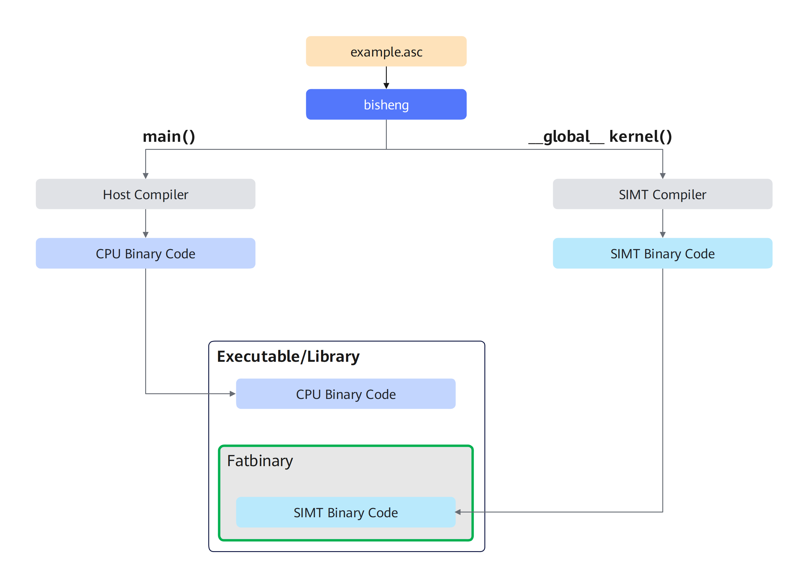

# AI Core SIMT编译基本用法<a name="ZH-CN_TOPIC_0000002561936205"></a>

使用bisheng编译Ascend C SIMT源文件的基本命令是：
```
bisheng <source_file>.asc -o <output_file> --npu-arch=dav-<npu architecture> --enable-simt
```
bisheng可以通过-I <path>指定头文件按路径、-L <path> 指定链接库路径、-l <library>指定需要链接的动态库或静态库、-D<macro>=<value>指定宏定义
```
bisheng example.asc -I <path_to_include> -L <path_to_library> -l <library> -o <output_file> --npu-arch=dav-<npu architecture> --enable-simt
```

- Ai Core SIMT编译 [LINK]()
```
// ----- simt_vec.asc -----
__global__  simtKernel()
 
bisheng  -c simt_vec.asc -o simt_vec.o --npu-arch=dav-xxxx --enable-simt
bisheng  -c main.cpp   -o main.o
bisheng  -x asc simt_vec.o  main.o -o main --npu-arch=dav-xxxx --enable-simt
  或
bisheng main.cpp simt_vec.asc -o main --npu-arch=dav-xxxx --enable-simt
```

- Ai Core SIMT单独编译[LINK]()

 simt独立编译与aicore独立编译相同，需要在bisheng的命令行中增加-dc编译选项。
下方示例中，definition.cu 定义了变量和函数，example.cu 对其进行引用；两个文件将分别编译，最终链接为完整可执行文件
```
// ------- definition.asc -------
extern __gm__ int dev_var = 5;
__aicore__ int device_function();
 
// ------- example.asc -------
extern __aicore__ int device_varibale;
__aicore__ int device_function();
__global__ void kernel(int *var) {
    dev_var = 0;
    *var = device_function();
}
```
 ```
  bisheng -dc definition.asc -o definition.o --npu-arch=dav-xxxx --enable-simt
  bisheng -dc example.asc -o example.o --npu-arch=dav-xxxx --enable-simt
  bisheng definition.o example.o -o program --npu-arch=dav-xxxx --enable-simt
  ```

- Ai Core SIMT动态库编译
```
bisheng -shared example.asc -o libexample.so --npu-arch=dav-xxxx --enable-simt
```
- Ai Core SIMT静态库编译
```
bisheng -lib example.asc -o libexample.a --npu-arch=dav-xxxx --enable-simt
```

更多的编译选项用法可以参见《毕生编译器用户指南》。
  
  ## 通过Ai Core SIMT CMake编译

以下是CMake脚本的示例及其核心步骤说明：

```cmake
# 1、find_package(ASC)是CMake中用于查找和配置Ascend C编译工具链的命令
find_package(ASC)  

# 2、指定项目支持的语言包括ASC，ASC表示支持使用毕昇编译器对Ascend C编程语言进行编译
project(kernel_samples LANGUAGES ASC)

# 3、使用CMake接口编译可执行文件、动态库、静态库、二进制文件
add_executable(demo
    add_custom.asc
)
#.....
target_compile_options(demo PRIVATE
    # --npu-arch用于指定NPU的架构版本，dav-后为架构版本号，各产品型号对应的架构版本号请通过[对应关系表](../../语言扩展层/SIMD-BuiltIn关键字.md#table65291052154114)进行查询。
    # <COMPILE_LANGUAGE:ASC>:表明该编译选项仅对语言ASC生效
    # --enable-simt: 表明启动SIMT 方式编译
    $<$<COMPILE_LANGUAGE:ASC>: --npu-arch=dav-2201 --enable-simt>    
)
```


