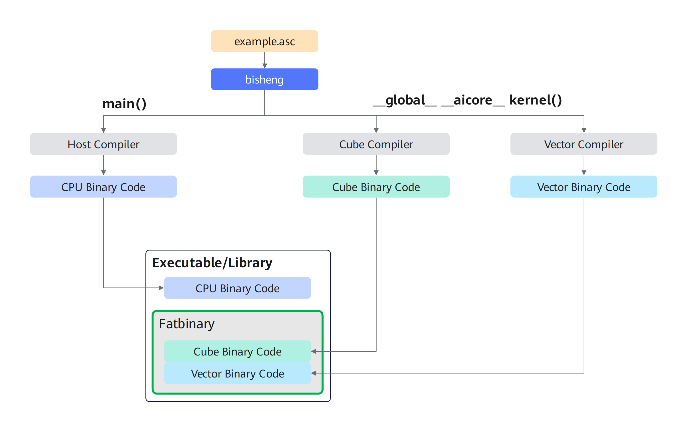

## 毕昇编译器基本用法<a name="section229217121411"></a> 
使用bisheng编译Ascend C 源文件的基本命令是：
```
bisheng <source_file>.asc -o <output_file> --npu-arch=dav-<npu architecture>
```
bisheng可以通过-I <path>指定头文件按路径、-L <path> 指定链接库路径、-l <library>指定需要链接的动态库或静态库、-D<macro>=<value>指定宏定义
```
bisheng example.asc -I <path_to_include> -L <path_to_library> -l <library> -o <output_file> --npu-arch=dav-<npu architecture>
```

  
- Ai Core SIMD编译 [样例LINK]() 
  
  [函数执行空间限定符](#section1074418132518)
  
```
// ----- vector.asc -----
__global__ __vector__ vectorKernel()
  
// -----  cube.asc  -----
__global__ __cube__ cubeKernel()
  
// ------- mix.asc ------
__global__ __mix__(1, 2) mixKernel()
  
bisheng  -c vector.asc -o vector.o --npu-arch=dav-xxxx
bisheng  -c cube.asc   -o cube.o   --npu-arch=dav-xxxx
bisheng  -c mix.asc    -o mix.o    --npu-arch=dav-xxxx
bisheng  -c main.cpp   -o main.o
bisheng  vector.o cube.o mix.o  main.o -o main
  或
bisheng main.cpp vector.asc cube.asc mix.asc -o main --npu-arch=dav-xxxx
```

- Ai Core SIMD单独编译[LINK]()

bisheng异构编译默认采用的是全程序编译模式，该模式要在单个源文件X.asc中编译的设备程序，没有任何未解析的外部设备函数和变量引用。设备函数可以调用其他编译单元中定义的设备函数或访问其中定义的设备变量，但必须在bisheng命令行中指定  -dc 编译选项，才能启用不同编译单元间设备代码的链接功能。这种支持跨编译单元链接设备代码与符号的能力，被称为单独编译。

  单独编译能实现更灵活的代码组织、缩短编译耗时，并生成体积更小的可执行文件；相较于全程序编译，它会增加一定的编译构建复杂度。此外，设备代码链接可能会影响程序性能，这也是该模式未被设为默认模式的原因。链接时优化（LTO） 可有效降低单独编译带来的性能损耗。
单独编译的强制要求：
- 在一个编译单元中定义的非常量设备变量，在其他编译单元中引用时，必须使用 extern 关键字声明；
- 所有常量设备变量，定义和跨单元引用时都必须使用 extern 关键字；
- 所有Ascend C 源文件（.asc）都必须使用 -dc 选项编译。

下方示例中，definition.cu 定义了变量和函数，example.cu 对其进行引用；两个文件将分别编译，最终链接为完整可执行文件
```
// ------- definition.asc -------
extern __gm__ int dev_var = 5;
__aicore__ int device_function();
 
// ------- example.asc -------
extern __aicore__ int device_varibale;
__aicore__ int device_function();
__global__ void kernel(int *var) {
    dev_var = 0;
    *var = device_function();
}
```
 ```
  bisheng -dc definition.asc -o definition.o --npu-arch=dav-xxxx
  bisheng -dc example.asc -o example.o --npu-arch=dav-xxxx
  bisheng definition.o example.o -o program
  ```

- Ai Core SIMD 动态库编译
```
bisheng -shared example.asc -o libexample.so --npu-arch=dav-xxxx
```
-  Ai Core SIMD 静态库编译
```
bisheng -lib example.asc -o libexample.a --npu-arch=dav-xxxx
```

更多的编译选项用法可以参见《毕生编译器用户指南》


