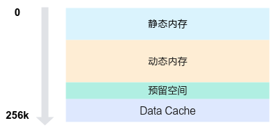

# UB划分<a name="ZH-CN_TOPIC_0000002563309890"></a>

UB（即Unified Buffer）内存空间总大小为256KB，参考[图1](#zh-cn_topic_0000002571697985_fig9500834165913)，按功能划分为四个主要区域，从低地址向高地址依次为静态内存、动态内存、 预留空间 、Data Cache。

**图 1**  UB内存分配图<a name="zh-cn_topic_0000002571697985_fig9500834165913"></a>  


## 内存空间说明<a name="zh-cn_topic_0000002571697985_section19291134194"></a>

1.  静态内存：从内存的起始地址分配一段指定大小的内存空间，其大小在编译时确定，不可动态修改。

    ```
    // 静态内存通过数组分配，例如：
    __ubuf__ char static_buf[1024];
    ```

2.  动态内存：位于静态内存之后，通过[<<<...\>\>\>](函数层级.md#zh-cn_topic_0000002571578013_section156822920311)中参数dyn\_ub\_size指定的动态内存大小空间，可通过以下方式申请使用：

    -   通过LocalMemAllocator的Alloc接口申请。
    -   使用动态数组分配。

        ```
        // 动态内存通过动态数组分配，例如：
        extern __ubuf__ char dynamic_buf[];
        ```

    由于申请动态内存时均从静态内存结束位置之后开始分配，如果同时使用可能会导致地址空间重叠，从而引发未定义行为，因此只能选择其中一种方法进行申请。

3.  预留空间：编译器和Ascend C预留空间，大小固定为8KB。
4.  Data Cache：SIMT专有的Data Cache空间，内存大小可分配的范围为32KB到128KB，具体计算公式为：

    ```
    DataCache =  UB总大小（256KB） –  静态内存 – 动态内存 – 预留空间(8KB)
    ```

    若DataCache小于32KB，会出现校验报错。

