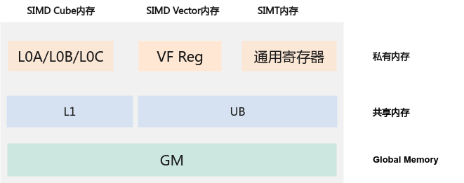
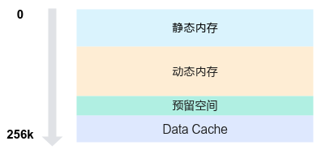

# 内存层级

## 整体内存资源<a name="zh-cn_topic_0000002571695539_section598391912124"></a>

在SIMD与SIMT混合编程场景，整体内存资源如下图所示，核外的GlobalMemory是所有核的全局内存，容量最大访问效率最低，AIC的L1和AIV的UB是单核内的共享内存，容量小但访问效率高，私有内存层最靠近计算单元，容量最小访问效率最高。



在混合编程场景，UB内存作为SIMT VF和SIMD VF的共享内存，是两种VF工作模式间的数据通信与协同操作基础。下文将重点介绍UB内存划分，VF切换时的UB资源管理，指导用户如何在两个VF模式间共用UB资源。

## UB划分<a name="ZH-CN_TOPIC_0000002563309890"></a>

UB（即Unified Buffer）内存空间总大小为256KB，参考[图1](#zh-cn_topic_0000002571697985_fig9500834165913)，按功能划分为四个主要区域，从低地址向高地址依次为静态内存、动态内存、 预留空间 、Data Cache。

**图 1**  UB内存分配图<a name="zh-cn_topic_0000002571697985_fig9500834165913"></a>  


### 内存空间说明<a name="zh-cn_topic_0000002571697985_section19291134194"></a>

1.  静态内存：从内存的起始地址分配一段指定大小的内存空间，其大小在编译时确定，不可动态修改。

    ```
    // 静态内存通过数组分配，例如：
    __ubuf__ char static_buf[1024];
    ```

2.  动态内存：位于静态内存之后，通过[<<<...\>\>\>](函数层级.md#zh-cn_topic_0000002571578013_section156822920311)中参数dyn\_ub\_size指定的动态内存大小空间，可通过以下方式申请使用：

    -   使用动态数组分配。

        ```
        // 动态内存通过动态数组分配，例如：
        extern __ubuf__ char dynamic_buf[];
        ```
    -   通过LocalMemAllocator的Alloc接口申请。

    由于申请动态内存时均从静态内存结束位置之后开始分配，因此只能选择其中一种方法申请，否则可能会导致地址空间重叠，从而引发未定义行为。

3.  预留空间：编译器和Ascend C预留空间，大小固定为8KB。
4.  Data Cache：SIMT专有的Data Cache空间，内存大小可分配的范围为32KB到128KB，具体计算公式为：

    ```
    DataCache =  UB总大小（256KB） –  静态内存 – 动态内存 – 预留空间(8KB)
    ```

DataCache作为GM内存访存的缓存，其大小会影响算子访存效率，若DataCache小于32KB，执行时会出现校验报错而退出，因此在申请内存需确保预留了足够的DataCache。

## SIMD/SIMT间共享UB内存

UB作为共享内存，在Vector Function切换时，UB上的数据不会被清除，因此可通过UB实现Vector Function间的通信。常见使用方式是，在核函数入口中申请动态或者静态内存，将指针传入VF函数中，实现VF函数间共享内存。需要注意的是，SIMT VF在切换时，不会清除上下文信息（即UB DataCache），因此在SIMD VF内使用动静态内存时也需要预留一定空间，避免污染SIMT VF内的DataCache数据。
