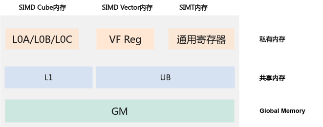
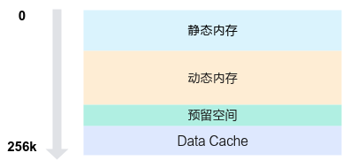

# Memory Hierarchy

## Overall Memory Resources<a name="en-us_topic_0000002571695539_section598391912124"></a>

In a hybrid SIMD and SIMT programming scenario, the overall memory resources are shown in the following figure. The Global Memory outside the cores is the global memory of all cores. It has the largest capacity but the lowest access efficiency. The L1 of the AIC and the UB of the AIV are the shared memory within a single core. They have a smaller capacity but higher access efficiency. The private memory layer is closest to the computing unit. It has the smallest capacity and the highest access efficiency.

**Figure 1**  Memory hierarchy of hybrid SIMD and SIMT programming  


In a hybrid programming scenario, the UB memory is the memory shared by the SIMT VF and the SIMD VF. When Vector Functions are switched, the data in the UB is not cleared. Therefore, the UB can be used for communication between Vector Functions. The [UB Division](#ub-division) section below describes in detail how the UB is divided into the static memory, dynamic memory, Data Cache, and other areas. The [Data Path](#data-path) section describes the overall data path in a hybrid programming scenario and explains data synchronization between parallel pipelines and cache coherence issues when the GM is accessed.

## UB Division<a name="EN-US_TOPIC_0000002563309890"></a>

The total size of the UB memory space is 256 KB. The UB is divided into four main areas by function. From the low address to the high address, they are the static memory, dynamic memory, reserved space, and Data Cache, as shown in the following figure.

**Figure 2**  UB memory allocation of hybrid SIMD and SIMT programming  


### Memory Space Description<a name="en-us_topic_0000002571697985_section19291134194"></a>

1.  Static memory: A memory space of a specified size is allocated from the start address of the memory. The size is determined at compile time and cannot be modified dynamically.

    ```cpp
    // The static memory is allocated through an array. For example:
    __ubuf__ char static_buf[1024];
    ```

2.  Dynamic memory: It is located after the static memory. Its size is specified by the `dyn_ub_size` parameter in [<<<...\>\>\>](核函数与VF函数.md#zh-cn_topic_0000002571578013_section156822920311). It can be allocated and used in the following ways.

    -   Allocation through a dynamic array.

        ```cpp
        // The dynamic memory is allocated through a dynamic array. For example:
        extern __ubuf__ char dynamic_buf[];
        ```

    -   Allocation through the Alloc API of LocalMemAllocator.

    Because the dynamic memory is always allocated from the position after the end of the static memory, only one of these methods can be used to allocate the dynamic memory. Otherwise, address space overlap may occur, resulting in undefined behavior.

3.  Reserved space: space reserved by the compiler and Ascend C. The size is fixed at 8 KB.
4.  Data Cache: the Data Cache space dedicated to SIMT. The allocatable memory size ranges from 32 KB to 128 KB. The calculation formula is as follows:

    ```text
    Data Cache space size = min(total UB size (256 KB) - static memory - dynamic memory - reserved space (8 KB), 128 KB)
    ```

    The Data Cache serves as the cache for accessing the GM memory, and its size affects the memory access efficiency of the operator. If the Data Cache is smaller than 32 KB, a verification error is reported during execution and the program exits. Therefore, when allocating memory, ensure that sufficient Data Cache space is reserved.

Because the Data Cache, the reserved space, and the UB memory allocated by the user share the same UB, developers cannot use the entire UB space and should ensure that the actual UB access range in each of the SIMT and SIMD execution spaces does not exceed the allocated static and dynamic memory sizes.

The declaration or configuration of the static memory and dynamic memory defines the valid range in which the user can use the UB memory. If the configured memory size is insufficient, or if a UB address is accessed directly without any memory allocation, the accessed address may cross the boundary of the user's dynamic and static memory and fall into the Data Cache area. Because the Data Cache capacity is determined by subtracting the static memory, dynamic memory, and reserved space from the total UB size, a smaller shared memory configuration enlarges the remaining space that can be allocated to the Data Cache. When the program crosses the boundary of the allocated dynamic and static memory and an out-of-bounds write occurs, memory allocation failure may not be reported immediately, but the data cache for SIMT global memory access may be corrupted, resulting in unstable computation results or abnormal operator precision.

> [!NOTE]NOTE
>
> You can disable the reserved space by adding the [--cce-disable-vf-stack-reserved-ubuf](../../../编译与运行/算子编译/AI-Core算子编译基本用法.md#ZH-CN_TOPIC_0000002462746461) option during compilation. After this option is enabled, the compiler no longer reserves this part of the UB space, and the space can be used as common UB space. The Data Cache space can be estimated by using the following formula:
> ```text
> Data Cache space size = min(total UB size (256 KB) - static memory - dynamic memory - reserved space (8 KB), 128 KB)
> ```
> When this option is used, the Data Cache space must still be no less than 32 KB, and the upper limit of the Data Cache space is still 128 KB. After this option is enabled, the compiler cannot use the reserved UB space as the buffer space for register spilling, so developers must ensure that register spilling does not occur.

In the hybrid programming mode, the static memory and dynamic memory can be allocated in the SIMT VF, SIMD VF, and MainScalar execution spaces. MainScalar refers to the execution space outside VF functions on the device side. The following figure shows the UB memory layout when memory is allocated in different execution spaces.

**Figure 3**  UB memory layout of different execution spaces  


Note the following when allocating the static memory and dynamic memory:

-   The static memory allocated multiple times is laid out in the UB according to certain start address alignment rules:
    -   By default, the start address of the allocated static memory is aligned to 32 bytes.
    -   You can use `__align__(N)` to manually specify the alignment, which takes precedence over the default alignment.
-   The dynamic memory size is dynamically configured when `<<<...>>>` is executed. There is only one copy globally, so the start addresses returned for the dynamic memory allocated at different execution positions are the same.

## Data Path

In a hybrid programming scenario, the AIV core supports access to the UB/GM in the SIMT VF, SIMD VF, and MainScalar execution spaces, and also supports an independent MTE path from the UB to the GM. The overall data path is shown in the following figure.

**Figure 4**  Data path of hybrid SIMD and SIMT programming  


### Accessing the UB Memory

For the UB memory, reading from and writing to the UB inside a VF uses the Vector pipeline, and reading from and writing to the UB on MainScalar uses the Scalar pipeline. In addition, there is an MTE pipeline between the UB and the GM. Because these three pipelines are executed in parallel, synchronization must be handled properly if there are data dependencies between them.

### Accessing the GM Memory

For the GM memory, reads from and writes to the GM by the SIMT VF and MainScalar pass through their respective Data Caches. In addition, the MTE pipeline may also cause cache data coherence issues. The details are as follows:

-   When data in the GM is read in the SIMT VF execution space, cache data may be incoherent:
    -   When data is written, the underlying implementation ensures that the data is written out to the GM immediately, so that other paths can read the latest data.
    -   When data is read, the underlying implementation of the default memory access is the same as that of [asc\_ldca](../../../../../api/SIMT-API/访存函数/asc_ldca.md). If the accessed memory data hits in the SIMT Data Cache, the cached data is read by default, which may cause the read data to be inconsistent with the latest data in the GM.
-   When data in the GM is read from or written to through the cache in the MainScalar execution space, coherence issues may occur for both reads and writes:
    -   When data is written, the data is first written to the cache. The underlying implementation cannot guarantee that the data is immediately flushed to the GM, so other paths may read stale data. You can use cache control to flush the data to the GM immediately, ensuring that other paths read the latest data. For details, see [asc\_dcci](../../../../../api/SIMD-API/C-API/cache_ctrl/asc_dcci.md).
    -   When data is read, if the accessed memory hits in the cache, the latest data in the GM is not read, which may cause the read data to be invalid.

When data in the GM is read in the SIMT VF execution space, the preceding incoherence between the cached data and the GM data can be resolved in the following ways:

-   Use the `volatile` keyword to declare a pointer or variable to obtain the latest data.
-   Use the [asc\_dcci\_single](../../../../../api/SIMT-API/访存函数/asc_dcci_single.md) API to flush the cache line where the specified address is located, or use the [asc\_dcci\_entire](../../../../../api/SIMT-API/访存函数/asc_dcci_entire.md) API to flush the entire Data Cache within the core.
-   Use the [asc\_ldcg](../../../../../api/SIMT-API/访存函数/asc_ldcg.md) API to ensure the coherence between the cached data and the GM data through hardware.

The preceding solutions introduce additional operations and affect the overall execution efficiency. You need to decide whether to use them based on your own requirements and the actual scenario.
