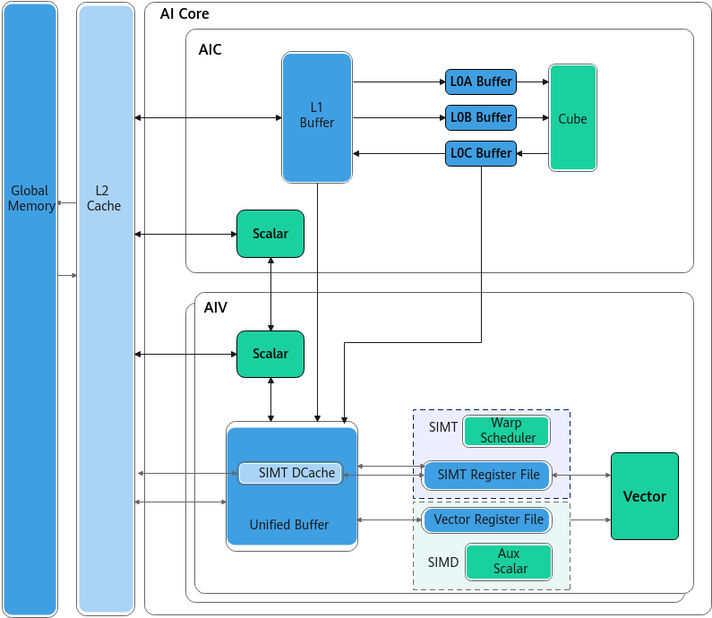

# 抽象硬件架构

Ascend C支持SIMD与SIMT混合编程，实现向量级并行与线程级并行的高效协同。AI Core包含AIC和AIV，其中AIV核支持SIMT、SIMD两种工作模式，因此可以实现AIV内SIMD与SIMT的混合编程，也支持AIV的SIMT与AIC的SIMD融合编程，整体硬件架构如下图所示：

## Vector Function工作机制

如上图硬件架构所述，AIV核的计算单元包括SIMD和SIMT两种。针对这两种硬件计算单元，Ascend C抽象出了Vector Function的软件概念，用于表示执行在SIMT或SIMD硬件计算单元上的特定功能代码段。用户通过编写SIMD Vector Funtion或者SIMT Vector Function来调用对应的执行单元完成计算任务，在算子核函数中通过调用不同类型的Vector Function，以实现SIMD/SIMT硬件单元的切换使用。

如下图硬件架构和示例代码所示，simt\_func表示对应在SIMT硬件单元的代码段，simd\_func表示对应在SIMD硬件单元的代码段，对应代码段的属性是通过[\_\_simt\_vf\_\_](函数层级.md#zh-cn_topic_0000002571578013_section1780955884616)、[\_\_sind\_vf\_\_](函数层级.md#zh-cn_topic_0000002571578013_section2067153312577)来标识。

AIV执行时，Scalar计算单元会将Vector Function发射到Vector Function Queue中，后续串行执行每个Vector Function,与MTE是异步执行的。

-   **SIMD Vector Function**

    SIMD VF是SIMD计算执行的基本软件单元，由于SIMD硬件单元只能访问UB，且SIMD的计算是基于SIMD寄存器完成的。因此SIMD VF内的每次循环将一个固定长度（SIMD Vector寄存器宽度）的数据从UB加载到寄存器中，进行复杂的数学计算后搬出到UB中，所有的计算逻辑均在寄存器中完成。

-   **SIMT Vector Function**

    SIMT VF是SIMT计算执行的基本软件单元，SIMT的执行模型遵从由Thread、Warp、Block、Grid组成的[线程架构](../../../语言扩展层/SIMD&SIMT-BuiltIn关键字.md#ZH-CN_TOPIC_0000002563469530)。同一时刻一个AIV核只执行一个线程块任务，每个线程块会被切分成多个Warp依次调度并完成执行。Warp是SIMT VF内部调度的最小单元，每个Warp包含32个线程，同一时刻Warp内每个线程会执行相同的代码。
UB是AIV核内的共享内存，在Vector Function切换时，UB上的数据不会被清除，因此可通过UB实现Vector Function间的数据共享和通信。