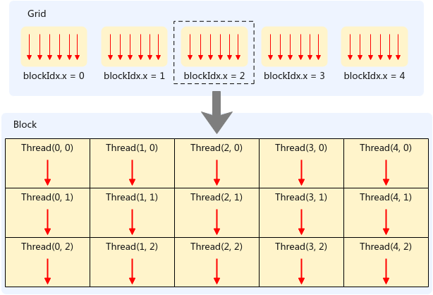

# 线程架构<a name="ZH-CN_TOPIC_0000002563469530"></a>

SIMT（Single Instruction Multiple Thread，单指令多线程）是一种并行计算架构，它允许每个线程维护独立的状态和控制流。本章通过介绍SIMT线程层次结构、线程索引、Warp执行机制等内容，带领用户理解SIMT编程。

## 线程层次结构<a name="zh-cn_topic_0000002540938034_section8959121611415"></a>

SIMT编程模型采用分层的抽象线程组织结构，示意图如下图所示，从顶层到底层依次为：Grid（线程块网格）、Thread Block（线程块）、Warp（线程束）和Thread（线程）。这种层次化的设计使得开发者可以方便地将并行计算问题映射到硬件资源上。

**图 1**  线程结构示意图<a name="zh-cn_topic_0000002540938034_fig1253493131016"></a>  


**Thread（线程）**

线程是整个架构中的最小单元，每个线程独立完成计算任务，拥有独立的寄存器和栈空间。

**Thread Block（线程块）**

Thread Block是Grid的组成单元，由若干线程组成（最大2048个线程）。使用内置变量[blockDim](扩展语法.md#zh-cn_topic_0000002571575581_li076017381191)来表示一个Thread Block启用的线程数量。在SIMD与SIMT混合编程场景Thread Block有以下特点：

-   使用[asc\_vf\_call](zh-cn_topic_0000002542637820.md)调用SIMT VF时，需显示指定Thread Block的维度信息；
-   同一Thread Block内的线程可以访问共享内存（UB）实现数据交互；Thread Block内的线程可通过同步机制实现协作；
-   在SIMT函数定义时可配置最大线程数，用于编译期底层对寄存器资源进行预分配，语法为：

    ```
    constexpr uint32_t MAX_THREAD_COUNT = 1024;
    __simt_vf__ __launch_bounds__(MAX_THREAD_COUNT) inline void simt_gather()
    {
       ...
    }
    ```

-   Thread Block内的blockDim影响每个线程可用的寄存器数量，用户配置的blockDim越大，每个线程可用寄存器越少，具体如下表所示：

    <a name="zh-cn_topic_0000002540938034_table167091123820"></a>
    <table><thead align="left"><tr id="zh-cn_topic_0000002540938034_row11709152311216"><th class="cellrowborder" valign="top" width="49.230000000000004%" id="mcps1.1.3.1.1"><p id="zh-cn_topic_0000002540938034_p47094233211"><a name="zh-cn_topic_0000002540938034_p47094233211"></a><a name="zh-cn_topic_0000002540938034_p47094233211"></a>配置的最大线程数</p>
    </th>
    <th class="cellrowborder" valign="top" width="50.77%" id="mcps1.1.3.1.2"><p id="zh-cn_topic_0000002540938034_p870962310211"><a name="zh-cn_topic_0000002540938034_p870962310211"></a><a name="zh-cn_topic_0000002540938034_p870962310211"></a>每个Thread可用寄存器个数(个)</p>
    </th>
    </tr>
    </thead>
    <tbody><tr id="zh-cn_topic_0000002540938034_row070912231821"><td class="cellrowborder" valign="top" width="49.230000000000004%" headers="mcps1.1.3.1.1 "><p id="zh-cn_topic_0000002540938034_p14710323828"><a name="zh-cn_topic_0000002540938034_p14710323828"></a><a name="zh-cn_topic_0000002540938034_p14710323828"></a>1025~2048</p>
    </td>
    <td class="cellrowborder" valign="top" width="50.77%" headers="mcps1.1.3.1.2 "><p id="zh-cn_topic_0000002540938034_p6710623323"><a name="zh-cn_topic_0000002540938034_p6710623323"></a><a name="zh-cn_topic_0000002540938034_p6710623323"></a>16</p>
    </td>
    </tr>
    <tr id="zh-cn_topic_0000002540938034_row1671016231122"><td class="cellrowborder" valign="top" width="49.230000000000004%" headers="mcps1.1.3.1.1 "><p id="zh-cn_topic_0000002540938034_p97101423728"><a name="zh-cn_topic_0000002540938034_p97101423728"></a><a name="zh-cn_topic_0000002540938034_p97101423728"></a>513~1024</p>
    </td>
    <td class="cellrowborder" valign="top" width="50.77%" headers="mcps1.1.3.1.2 "><p id="zh-cn_topic_0000002540938034_p1571010235215"><a name="zh-cn_topic_0000002540938034_p1571010235215"></a><a name="zh-cn_topic_0000002540938034_p1571010235215"></a>32</p>
    </td>
    </tr>
    <tr id="zh-cn_topic_0000002540938034_row171017234215"><td class="cellrowborder" valign="top" width="49.230000000000004%" headers="mcps1.1.3.1.1 "><p id="zh-cn_topic_0000002540938034_p971062316210"><a name="zh-cn_topic_0000002540938034_p971062316210"></a><a name="zh-cn_topic_0000002540938034_p971062316210"></a>257~512</p>
    </td>
    <td class="cellrowborder" valign="top" width="50.77%" headers="mcps1.1.3.1.2 "><p id="zh-cn_topic_0000002540938034_p137102235212"><a name="zh-cn_topic_0000002540938034_p137102235212"></a><a name="zh-cn_topic_0000002540938034_p137102235212"></a>64</p>
    </td>
    </tr>
    <tr id="zh-cn_topic_0000002540938034_row1425604114155"><td class="cellrowborder" valign="top" width="49.230000000000004%" headers="mcps1.1.3.1.1 "><p id="zh-cn_topic_0000002540938034_p5256124181516"><a name="zh-cn_topic_0000002540938034_p5256124181516"></a><a name="zh-cn_topic_0000002540938034_p5256124181516"></a>1~256</p>
    </td>
    <td class="cellrowborder" valign="top" width="50.77%" headers="mcps1.1.3.1.2 "><p id="zh-cn_topic_0000002540938034_p42562418157"><a name="zh-cn_topic_0000002540938034_p42562418157"></a><a name="zh-cn_topic_0000002540938034_p42562418157"></a>127</p>
    </td>
    </tr>
    </tbody>
    </table>

**Grid（线程块网格）**

Grid是SIMT线程层次结构的最顶层，由多个Thread Block组成。使用内置变量[gridDim](扩展语法.md#zh-cn_topic_0000002571575581_li20760123812911)来表示Grid中启用的线程块数量。在SIMD与SIMT混合编程场景，Grid有以下特征：

-   Grid的维度配置由用户设置的启动AIV核数决定，核函数执行期间不可更改；
-   Grid中的所有线程块具有相同的尺寸和维度配置；
-   同一Grid中的线程块相互独立，按任意顺序执行；

限制说明如下：

-   由于Runtime的限制，Grid中线程块总数不能超过65536。
-   由于gridDim实际就是用户配置的启动AIV核数，当设置的核数超过物理核数时，头尾开销会增大，强烈建议限制启动AIV核数小于物理核数。

**线程索引**

每个线程都有唯一的标识，开发者可以通过内置变量获取线程的身份信息，从而确定每个线程负责处理的数据，相关内置变量如下表所示：

<a name="zh-cn_topic_0000002540938034_table19588941869"></a>
<table><thead align="left"><tr id="zh-cn_topic_0000002540938034_row1588184569"><th class="cellrowborder" valign="top" width="12.989999999999998%" id="mcps1.1.4.1.1"><p id="zh-cn_topic_0000002540938034_p16588124365"><a name="zh-cn_topic_0000002540938034_p16588124365"></a><a name="zh-cn_topic_0000002540938034_p16588124365"></a>内置变量</p>
</th>
<th class="cellrowborder" valign="top" width="52.87%" id="mcps1.1.4.1.2"><p id="zh-cn_topic_0000002540938034_p65881740614"><a name="zh-cn_topic_0000002540938034_p65881740614"></a><a name="zh-cn_topic_0000002540938034_p65881740614"></a>说明</p>
</th>
<th class="cellrowborder" valign="top" width="34.14%" id="mcps1.1.4.1.3"><p id="zh-cn_topic_0000002540938034_p155889417619"><a name="zh-cn_topic_0000002540938034_p155889417619"></a><a name="zh-cn_topic_0000002540938034_p155889417619"></a>约束</p>
</th>
</tr>
</thead>
<tbody><tr id="zh-cn_topic_0000002540938034_row18588641969"><td class="cellrowborder" valign="top" width="12.989999999999998%" headers="mcps1.1.4.1.1 "><p id="zh-cn_topic_0000002540938034_p10588341365"><a name="zh-cn_topic_0000002540938034_p10588341365"></a><a name="zh-cn_topic_0000002540938034_p10588341365"></a>gridDim</p>
</td>
<td class="cellrowborder" valign="top" width="52.87%" headers="mcps1.1.4.1.2 "><p id="zh-cn_topic_0000002540938034_p13588104965"><a name="zh-cn_topic_0000002540938034_p13588104965"></a><a name="zh-cn_topic_0000002540938034_p13588104965"></a>Grid的维度大小，数据类型为dim3。</p>
</td>
<td class="cellrowborder" valign="top" width="34.14%" headers="mcps1.1.4.1.3 "><p id="zh-cn_topic_0000002540938034_p125881042611"><a name="zh-cn_topic_0000002540938034_p125881042611"></a><a name="zh-cn_topic_0000002540938034_p125881042611"></a>gridDim.x &lt;= 65535；gridDim.y、gridDim.z必须为1</p>
</td>
</tr>
<tr id="zh-cn_topic_0000002540938034_row165881240612"><td class="cellrowborder" valign="top" width="12.989999999999998%" headers="mcps1.1.4.1.1 "><p id="zh-cn_topic_0000002540938034_p25887412611"><a name="zh-cn_topic_0000002540938034_p25887412611"></a><a name="zh-cn_topic_0000002540938034_p25887412611"></a>blockDim</p>
</td>
<td class="cellrowborder" valign="top" width="52.87%" headers="mcps1.1.4.1.2 "><p id="zh-cn_topic_0000002540938034_p19588154965"><a name="zh-cn_topic_0000002540938034_p19588154965"></a><a name="zh-cn_topic_0000002540938034_p19588154965"></a>Thread Block的维度大小，数据类型为dim3。</p>
</td>
<td class="cellrowborder" valign="top" width="34.14%" headers="mcps1.1.4.1.3 "><p id="zh-cn_topic_0000002540938034_p65881841362"><a name="zh-cn_topic_0000002540938034_p65881841362"></a><a name="zh-cn_topic_0000002540938034_p65881841362"></a>blockDim.x * blockDim.y *blockDim.z  &lt;= 2048</p>
</td>
</tr>
<tr id="zh-cn_topic_0000002540938034_row195881741465"><td class="cellrowborder" valign="top" width="12.989999999999998%" headers="mcps1.1.4.1.1 "><p id="zh-cn_topic_0000002540938034_p458813418611"><a name="zh-cn_topic_0000002540938034_p458813418611"></a><a name="zh-cn_topic_0000002540938034_p458813418611"></a>blockIdx</p>
</td>
<td class="cellrowborder" valign="top" width="52.87%" headers="mcps1.1.4.1.2 "><p id="zh-cn_topic_0000002540938034_p15880414619"><a name="zh-cn_topic_0000002540938034_p15880414619"></a><a name="zh-cn_topic_0000002540938034_p15880414619"></a>当前Thread Block在Grid中的索引，数据类型为dim3。</p>
</td>
<td class="cellrowborder" valign="top" width="34.14%" headers="mcps1.1.4.1.3 ">&nbsp;&nbsp;</td>
</tr>
<tr id="zh-cn_topic_0000002540938034_row7588541467"><td class="cellrowborder" valign="top" width="12.989999999999998%" headers="mcps1.1.4.1.1 "><p id="zh-cn_topic_0000002540938034_p85884419613"><a name="zh-cn_topic_0000002540938034_p85884419613"></a><a name="zh-cn_topic_0000002540938034_p85884419613"></a>threadIdx</p>
</td>
<td class="cellrowborder" valign="top" width="52.87%" headers="mcps1.1.4.1.2 "><p id="zh-cn_topic_0000002540938034_p15881441360"><a name="zh-cn_topic_0000002540938034_p15881441360"></a><a name="zh-cn_topic_0000002540938034_p15881441360"></a>当前线程在Thread Block内的索引，数据类型为dim3。</p>
</td>
<td class="cellrowborder" valign="top" width="34.14%" headers="mcps1.1.4.1.3 ">&nbsp;&nbsp;</td>
</tr>
</tbody>
</table>

各Thread Block可通过线程块索引blockIdx进行标识，各线程可通过线程块内线程索引threadIdx进行标识。对于一维Grid和Block，索引计算公式为：

```
int global_id = blockIdx.x * blockDim.x + threadIdx.x
```

对于二维Grid和Block，索引计算公式为：

```
int global_id_x = blockIdx.x * blockDim.x + threadIdx.x;
int global_id_y = blockIdx.y * blockDim.y + threadIdx.y;
```

## Warp执行机制<a name="zh-cn_topic_0000002540938034_section3214318716"></a>

Warp是SIMT架构中基本的调度和执行单位。每个Warp包含32个线程，这些线程从相同的程序地址开始执行，拥有各自的指令地址计数器和寄存器状态，并且可以选择分支独立执行。在一个Thread Block内，所有线程按线性顺序被硬件自动划分为每32个线程一组的 Warp，同一Warp内的所有线程执行同一条指令。

Warp 内的线程虽然执行同一段代码，但可通过条件分支进入不同的执行路径，这种情况称为分支发散（Warp Divergence）。当Warp中的32个线程均执行相同的代码分支时，硬件利用率最高；一旦发生分支发散，硬件会串行执行每个分支路径，只有进入当前分支的线程（即活跃线程）会被执行，其余线程则被屏蔽，从而导致Warp执行效率下降。此外，同一Warp内的线程相互独立，彼此不能存在依赖关系。

Thread Block的线程数建议设置为32的整数倍。若线程数未满足该要求，最后一个Warp将包含不足 32 个线程，导致该Warp内存在空闲线程通道，进而降低执行效率。

