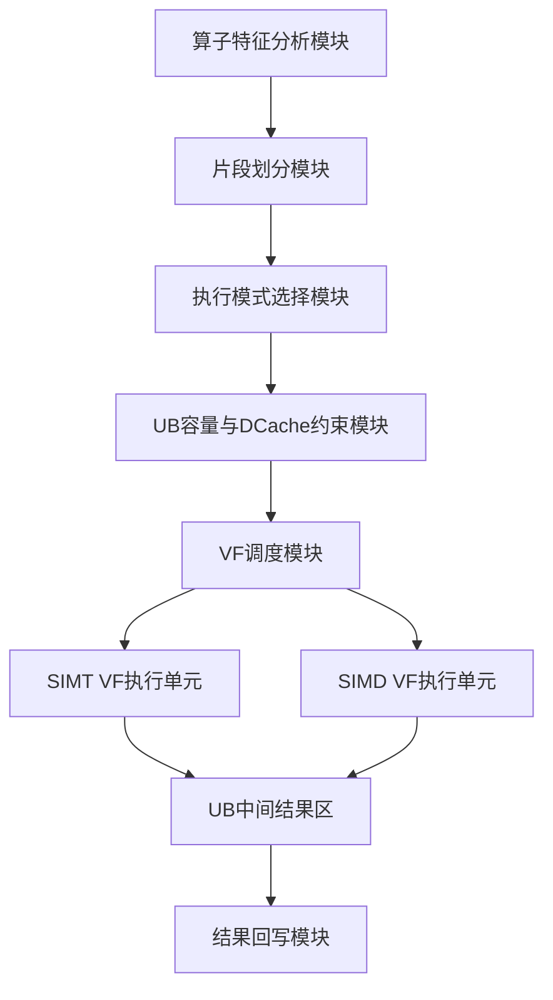
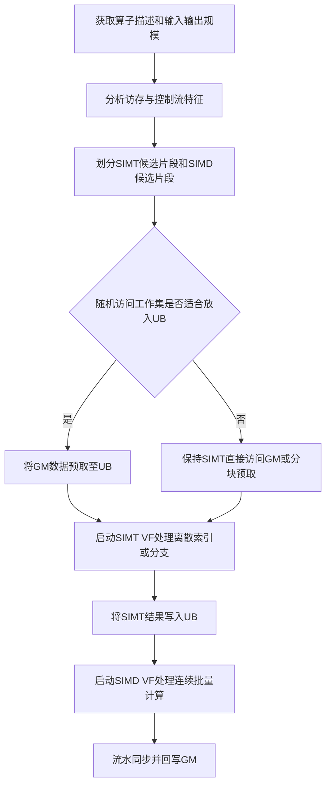

# 技术交底书初版

**案件名称**：一种面向AI Core的SIMD与SIMT混合算子分段执行及片上缓存复用方法

**专利类型**：发明


---

## 一、技术背景及现有技术缺点

### 1.1 技术背景

在AI Core矢量计算场景中，SIMD适合规则、连续、批量的数据并行计算，例如逐元素计算、向量计算、矩阵相关计算等；SIMT适合不规则访存、动态索引、条件分支和线程级标量逻辑。Ascend 950PR/Ascend 950DT支持在同一算子中以Vector Function（VF）为基本调度单位进行SIMD与SIMT混合编程，一个核函数内可以包含多个VF，每个VF可选择采用SIMD或SIMT方式实现。

在该混合模型中，SIMD VF与SIMT VF共享部分片上资源，例如Unified Buffer（UB）、Vector ALU、ICache等。SIMT模式下，线程可直接访问Global Memory（GM）或UB；SIMD模式下，通常需要先将数据从GM搬运至UB，再由Reg矢量计算接口从UB加载到寄存器执行计算。因此，UB既是SIMD与SIMT之间传递中间结果的共享片上存储，也是降低GM随机访存开销的重要缓存层。

相关材料位置：

- `/home/q00954432/asc-devkit/docs/guide/编程指南/高级编程/高级AI-Core编程模型/SIMD与SIMT混合编程.md`
- `/home/q00954432/asc-devkit/docs/guide/算子实践参考/SIMD与SIMT混合算子实现/算子实现.md`
- `/home/q00954432/asc-devkit/docs/api/context/asc_vf_call.md`

### 1.2 现有技术缺点

1. 单独使用SIMD实现复杂分支时，需要通过Compare、Select、Mask等多个矢量操作间接表达条件逻辑，代码复杂，寄存器和掩码资源消耗较高，且容易引入额外流水开销。

2. 单独使用SIMT处理随机索引访存时，线程可直接从GM读取离散数据，但GM随机访问粒度较大，实际有效数据占比较低，容易造成DCache与L2之间带宽浪费，影响整体执行时间。

3. 现有算子实现通常依赖开发者手工判断哪一段逻辑适合SIMD、哪一段逻辑适合SIMT，缺少围绕“算子片段特征、UB容量约束、DCache预留约束、线程配置、VF调度顺序”的系统化分段执行方法。

4. 在SIMD与SIMT混合场景下，UB需要同时承担静态内存、动态内存、预留空间和SIMT DCache等功能，若缺少明确的容量判断和启动参数配置，可能导致UB空间浪费、DCache不足或动态内存越界风险。

## 二、本发明要解决的技术问题

本发明拟解决以下技术问题：

1. 如何在同一AI Core算子中，根据计算片段的访存规律和控制流复杂度，自动或半自动地选择SIMD VF或SIMT VF执行方式。

2. 如何利用UB作为SIMD与SIMT之间的共享片上缓存，使SIMT随机访问尽量落在UB上，减少直接访问GM造成的低效随机访存。

3. 如何在UB容量、系统预留空间和SIMT DCache下限约束下，确定动态UB大小、线程数、分核策略和VF调度顺序。

4. 如何通过VF粒度的串行调度与流水同步，保证SIMT/SIMD片段之间的数据可见性，并减少不必要的数据回写GM。

## 三、技术方案

### 3.1 总体方案

本发明提出一种面向AI Core的SIMD与SIMT混合算子分段执行及片上缓存复用方法。该方法将待执行算子拆分为若干逻辑片段，对每个片段提取访存连续性、分支复杂度、数据复用规模、输入输出位置等特征，并据此选择SIMT VF或SIMD VF实现。

对于离散索引、条件分支、动态访问等片段，优先映射为SIMT VF；对于连续规整、批量逐元素或向量计算片段，优先映射为SIMD VF。多个VF在同一核函数内按依赖关系顺序执行，中间结果优先写入UB。若某一SIMT片段需要随机读取的数据工作集小于可用UB阈值，则先通过搬运接口将GM数据预取至UB，再由SIMT线程按索引从UB读取，以降低GM随机访问开销。

### 3.2 系统框图



### 3.3 模块功能说明

**算子特征分析模块**用于分析算子的输入输出、数学表达式、访存模式和控制流类型，识别连续计算、离散索引、分支判断、类型转换、结果回写等片段。

**片段划分模块**用于将单一算子拆分为多个可通过VF执行的任务片段。每个片段具有明确的输入、输出、数据规模和依赖关系。

**执行模式选择模块**根据片段特征选择SIMD或SIMT。若片段为规则连续批量计算，则选择SIMD；若片段包含随机索引、条件分支、动态访问或线程级独立逻辑，则选择SIMT。

**UB容量与DCache约束模块**根据UB总容量、静态内存、动态内存、系统预留空间和最小DCache需求，判断是否可将目标工作集预取至UB，并据此计算动态UB大小和kernel启动参数。

**VF调度模块**通过VF调用接口启动SIMT VF或SIMD VF，并在必要位置插入流水同步，保证前一片段写入UB的数据对后一片段可见。

**结果回写模块**在所有片段执行完成后，将最终结果从UB搬运至GM，避免中间结果在GM和UB之间反复搬运。

### 3.4 方法流程



### 3.5 关键技术参数

1. VF粒度：每个SIMD VF或SIMT VF对应一个可独立调度的算子片段。

2. 线程数：SIMT VF通过`dim3`指定线程层次结构，单线程可处理一个或多个数据元素。

3. 可用UB空间：由UB总容量扣除静态内存、动态内存、系统预留空间和DCache保留空间后确定。

4. DCache约束：在混合编程场景下，需要为SIMT保留最小DCache空间；若预取工作集导致DCache不足，则调整分块大小或退化为直接GM访问。

5. SIMD循环次数：由每核数据量与Reg矢量计算接口单次处理长度计算得到。

6. 同步点：在SIMT/SIMD切换或计算/搬运流水之间插入同步，保证UB数据生产与消费顺序正确。

## 四、实施例

### 4.1 实施例一：gather与adds融合算子

该实施例中，算子表达式为：

```text
output[i] = input[index[i]] + 1
```

其中，`input[index[i]]`属于离散索引访问，适合由SIMT线程根据`threadIdx`和`blockIdx`计算索引并完成gather；`+1`属于连续规整逐元素计算，适合由SIMD Reg矢量计算接口执行。

执行过程如下：

1. 将算子划分为SIMT gather片段、SIMD adds片段和结果回写片段。
2. SIMT gather片段读取GM中的`input`和`index`，将gather结果写入UB。
3. SIMD adds片段从UB加载gather结果，执行批量加一，并将结果写回UB。
4. 通过同步保证SIMD写入完成后，将最终结果从UB搬运到GM。

对应代码材料：

- `/home/q00954432/asc-devkit/examples/01_simd_cpp_api/00_introduction/03_fusion_operation/gather_adds_simt_simd_hybrid/gather_and_adds.asc`

### 4.2 实施例二：SIMT随机访存的UB预缓存优化

对于gather类算子，如果`input`工作集较小而`index`数量较大，SIMT线程直接从GM随机读取`input[gather_idx]`会造成较低的有效带宽利用率。本实施例先将`input`从GM整体搬运到UB中的`input_buf`，随后SIMT VF按`index`从UB中离散读取。

执行过程如下：

1. 判断`input`工作集大小是否小于可用UB阈值。
2. 若满足条件，使用搬运接口将`input`从GM搬入UB。
3. 插入MTE2到V流水同步，保证搬运结果可被SIMT读取。
4. 启动SIMT VF，线程按索引从UB读取输入并写出结果。

该方案可降低GM随机访问次数，将离散访问转换为UB访问。材料中gather优化案例显示，正例相较反例整体运行时间有明显下降。

对应代码材料：

- `/home/q00954432/asc-devkit/examples/01_simd_cpp_api/04_best_practices/03_fusion_compute_practices/simt_gather_with_ub/gather_v2.asc`
- `/home/q00954432/asc-devkit/docs/guide/算子实践参考/SIMD与SIMT混合算子性能优化/内存访问/使用Unified-Buffer提升内存访问效率.md`

### 4.3 实施例三：分支密集计算迁移到SIMT

对于floor_mod类算子，需要根据余数符号和除数符号进行条件判断。若使用SIMD实现，需要多组Compare、Select、Mask等操作组合实现分支逻辑；若使用SIMT实现，每个线程可通过普通`if/else`完成对应元素的判断。

执行过程如下：

1. 将输入数据从GM搬入UB。
2. 对整数类型或分支密集路径，启动SIMT VF。
3. 每个线程读取一个元素，计算余数并判断符号条件。
4. 根据判断结果写出对应元素结果。
5. 将UB中的最终结果搬回GM。

对应代码材料：

- `/home/q00954432/asc-devkit/examples/01_simd_cpp_api/04_best_practices/03_fusion_compute_practices/simt_and_simd_floor_mod/floor_mod.asc`
- `/home/q00954432/asc-devkit/docs/guide/算子实践参考/SIMD与SIMT混合算子性能优化/计算优化/通过SIMT实现分支判断.md`

## 五、创新点及技术效果

### 5.1 创新点

1. 提出一种基于算子片段特征的SIMD/SIMT执行模式选择机制，将规则连续计算映射到SIMD，将离散访存和分支判断映射到SIMT。

2. 提出一种面向SIMT随机访存的UB预缓存机制，在工作集满足UB容量约束时，先将GM数据搬入UB，再由SIMT线程从UB进行离散读取。

3. 提出一种以VF为粒度的混合执行编排方法，在同一核函数内按依赖关系串行调度SIMT VF和SIMD VF，并通过UB传递中间结果。

4. 提出一种结合UB容量、动态内存、系统预留空间和DCache下限的启动参数配置方法，用于确定分块大小、动态UB大小、线程数和回退策略。

5. 提出一种针对分支密集算子的SIMT替代SIMD掩码选择机制，将复杂的矢量掩码逻辑转换为线程级条件分支。

### 5.2 技术效果

1. 降低SIMT随机访问GM带来的无效带宽消耗，提高离散访存场景下的有效访存效率。

2. 减少分支密集算子中SIMD Compare、Select、Mask等组合操作数量，降低实现复杂度和寄存器压力。

3. 减少中间结果反复回写GM，通过UB完成SIMT与SIMD片段之间的数据复用。

4. 在不同算子片段中分别发挥SIMT灵活控制流和SIMD高吞吐连续计算的优势，提升整体执行效率。

5. 通过容量约束与调度约束显式化，降低混合编程中UB越界、DCache不足和流水依赖错误的风险。

## 六、拟保护点

### 6.1 主保护点

一种面向AI Core的SIMD与SIMT混合算子执行方法，其特征在于：

1. 对待执行算子进行片段划分，得到至少一个SIMT候选片段和至少一个SIMD候选片段；
2. 根据片段的访存连续性、分支复杂度和数据复用规模，确定各片段采用SIMT VF或SIMD VF执行；
3. 根据UB容量、系统预留空间和SIMT DCache保留空间，确定是否将目标工作集从GM预取至UB；
4. 当满足预取条件时，将目标工作集搬运至UB，并启动SIMT VF从UB进行离散读取或分支计算；
5. 将SIMT VF的输出作为SIMD VF的输入保存在UB中，启动SIMD VF执行连续批量计算；
6. 在VF切换或计算与搬运流水之间设置同步点，将最终结果从UB回写至GM。

### 6.2 从属保护点

1. 所述片段划分依据包括：索引访问是否连续、是否包含条件分支、数据规模是否适合线程级并行、数据是否需要跨片段复用。

2. 所述UB预缓存判断包括：计算目标工作集字节数，并与扣除系统预留空间和DCache下限后的可用UB空间比较。

3. 所述SIMT VF的线程数根据每核处理数据量确定；当每核处理数据量大于单次启动线程数时，将数据切分为多个线程块或多次VF调用。

4. 所述SIMD VF的循环次数根据每核数据量和Reg矢量计算接口单次处理数据量确定。

5. 所述同步点至少包括GM到UB搬运完成后SIMT读取前的同步，以及SIMD计算完成后结果回写GM前的同步。

6. 所述方法适用于gather、scatter、where、floor_mod、hash table插入、稀疏更新、注意力机制中动态索引访问等算子或算子片段。

### 6.3 系统保护点

一种SIMD与SIMT混合算子执行系统，包括：

1. 算子特征分析模块；
2. 片段划分模块；
3. SIMD/SIMT执行模式选择模块；
4. UB容量与DCache约束判断模块；
5. VF调度模块；
6. 流水同步模块；
7. 结果回写模块。

其中，VF调度模块用于在同一核函数内启动SIMT VF和SIMD VF，UB容量与DCache约束判断模块用于决定是否进行GM到UB的预缓存，以及确定动态UB大小和分块策略。

## 七、后续完善建议

1. 对“UB预缓存 + SIMT离散读取”的方向进行专利查新，重点检索GPU shared memory、SIMT gather、AI Core UB cache、vector function调度等关键词。

2. 将主权利要求从“开发范式”进一步收紧为“基于容量约束的预缓存判断 + VF粒度混合调度 + UB中间结果复用”的组合方案。

3. 补充更多可量化实验数据，例如不同input工作集大小、不同index规模、不同分支密度下的性能变化曲线。

4. 明确回退策略：当工作集超过可用UB阈值时，采用分块预取、直接GM访问或混合分块策略。

5. 将实施例中的具体API名称抽象为“VF调用接口、片上搬运接口、流水同步接口”，避免权利要求过度绑定某一代码接口。
