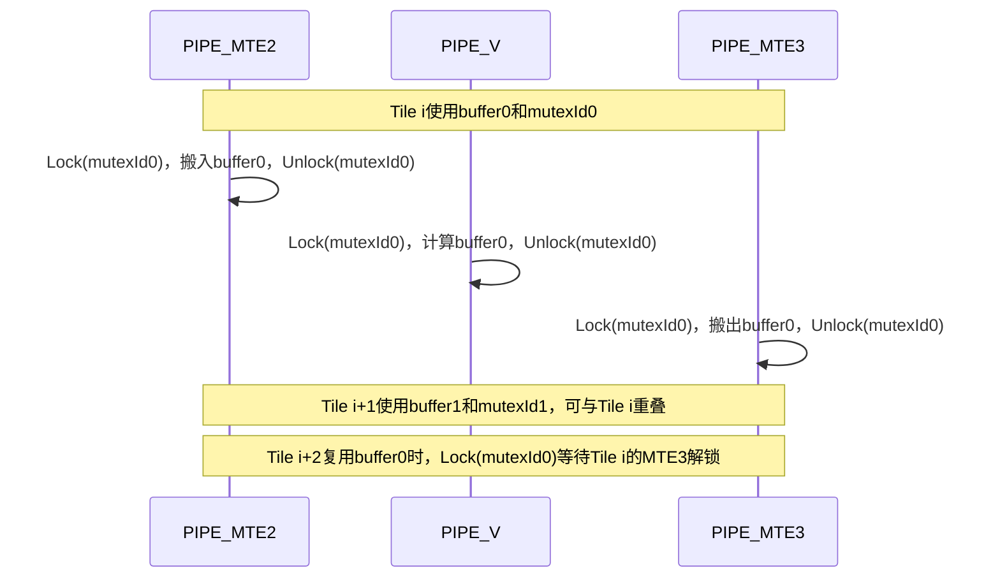

# 基于Mutex实现多流水同步

在Ascend 950PR/Ascend 950DT上，矢量算子可通过Mutex实现AI Core内多条异步流水之间的同步，从而解决彼此之间的数据依赖问题。本文以使用双缓冲的Add算子为例，说明如何使用`AscendC::Mutex::Lock`和`AscendC::Mutex::Unlock`串联数据搬入、矢量计算和数据搬出三个阶段，并在此基础上说明Buffer复用时的反向同步为何无需额外处理。

Mutex中Lock和Unlock必须配合使用，两个接口的功能描述如下：
- `Lock`：阻塞由模板参数pipe指定的流水，其解除阻塞的条件是此前所有流水中使用相同MutexID的Mutex均已执行`Unlock`。
- `Unlock`：指定流水的前序指令执行完成后，根据mutex_id释放对应Mutex。

## 前置说明

- 本文适用于Ascend 950PR/Ascend 950DT。Mutex为NPU架构版本3510新增能力，其他产品应使用[SetFlag/WaitFlag](../../../../api/SIMD-API/basic_api/sync_control/intra_core_sync/SetFlag-WaitFlag.md)等可用同步接口。
- 需要了解[DoubleBuffer场景](double_buffer_scenario.md)和[内存一致性](../../../programming_guide/advanced_programming/memory_model/memory_consistency.md)中关于跨流水依赖与Buffer复用的说明。
- 本文示例聚焦主块均匀切分场景，用于说明Mutex管理双缓冲多流水同步的原理；尾块处理不在本文展开。实际算子中若存在尾块，可参考[DoubleBuffer场景](double_buffer_scenario.md)单独处理尾块，避免将不满足DoubleBuffer条件的尾块纳入相同切分逻辑。
- 本文以Basic API中的[AscendC::Mutex::Lock](../../../../api/SIMD-API/basic_api/sync_control/intra_core_sync/Mutex_ISASI.md)/[AscendC::Mutex::Unlock](../../../../api/SIMD-API/basic_api/sync_control/intra_core_sync/Mutex_ISASI.md)为例说明Mutex实现多流水同步的原理，相关结论同样适用于C API中的[asc_lock](../../../../api/SIMD-API/c_api/sync/asc_lock.md)/[asc_unlock](../../../../api/SIMD-API/c_api/sync/asc_unlock.md)接口。
- 本文示例采用TPipe-TQue框架编程范式（这句话应该是错的，应该改为采用静态tensor编程方式），MutexID通过[AllocMutexID](../../../../api/SIMD-API/basic_api/sync_control/intra_core_sync/AllocMutexID_ISASI.md)申请，并在使用结束后通过[ReleaseMutexID](../../../../api/SIMD-API/basic_api/sync_control/intra_core_sync/ReleaseMutexID_ISASI.md)释放。

## 适用场景（<span style="color:red">说明正向同步和反向同步是什么</span>）<a name="section_mutex_sync_scenario"></a>

一个典型的矢量算子会将每个数据块分为数据搬入、计算和数据搬出三个阶段：`PIPE_MTE2 -> PIPE_V -> PIPE_MTE3`。当数据量超过单个Unified Buffer（UB）可容纳范围时，算子通常按tile循环处理；采用双缓冲后，当前tile的计算可以与相邻tile的搬运重叠执行。

从数据依赖和指令执行关系看，多流水同步包括正向同步和反向同步。正向同步用于约束同一tile内的流水顺序：数据搬入完成后才能开始计算，即`PIPE_MTE2 -> PIPE_V`；计算完成后才能搬出结果，即`PIPE_V -> PIPE_MTE3`。

反向同步用于约束不同tile之间的Buffer复用。下一轮复用输入Buffer进行数据搬入前，需要等待上一轮计算完成，即`PIPE_V -> PIPE_MTE2`，避免`PIPE_MTE2`覆盖仍被`PIPE_V`读取的数据；下一轮复用输出Buffer进行计算前，需要等待上一轮数据搬出完成，即`PIPE_MTE3 -> PIPE_V`，避免`PIPE_V`覆盖仍被`PIPE_MTE3`读取的数据。

MutexID可以表示一个Buffer的完整生命周期。同一Buffer上的MTE2、V、MTE3阶段使用同一个MutexID，两个Buffer使用不同的MutexID。调用`Lock<当前pipe>(mutexId)`时，当前流水会等待此前所有流水中相同MutexID的`Unlock`全部完成。开发者无需识别前序流水类型，也无需显式指定流水间的依赖关系。



Mutex不限定为上述三段矢量流水。`Mutex::Lock/Unlock`的流水模板参数支持`PIPE_S`、`PIPE_M`、`PIPE_V`、`PIPE_MTE1`、`PIPE_MTE2`、`PIPE_MTE3`和`PIPE_FIX`。因此，除矢量算子的`MTE2 -> V -> MTE3`外，也可用同一模式描述矩阵算子的`MTE2 -> MTE1 -> M -> FIX`依赖。本文聚焦矢量算子；矩阵算子的完整调用方式请参考[矩阵计算同步机制](../../../programming_guide/programming_model/ai_core_simd_programming/cpp_tensor_programming/cube_matrix_computation.md#同步机制)。

### MutexID管理方式

MutexID应与其管理的Buffer或资源生命周期一一对应。不同编程范式的获取方式不同。

| 编程范式 | MutexID管理方式 | 使用建议 |
| --- | --- | --- |
| TPipe-TQue框架编程范式 | 使用`AllocMutexID`申请，并在使用结束后调用`ReleaseMutexID`释放。 | 按Buffer数量申请ID。双缓冲通常申请两个ID，分别管理两个Buffer。 |
| 静态Tensor编程范式 | 由开发者自行指定和管理。 | 建议使用0-27，避免使用系统内部规划预留的28-31。 |

## 算子实现

### MutexID与Buffer对应关系

双缓冲使用两个Buffer和两个MutexID。循环第`i`轮选择`bufferIndex = i % 2`，使同一个MutexID只管理其对应Buffer的依赖。第`i + 2`轮再次选择相同的Buffer和MutexID，其`PIPE_MTE2`上的Lock会等待此前所有使用该MutexID的流水均已Unlock；其中包括第`i`轮`PIPE_MTE3`的Unlock。由此保证Buffer能够安全复用。

| 轮次 | Buffer | MutexID | 关键约束 |
| --- | --- | --- | --- |
| `i` | `buffer0` | `mutexId0` | MTE2、V、MTE3按顺序处理当前tile。 |
| `i + 1` | `buffer1` | `mutexId1` | 使用另一组资源，可与`i`轮的异步流水重叠。 |
| `i + 2` | `buffer0` | `mutexId0` | MTE2搬入前等待`i`轮MTE3完成，避免覆盖`buffer0`。 |

### 核函数核心流程

以下代码展示双缓冲Add算子的核心同步逻辑。`xLocal`、`yLocal`和`zLocal`各包含两个UB Buffer，`DataCopy`和`Add`的参数省略了与同步无关的初始化细节。

```cpp
constexpr uint32_t BUFFER_NUM = 2;

uint8_t mutexId0 = AscendC::AllocMutexID();
uint8_t mutexId1 = AscendC::AllocMutexID();

for (uint32_t i = 0; i < loopCount; ++i) {
    uint32_t bufferIndex = i % BUFFER_NUM;
    uint8_t mutexId = (bufferIndex == 0) ? mutexId0 : mutexId1;

    // 只指定当前PIPE_MTE2。Lock自动等待此前所有流水对该MutexID的Unlock；
    // 复用同一Buffer时，这里会等待该Buffer上一轮的MTE3搬出完成。
    AscendC::Mutex::Lock<PIPE_MTE2>(mutexId);
    AscendC::DataCopy(xLocal[bufferIndex], xGm[tileLength * i], tileLength);
    AscendC::DataCopy(yLocal[bufferIndex], yGm[tileLength * i], tileLength);
    AscendC::Mutex::Unlock<PIPE_MTE2>(mutexId);

    // 当前tile的数据搬入完成后，Vector流水才开始计算。
    AscendC::Mutex::Lock<PIPE_V>(mutexId);
    AscendC::Add(zLocal[bufferIndex], xLocal[bufferIndex], yLocal[bufferIndex], tileLength);
    AscendC::Mutex::Unlock<PIPE_V>(mutexId);

    // 当前tile的计算完成后，MTE3流水才开始搬出结果。
    AscendC::Mutex::Lock<PIPE_MTE3>(mutexId);
    AscendC::DataCopy(zGm[tileLength * i], zLocal[bufferIndex], tileLength);
    AscendC::Mutex::Unlock<PIPE_MTE3>(mutexId);
}

AscendC::ReleaseMutexID(mutexId0);
AscendC::ReleaseMutexID(mutexId1);
```

在每条流水上，`Lock<当前pipe>`后的指令会等待此前所有流水中相同MutexID的`Unlock`全部完成。MTE2、V和MTE3使用同一MutexID时，代码顺序即表达了当前tile的正向依赖；再次使用该MutexID的MTE2或V时，会同时检查该MutexID此前全部阶段的完成状态，从而自然表达Buffer复用前的反向依赖。

完整的可编译示例请参考仓内[Mutex核内流水线同步样例](../../../../../../examples/01_simd_cpp_api/03_basic_api/05_sync_control/mutex)。

## 反向同步原理（<span style="color:red">说明Mutex如何表达反向同步</span>）

双缓冲的正向依赖是当前tile的`PIPE_MTE2 -> PIPE_V -> PIPE_MTE3`。反向依赖发生在Buffer复用时，不属于当前tile内部的正向依赖。

第`i + 2`轮与第`i`轮复用同一组Buffer时，MTE2搬入输入Buffer前必须等待第`i`轮V流水完成计算，对应`PIPE_V -> PIPE_MTE2`；V流水写入输出Buffer前必须等待第`i`轮MTE3流水完成搬出，对应`PIPE_MTE3 -> PIPE_V`。这两个等待共同保证输入、输出Buffer复用时不会覆盖前序tile仍在读取或搬出的数据。

使用Mutex时，`mutexId`与Buffer绑定，MutexID记录的是该Buffer此前所有阶段的完成状态，而非某个指定生产者的完成状态。每个阶段只锁定当前流水；`Lock<PIPE_MTE2>(mutexId)`和`Lock<PIPE_V>(mutexId)`会阻塞对应流水的后续指令，直至此前所有流水中同一MutexID的Mutex均已Unlock。

这正是Mutex能够简化反向同步的原因：第`i + 2`轮的MTE2或V不需要知道前一次使用该Buffer的是哪一条流水，也不需要为反向依赖维护专用事件。只要所有访问该Buffer的阶段复用同一MutexID，Lock便会统一等待其此前全部阶段完成。

```cpp
// Mutex：只指定当前流水，MutexID表达整个Buffer生命周期。
for (uint32_t i = 0; i < loopCount; ++i) {
    uint32_t bufferIndex = i % 2;
    uint8_t mutexId = (bufferIndex == 0) ? mutexId0 : mutexId1;

    AscendC::Mutex::Lock<PIPE_MTE2>(mutexId);
    // MTE2搬入bufferIndex。
    AscendC::Mutex::Unlock<PIPE_MTE2>(mutexId);
    AscendC::Mutex::Lock<PIPE_V>(mutexId);
    // V计算bufferIndex。
    AscendC::Mutex::Unlock<PIPE_V>(mutexId);
    AscendC::Mutex::Lock<PIPE_MTE3>(mutexId);
    // MTE3搬出bufferIndex。
    AscendC::Mutex::Unlock<PIPE_MTE3>(mutexId);
}
```

## 与SetFlag/WaitFlag的选择

`SetFlag/WaitFlag`和Mutex都可以建立核内多流水依赖。对于双缓冲算子中按Buffer生命周期组织的依赖，Mutex能将同步状态聚合到对应的MutexID：开发者在当前阶段只需调用`Lock<当前pipe>(mutexId)`和`Unlock<当前pipe>(mutexId)`，无需关心或传入前序生产者流水。Lock阻塞当前流水，直至此前所有流水中相同MutexID的Mutex均已Unlock；它等待的是该资源此前所有阶段的完成状态，而不是某一条指定源流水。因此，不需要像SetFlag/WaitFlag一样传入或维护源流水、目的流水组合及其事件ID。

### SetFlag/WaitFlag时序

SetFlag/WaitFlag以一对源流水和目的流水为同步方向。以MTE2流水搬入数据、V流水读取数据进行计算为例，需要通过`HardEvent::MTE2_V`明确指定源流水和目的流水，并为这组同步分配事件ID。MTE2流水的前序指令执行完成后，`SetFlag`将对应事件置为1；V流水执行到`WaitFlag`时，如果事件为0，则阻塞V流水的后续指令，如果事件为1，则将事件清零并继续执行。

**图1**  SetFlag/WaitFlag同步时序示意图    


`SetFlag`和`WaitFlag`必须使用完全相同的HardEvent和事件ID。图中的`MTE2_V`同时编码了源流水MTE2和目的流水V；如果同步方向或参与流水发生变化，开发者需要选择对应的HardEvent并管理其事件ID。

### Lock/Unlock时序

Lock/Unlock不指定源流水和目的流水组合。在相同场景中，MTE2和V流水分别通过`Lock<当前pipe>(mutexId)`指定当前流水，并在操作完成后通过相同pipe和MutexID的`Unlock`释放。V流水执行Lock时，会等待此前所有流水中具有相同MutexID的Mutex均已释放，其中包括MTE2流水的Unlock。

**图2**  Lock/Unlock同步时序示意图    


图中MTE2流水只指定`PIPE_MTE2`，V流水只指定`PIPE_V`，两条流水通过相同的MutexID建立依赖。与SetFlag/WaitFlag相比，Lock/Unlock不需要通过HardEvent同时编码源流水和目的流水；V流水只需关注自身和待访问资源对应的MutexID。

| 对比项 | Mutex Lock/Unlock | SetFlag/WaitFlag |
| --- | --- | --- |
| 依赖表达 | 调用`Lock<当前pipe>(mutexId)`即可等待此前所有流水对该MutexID的Unlock，以MutexID关联同一Buffer生命周期内的多个阶段。 | 以源流水、目标流水和事件ID明确配对。 |
| 解除阻塞条件 | 此前所有流水中相同MutexID的Mutex均已Unlock，不需要识别前序流水类型。 | 指定源流水已通过对应事件通知指定目标流水。 |
| 反向同步 | 后续复用Buffer时再次Lock同一MutexID即可等待前序使用者释放，无需在当前调用中指定V到下一轮MTE2、MTE3到下一轮V等流水组合。 | 需要为反向依赖额外设置与等待相应的事件。 |
| 同步信号量 | 建议使用MutexID 0-27，共28个ID，适合区分较多并发Buffer或资源。 | Ascend 950PR/Ascend 950DT支持事件ID 0-7；静态Tensor编程范式建议使用0-5，事件ID 6和7为系统或框架规划保留。 |
| 架构相关配置 | 不依赖HardEvent，不需要根据源、目的流水组合选择事件类型。 | HardEvent的取值随硬件架构变化，需要根据目标架构支持的事件选择源、目的流水组合。 |
| 跨硬件版本 | 仅适用于支持Mutex的Ascend 950PR/Ascend 950DT。 | TQueSync的SetFlag/WaitFlag可保证跨硬件版本兼容。 |

“同步信号量更多”是指开发者可用于区分同步对象的MutexID数量更多，不表示一次Lock/Unlock能够同步更多流水，也不代表使用Mutex一定能提升性能。例如，多个Buffer并发复用时，可以为每个Buffer分配不同的MutexID，并由MTE2、V、MTE3流水复用该MutexID管理Buffer的完整生命周期。使用SetFlag/WaitFlag时，每种HardEvent表示一种源流水到目的流水的依赖方向，同一依赖方向可使用的事件ID数量有限；并发Buffer较多时，需要规划事件ID的复用时机，并确保上一组SetFlag/WaitFlag已经严格配对和消费。

MutexID数量和事件ID数量不能直接理解为全部硬件同步资源的总量对比。SetFlag/WaitFlag的事件资源按HardEvent方向组织，不能将不同HardEvent下的事件槽位简单相加后与MutexID数量比较。此外，采用TPipe-TQue框架编程范式时，MutexID由框架分配，实际可申请数量还取决于框架内部的资源占用。因此，Mutex的主要优势仍是通过MutexID聚合同一资源的多流水依赖，降低HardEvent选择和事件配对的编程复杂度；可使用更多同步信号量是其附加优势。

Mutex并不用于同一条流水内的指令排序。例如，同一`PIPE_MTE2`上两次UB地址重叠的数据搬运，需要使用[PipeBarrier](../../../../api/SIMD-API/basic_api/sync_control/intra_core_sync/PipeBarrier_ISASI.md)等待前一次搬运完成。

由于Mutex不需要传入源流水、目的流水组合，因此也不依赖对应的HardEvent。在不同硬件架构上，HardEvent支持的取值可能不同；使用SetFlag/WaitFlag时，需要针对目标架构确认所需的流水组合是否存在。使用Mutex时，开发者只需关注当前流水和MutexID，可减少这部分事件配置。Mutex不提供跨硬件版本兼容性，仍需以Ascend 950PR/Ascend 950DT的产品支持范围为准。

### SetFlag/WaitFlag的反向同步（<span style="color:red">说明SetFlag/WaitFlag表达反向同步时为什么更复杂</span>）

使用SetFlag/WaitFlag时，开发者需要为反向依赖显式维护`V -> MTE2`和`MTE3 -> V`等事件，并在下一次复用对应Buffer前等待这些事件。除反向依赖外，当前tile的`MTE2 -> V`和`V -> MTE3`也分别需要事件配对。

反向事件是否需要插入还取决于循环位置：前两个tile首次使用两个Buffer，没有前序V或MTE3需要等待；最后两个tile后没有下一轮复用该Buffer，也不应再为反向依赖设置事件。开发者需要根据`loopCount`和Buffer数量维护这些边界判断，并保证反向事件的设置与后续等待严格配对。这会增加循环代码的分支和事件ID管理负担。

```text
SetFlag/WaitFlag伪代码：需要分别表达正向和反向的流水组合。
for (uint32_t i = 0; i < loopCount; ++i) {
    uint32_t bufferIndex = i % 2;
    if (i >= BUFFER_NUM) {
        // 等待前两轮的V释放当前要复用的输入Buffer：V -> MTE2。
        wait_v_to_mte2(bufferIndex);
    }
    // MTE2搬入bufferIndex。
    set_mte2_to_v(bufferIndex);
    wait_mte2_to_v(bufferIndex);
    if (i >= BUFFER_NUM) {
        // 等待前两轮的MTE3释放当前要复用的输出Buffer：MTE3 -> V。
        wait_mte3_to_v(bufferIndex);
    }
    // V计算bufferIndex。
    if (i + BUFFER_NUM < loopCount) {
        // 仅当后续仍会复用输入Buffer时，设置V -> MTE2事件。
        set_v_to_mte2(bufferIndex);
    }
    set_v_to_mte3(bufferIndex);
    wait_v_to_mte3(bufferIndex);
    // MTE3搬出bufferIndex。
    if (i + BUFFER_NUM < loopCount) {
        // 仅当后续仍会复用输出Buffer时，设置MTE3 -> V事件。
        set_mte3_to_v(bufferIndex);
    }
}
```

仓内矩阵算子样例在复用工作空间前使用`HardEvent::MTE3_MTE2`获取事件ID，并显式插入对应的SetFlag/WaitFlag。这说明反向同步不仅出现在双缓冲矢量算子中；只要后续流水需要复用仍被前序流水访问的存储资源，就需要表达这类依赖。详见[matmul_partial_output样例](../../../../../../examples/01_simd_cpp_api/04_advanced_api/00_matmul/matmul_partial_output/matmul_partial_output.asc)。

## 使用约束

- 对同一个MutexID，Lock和Unlock必须严格成对出现，且使用相同的流水类型和MutexID；Unlock必须位于对应Lock之后。
- 不得嵌套使用相同MutexID的Lock/Unlock组合，否则行为未定义。
- 在TPipe-TQue框架编程范式中，使用结束后应释放申请的MutexID，避免ID耗尽。
- 不要用连续的同一MutexID、同一流水类型的Lock/Unlock实现单流水同步；此场景应使用PipeBarrier。
- 本文示例为C++ Tensor接口的阻塞式`Mutex::Lock/Unlock`用法。C API的`asc_lock/asc_unlock`另提供阻塞和非阻塞模式，调用约束和头文件请参见[asc_lock](../../../../api/SIMD-API/c_api/sync/asc_lock.md)和[asc_unlock](../../../../api/SIMD-API/c_api/sync/asc_unlock.md)。

具体接口约束请参见[Mutex](../../../../api/SIMD-API/basic_api/sync_control/intra_core_sync/Mutex_ISASI.md)、[Lock](../../../../api/SIMD-API/basic_api/sync_control/intra_core_sync/Lock.md)和[Unlock](../../../../api/SIMD-API/basic_api/sync_control/intra_core_sync/Unlock.md)。

## 相关参考

- [新增Mutex核内同步能力](../../../cross_gen_migration_guide/instructions_for_new_features/3510_new_features.md#section_mutex)

  介绍3510架构新增Mutex能力的应用场景、接口入口和典型样例，可用于了解Mutex相对SetFlag/WaitFlag在反向同步场景中的简化作用。

- [静态Tensor编程方式的同步管理](../../../programming_guide/programming_model/ai_core_simd_programming/cpp_tensor_programming/static_tensor_programming.md#section4338114663610)

  说明静态Tensor编程中正向同步和反向同步的划分，并给出`MTE2_V`、`V_MTE3`、`V_MTE2`和`MTE3_V`等事件的使用位置。

- [内存一致性中的反向依赖](../../../programming_guide/advanced_programming/memory_model/memory_consistency.md#反向依赖)

  从Buffer复用角度说明反向依赖的产生原因。可进一步参考[单Buffer示例](../../../programming_guide/advanced_programming/memory_model/memory_consistency.md#单buffer示例)和[Double Buffer示例](../../../programming_guide/advanced_programming/memory_model/memory_consistency.md#double-buffer示例)，了解不同Buffer复用方式下的等待关系。

- [NPU架构版本2201硬件约束](../../../programming_guide/advanced_programming/hardware_implementation/hardware_constraints/npu_arch_2201.md#p12395184212116)

  说明核间流水同步中CrossCoreSetFlag计数器的反向同步约束。该约束属于核间同步场景，与本文的核内Mutex同步场景不同。
