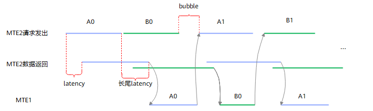

# 启用Pre-Allocation减少MTE2流水间隙<a name="ZH-CN_TOPIC_0000001893038946"></a>

【优先级】中

【描述】Ascend 960PR/Ascend 960DT中HBM带宽增大，同时增加了相应数量的outstanding，由于存在总线乱序返回等原因会导致一定的lantency（延迟），最终在double buffer场景下出现bubble（间隙）。如[图1](#fig_pre_alloc_bubble_1)所示。

**图1**  double buffer场景出现bubble<a name="fig_pre_alloc_bubble_1"></a>  


为解决该问题，芯片支持MTE2 Pre-Allocation特性：在与前序指令存在数据依赖的情况下，MTE2指令仍然可以提前发出，硬件保证数据的返回维持依赖关系——数据先从GM读到ROB缓冲区上暂存，待同步解除后再写入UB，从而消除bubble，如[图2](#fig_pre_alloc_bubble_2)所示。

**图2**  pre-allocation消除bubble<a name="fig_pre_alloc_bubble_2"></a>  


该特性通过`enablePreReadIgnoreSync`参数使能。需要注意的是，`enablePreReadIgnoreSync`仅对MTE2有效，MTE1及MTE3不支持该参数。

【正例】

在上述double buffer场景的CopyIn中，将`DataCopy`的第4个参数`enablePreReadIgnoreSync`设为`true`，使能Pre-Allocation特性。MTE2指令可提前发出GM读请求，数据暂存总线，待屏障解除后立即写入UB，消除bubble。

```
constexpr uint32_t TILE_LENGTH = 1024;

__aicore__ inline void Process()
{
    LocalTensor<float> bufPing(TPosition::VECCALC, bufPingAddr, TILE_LENGTH);
    LocalTensor<float> bufPong(TPosition::VECCALC, bufPongAddr, TILE_LENGTH);

    SetFlag<HardEvent::MTE3_MTE2>(EVENT_ID0);
    SetFlag<HardEvent::MTE3_MTE2>(EVENT_ID1);
    for (uint32_t i = 0; i < TILE_NUM; i++) {
        int32_t eventID = (i % 2 == 0) ? EVENT_ID0 : EVENT_ID1;
        LocalTensor<float>& buf = (i % 2 == 0) ? bufPing : bufPong;

        WaitFlag<HardEvent::MTE3_MTE2>(eventID);
        // 使能pre-allocation：MTE2提前发GM读请求，跳过MTE3_MTE2屏障等待
        DataCopy(buf, xGm[i * TILE_LENGTH], TILE_LENGTH, true);

        SetFlag<HardEvent::MTE2_MTE3>(eventID);
        WaitFlag<HardEvent::MTE2_MTE3>(eventID);
        DataCopy(yGm[i * TILE_LENGTH], buf, TILE_LENGTH);

        SetFlag<HardEvent::MTE3_MTE2>(eventID);
    }
    WaitFlag<HardEvent::MTE3_MTE2>(EVENT_ID0);
    WaitFlag<HardEvent::MTE3_MTE2>(EVENT_ID1);
}
```
完整的可运行样例请参考[data_copy_pre_allocation](../../../../../../examples/01_simd_cpp_api/05_best_practices/04_memory_access/data_copy_pre_allocation/)。

【约束说明】

- 该特性仅支持Ascend 960PR/Ascend 960DT，且仅对MTE2搬运有效。
- 如果该搬运指令读取的数据是前一条指令的输出，则应设置同步依赖关系，并且**禁用**Pre-Allocation功能。
- 该特性适用于存在MTE2前置同步关系（如MTE3→MTE2、V→MTE2等）且该同步会阻塞MTE2发出GM读请求的场景；若MTE2无前置同步约束，使能该特性不会带来额外收益。
