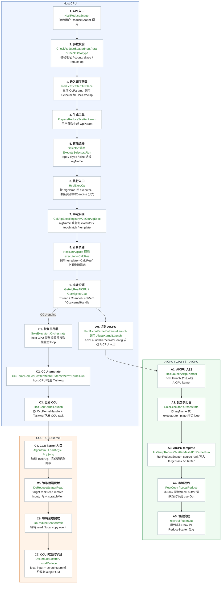
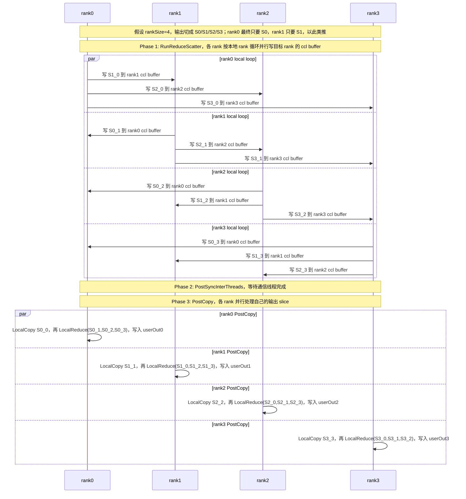
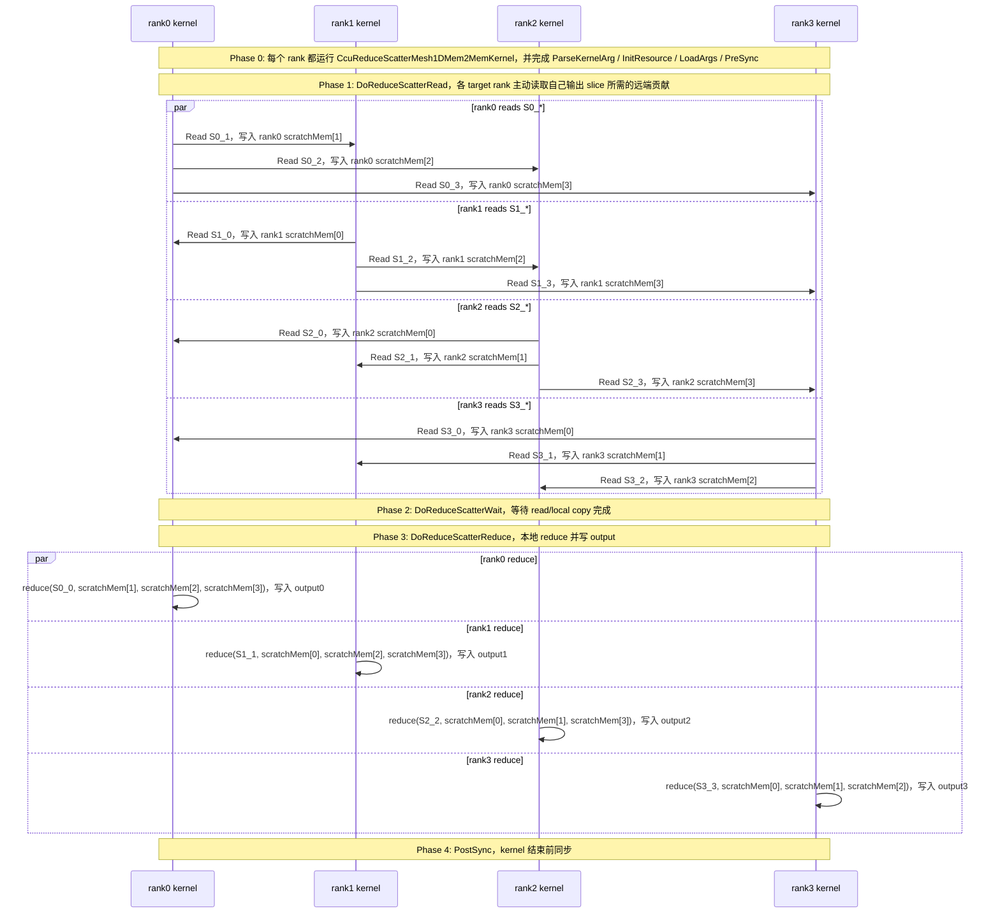
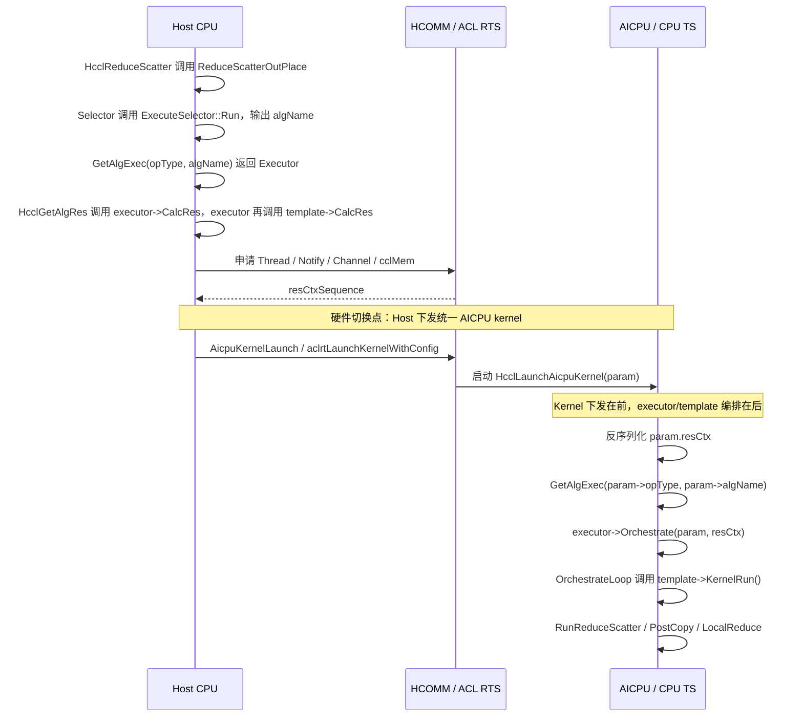
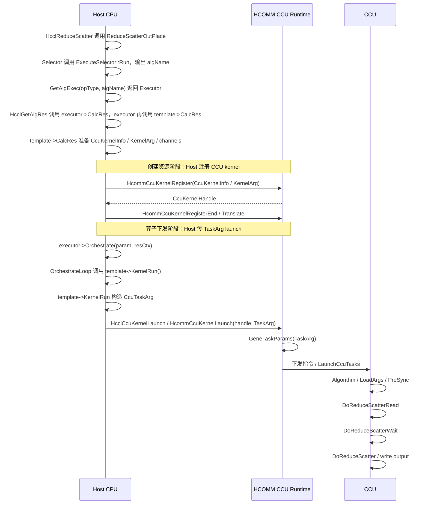

# ReduceScatter Mesh 算法走读与代码理解

本文用于代码走读和团队分享准备，重点讲清楚两条实现：

- `InsReduceScatterMesh1D` / `InsTempReduceScatterMesh1D`
- `CcuReduceScatterMesh1DMem2Mem` / `CcuTempReduceScatterMesh1DMem2Mem`

文档按“先打通流程，再看关键决策，再看实现细节”的顺序组织，避免一开始陷入命名、executor、template 等概念。

## 1. ReduceScatter 做什么，以及 MC2 如何使用它

### 1.1 ReduceScatter 的语义

`ReduceScatter` 的语义是：先 reduce，再 scatter。

- 所有 rank 对同一逻辑位置上的元素做归约。
- 归约后的结果按 rank 切片。
- 每个 rank 只拿自己负责的那一段。

和 `AllReduce` 对比：

- `AllReduce`：每个 rank 得到完整结果。
- `ReduceScatter`：每个 rank 只得到完整结果中的一个分片。

以 `rankSize = 4` 为例，每个 rank 的输入都可以按输出 rank 切成 4 段：

```text
rank0 input: [S0_0, S1_0, S2_0, S3_0]
rank1 input: [S0_1, S1_1, S2_1, S3_1]
rank2 input: [S0_2, S1_2, S2_2, S3_2]
rank3 input: [S0_3, S1_3, S2_3, S3_3]
```

ReduceScatter 后，每个 rank 只得到自己那一段的归约结果：

```text
rank0 output = reduce(S0_0, S0_1, S0_2, S0_3)
rank1 output = reduce(S1_0, S1_1, S1_2, S1_3)
rank2 output = reduce(S2_0, S2_1, S2_2, S2_3)
rank3 output = reduce(S3_0, S3_1, S3_2, S3_3)
```

所以它不是“每个 rank 都拿到全部 reduce 结果”，而是“每个 rank 只拿到自己负责的 reduce 分片”。

### 1.2 MC2 如何使用 ReduceScatter

`matmul_reduce_scatter_v2` 是一个典型 MC2 融合算子：先做 MatMul，再把 MatMul 输出在通信域内做 ReduceScatter。它不直接调用 HCCL C API，而是在 Ascend C kernel 中通过 `asc-devkit` 的 `AscendC::Hccl` 对象提交通信任务。

按代码执行顺序看，MC2 使用 ReduceScatter 可以分成四步：

第一步发生在 MC2 通信参数准备阶段。`GetOpParam()` 会先尝试使用 `ccTiling->algConfig` 中的强制算法名；没有强制算法，或强制算法资源校验失败时，再调用 selector 选择默认算法。

- `/home/june/project/cann/asc-devkit/impl/adv_api/detail/hccl/cc/src/common/hccl_alloc_ctx_res.h:675`

```cpp
GetOpParam(comm, stream, tag, ccTiling, opParam) {
    InitOpParamByTiling(comm, stream, tag, ccTiling, opParam);

    TryForcedAlgAndPrepareEngine(comm, ccTiling, opParam, algName, topoInfo, forcedAlgAccepted);
    if (!forcedAlgAccepted) {
        SelectAlgAndPrepareEngine(comm, opParam, algName, topoInfo);
    }

    FillOpParamAlgName(opParam, algName);
}
```

在默认选择路径中，`SelectAlgAndPrepareEngine()` 会调用 `ExecuteSelector::Run()`。如果当前 ReduceScatter 满足 CCU schedule 的 Mesh1D 条件，`ReduceScatterAutoSelector::SelectMeshAlgoCcuSchedule()` 会选出 `CcuReduceScatterMesh1DMem2Mem`。

- `/home/june/project/cann/asc-devkit/impl/adv_api/detail/hccl/cc/src/ops/reduce_scatter/selector/reduce_scatter_auto_selector.cc:188`

```cpp
selectAlgName = "CcuReduceScatterMesh1DMem2Mem";
```

第二步进入算子 kernel。`MatmulReduceScatterFP16BF16` 初始化 HCCL 上下文，MatMul 计算完成后把 `cWork` 作为 send buffer 提交给 `ReduceScatter`。

- `/home/june/project/cann/ops-transformer/mc2/matmul_reduce_scatter_v2/op_kernel/arch35/matmul_reduce_scatter_fp16_bf16.h:66`
- `/home/june/project/cann/ops-transformer/mc2/matmul_reduce_scatter_v2/op_kernel/arch35/matmul_reduce_scatter_fp16_bf16.h:176`

```cpp
MatmulReduceScatterFP16BF16::Init(...) {
    hccl_.InitV2(contextGM, &tilingData_->mc2InitTiling);
    hccl_.SetCcTilingV2(offsetof(TilingData, mc2CcTiling));
}

MatmulReduceScatterFP16BF16::MatMulV3Compute(...) {
    mmv3.Process(...);
    handles_[i + shift] = hccl_.ReduceScatter<true>(
        cWork, recvBuffer, recvCount, dataType_, HCCL_REDUCE_SUM, stride, repeat);
}

MatmulReduceScatterFP16BF16::PostProcess(...) {
    hccl_.Wait(handles_[i]);
    hccl_.Finalize();
}
```

第三步进入 `asc-devkit` HCCL wrapper。`hccl_.ReduceScatter<true>(...)` 最终会把任务描述成 `HCCL_CMD_REDUCE_SCATTER` 并提交给 server。

- `/home/june/project/cann/asc-devkit/impl/adv_api/detail/hccl/impl/hccl_impl.h:74`
- `/home/june/project/cann/asc-devkit/impl/adv_api/detail/hccl/impl/platform_v310/hccl_ccu_v0.h:47`

```cpp
Hccl<serverType, config>::ReduceScatter<commit>(...) {
    return impl_.ReduceScatter<commit>(sendBuf, recvBuf, recvCount, dataType, op, strideCount, repeat);
}

HcclImpl<serverType>::ReduceScatter<commit>(...) {
    return CommonPrepareImpl<commit>({HCCL_CMD_REDUCE_SCATTER, sendBuf, recvBuf, recvCount, dataType, dataType, op,
        strideCount, repeat});
}
```

最后 server 执行时不再重新选择算法，而是读取准备阶段保存的 `tilingData->algName`，再用 `(opType, algName)` 查 registry 执行。

- `/home/june/project/cann/asc-devkit/impl/adv_api/detail/hccl/cc/src/aicpu_kfc/framework/device/framework/aicpu_hccl_process.cc:376`

```cpp
AicpuRunRpcServerV2(hcclCommAicpu, tilingData, commParam) {
    std::string algName = tilingData->algName;
    opParam.opType = static_cast<HcclCMDType>(tilingData->opType);
    hcclCommAicpu->ExecOp(newTag, algName, opParam, commParam);
}
```

这里要记住一个关键点：`CcuReduceScatterMesh1DMem2Mem` 是前面 selector 选出来并写入 tiling 的；server 阶段只是消费这个结果，按算法名进入 executor、template、kernel 链路。

## 2. ReduceScatter 的实现流程：入口、选择和执行

先看整条实现链路。这里把每一层的关键源码和执行位置一起标出来，方便后面按代码顺序走读：



这张图的节点统一为三行：第一行是步骤，第二行是关键函数/对象，第三行是业务含义。底色表示运行位置：蓝色是普通 host API 路径的 host CPU，绿色是 AICPU / CPU TS，橙色是 CCU。图里只保留真实的硬件切换函数：AICPU 路径在 `AicpuKernelLaunch()` 调 `aclrtLaunchKernelWithConfig()` 后进入 AICPU；CCU 路径先在 host CPU 上执行 `SoleExecutor::Orchestrate()` 和 `CcuTempReduceScatterMesh1DMem2Mem::KernelRun()`，再由 `HcclCcuKernelLaunch()` 切到 CCU。

`SoleExecutor::Orchestrate` 的运行位置要分路径看：AICPU 路径中，host 先通过 `aclrtLaunchKernelWithConfig` 启动 `HcclLaunchAicpuKernel`，之后 `SoleExecutor::Orchestrate` 在 AICPU / CPU TS 里执行；CCU 路径中，`SoleExecutor::Orchestrate` 仍在 host CPU 执行，直到 `CcuTempReduceScatterMesh1DMem2Mem::KernelRun` 调 `HcclCcuKernelLaunch` 后，才切到 CCU kernel 的 `Algorithm()`。

可以把这条链路理解成五层，同时注意 host、AICPU、CCU 的分工不同：

| 层级 | 作用 | 典型代码 | 主要运行位置 |
|---|---|---|---|
| 入口层 | 接收 API 调用，校验参数 | `src/ops/reduce_scatter/reduce_scatter_op.cc` | host CPU |
| 调度层 | 组装 `OpParam`，进入 selector | `ReduceScatterOutPlace` / `src/ops/op_common/op_common.cc` | host CPU |
| 选择层 | 选择算法名 `algName` | `src/ops/reduce_scatter/selector/reduce_scatter_auto_selector.cc` | host CPU |
| 执行层 | 用 executor 承接算法名，准备资源 | `src/ops/reduce_scatter/executor/ins_v2_reduce_scatter_sole_executor.cc` | host CPU；AICPU 路径 launch 后在 AICPU/CPU TS 执行 `Orchestrate` |
| 实现层 | template/kernel 真正组织通信 | `template/aicpu/ins_temp_reduce_scatter_mesh_1D.cc` / `template/ccu/ccu_temp_reduce_scatter_mesh_1D_mem2mem.cc` / `template/ccu/kernel/ccu_kernel_reduce_scatter_mesh1d_mem2mem.cc` | AICPU / CPU TS / CCU |

本文后面所有细节都围绕这条链路展开。

这里多出来的 HCOMM 视角可以这样理解：HCCL 负责“选择哪个集合通信算法、怎么组织 executor/template”，HCOMM 负责“通信域、拓扑、Thread/Notify/Channel、CCU kernel 注册和 launch”等基础通信资源。也就是说，HCCL 的 `HcclGetCcuKernel` / `HcclCcuKernelLaunch` 等接口最终会落到 HCOMM 的 CCU 注册和下发模型上。

相关源码：

- `src/ops/reduce_scatter/reduce_scatter_op.cc`
- `src/ops/reduce_scatter/selector/reduce_scatter_auto_selector.cc`

### 2.1 入口只负责把任务变成“工单”

入口函数不是直接通信，而是把用户调用变成内部可调度的 `OpParam`。

- `src/ops/reduce_scatter/reduce_scatter_op.cc`

先看入口参数，后面所有 `OpParam` 都是由这些参数展开出来的：

```cpp
HcclResult HcclReduceScatter(
    void* sendBuf,
    void* recvBuf,
    uint64_t recvCount,
    HcclDataType dataType,
    HcclReduceOp op,
    HcclComm comm,
    aclrtStream stream) {
    if (!HcclCheckCcuEnableOpen() && !HcclCheckAicpuEnableOpen()) {
        return HcclReduceScatterInner(...);
    }

    OpParam param;
    CheckReduceScatterInputPara(comm, sendBuf, recvBuf, stream);
    HcclGetRankSize(comm, &rankSize);
    CheckCount(recvCount);
    CheckDataType(dataType, true);
    ReduceScatterOutPlace(param, sendBuf, recvBuf, recvCount, dataType, op, comm, stream, rankSize);
}
```

| 参数 | 含义 |
|---|---|
| `sendBuf` | 当前 rank 的 ReduceScatter 输入，逻辑上包含发给所有 rank 的分片贡献。 |
| `recvBuf` | 当前 rank 的输出地址，只写当前 rank 负责的 reduce 后分片。 |
| `recvCount` | 当前 rank 输出分片的元素个数；总输入元素量通常按 `rankSize * recvCount` 理解。 |
| `dataType` | 输入和输出元素类型，用于计算字节数、检查 dtype 支持、选择算法。 |
| `op` | 归约类型，如 `SUM`、`MAX`、`MIN`、`PROD`；部分算法对 `PROD` 更保守。 |
| `comm` | HCCL 通信域，用于获取 rank 数、当前 rank、拓扑和资源。 |
| `stream` | 用户流，后续 launch / 同步 / 资源绑定都围绕这个流展开。 |

- `src/ops/reduce_scatter/reduce_scatter_op.cc`

入口校验后进入 `ReduceScatterOutPlace()`：

```cpp
HcclResult ReduceScatterOutPlace(
    OpParam& param,
    void* sendBuf,
    void* recvBuf,
    uint64_t recvCount,
    HcclDataType dataType,
    HcclReduceOp op,
    HcclComm comm,
    aclrtStream stream,
    u32 userRankSize) {
    PrepareReduceScatterParam(param, sendBuf, recvBuf, recvCount, dataType, op, comm, stream, userRankSize, OPBASE);
    Selector(comm, param, topoInfo, algName);
    HcclExecOp(comm, param, topoInfo, algName);
}
```

| 参数 | 含义 |
|---|---|
| `param` | 输出型工单对象，保存 `inputPtr`、`outputPtr`、`DataDes`、`opType`、`engine`、`algName` 等内部执行信息。 |
| `sendBuf` / `recvBuf` | 继续传入 `PrepareReduceScatterParam()`，最终分别落到 `param.inputPtr` / `param.outputPtr`。 |
| `recvCount` / `dataType` / `op` | 继续落到 `param.DataDes.count`、`param.DataDes.dataType`、`param.reduceType`。 |
| `comm` | 用来计算拓扑、选择算法、准备 executor 资源。 |
| `stream` | 绑定执行流和线程资源。 |
| `userRankSize` | 通信域 rank 数，影响输入/输出数据量计算和单 rank 快速返回。 |

`OpParam` 可以理解成“一次 ReduceScatter 的工单”，里面至少要描述：

- 输入输出地址
- 数据量和 dtype
- reduce 类型
- 通信域信息
- 当前 op 类型是 `HCCL_CMD_REDUCE_SCATTER`
- 当前执行模式和引擎信息

### 2.2 Selector 选择算法的思路

selector 的核心问题是：同样是 ReduceScatter，当前条件下应该选哪种算法？

- `src/ops/op_common/op_common.cc`

调度入口：

```cpp
HcclResult Selector(
    HcclComm comm,
    OpParam& param,
    std::unique_ptr<TopoInfoWithNetLayerDetails>& topoInfo,
    std::string& algName) {
    HcclCalcTopoInfo(comm, param, topoInfo);
    ExecuteSelector().Run(param, topoInfo.get(), algName);
    SetOpParamAlgTag(param, algName);
}
```

| 参数 | 含义 |
|---|---|
| `comm` | 通信域，selector 会基于它计算拓扑和 rank 信息。 |
| `param` | 输入/输出型参数；输入包含 op 类型、dtype、count、reduce op、执行配置；输出会更新 engine、execute config、`algTag` 等。 |
| `topoInfo` | 输出拓扑信息，包括 `level0Topo`、`level0MeshType`、`topoLevelNums`、`userRankSize` 等。 |
| `algName` | 输出算法名，如 `InsReduceScatterMesh1D` 或 `CcuReduceScatterMesh1DMem2Mem`。 |

- `src/ops/op_common/selector/execute_selector.cc`

真正执行 selector 列表的是：

```cpp
HcclResult ExecuteSelector::Run(
    OpParam& opParam,
    TopoInfoWithNetLayerDetails* topoInfo,
    std::string& selectAlgName) const;
```

这里 `opParam.isMc2 == true` 时会优先走 MC2/CCU selector；普通路径会按 `opType` 找到 ReduceScatter selector，再逐个尝试直到返回 `MATCH`。对 ReduceScatter 来说，`ExecuteSelector::Run()` 找到的是 `ReduceScatterAutoSelector`，实际会进入它继承的 `AutoSelectorBase::Select()`。

- `src/ops/op_common/selector/execute_selector.cc:52`
- `src/ops/op_common/selector/auto_selector_base.cc:15`

```cpp
ExecuteSelector::Run(opParam, topoInfo, selectAlgName) const {
    selectors = SelectorRegistry::Global()->GetSelectorsByOpType(opParam.opType);
    for (auto iter : selectors) {
        if (iter.second->Select(opParam, topoInfo, selectAlgName) == SelectorStatus::MATCH) {
            return HCCL_SUCCESS;
        }
    }
}

AutoSelectorBase::Select(opParam, topoInfo, selectAlgName) const {
    if (opParam.opExecuteConfig == OpExecuteConfig::CCU_SCHED) {
        ret = SelectCcuScheduleAlgo(topoInfo, opParam, configAlgMap, selectAlgName);
        if (ret == SelectorStatus::MATCH) {
            return ret;                                      // 下一节 2.4 展开
        }
        opParam.opExecuteConfig = OpExecuteConfig::CCU_FAIL;
    }

    if (IsStarsState(opParam.opExecuteConfig)) {
        ret = SelectAicpuAlgo(topoInfo, opParam, configAlgMap, selectAlgName);
        if (ret == SelectorStatus::MATCH) {
            opParam.opExecuteConfig = OpExecuteConfig::AICPU_TS; // 下一节 2.3 展开
        }
    }
    return ret;
}
```

所以 2.3 和 2.4 不是孤立函数：它们都是 `ExecuteSelector::Run()` 间接调用的 ReduceScatter selector 分支。调用关系是：

```text
Selector() 调用 ExecuteSelector::Run()。
ExecuteSelector::Run() 调用 ReduceScatterAutoSelector::Select() / AutoSelectorBase::Select()。
AutoSelectorBase::Select() 优先尝试 SelectCcuScheduleAlgo()，对应 2.4。
如果需要走 AICPU 分支，则调用 SelectAicpuAlgo()，再进入 SelectMeshAlgoAicpu()，对应 2.3
```

它主要看这些因素：

| 因素 | 影响 |
|---|---|
| 执行引擎 | AICPU / CCU / AIV 会走不同算法族 |
| 拓扑 | `MESH_1D` / `MESH_1D_CLOS` / `CLOS` 决定主方向 |
| 数据类型 | 64-bit、INT8 等类型会触发特殊限制 |
| reduce op | `PROD` 往往更保守 |
| 数据量 | 小数据走简单路径，大数据走 chunk/parallel/pipe |
| inplace | 某些 CCU 路径不支持 inplace |

### 2.3 AICPU Mesh1D 的选择逻辑

AICPU Mesh1D selector 根据 dtype、reduce op、拓扑层级和数据量决定基础 Mesh1D 还是 MeshChunk。特殊 dtype 或 `PROD` 会更保守，大数据会倾向 chunk。

上一节的 `AutoSelectorBase::Select()` 在 CCU 不匹配或当前配置本来就是 AICPU/CPU TS 时，会调用 `SelectAicpuAlgo()`；ReduceScatter 的 `SelectAicpuAlgo()` 再进入本节的 `SelectMeshAlgoAicpu()`。

- `src/ops/reduce_scatter/selector/reduce_scatter_auto_selector.cc`

```cpp
SelectorStatus ReduceScatterAutoSelector::SelectMeshAlgoAicpu(
    const TopoInfoWithNetLayerDetails* topoInfo,
    const OpParam& opParam,
    std::string& selectAlgName) const {
    u64 dataSize = opParam.DataDes.count * DATATYPE_SIZE_TABLE[opParam.DataDes.dataType];
    double ratio = CalcAicpuRankSizeRatio(topoInfo->userRankSize);

    if (Is64BitDataType(opParam.DataDes.dataType) || opParam.reduceType == HcclReduceOp::HCCL_REDUCE_PROD) {
        selectAlgName = "InsReduceScatterMesh1D";
        return SelectorStatus::MATCH;
    }

    if (IsTwoLevelNetLayer(topoInfo)) {
        if (dataSize * ratio > RS_AICPU_1D_MAX_DATA_SIZE) {
            selectAlgName = "InsReduceScatterMesh1DMeshChunk";
        } else {
            selectAlgName = "InsReduceScatterMesh1D";
        }
        return SelectorStatus::MATCH;
    }

    if (dataSize * ratio > RS_AICPU_1D_MAX_DATA_SIZE) {
        selectAlgName = "InsReduceScatterMesh1DMeshChunk";
    } else {
        selectAlgName = "InsReduceScatterMesh1D";
    }
    return SelectorStatus::MATCH;
}
```

| 参数 | 含义 |
|---|---|
| `topoInfo` | 当前通信拓扑，重点看 `level0Topo`、`userRankSize`、是否两层网络。 |
| `opParam` | 当前 ReduceScatter 工单，重点看 `DataDes.count`、`DataDes.dataType`、`reduceType`。 |
| `selectAlgName` | 输出算法名；AICPU Mesh1D 常见值是 `InsReduceScatterMesh1D` 或 `InsReduceScatterMesh1DMeshChunk`。 |

这里 `dataSize` 是单个 rank 输出分片的字节数，`ratio` 用 rank 数修正数据量阈值。大数据会倾向 chunk，特殊 dtype 或 `PROD` 会回到更基础的 Mesh1D 路径。

读这段时先记一个结论：

- 特殊 dtype / `PROD`：倾向基础 `InsReduceScatterMesh1D`。
- 普通 dtype + 大数据：倾向 `InsReduceScatterMesh1DMeshChunk`。
- 普通 dtype + 小数据：倾向 `InsReduceScatterMesh1D`。

### 2.4 CCU Mesh1D 的选择逻辑

CCU 路径更强调拓扑、inplace 和硬件能力。

上一节的 `AutoSelectorBase::Select()` 在 `opParam.opExecuteConfig == OpExecuteConfig::CCU_SCHED` 时，优先调用 `SelectCcuScheduleAlgo()`；如果这里匹配成功，就直接返回 CCU 算法名，不会继续走 AICPU selector。

- `src/ops/reduce_scatter/selector/reduce_scatter_auto_selector.cc`

```cpp
SelectorStatus ReduceScatterAutoSelector::SelectCcuScheduleAlgo(
    const TopoInfoWithNetLayerDetails* topoInfo,
    const OpParam& opParam,
    const std::map<HcclCMDType, std::vector<HcclAlgoType>>& configAlgMap,
    std::string& selectAlgName) const {
    if (opParam.reduceType == HcclReduceOp::HCCL_REDUCE_PROD || Is64BitDataType(opParam.DataDes.dataType)) {
        return SelectorStatus::NOT_MATCH;
    }

    if (topoInfo->topoLevelNums > 1) {
        if (topoInfo->Level1Nhr) {
            selectAlgName = "CcuReduceScatterNHR1DMem2Mem";
        } else if (topoInfo->netLayerDetails.localNetInsSizeOfLayer.at(0) > 1) {
            selectAlgName = "CcuReduceScatterParallelMesh1DNHR";
        } else {
            selectAlgName = "CcuReduceScatterNHR1DMem2Mem";
        }
        return SelectorStatus::MATCH;
    } else {
        return SelectMeshAlgoCcuSchedule(topoInfo, opParam, selectAlgName);
    }
}

SelectorStatus ReduceScatterAutoSelector::SelectMeshAlgoCcuSchedule(
    const TopoInfoWithNetLayerDetails* topoInfo,
    const OpParam& opParam,
    std::string& selectAlgName) const {
    u64 dataSize = opParam.DataDes.count * DATATYPE_SIZE_TABLE[opParam.DataDes.dataType];
    double ratio = CalcCcuRankSizeRatio(topoInfo->userRankSize);

    if (topoInfo->level0Topo == Level0Shape::MESH_1D) {
        if (opParam.DataDes.dataType == HcclDataType::HCCL_DATA_TYPE_INT8 ||
            dataSize * ratio >= RS_M2M_1D_MAX_DATA_SIZE) {
            return SelectorStatus::NOT_MATCH;
        }
        if (topoInfo->level0MeshType == Level0MeshType::TWO_DIE_REGULAR) {
            selectAlgName = "CcuReduceScatterMeshMem2Mem1D2Die";
        } else {
            selectAlgName = "CcuReduceScatterMesh1DMem2Mem";
        }
        return SelectorStatus::MATCH;
    }

    if (topoInfo->level0Topo == Level0Shape::MESH_1D_CLOS) {
        if (IsSmallData(dataSize) && CheckMeshNumEqualToClosNum(topoInfo)) {
            selectAlgName = "CcuReduceScatterMesh1DMem2Mem";
        } else if (!IsSmallData(dataSize) && CheckClosNumMultipleOfMeshNum(topoInfo)) {
            selectAlgName = "CcuReduceScatterParallelMesh1DNHRMultiJetty";
        } else {
            selectAlgName = "CcuReduceScatterNhr1DMem2MemMultiJetty";
        }
        return SelectorStatus::MATCH;
    }

    return SelectorStatus::NOT_MATCH;
}
```

| 参数 | 含义 |
|---|---|
| `topoInfo` | 拓扑信息，CCU 重点看 `topoLevelNums`、`level0Topo`、`level0MeshType`、`userRankSize`。 |
| `opParam` | 当前 ReduceScatter 工单，CCU 重点看 `DataDes.dataType`、`DataDes.count`、`reduceType`。 |
| `configAlgMap` | 外部算法配置集合；当前函数中主要作为接口统一参数，CCU schedule 逻辑本身不依赖它。 |
| `selectAlgName` | 输出算法名；Mesh1D 常见值是 `CcuReduceScatterMesh1DMem2Mem`。 |

`CcuReduceScatterMesh1DMem2Mem` 的典型命中条件是单层 `MESH_1D`、非 two-die 特殊拓扑、dtype/op 被 CCU 支持、数据量没有超过 Mem2Mem 路径阈值。

你关注的 `CcuReduceScatterMesh1DMem2Mem` 是 CCU 下典型的 Mesh1D Mem2Mem 路径。

选择速查表：

| 条件 | 常见选择 | 说明 |
|---|---|---|
| AICPU + `MESH_1D` + 小数据 + 普通 dtype/op | `InsReduceScatterMesh1D` | 基础 Mesh1D 路径 |
| AICPU + `MESH_1D` + 大数据 | `InsReduceScatterMesh1DMeshChunk` | 大数据拆 chunk |
| AICPU + 64-bit 或 `PROD` | `InsReduceScatterMesh1D` 或 NHR 相关路径 | 更保守 |
| CCU + `MESH_1D` + 非 inplace | `CcuReduceScatterMesh1DMem2Mem` | 典型 CCU Mem2Mem 路径 |
| CCU + `MESH_1D_CLOS` + 小数据 | `CcuReduceScatterMesh1DMem2Mem` | 简单路径优先 |
| CCU + `MESH_1D_CLOS` + 大数据 | Concurrent / Parallel / OmniPipe | 并行或流水线化 |
| CLOS 拓扑 | NHR 类算法 | 更适配 CLOS |

## 3. Executor 怎么承接算法名

相关源码：

- `src/ops/reduce_scatter/executor/ins_v2_reduce_scatter_sole_executor.cc`
- `src/ops/reduce_scatter/executor/ins_v2_reduce_scatter_sequence_executor.cc`

### 3.1 `HcclExecOp()` 承接 selector 结果并触发 executor

`Selector()` 只产出 `algName`，真正把 `algName` 变成 executor、资源和硬件执行的是 `HcclExecOp()`。这一步仍从普通 host API 路径进入，不涉及 MC2 server 消息解包。

- `src/ops/op_common/op_common.cc:315`

```cpp
HcclResult HcclExecOp(
    HcclComm comm,
    OpParam& param,
    std::unique_ptr<TopoInfoWithNetLayerDetails>& topoInfo,
    std::string& algName,
    const ResPackGraphMode& resPack) {
    param.hcclComm = comm;

    // selector 已经选好了 algName；这里用 algName 找 executor
    executor = CollAlgExecRegistryV2::Instance().GetAlgExec(param.opType, algName);

    // 资源准备：内部会调用 executor->CalcAlgHierarchyInfo() 和 executor->CalcRes()
    HcclGetAlgRes(comm, param, executor, topoInfo.get(), resCtxHost, &resCtxSequence, isResourceReused);

    if (param.engine == COMM_ENGINE_AICPU_TS || param.engine == COMM_ENGINE_CPU) {
        // AICPU 路径：host launch AICPU 统一入口，后续 Orchestrate 在 AICPU/CPU TS 内执行
        HcclAicpuKernelEntranceLaunch(comm, param, cpuTsThread, exportedCpuTsThread,
                                      notifyNumOnMainThread, resCtxSequence, algName, unfoldThread);
    } else if (param.engine == COMM_ENGINE_CCU) {
        // CCU 路径：Orchestrate 仍在 host CPU；直到 template->KernelRun() 调 HcclCcuKernelLaunch 才切到 CCU
        param.algName = algName;
        executor->Orchestrate(param, *resCtxHost);
    } else {
        executor->Orchestrate(param, *resCtxHost);
    }
}
```

| 参数/对象 | 含义 |
|---|---|
| `comm` | 通信域，用于申请 Thread、Channel、ccl buffer、CCU kernel 等资源。 |
| `param` | 当前 ReduceScatter 工单，包含 `opType`、engine、input/output、dtype、reduce op 等。 |
| `topoInfo` | selector 阶段计算出的拓扑信息，资源计算还会继续使用。 |
| `algName` | selector 输出的算法名，用于从 registry 找 executor。 |
| `executor` | 根据 `(opType, algName)` 找到的执行器，例如 `InsV2ReduceScatterSoleExecutor`。 |
| `resCtxHost` / `resCtxSequence` | 已申请的资源上下文；AICPU 路径需要序列化给 AICPU kernel，CCU 路径在 host 侧直接使用。 |

这一节把第 2 章 selector 的输出接到 executor：`HcclExecOp()` 先通过 registry 找到 executor，再通过 `HcclGetAlgRes()` 调用 executor 的 `CalcRes()`，最后按 engine 分支进入 AICPU 或 CCU 路径。

AICPU 分支的下一段代码仍由 `HcclExecOp()` 触发，但它不会在 host 上直接调用 template。`HcclAicpuKernelEntranceLaunch()` 会把资源上下文和算法名写入 `param`，再调用 `AicpuKernelLaunch()`，真正通过 `aclrtLaunchKernelWithConfig()` 切到 AICPU。

- `src/ops/op_common/op_common.cc:479`
- `src/ops/op_common/op_common.cc:535`

```cpp
HcclAicpuKernelEntranceLaunch(...) {
    param.resCtx = resCtxSequence;
    param.algName = algName;

    HcommThreadNotifyRecordOnThread(...);
    AicpuKernelLaunch(comm, param, unfoldThread);
    HcommThreadNotifyWaitOnThread(...);
}

AicpuKernelLaunch(...) {
    kernelName = "HcclLaunchAicpuKernel";
    aclrtBinaryGetFunction(g_binKernelHandle, kernelName.c_str(), &funcHandle);
    aclrtKernelArgsAppend(argsHandle, &param, sizeof(OpParam) + param.varMemSize, &paraHandle);
    aclrtLaunchKernelWithConfig(funcHandle, 1, streamOrUnfoldStream, &cfg, argsHandle, nullptr);
}
```

| 参数/对象 | 含义 |
|---|---|
| `param.resCtx` | `HcclGetAlgRes()` 准备好的资源上下文，AICPU 入口会反序列化它。 |
| `param.algName` | selector 选出的算法名，AICPU 入口靠它重新找到 executor/template。 |
| `HcclLaunchAicpuKernel` | AICPU binary 里的统一入口函数，不是具体 ReduceScatter template。 |
| `aclrtLaunchKernelWithConfig()` | 从 host CPU 切到 AICPU / CPU TS 的真实 launch 函数。 |

进入 AICPU 后，`HcclLaunchAicpuKernel()` 会重新按 `param->algName` 找 executor，并调用 `executor->Orchestrate()`。这一步解释了为什么 AICPU 路径的 `SoleExecutor::Orchestrate()` 不在 host 上执行。

- `src/ops/op_common/template/aicpu/kernel_launch.cc:230`
- `src/ops/op_common/template/aicpu/kernel_launch.cc:347`

```cpp
HcclLaunchAicpuKernel(OpParam* param) {
    AlgResourceCtxSerializable resCtx;
    resCtx.DeSerialize(param->resCtx);

    algName = std::string(param->algName);
    executor = CollAlgExecRegistryV2::Instance().GetAlgExec(param->opType, algName);
    executor->Orchestrate(*param, resCtx);
}
```

CCU 分支不需要先 launch AICPU。`HcclExecOp()` 在 `param.engine == COMM_ENGINE_CCU` 时直接在 host CPU 上调用 `executor->Orchestrate()`；后续真正切到 CCU 的位置，是 CCU template 的 `KernelRun()` 里调用 `HcclCcuKernelLaunch()`。

上一节已经看到，`HcclExecOp()` 通过 `GetAlgExec()` 找到 executor，并通过 `HcclGetAlgRes()` 触发 executor 的资源计算。下面继续看 executor 如何把算法名映射到 template，以及如何在资源准备和执行阶段调用 template。

### 3.2 算法名如何映射到 executor/template

源码里通过注册宏把“算法名、executor、template”绑定起来。

- `src/ops/reduce_scatter/executor/ins_v2_reduce_scatter_sole_executor.cc`

简化示例：

```cpp
REGISTER_EXEC_V2(
    HCCL_CMD_REDUCE_SCATTER,
    InsReduceScatterMesh1D,
    InsV2ReduceScatterSoleExecutor,
    TopoMatch1D,
    InsTempReduceScatterMesh1D);

REGISTER_EXEC_V2(
    HCCL_CMD_REDUCE_SCATTER,
    CcuReduceScatterMesh1DMem2Mem,
    InsV2ReduceScatterSoleExecutor,
    TopoMatch1D,
    CcuTempReduceScatterMesh1DMem2Mem);
```

| 宏参数 | 含义 |
|---|---|
| `HCCL_CMD_REDUCE_SCATTER` | op 类型，表示这组注册只服务 ReduceScatter。 |
| `InsReduceScatterMesh1D` / `CcuReduceScatterMesh1DMem2Mem` | selector 输出的算法名，也是 registry 查询 key 的一部分。 |
| `InsV2ReduceScatterSoleExecutor` | 承接该算法名的 executor 类型，负责编排资源和循环。 |
| `TopoMatch1D` | 拓扑匹配器，用于把 `topoInfo` 转成算法层级信息。 |
| `InsTempReduceScatterMesh1D` / `CcuTempReduceScatterMesh1DMem2Mem` | 具体 template，负责 AICPU 或 CCU 路径的通信实现。 |

这说明：

| selector 返回算法名 | executor | topo match | template |
|---|---|---|---|
| `InsReduceScatterMesh1D` | `InsV2ReduceScatterSoleExecutor` | `TopoMatch1D` | `InsTempReduceScatterMesh1D` |
| `CcuReduceScatterMesh1DMem2Mem` | `InsV2ReduceScatterSoleExecutor` | `TopoMatch1D` | `CcuTempReduceScatterMesh1DMem2Mem` |

### 3.3 Sole executor 的关键逻辑

`Sole` 表示单模板路径。它不是说逻辑简单，而是说“一次算法主要由一个 template 承接”。

它在整条链路里的位置是：`HcclExecOp()` 已经拿到 selector 输出的 `algName`，并通过 registry 把 `algName` 映射到了 `InsV2ReduceScatterSoleExecutor + TopoMatch1D + 某个 template`。从这里开始，executor 不再决定“用哪个算法”，而是负责把这个算法跑起来。

可以先把 `Sole executor` 理解成一层通用调度壳：

```text
1. HcclExecOp 根据 algName 查询 registry，拿到 Sole executor 和 template 类型。
2. HcclGetAlgRes 调用 executor->CalcAlgHierarchyInfo()，整理算法层级。
3. HcclGetAlgRes 调用 executor->CalcRes()，再由 executor 调用 template->CalcRes() 计算资源需求。
4. HCCL/HCOMM 根据 resourceRequest 申请 Thread / Channel / cclMem / CCU kernel。
5. 执行阶段调用 executor->Orchestrate()，拿到 resCtx 后按数据量切 loop。
6. OrchestrateLoop 每一轮调用 template->KernelRun()。
```

这里要区分三个对象：

| 对象 | 角色 | 是否实现通信细节 |
|---|---|---|
| `executor` | 通用调度壳，负责拓扑匹配、资源串联、loop 切分和调用 template | 否 |
| `template` | 具体算法实现，如 AICPU Mesh1D 或 CCU Mesh1D Mem2Mem | 是 |
| `HCOMM` | 底层资源与执行平台，提供 Thread/Channel/Kernel 注册和下发 | 否，但提供执行能力 |

因此，`Sole executor` 的关键不是 `ReduceScatter` 的通信细节，而是“怎样把一次 ReduceScatter 工单转成 template 可执行的一轮或多轮任务”。

- `src/ops/reduce_scatter/executor/ins_v2_reduce_scatter_sole_executor.cc`

按调用顺序分成四步看，不要把资源准备和运行编排混在一起。

第一步，`HcclGetAlgRes()` 调 `CalcAlgHierarchyInfo()`，把 selector 阶段得到的拓扑整理成 template 可消费的算法层级信息。

```cpp
HcclResult InsV2ReduceScatterSoleExecutor::CalcAlgHierarchyInfo(
    HcclComm comm,
    TopoInfoWithNetLayerDetails* topoInfo,
    AlgHierarchyInfoForAllLevel& algHierarchyInfo) {
    TopoMatch1D().MatchTopo(comm, topoInfo, algHierarchyInfo);
}
```

这一步只做拓扑匹配，不申请资源，也不执行通信。

| 参数 | 含义 |
|---|---|
| `comm` | HCCL 通信域，用于 `TopoMatch1D` 获取 rank 和通信域信息。 |
| `topoInfo` | selector 阶段得到的拓扑详情，如 `level0Topo`、rank 数、mesh 类型等。 |
| `algHierarchyInfo` | 输出参数，保存匹配后的算法层级信息，后续创建 template 时使用。 |

第二步，`HcclGetAlgRes()` 继续调 `CalcRes()`。executor 先根据 registry 绑定的 template 类型创建 template，再把资源计算交给 `template->CalcRes()`。

```cpp
HcclResult InsV2ReduceScatterSoleExecutor::CalcRes(
    HcclComm comm,
    const OpParam& param,
    const TopoInfoWithNetLayerDetails* topoInfo,
    const AlgHierarchyInfoForAllLevel& algHierarchyInfo,
    AlgResourceRequest& resourceRequest) {
    auto algTemplate = std::make_shared<InsAlgTemplate>(param, topoInfo->userRank, algHierarchyInfo.infos[0]);
    algTemplate->CalcRes(comm, param, topoInfo, resourceRequest);
}
```

这一步输出的是 `resourceRequest`。AICPU template 会上报线程、channel、ccl buffer 等需求；CCU template 会额外上报 CCU kernel、KernelArg、channel 等需求。

| 参数 | 含义 |
|---|---|
| `comm` | 通信域，template 计算资源时会继续使用它查询通信资源。 |
| `param` | 当前 ReduceScatter 工单，包含 dtype、count、reduce op、engine、输入输出地址等。 |
| `topoInfo` | 拓扑信息，决定 channel、rank 关系和资源层级。 |
| `algHierarchyInfo` | 上一步得到的算法层级信息，决定本 template 作用在哪个 rank 子集/拓扑层。 |
| `resourceRequest` | 输出资源需求，如 thread、channel、ccl buffer、CCU kernel、KernelArg 等。 |

第三步，执行阶段调用 `Orchestrate()`。这一步拿到已经申请好的 `resCtx`，恢复线程、buffer、channel 等资源，然后进入 loop 编排。

```cpp
HcclResult InsV2ReduceScatterSoleExecutor::Orchestrate(
    const OpParam& param,
    const AlgResourceCtxSerializable& resCtx) {
    threads_ = resCtx.threads;
    maxTmpMemSize_ = resCtx.cclMem.size;
    RestoreChannelMap(resCtx, remoteRankToChannelInfo_);
    OrchestrateLoop(param, resCtx);
}
```

这一步的位置和 engine 有关：AICPU 路径是在 AICPU / CPU TS 内执行；CCU 路径是在 host CPU 上执行。

| 参数/成员 | 含义 |
|---|---|
| `param` | 运行期 op 工单，提供输入输出、count、dtype、stride、repeat、engine 等信息。 |
| `resCtx` | 已经申请好的资源上下文，包含 threads、channels、cclMem、CCU kernel handle 等。 |
| `threads_` | 从 `resCtx.threads` 恢复出的执行线程资源。 |
| `maxTmpMemSize_` | 当前可用临时 buffer / ccl buffer 大小。 |
| `remoteRankToChannelInfo_` | 从资源上下文恢复出的 rank 到 channel 映射。 |

第四步，`OrchestrateLoop()` 按数据量切分多轮任务，每轮构造 `TemplateDataParams` 和 `TemplateResource`，最后调用 `template->KernelRun()`。

```cpp
HcclResult InsV2ReduceScatterSoleExecutor::OrchestrateLoop(
    const OpParam& param,
    const AlgResourceCtxSerializable& resCtx) {
    TemplateResource templateAlgRes = BuildTemplateResource(resCtx);
    TemplateDataParams tempAlgParams = BuildTemplateDataParams(param, resCtx.cclMem);

    for (u64 loop = 0; loop < loopTimes; ++loop) {
        tempAlgParams.count = currDataCount;
        tempAlgParams.sliceSize = currDataCount * dataTypeSize_;
        tempAlgParams.buffInfo.inBuffBaseOff = processedDataCount * dataTypeSize_;
        tempAlgParams.buffInfo.outBuffBaseOff = processedDataCount * dataTypeSize_;
        algTemplate->KernelRun(param, tempAlgParams, templateAlgRes);
    }
}
```

这里就是第 3 章连接第 4 / 第 5 章的调用点。`algTemplate` 的真实类型来自 3.2 的注册宏：如果 `algName == InsReduceScatterMesh1D`，`KernelRun()` 进入第 4 章的 `InsTempReduceScatterMesh1D::KernelRun()`；如果 `algName == CcuReduceScatterMesh1DMem2Mem`，`KernelRun()` 进入第 5 章的 `CcuTempReduceScatterMesh1DMem2Mem::KernelRun()`。因此，同一个 `Sole executor` 可以承接不同后端，差异被封装在 template 里。

| 参数/变量 | 含义 |
|---|---|
| `param` | 运行期 op 工单，贯穿每轮 `KernelRun()`。 |
| `resCtx` | 本轮 loop 可用资源的来源。 |
| `templateAlgRes` | 每轮传给 template 的资源视图，如 thread、channel、CCU kernel submit info。 |
| `tempAlgParams` | 每轮数据参数，如 `count`、`sliceSize`、offset、stride、repeat。 |
| `currDataCount` | 当前 loop 实际处理的元素个数。 |
| `inBuffBaseOff` / `outBuffBaseOff` | 当前 loop 输入/输出相对基地址偏移。 |
| `algTemplate->KernelRun()` | 每轮真正进入 AICPU template 或 CCU template 的调用点。 |

`OrchestrateLoop()` 里最关键的是把 `param.DataDes.count` 拆成若干 loop。每一轮会设置 `tempAlgParams.count`、`sliceSize`、`inBuffBaseOff`、`outBuffBaseOff` 和 `inputSliceStride`，template 只需要按这一轮参数执行通信。

你可以把 executor 理解成“施工调度员”：

- selector 决定“请哪支施工队”。
- executor 准备“施工资源”。
- template 才是“具体怎么施工”。

### 3.4 Sequence / Parallel 和 Sole 的差异

| Executor | 核心特点 | 适合场景 |
|---|---|---|
| `Sole` | 单模板主路径 | `Mesh1D`、`NHR`、`Ccu Mesh1D Mem2Mem` |
| `Sequence` | 多阶段串行，如框内再框间 | 多层拓扑 |
| `Parallel/Concurrent` | 多模板或多路径并发 | 大数据、复杂拓扑 |

本文关注的两个算法都可以先按 `SoleExecutor + TopoMatch1D + Template` 这条线理解。

对应到关键函数，三类 executor 都围绕同一组输入参数组织资源和执行，只是 template 数量和调度方式不同：

```cpp
HcclResult InsV2ReduceScatterSoleExecutor::Orchestrate(
    const OpParam& param,
    const AlgResourceCtxSerializable& resCtx);

HcclResult InsV2ReduceScatterSequenceExecutor::Orchestrate(
    const OpParam& param,
    const AlgResourceCtxSerializable& resCtx);

HcclResult InsReduceScatterParallelExecutor::Orchestrate(
    const OpParam& param,
    const AlgResourceCtxSerializable& resCtx);
```

三类 executor 的参数模型是一致的，区别是怎么消费这些参数：

| 参数对象 | `Sole` | `Sequence` | `Parallel/Concurrent` |
|---|---|---|---|
| `param` | 一个 op 工单贯穿单 template | 同一个工单拆成阶段 0 / 阶段 1 | 同一个工单拆给多个并发 template |
| `resCtx` | 一组资源上下文 | inter / intra 阶段复用或拆分资源 | intra / inter 多组资源并行使用 |
| `algHierarchyInfo` | 通常使用 `infos[0]` | 使用多层 `infos` 表示层间/层内 | 使用多组 topo 信息组织并发路径 |
| `TemplateDataParams` | loop 内单份参数 | 每个阶段构造一份参数 | 每条并发路径构造一份参数 |
| `TemplateResource` | 单 template 资源 | 两个 template 顺序消费资源 | 多个 template 并发消费资源 |

## 4. AICPU 实现走读：`InsTempReduceScatterMesh1D`

上一章已经把 AICPU 路径串到 `OrchestrateLoop()` 调用 `algTemplate->KernelRun()`。当 `algName == InsReduceScatterMesh1D` 时，`REGISTER_EXEC_V2` 绑定的 `algTemplate` 真实类型就是 `InsTempReduceScatterMesh1D`，所以这里进入本章的 `InsTempReduceScatterMesh1D::KernelRun()`。

相关源码：

- `src/ops/reduce_scatter/template/aicpu/ins_temp_reduce_scatter_mesh_1D.h:20`
- `src/ops/reduce_scatter/template/aicpu/ins_temp_reduce_scatter_mesh_1D.cc:65`
- `src/ops/reduce_scatter/template/aicpu/ins_temp_reduce_scatter_mesh_1D.cc:103`
- `src/ops/reduce_scatter/template/aicpu/ins_temp_reduce_scatter_mesh_1D.cc:174`

### 4.1 一屏伪代码先打通

先看主线，AICPU 版本可以分成五步：准备状态、通信前同步、通信写入、通信后同步、最终规约写回。

```cpp
InsTempReduceScatterMesh1DFlow(...) {
    InsTempReduceScatterMesh1D::KernelRun(...) {
        PrepareState(...);                         // Step 1: 准备 dtype/sliceSize/count/threadNum；无数据则返回
        PreSyncInterThreads(...);                  // Step 2: worker 开始通信前同步；不搬数据
        RunReduceScatter(...);                     // Step 3: 本 rank userIn 写入目标 rank ccl buffer
        PostSyncInterThreads(...);                 // Step 4: 等待通信线程完成；不搬数据
        PostCopy(...);                             // Step 5: 本地 userIn 和本地 ccl buffer 规约写入 userOut，LocalReduce 在这里发生
    }
}
```

对应到一次 AICPU 基础 Mesh1D ReduceScatter，时序可以这样看：



注意这里不是“target rank 拿到所有完整输入后再 reduce”，而是“target rank 拿到所有 rank 对自己输出 slice 的贡献后，只 reduce 这一片”。

### 4.2 Step 1：准备运行状态

这一步只准备本轮执行需要的基础状态：线程数、数据类型、每片字节数、元素个数。如果本轮没有普通块也没有 tail 块，直接返回。

- `src/ops/reduce_scatter/template/aicpu/ins_temp_reduce_scatter_mesh_1D.cc:65`

```cpp
if (tempAlgParams.sliceSize == 0 && tempAlgParams.tailSize == 0) {
    return HCCL_SUCCESS;
}

threadNum_ = GetThreadNum();
dataType_ = param.DataDes.dataType;
processSize_ = tempAlgParams.sliceSize;
count_ = tempAlgParams.sliceSize / DATATYPE_SIZE_TABLE[dataType_];
```

| 参数/变量 | 含义 |
|---|---|
| `param` | 当前 ReduceScatter 工单，提供 dtype、reduce op、输入输出等信息。 |
| `tempAlgParams` | executor 切出的本轮数据参数，重点看 `sliceSize`、`tailSize`、repeat 和 stride。 |
| `threadNum_` | 本轮 AICPU template 可使用的通信线程数量。 |
| `processSize_` / `count_` | 本轮普通 slice 的字节数和元素数。 |

### 4.3 Step 2：线程同步

同步是为了确保 worker 线程开始通信前，主线程已经把 channel、buffer、切分参数准备好。

- `src/ops/reduce_scatter/template/aicpu/ins_temp_reduce_scatter_mesh_1D.cc:79`

```cpp
if (threadNum_ > 1) {
    subThreads = threads[1:];
    PreSyncInterThreads(mainThread, subThreads, notifyIdxMainToSub_);
}
```

| 参数/变量 | 含义 |
|---|---|
| `threads` | HCOMM/HCCL 申请到的通信线程列表，`threads[0]` 通常作为主线程。 |
| `subThreads` | 除主线程外的 worker 线程，用于并行通信。 |
| `notifyIdxMainToSub_` | 主线程通知 worker 线程启动通信的 notify 索引。 |

### 4.4 Step 3：按 rank/channel/repeat 组织通信

这一阶段只负责“写贡献”，不做 reduce：当前 rank 从自己的 `user input` 中取出属于其他 rank 输出 slice 的贡献，写到目标 rank 的 `ccl buffer`。后面的 `PostCopy()` 才会把这些贡献规约到 `userOut`。

- `src/ops/reduce_scatter/template/aicpu/ins_temp_reduce_scatter_mesh_1D.cc:174`
- `src/ops/op_common/template/template_utils.h:38`
- `src/ops/op_common/template/wrapper/alg_data_trans_wrapper.cc:53`

```cpp
RunReduceScatter(...) {
    myAlgRank = GetAlgRank(myRank_);

    // 1. rank 循环：选择要写到哪个目标 rank。rankIdx 从 1 开始，是为了跳过本 rank 自己的 slice。
    for (rankIdx = 1; rankIdx < templateRankSize_; rankIdx++) {
        nextRank = (myAlgRank + rankIdx) % templateRankSize_;
        remoteRank = subCommRanks_[0][nextRank];
        curChannels = channels.at(remoteRank);

        // 2. channel 拆分：同一个目标 rank 的 slice 可继续拆到多条 channel。
        CalcDataSplitByPortGroup(curChannels, elemCountOut_, sizeOut_, elemOffset_);

        for (channelIdx = 0; channelIdx < channelsPerRank_; channelIdx++) {
            txSrcSlices.clear(); txDstSlices.clear();
            rxSrcSlices.clear(); rxDstSlices.clear();

            // 3. repeat 循环：为每个 repeat 生成一组 DataSlice 描述。
            for (repeatIdx = 0; repeatIdx < tempAlgParam.repeatNum; repeatIdx++) {
                txSrcOffset = tempAlgParam.buffInfo.inBuffBaseOff +
                    repeatIdx * tempAlgParam.inputRepeatStride +
                    nextRank * tempAlgParam.inputSliceStride + elemOffset_[channelIdx];
                txDstOffset = tempAlgParam.buffInfo.hcclBuffBaseOff +
                    repeatIdx * tempAlgParam.outputRepeatStride +
                    myAlgRank * outputSliceStride + elemOffset_[channelIdx];

                rxSrcOffset = tempAlgParam.buffInfo.inBuffBaseOff +
                    repeatIdx * tempAlgParam.inputRepeatStride +
                    myAlgRank * tempAlgParam.inputSliceStride + elemOffset_[channelIdx];
                rxDstOffset = tempAlgParam.buffInfo.hcclBuffBaseOff +
                    repeatIdx * tempAlgParam.outputRepeatStride +
                    nextRank * outputSliceStride + elemOffset_[channelIdx];

                txSrcSlice = DataSlice(tempAlgParam.buffInfo.inputPtr, txSrcOffset, sliceSize, sliceCount);
                txDstSlice = DataSlice(remoteCclBuffAddr, txDstOffset, sliceSize, sliceCount);
                rxSrcSlice = DataSlice(remoteCclBuffAddr, rxSrcOffset, sliceSize, sliceCount);
                rxDstSlice = DataSlice(tempAlgParam.buffInfo.hcclBuff.addr, rxDstOffset, sliceSize, sliceCount);

                txSrcSlices.push_back(txSrcSlice);
                txDstSlices.push_back(txDstSlice);
                rxSrcSlices.push_back(rxSrcSlice);
                rxDstSlices.push_back(rxDstSlice);
            }

            sendRecvInfo = SendRecvInfo{{linkSend, linkRecv}, {{txSrcSlices, txDstSlices}, {rxSrcSlices, rxDstSlices}}};
            SendRecvWrite(sendRecvInfo, threads[queIdx]);
        }
    }
}
```

`DataSlice` 本身不搬数据，只描述一段数据：

```cpp
struct DataSlice {
    void* addr_;   // 基地址：user input、remote ccl buffer 或 local ccl buffer
    u64 offset_;   // 相对基地址的字节偏移
    u64 size_;     // 本段字节数
    u64 count_;    // 本段元素个数
};
```

四个 slice 里真正用于写数据的是 `txSrcSlice` 和 `txDstSlice`：

| Slice | 含义 |
|---|---|
| `txSrcSlice` | 当前 rank 的 `user input` 中，要写给 `nextRank` 的那段贡献。 |
| `txDstSlice` | 目标 rank 的 remote `ccl buffer` 中，属于 `myAlgRank` 贡献 slot 的位置。 |
| `rxSrcSlice` / `rxDstSlice` | `SendRecvInfo` 的双向结构需要的接收侧描述；当前 `SendRecvWrite()` 的实际写动作主要消费 tx slices。 |

同一个 rank/channel 下，多个 repeat 的 `size_` 和 `count_` 通常相同，区别主要在 `offset_`。`repeatIdx * inputRepeatStride` 决定从 input 的第几个 repeat 读取，`repeatIdx * outputRepeatStride` 决定写入 remote `ccl buffer` 的第几个 repeat 区域。

`SendRecvInfo` 把 channel 和 slice 计划打包起来：

```cpp
SendRecvInfo sendRecvInfo{
    {linkSend, linkRecv},
    {{txSrcSlices, txDstSlices}, {rxSrcSlices, rxDstSlices}}
};
```

`SendRecvWrite()` 消费这个计划。它先做 notify 同步，然后逐个 repeat 取 `txSrcSlices[i]` 和 `txDstSlices[i]`，最后调用 `HcommWriteOnThread()` 把数据写到远端 `ccl buffer`。

```cpp
SendRecvWrite(sendRecvInfo, thread) {
    srcSlices = sendRecvInfo.sendRecvSlices_.txSlicesList_.srcSlices_;
    dstSlices = sendRecvInfo.sendRecvSlices_.txSlicesList_.dstSlices_;

    HcommChannelNotifyRecordOnThread(thread, recvChannel.handle, NOTIFY_IDX_ACK);
    HcommChannelNotifyWaitOnThread(thread, sendChannel.handle, NOTIFY_IDX_ACK, CUSTOM_TIMEOUT);

    for (i = 0; i < srcSlices.size(); i++) {
        src = srcSlices[i].addr_ + srcSlices[i].offset_;
        dst = dstSlices[i].addr_ + dstSlices[i].offset_;
        HcommWriteOnThread(thread, sendChannel.handle, dst, src, srcSlices[i].size_);
    }

    HcommChannelNotifyRecordOnThread(thread, sendChannel.handle, NOTIFY_IDX_DATA_SIGNAL);
    HcommChannelNotifyWaitOnThread(thread, recvChannel.handle, NOTIFY_IDX_DATA_SIGNAL, CUSTOM_TIMEOUT);
}
```

举例：`rankSize = 4`，当前 `myAlgRank = 0`，`channelsPerRank_ = 1`，`repeatNum = 1`。rank0 的输入是：

```text
rank0 input: [S0_0, S1_0, S2_0, S3_0]
```

三层循环会生成这些写入任务：

| rank 循环 | `nextRank` | `txSrcSlice` | `txDstSlice` |
|---|---|---|---|
| 第 1 轮 | 1 | rank0 input 的 `S1_0` | rank1 ccl buffer 的 slot0 |
| 第 2 轮 | 2 | rank0 input 的 `S2_0` | rank2 ccl buffer 的 slot0 |
| 第 3 轮 | 3 | rank0 input 的 `S3_0` | rank3 ccl buffer 的 slot0 |

这里的 slot0 来自 `myAlgRank = 0`。rank1 收到的 ccl buffer 后续会包含其他 rank 写来的 `S1_0 / S1_2 / S1_3`，而 rank1 自己的 `S1_1` 不在这里写入；它会在 `PostCopy()` 中直接从本地 `user input` copy 到 `userOut`，再和 ccl buffer 里的贡献做 `LocalReduce()`。

### 4.5 Step 4：`PostCopy()` 整理最终输出

前面的 `RunReduceScatter()` 只把各 rank 的贡献写到了目标 rank 的 `ccl buffer`，用户真正要的结果还没有在 `userOut` 中形成。`PostCopy()` 这一阶段同时完成两件事：把本 rank 自己的 slice 放到输出，并把其他 rank 写来的 slice 规约到输出。

- `src/ops/reduce_scatter/template/aicpu/ins_temp_reduce_scatter_mesh_1D.cc:103`

```cpp
PostCopy(...) {
    rankIdx = GetAlgRank(myRank_, subCommRanks_[0]);                 // 当前 rank 在子通信域中的位置
    processSize_ = SelectNormalOrTailSize(rankIdx, tempAlgParams);   // 最后一个 rank 可能处理 tailSize

    for (repeatIdx = 0; repeatIdx < tempAlgParams.repeatNum; repeatIdx++) {
        // 本 rank 自己的贡献先放到 userOut
        if (input and output are not same buffer) {
            LocalCopy(threads[0], myUserInSlice, myUserOutSlice);
        }

        // 其他 rank 写到本地 ccl buffer 的贡献，在这里规约到 userOut
        for (tmpRank = 0; tmpRank < templateRankSize_; tmpRank++) {
            if (tmpRank != rankIdx) {
                LocalReduce(threads[0], hcclBufferSlice, myUserOutSlice, dataType_, reduceOp_);
            }
        }
    }
}
```

| 参数/变量 | 含义 |
|---|---|
| `rankIdx` | 当前 rank 在 Mesh1D 子通信域中的逻辑位置，也决定本 rank 输出 slice。 |
| `myUserInSlice` | 当前 rank 自己对本输出 slice 的贡献。 |
| `myUserOutSlice` | 当前 rank 的最终输出 slice 地址。 |
| `hcclBufferSlice` | 其他 rank 写入本 rank ccl buffer 的贡献。 |
| `LocalCopy()` | 把本 rank 自己的贡献作为初始输出。 |
| `LocalReduce()` | 把其他 rank 的贡献规约到 `myUserOutSlice`。 |

所以 AICPU 基础 Mesh1D 的 reduce 点就在 `PostCopy()` 里的 `LocalReduce()`，对应源码位置是 `src/ops/reduce_scatter/template/aicpu/ins_temp_reduce_scatter_mesh_1D.cc:146` 附近。完整逻辑可以按下面三步记：

1. `RunReduceScatter()`：把每个 rank 对目标 slice 的贡献写到目标 rank 的 `ccl buffer`。
2. `PostCopy()`：目标 rank 把自己的贡献和 `ccl buffer` 里的其他贡献做 `LocalReduce()`。
3. `userOut` 得到最终 reduce-scatter 的输出。

注意：`InsReduceScatterMesh1DMeshChunk` 这类 chunk 变体不完全一样，它会在通信阶段使用 `SendRecvBatchWriteReduce()`，也就是“边写边规约”。但本文关注的基础 `InsTempReduceScatterMesh1D`，关键 reduce 点在 `PostCopy()`。

### 4.6 AICPU Mesh1D 小结

`InsTempReduceScatterMesh1D` 可以记成：

> 模板层显式组织线程、channel 和数据切片；通信先写入 ccl buffer，最终由 `PostCopy()` 规约并写回 userOut。

## 5. CCU 实现走读：`CcuTempReduceScatterMesh1DMem2Mem`

上一章已经把 CCU 路径串到 `OrchestrateLoop()` 调用 `algTemplate->KernelRun()`。当 `algName == CcuReduceScatterMesh1DMem2Mem` 时，`REGISTER_EXEC_V2` 绑定的 `algTemplate` 真实类型就是 `CcuTempReduceScatterMesh1DMem2Mem`，所以这里进入本章的 `CcuTempReduceScatterMesh1DMem2Mem::KernelRun()`。这个 template 仍在 host CPU 上构造 `TaskArg`；真正切到 CCU 是它调用 `HcclCcuKernelLaunch()` 之后。

相关源码：

- `src/ops/reduce_scatter/template/ccu/ccu_temp_reduce_scatter_mesh_1D_mem2mem.h:19`
- `src/ops/reduce_scatter/template/ccu/ccu_temp_reduce_scatter_mesh_1D_mem2mem.cc:35`
- `src/ops/reduce_scatter/template/ccu/ccu_temp_reduce_scatter_mesh_1D_mem2mem.cc:115`
- `src/ops/reduce_scatter/template/ccu/kernel/ccu_kernel_reduce_scatter_mesh1d_mem2mem.h:26`
- `src/ops/reduce_scatter/template/ccu/kernel/ccu_kernel_reduce_scatter_mesh1d_mem2mem.cc:287`
- `src/ops/reduce_scatter/template/ccu/kernel/ccu_kernel_reduce_scatter_mesh1d_mem2mem.cc:531`

### 5.1 三阶段主线，不是源码函数

先不要进入函数体，先看这条主线。下面只是执行阶段摘要，不是仓里存在的函数。CCU 版本分成三段：资源需求转成可 launch 的 handle、host 侧提交任务、CCU kernel 内执行。前两段不搬数据，真正的数据流发生在 kernel 内部。

```text
资源准备阶段：
    CalcRes() 声明需要 1 个 CCU kernel，并填入 creator、kernelArg、channels
    HcclGetAlgRes() 消费 resourceRequest
    GetAlgResCcu() / HcclAllocAlgResourceCcu() 申请 channel、注册 kernel
    HcclGetCcuKernel() 把 ccuKernelInfos 注册成 CcuKernelHandle
    resCtxHost->ccuKernels 保存注册后的 handle

任务提交阶段：
    OrchestrateLoop() 从 resCtxHost 构造 TemplateResource
    KernelRun() 使用 templateResource.ccuKernels[0]
    HcclCcuKernelLaunch() 把 TaskArg 下发到 CCU

kernel 执行阶段：
    CCU kernel 读取 TaskArg
    读取 input / remoteInput 到 scratchMem
    LocalReduce 后写 output
```

后面的 5.2 把 `resourceRequest` 到 `templateResource.ccuKernels[0]` 的数据传递讲清楚；5.3 开始看 host 怎么 launch，5.4、5.5 再看 CCU kernel 内部怎么真正执行。

### 5.2 Step 1：`CalcRes()` 声明资源，并转成 `CcuKernelHandle`

这一步不是搬数据，而是把“我要运行哪个 CCU kernel、需要哪些 channel、静态参数是什么”登记到 `resourceRequest`。`resourceRequest` 只是资源需求对象，它不会直接传给 `KernelRun()`；后面 `HcclGetAlgRes()` 会消费它，把它转成 `resCtxHost` 里的真实资源。

- `src/ops/reduce_scatter/template/ccu/ccu_temp_reduce_scatter_mesh_1D_mem2mem.cc:35`

```cpp
CalcRes(...) {
    resourceRequest.ccuKernelNum.push_back(1);

    kernelInfo.creator = [](const hcomm::CcuKernelArg& arg) {
        return std::make_unique<CcuKernelReduceScatterMesh1DMem2Mem>(arg);
    };

    channelDescs = CalcChannelRequestMesh1D(...);

    kernelInfo.kernelArg = std::make_shared<CcuKernelArgReduceScatterMesh1DMem2Mem>(
        subCommRanks_[0].size(), mySubCommRank_, param, subCommRanks_);
    kernelInfo.channels = channelDescs;

    resourceRequest.ccuKernelInfos.push_back(kernelInfo);
}
```

| 参数/变量 | 含义 |
|---|---|
| `comm` | HCCL 通信域，用于查询链路、申请 channel 和绑定 CCU 实例。 |
| `param` | 当前 ReduceScatter 工单，会被保存进 `KernelArg`，供 CCU kernel 解析 dtype、reduce op 等静态信息。 |
| `topoInfo` | 当前拓扑信息，用于计算 Mesh1D channel 需求。 |
| `resourceRequest` | 输出资源需求，包含 `ccuKernelNum`、`ccuKernelInfos`、channel 等。 |
| `kernelInfo.creator` | CCU kernel 创建器，注册时用于构造 `CcuKernelReduceScatterMesh1DMem2Mem`。 |
| `kernelInfo.kernelArg` | 注册阶段静态参数，保存 rankSize、rankId、`param`、子通信域 rank 映射。 |
| `kernelInfo.channels` | 当前 CCU kernel 需要使用的跨 rank channel。 |

`CalcRes()` 返回后，`HcclGetAlgRes()` 继续拿着同一个 `resourceRequest` 申请资源。这里可以只抓住数据传递主线：`executor->CalcRes()` 填需求，`GetAlgResCcu()` 消费需求，`resCtxHost` 保存申请结果。

- `src/ops/op_common/op_common.cc:695`
- `src/ops/op_common/op_common.cc:1195`
- `src/ops/op_common/op_common.cc:1235`

```cpp
HcclGetAlgRes(...) {
    AlgResourceRequest resRequest;

    executor->CalcRes(param, topoInfo, resRequest);       // 填 resourceRequest.ccuKernelInfos

    if (param.engine == COMM_ENGINE_CCU) {
        GetAlgResCcu(comm, param, resRequest, resCtxHost, topoInfo);
    }
}

GetAlgResCcu(...) {
    HcclAllocAlgResourceCcu(comm, param, resRequest, resCtxHost, topoInfo);
}

HcclAllocAlgResourceCcu(...) {
    HcclGetHcclBuffer(..., resCtxHost);                   // 准备 cclMem / scratch
    HcclGetThread(..., resCtxHost);                       // 准备通信线程
    HcclGetChannelForCcu(..., resRequest);                // 消费 kernelInfo.channels，写回 kernelArg->channels
    HcclGetCcuKernel(comm, resRequest, resCtxHost);        // 注册 kernel，写 resCtxHost->ccuKernels
}
```

这里最容易漏掉的是 `HcclGetChannelForCcu()` 和 `HcclGetCcuKernel()`。前者把 `resourceRequest.ccuKernelInfos[i].channels` 里的 channel 需求变成实际 channel handle，并写进 `kernelArg`；后者把 `resourceRequest.ccuKernelInfos[i]` 注册成真正可 launch 的 `CcuKernelHandle`。

- `src/ops/op_common/op_common.cc:1264`
- `src/ops/op_common/op_common.cc:1284`

```cpp
HcclGetCcuKernel(...) {
    for (i = 0; i < resRequest.ccuKernelInfos.size(); i++) {
        CcuKernelInfo& kernelInfo = resRequest.ccuKernelInfos[i];

        creatorPtr = &kernelInfo.creator;
        kernelArgPtr = kernelInfo.kernelArg.get();

        HcclCcuKernelRegister(comm, &handle, creatorPtr, kernelArgPtr);
        resCtxHost->ccuKernels[i] = handle;
    }

    resCtxHost->ccuKernelNum = resRequest.ccuKernelInfos.size();
    HcclCcuKernelRegisterFinish(comm);
}
```

这一节可以记成一条数据链：`CalcRes()` 填 `resourceRequest.ccuKernelInfos`，`HcclGetCcuKernel()` 注册这些 infos，注册结果写到 `resCtxHost->ccuKernels`，后续 `OrchestrateLoop()` 再用 `resCtxHost` 构造 `TemplateResource`。因此 `KernelRun()` 看到的 `templateResource.ccuKernels[0]`，本质上就是前面 `resourceRequest.ccuKernelInfos[0]` 注册后的 handle。

### 5.3 Step 2：`KernelRun()` 组装动态参数并 launch

前面已经把 `resourceRequest` 转成 `resCtxHost`，并在 `resCtxHost->ccuKernels` 里保存了注册后的 handle。`OrchestrateLoop()` 从 `resCtxHost` 构造 `TemplateResource` 后调用 `KernelRun()`，所以这里可以直接使用 `templateResource.ccuKernels[0]`。

`KernelRun()` 仍在 host CPU 上执行。它不搬数据，只根据本轮 loop 的 input/output/scratch 偏移构造动态 `TaskArg`，然后按 `CcuKernelHandle` 下发到 CCU。

- `src/ops/reduce_scatter/template/ccu/ccu_temp_reduce_scatter_mesh_1D_mem2mem.cc:101`

```cpp
KernelRun(...) {
    inputAddr = inputPtr + inputBaseOffset;
    outputAddr = outputPtr + outputBaseOffset;
    scratchAddr = hcclBuffer + scratchBaseOffset;

    currentRankInputOffset = inputSliceStride * mySubCommRank_;
    currentRankOutputOffset = outputSliceStride * mySubCommRank_;
    scratchRepeatStride = rankSize * normalSliceSize;
    goSize = calculate loop/group size;

    taskArgs = [inputAddr, outputAddr, token, scratchAddr,
                offsets, strides, sizes, repeatNum, goSize...];

    ccuKernelHandle = templateResource.ccuKernels[0];
    HcclCcuKernelLaunch(param.hcclComm, thread, ccuKernelHandle, taskArgs);
}
```

这些参数分成几类：

| 参数组 | 作用 |
|---|---|
| 地址 | 输入、输出、scratch 在哪里 |
| offset | 当前 rank 负责哪一片 |
| stride/repeat | 连续内存多任务怎么推进 |
| size | 普通 slice 和尾块大小 |
| goSize | CCU loop/group 执行参数 |

这里的动态参数对应 HCOMM 文档里的 `TaskArg`：`KernelArg` 在 `CalcRes()` / 注册阶段确定，`TaskArg` 在每次 `KernelRun()` / launch 阶段传入。HCOMM 会根据已经注册好的 `CcuKernelHandle` 找到 CCU kernel，再把 `TaskArg` 转成底层 CCU task 并下发。

### 5.4 Step 3：kernel 入口初始化上下文

CCU kernel 启动后，先把注册阶段的 `KernelArg` 和 launch 阶段的 `TaskArg` 解析成内部上下文，再做前同步。这个阶段主要是建好变量、地址、event 和 channel 绑定关系，还没有进入主数据流。

- `src/ops/reduce_scatter/template/ccu/kernel/ccu_kernel_reduce_scatter_mesh1d_mem2mem.cc:32`
- `src/ops/reduce_scatter/template/ccu/kernel/ccu_kernel_reduce_scatter_mesh1d_mem2mem.cc:531`

```cpp
CcuReduceScatterMesh1DMem2MemKernel(arg) {
    ctx.arg = kernelArg;
    ParseKernelArg(ctx, kernelArg);
    InitResource(ctx);
    LoadArgs(ctx);

    PreSync(ctx);
    if (ctx.sliceSize != 0) {
        DoRepeatReduceScatter(ctx);
    }
    PostSync(ctx);
}

ParseKernelArg(ctx, kernelArg) {
    ctx.dataType = kernelArg.opParam.DataDes.dataType;
    ctx.outputDataType = kernelArg.opParam.DataDes.outputType or dataType;
    ctx.reduceOp = kernelArg.opParam.reduceType;
}

InitResource(ctx) {
    allocate ctx.input/scratch/token/remoteInput/scratchMem by rankSize;
    for each peer rank:
        if peer != my rank:
            get remote resources from channel;
    allocate events;
}
```

| 参数/变量 | 含义 |
|---|---|
| `arg` / `kernelArg` | 注册阶段传入的静态参数，包含 rankSize、rankId、`opParam`、channel 等。 |
| `ctx` | CCU kernel 内部上下文，保存解析后的 dtype、reduce op、地址、token、event 和 channel 资源。 |
| `ParseKernelArg()` | 从 `KernelArg` 解析 dtype、output dtype 和 reduce op。 |
| `InitResource()` | 根据 channel 和 rankSize 初始化 remote/local 资源、scratch 资源和 event。 |
| `LoadArgs()` | 从 `TaskArg` 加载 input/output/scratch 地址、token、stride、sliceSize、repeat 等动态参数。 |
| `PreSync()` | 发布本 rank 地址/token 等信息，并等待对端 rank 准备完成。 |

这一步把 template 传下来的静态参数、动态地址和 channel 描述变成 kernel 内部能直接使用的上下文：

- `ParseKernelArg()`：解析 dtype、output dtype 和 reduce op。
- `InitResource()`：绑定 input/scratch/token/remoteInput/scratchMem 和 event。
- `LoadArgs()`：加载 `KernelRun()` 传下来的 `taskArgs`。
- `PreSync()`：发布本 rank 的 input/scratch/token，等待对端也准备好。

注意：kernel 主入口实际在 `src/ops/reduce_scatter/template/ccu/kernel/ccu_kernel_reduce_scatter_mesh1d_mem2mem.cc:531`，`DoRepeatReduceScatter()` 才是主执行体。

### 5.5 Step 4：`DoRepeatReduceScatter()` 的三阶段执行

这一阶段是真正的数据处理。执行顺序是：先准备每个 rank 的地址，然后每个 repeat 调用一次 `DoReduceScatter()`。每次 `DoReduceScatter()` 内部再完成“读远端贡献、等待读完成、本地规约写输出”。

- `src/ops/reduce_scatter/template/ccu/kernel/ccu_kernel_reduce_scatter_mesh1d_mem2mem.cc:184`
- `src/ops/reduce_scatter/template/ccu/kernel/ccu_kernel_reduce_scatter_mesh1d_mem2mem.cc:151`

```cpp
DoRepeatReduceScatter() {
    // 先把当前 rank 要处理的输出 slice 对应到每个 rank 的输入地址。
    for (rankIdx = 0; rankIdx < rankSize_; rankIdx++) {
        if (rankIdx == rankId_) {
            myInput_.addr = input_[rankIdx] + currentRankSliceInputOffset_;
            myInput_.token = token_[rankIdx];
        } else {
            remoteInput_[rankIdx].addr = input_[rankIdx] + currentRankSliceInputOffset_;
            remoteInput_[rankIdx].token = token_[rankIdx];
        }

        scratchMem_[rankIdx].addr = scratch_[rankId_] + scratchOffset;
        scratchOffset += normalSliceSize_;
        scratchMem_[rankIdx].token = token_[rankId_];
    }

    // repeatNum_ 在 TaskArg 里用 UINT64_MAX - repeatNumTmp 编码。
    // kernel 里每轮先加 1，直到 repeatNum_ 变成 UINT64_MAX。
    repeatNumAdd = 1;
    flag_ = 0;
    CCU_WHILE(repeatNum_ != UINT64_MAX) {
        repeatNum_ += repeatNumAdd;

        if (flag_ == 1) {
            for (rankIdx = 0; rankIdx < rankSize_; rankIdx++) {
                if (rankIdx == rankId_) {
                    myInput_.addr += inputRepeatStride_;
                } else {
                    remoteInput_[rankIdx].addr += inputRepeatStride_;
                }
            }
            output_ += outputRepeatStride_;
        }

        DoReduceScatter();                          // 当前 repeat 的通信、等待、规约都在这里
        flag_ = 1;
    }
}
```

| 参数/变量 | 含义 |
|---|---|
| `input_[rankIdx]` | rank `rankIdx` 发布出来的 input 基地址。远端 rank 的值来自前面的 `PreSync()`。 |
| `currentRankSliceInputOffset_` | 当前 rank 输出 slice 在所有 rank 输入中的偏移。比如 rank0 要输出 S0，就从每个 rank 的 input 中取 S0。 |
| `myInput_` | 本 rank 自己对当前输出 slice 的贡献，不需要远端 read。 |
| `remoteInput_[rankIdx]` | 远端 rank 对当前输出 slice 的贡献地址。后续 `ReadNb()` 从这里读。 |
| `scratchMem_[rankIdx]` | 本 rank 本地 scratch 区中给 rank `rankIdx` 贡献预留的位置。远端贡献会读到这里。 |
| `repeatNum_` | 本次 kernel launch 中要处理的 repeat 数，在 host 侧被编码成 `UINT64_MAX - repeatNumTmp`，kernel 侧通过递增到 `UINT64_MAX` 结束循环。 |
| `inputRepeatStride_` / `outputRepeatStride_` | 进入下一个 repeat 时，input 地址和 output 地址分别推进的步长。 |

注意这里没有 `RS_UNROLL_NUM`。之前写成“批量 read、批量 wait、再 reduce”的形式会让人误解成存在一个 unroll 常量；当前源码不是这样组织的。真实调用关系是 `DoRepeatReduceScatter()` 每个 repeat 调一次 `DoReduceScatter()`，而 `DoReduceScatter()` 自己完成 read、wait、reduce。

进入 `DoReduceScatter()` 后，贡献进入 `scratchMem_` 的位置就在 `ReadNb()` 这一行。当前 rank 作为 target rank，主动读取每个远端 rank 的 `remoteInput_[rankIdx]`，写到本 rank 自己的 `scratchMem_[rankIdx]`。

- `src/ops/reduce_scatter/template/ccu/kernel/ccu_kernel_reduce_scatter_mesh1d_mem2mem.cc:151`

```cpp
DoReduceScatter() {
    myOutput.addr = output_ + currentRankSliceOutputOffset_;
    myOutput.token = token_[rankId_];

    sliceSize = (rankId_ == rankSize_ - 1) ? lastSliceSize_ : normalSliceSize_;

    if (sliceSize != 0) {
        channelId = 0;
        for (rankIdx = 0; rankIdx < rankSize_; rankIdx++) {
            event_.SetMask(1 << rankIdx);
            if (rankIdx == rankId_) {
                RecordEvent(event_);                // 本 rank 自己的贡献已经在 myInput_，不需要 read
            } else {
                ReadNb(
                    channels_[channelId],
                    scratchMem_[rankIdx],           // dst：本 rank 本地 scratch slot
                    remoteInput_[rankIdx],          // src：远端 rank 的 input slice
                    sliceSize,
                    event_);
                channelId++;
            }
        }

        event_.SetMask((1 << rankSize_) - 1);
        WaitEvent(event_);                          // 等所有远端 read 和本地 RecordEvent 完成

        ReduceLoopGroup(myOutput, myInput_, scratchMem_, GoSize_, dataType_, outputDataType_, reduceOp_);
    }
}
```

`ReadNb()` 是 HCOMM CCU kernel 提供的非阻塞 read 描述接口。它不会在 host CPU 上同步拷贝数据，而是在 CCU kernel 构图阶段追加一条 read representation；后续 HCOMM 把这个 representation 翻译成 CCU 指令，执行时由 CCU 通过 channel 从远端地址读到本地地址。

- `include/adv_api/hccl/internal/hcomm/pkg_inc/hcomm/ccu/ccu_kernel.h:147`
- `/home/june/project/cann/hcomm/src/base_comm/resources/ccu/ccu_kernel/ccu_kernel.cc:1490`
- `/home/june/project/cann/hcomm/src/base_comm/resources/ccu/ccu_representation/reps/data/ccu_rep_read.cc:38`

```cpp
// HCOMM 对外提供的接口形态
ReadNb(
    channel,     // 用哪条 CCU channel 访问远端 rank
    loc,         // 本地目的地址，当前算法里是 scratchMem_[rankIdx]
    rem,         // 远端源地址，当前算法里是 remoteInput_[rankIdx]
    len,         // 读取字节数，当前算法里是 sliceSize
    event);      // 完成事件，read 完成后设置对应 mask

// HCOMM 内部的简化实现：记录 channel，并追加一条 CcuRepRead
CcuKernel::ReadNb(channel, loc, rem, len, event, mask) {
    channels_.insert(channel);
    Append(std::make_shared<CcuRep::CcuRepRead>(channel, loc, rem, len, event, mask));
    return HCCL_SUCCESS;
}
```

放回当前 ReduceScatter 场景，`ReadNb(channels_[channelId], scratchMem_[rankIdx], remoteInput_[rankIdx], sliceSize, event_)` 的参数含义就是：通过和远端 rank 对应的 `channels_[channelId]`，从远端 rank 的 input slice 读取 `sliceSize` 字节，写入本 rank 本地 scratch 中给该远端 rank 预留的 slot；read 完成后在 `event_` 上置位，后面的 `WaitEvent(event_)` 用这个事件确认远端贡献已经到达。

这段代码里的数据流可以按 rank0 举例理解。假设 `rankSize = 4`，rank0 最终输出 S0：

```text
rank0 的 myInput_              读取 rank0 input 的 S0_0，不进 scratchMem_
rank0 的 remoteInput_[1]       指向 rank1 input 的 S0_1
rank0 的 remoteInput_[2]       指向 rank2 input 的 S0_2
rank0 的 remoteInput_[3]       指向 rank3 input 的 S0_3

ReadNb 写入 rank0 scratchMem_[1] = S0_1
ReadNb 写入 rank0 scratchMem_[2] = S0_2
ReadNb 写入 rank0 scratchMem_[3] = S0_3

ReduceLoopGroup 读取 myInput_、scratchMem_[1]、scratchMem_[2]、scratchMem_[3]
ReduceLoopGroup 规约写到 rank0 output 的 S0
```

所以“贡献怎么进到 scratchMem”这件事不是由 `InitReduceScatterAddr()` 完成的。`InitReduceScatterAddr()` 只是在 `DoRepeatReduceScatter()` 开头建立地址；真正把远端贡献搬进本地 scratch 的动作是 `DoReduceScatter()` 里的 `ReadNb(channels_[channelId], scratchMem_[rankIdx], remoteInput_[rankIdx], sliceSize, event_)`。

这里要注意：AICPU 基础 Mesh1D 是 source rank 主动把自己的贡献写到 target rank 的 `ccl buffer`，最后 target rank 在 `PostCopy()` 里规约；CCU Mesh1D Mem2Mem 是 target rank 主动 read 远端 input，把远端贡献拉到本地 `scratchMem_`，然后在同一个 CCU kernel 内规约写 output。

`ReadNb()` 全部完成后，`ReduceLoopGroup()` 会把本 rank 贡献和远端贡献组织到 CCU buffer，再用 `LocalReduceNb()` 规约，最后 copy 到 `myOutput`。

- `src/ops/reduce_scatter/template/ccu/kernel/ccu_kernel_reduce_scatter_mesh1d_mem2mem.cc:234`
- `src/ops/reduce_scatter/template/ccu/kernel/ccu_kernel_reduce_scatter_mesh1d_mem2mem.cc:290`

```cpp
CreateReduceLoop(size, dataType, outputDataType, opType) {
    for (index = 0; index < 2; index++) {
        for (i = 0; i < size; i++) {
            if (i == rankId_) {
                LocalCopyNb(bufs[i], src, len, event);        // 本 rank 贡献来自 myInput_
            } else {
                LocalCopyNb(bufs[i], scratch[i], len, event); // 远端贡献来自 scratchMem_[i]
            }
        }

        WaitEvent(event);
        LocalReduceNb(bufs, size, dataType, outputDataType, opType, len, event);
        WaitEvent(event);

        LocalCopyNb(dst, bufs[0], lenForExpansion, event);    // 规约结果写 myOutput
        WaitEvent(event);
    }
}

ReduceLoopGroup(myOutput, myInput_, scratchMem_, GoSize_, dataType_, outputDataType_, reduceOp_) {
    CreateReduceLoop(size, dataType_, outputDataType_, reduceOp_);

    // 按 GoSize_ 把大块拆成 loop/group 可执行的 m 部分和 residual 部分。
    LoopGroup(...);
}
```

所以 CCU 的数据流是：`remoteInput_` 通过 `ReadNb()` 进入本 rank 本地 `scratchMem_`，然后 `ReduceLoopGroup()` 读取 `myInput_` 和 `scratchMem_`，经 `LocalReduceNb()` 规约后写到 `myOutput`。reduce 被放在 CCU kernel 内部，host 侧 `KernelRun()` 只负责 launch，不参与这一步数据处理。

### 5.6 CCU kernel 内部 rank 时序图

下面这张图只画 CCU kernel 内部执行，participant 用 rank 维度。注意箭头语义和 AICPU 不一样：这里的 `rank0 到 rank1` 表示 **rank0 kernel 主动 read rank1 input 中属于 S0 的贡献**，不是 rank0 把数据 send 给 rank1。



这张图的核心是：CCU 把远端 input 的读取、等待、本地 reduce、写 output 都封装在 kernel 内部。相比 AICPU 路径，CPU/AICPU 侧不再显式组织 `SendRecvWrite + PostCopy` 这套流程。

### 5.7 CCU Mesh1D Mem2Mem 小结

`CcuTempReduceScatterMesh1DMem2Mem` 可以记成：

> template 层准备 CCU kernel 参数；kernel 层先批量 read，再批量 wait，最后把本 rank 目标 slice 的所有贡献在本地 reduce 并写到 output。

## 6. 从 HCOMM 视角看硬件执行

HCOMM 的 overall flow 把通信算子执行拆成：接口定义、拓扑查询、算法选择、创建资源、算子下发、算法执行。对应到 HCCL ReduceScatter，`selector / executor / template` 不是都直接跑到执行硬件上：AICPU 路径是先 launch 统一 AICPU kernel，再在 kernel 内重新找 executor/template；CCU 路径是 host 侧注册 CCU kernel，运行时通过 HCOMM launch `TaskArg` 到 CCU。

### 6.1 AICPU 路径：先下发 kernel，再在 AICPU 内编排 executor/template

这张图的 participant 只按“执行位置”划分，不按类名或仓库划分。`Selector`、`Executor`、`Template` 都作为对应执行位置里的调用动作出现。



- `Selector`、`executor->CalcRes()`、`template->CalcRes()` 都在 Host CPU 上执行。
- Host launch 的不是 `InsTempReduceScatterMesh1D`，而是统一入口 `HcclLaunchAicpuKernel`。
- AICPU kernel 启动后，才根据 `param.algName` 重新找 executor/template，并执行 `template->KernelRun()`。

### 6.2 CCU 路径：创建资源时注册 kernel，算子下发时 launch TaskArg

这张图同样只按“执行位置”划分 participant。CCU template 是 Host CPU 上的调度代码，真正进入 CCU 的只有 CCU kernel。



- `Selector`、`executor->CalcRes()`、`template->CalcRes()` 都在 Host CPU 上执行。
- CCU template 不会被加载到 CCU 执行；它在 Host CPU 上准备 `CcuKernelInfo` 和 `TaskArg`。
- 创建资源阶段，Host 通过 HCOMM 注册 CCU kernel，得到 `CcuKernelHandle`。
- 算子下发阶段，Host 调 `HcclCcuKernelLaunch` / `HcommCcuKernelLaunch`，HCOMM 下发指令后，CCU 执行 `Algorithm()`。

最后压缩成两句话：

```text
AICPU 路径：Host 选择算法并申请资源；Host launch HcclLaunchAicpuKernel；AICPU 内重新找 executor/template；AICPU template 执行通信编排。

CCU 路径：Host 选择算法并申请资源；Host 注册 CCU kernel；Host 侧 template->KernelRun 构造 TaskArg；HCOMM launch task；CCU kernel 执行 read/wait/reduce/write。
```

## 7. 对比、命名和分享速记

### 7.1 AICPU 与 CCU 实现核心差异

| 维度 | AICPU `InsTempReduceScatterMesh1D` | CCU `CcuTempReduceScatterMesh1DMem2Mem` |
|---|---|---|
| 数据收集方向 | source rank 主动写到 target rank 的 `ccl buffer` | target rank kernel 主动 read 远端 `input` 到本地 `scratchMem` |
| 数据收集函数 | `SendRecvWrite()` | `DoReduceScatterRead()` |
| 中间位置 | target rank 的 `ccl buffer` | target rank 的 `scratchMem[]` / CCU buffer |
| 等待方式 | `PostSyncInterThreads()` 等通信线程 | `DoReduceScatterWait()` 等 read/local copy event |
| reduce 位置 | `PostCopy()` 里的 `LocalReduce()` | kernel 内 `ReduceLoopGroup()` / `PairwiseLocalReduce()` |
| 箭头语义 | `rank0 到 rank1` 表示 rank0 写给 rank1 | `rank0 到 rank1` 表示 rank0 读取 rank1 的 remote input |
| 执行抽象 | template 层显式组织通信和 reduce | template 只准备参数，kernel 内封装 read/wait/reduce/write |
| 硬件价值 | AICPU 参与更多调度和本地规约流程 | CCU 接管数据读取、等待和规约，释放 CPU/AICPU 侧显式调度压力 |
| `Mem2Mem` 含义 | 不强调该命名 | 远端 input、本地 scratch、output 之间的 memory-to-memory 搬运和规约 |

从高层语义看，两者都是“收集属于自己输出 slice 的各 rank 贡献，然后本地 reduce”。真正差异在于数据怎么到达 target rank 的中间 buffer：AICPU 是 source 写，CCU 是 target read。

补充一个 HCOMM 视角：`hcomm` 仓库是 HCCL 的通信基础库，提供控制面和数据面能力。控制面负责通信域、拓扑、Thread、Notify、Channel、Kernel 等资源；数据面负责同步、搬运、LoadArg、Read/Write、LocalCopy/LocalReduce 等操作。HCCL 的 ReduceScatter 代码主要写“集合通信算法怎么选、怎么编排”，真正的资源申请和 kernel 下发能力来自 HCOMM 这一层。

### 7.2 命名怎么理解

| 名称片段 | 含义 |
|---|---|
| `Ins` | 内部通用模板族 |
| `Ccu` | CCU 路径 |
| `ReduceScatter` | 算子语义 |
| `Mesh1D` | 一维 mesh 拓扑 |
| `Mem2Mem` | 内存到内存搬运 |
| `MeshChunk` | 大数据按 chunk 拆分 |
| `NHR` | 另一类算法族，常用于非 Mesh1D 或分层路径 |

`Mem2Mem` 不是简单表示“有内存拷贝”，而是强调这条 CCU 路径把数据搬运和规约组织成 memory-to-memory 的 kernel 任务：目标 rank 的 CCU kernel 从远端 input 读取属于自己的输出 slice，放入本地 scratchMem，再在本地完成 reduce 并写 output。相比 AICPU 路径，CCU 把 read/wait/reduce/write 封装在硬件执行路径里，减少 CPU/AICPU 侧显式调度和规约压力。

### 7.3 一句话总结

`ReduceScatterMesh1D` 的核心是：

> 在一维 mesh 拓扑上，把每个 rank 对目标 slice 的贡献收集起来做 reduce，再把属于本 rank 的结果写到输出。

两条实现路径的区别是：

- AICPU：模板层显式组织 rank/channel/repeat 和 `PostCopy`。
- CCU：模板层打包参数，CCU kernel 负责读远端、规约和写输出。

### 7.4 分享时建议的顺序

1. 先讲 ReduceScatter 语义。
2. 再讲入口到 selector 的流程。
3. 再讲 selector 如何选算法。
4. 再讲 executor 如何把算法名映射到 template。
5. 最后分别走读 AICPU 和 CCU 两个实现。
