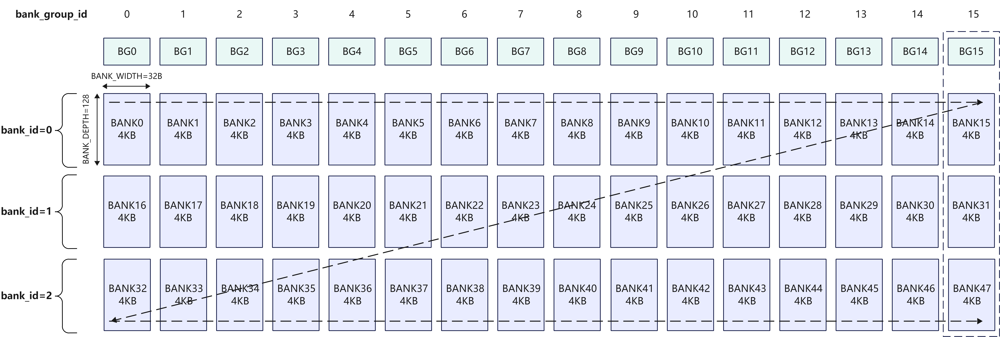

# UB bank冲突及地址重叠场景验证及分析（基于Mul指令）

## UB（Unified Buffer）内存结构

- UB内存结构图
    

    - A2/A3架构上，UB空间大小是192KB；
    - 共有48个`bank`；
    - bank间组成为16个`bank group`，每个`group`包含3个`bank`（`bank_id` = 1,2,3）。
    - bank内由128行组成（`BANK_DEPTH`），每行长度是32B（`BANK_WIDTH`），每个`bank`大小为4KB。

## UB地址编码规则
- UB地址编码遵循如下规则  
    `UB_ADDR[17:0] = {BANK[1:0], BANK_DEPTH[6:0], BG[3:0], BANK_WIDTH[4:0]}`  
    即：
    | part1 | part2 | part3 | part4 |
    | --- | --- | --- | --- |
    | 2bits | 7bits | 4bits | 5bits|
    | bank_id | row_id | bank_group_id | offset |
- 具体示例  
    地址`0x10020`，对应地址编码是`0001 0000 0000 0010 0000`，得出以下信息：
    - bank_id = 1
    - row_id = 0
    - bank_group_id = 1
    - offset = 0  
    结合[UB内存结构图](#ubunified-buffer-内存结构)，即表示bank17的0地址。

## UB bank冲突类型
- 读写冲突：读操作和写操作同时尝试访问同一个bank；
- 写写冲突：多个写操作同时尝试访问同一个bank group；
- 读读冲突：多个读操作同时尝试访问同一个bank group；

## 测试场景概览
包含bank冲突、地址重叠等场景的验证和分析。构造场景用例的输入数据类型是float，输入数据长度是4096，以连续读写为例

| case_num | 计算公式 | 场景描述 | 有无bank冲突 | src0_addr | src1_addr | dst_addr | 打点性能 （越低越好，指令执行1000次的数值） | 备注 |
| --- | --- | --- | --- | --- | --- | --- | --- | --- |
| 1 | dst = src0 * src1 | src0/src1首地址在不同bank group，src0/src1/dst首地址在不同bank | 无bank读读、读写冲突 | 0 | 0x10100 | 0x20000 | 2418 | 作为基线性能参照 |
| 2 | dst = src0 * src1 | src0/src1首地址在同一个bank | 有bank读读冲突 | 0 | 0x4000 | 0x10000 | 4195 | 说明bank读读冲突 |
| 3 | dst = src0 * src1 | src0/src1首地址在同一个bank group | 有bank读读冲突 | 0 | 0x10000 | 0x14100 | 4195 | 说明bank读读冲突 |
| 4 | dst = src0 * src1 | src0/dst首地址在同一个bank | 无bank读写冲突 | 0 | 0x10100 | 0x4000 | 2501 | 作为case5的基线参照 |
| 5 | dst = src0 * src1 | src0/dst首地址不在同一个bank | 有bank读写冲突 | 0 | 0x10100 | 0x4020 | 3612 | vs case4，说明bank读写冲突 |
| 6 | dst = src0 * src1 | src1/dst首地址在同一个bank | 无bank读写冲突 | 0 | 0x10100 | 0x10100 | 2501 | 作为case7的基线参照 |
| 7 | dst = src0 * src1 | src1/dst首地址不在同一个bank | 有bank读写冲突 | 0 | 0x10100 | 0x10120 | 3612 | vs case6，说明bank读写冲突 |
| 8 | dst = src0 * src1 | src0每次repeat读同一datablock(src0BlkStride=0, srcRepStride=1)， src1和dst首地址重叠 | 有bank读读冲突 | 0 | 0x10100 | 0x10100 | 3778 | vs case9/case6，作为基线参照 |
| 9 | dst = src0 * src1 | src0每次repeat读同一datablock(src0BlkStride=0, srcRepStride=8)， src1和dst首地址重叠 | 无bank读读冲突 | 0 | 0x10100 | 0x10100 | 2501 | |
| 72 | src0 = src0 * src0 | src0/src1/dst首地址完全重叠 | 无bank读读、读写冲突 | 0 | 0 | 0 | 2501 |  |

每个case的具体分析过程，请参考下述各章节

## case1 无读读冲突、无读写冲突场景分析

- src0的首地址是`0`，对应地址编码是 `0000 0000 0000 0000 0000`；故对应的`bank_id` = 0，`bank_group_id` = 0。
- src1的首地址是`0x10100`，对应地址编码是 `0001 0000 0001 0000 0000`；故对应的`bank_id` = 1，`bank_group_id` = 8。
- dst的首地址是`0x20000`，对应地址编码是 `0010 0000 0000 0000 0000`；故对应的`bank_id` = 2，`bank_group_id` = 0。

- UB读写示例图如下：
    
    - 每8个绿色数据块（32B），代表src0每次repeat读取的数据（256B）；
    - 每8个黄色数据块（32B），代表src1每次repeat读取的数据（256B）；
    - 每8个蓝色数据块（32B），代表dst每次repeat写入的数据（256B）；
    - 处理完所有数据，迭代次数repeat_times = 数据长度 * sizeof(float) / 每次repeat处理的数据量 = 4096 * 4 / 256 = 64。

- 分析结论
    - src0和src1读取的数据，每次repeat的所有datablock都在不同的bank_group，故不存在读读冲突。
    - src0/src1读取的数据和dst写入的数据，每次repeat的所有datablock都在不同的bank，故不存在读写冲突。

## case2 src0/src1首地址在同一个bank，读读冲突场景分析

- src0的首地址是`0`，对应地址编码是 `0000 0000 0000 0000 0000`；故对应的`bank_id` = 0，`bank_group_id` = 0。
- src1的首地址是`0x4000`，对应地址编码是 `0000 0100 0000 0000 0000`；故对应的`bank_id` = 0，`bank_group_id` = 0。
- dst的首地址是`0x10000`，对应地址编码是 `0001 0000 0000 0000 0000`；故对应的`bank_id` = 1，`bank_group_id` = 0。

- UB读写示例图如下：
    
    - 每8个绿色数据块（32B），代表src0每次repeat读取的数据（256B）；
    - 每8个黄色数据块（32B），代表src1每次repeat读取的数据（256B）；
    - 每8个蓝色数据块（32B），代表dst每次repeat写入的数据（256B）；
    - 处理完所有数据，迭代次数repeat_times = 数据长度 * sizeof(float) / 每次repeat处理的数据量 = 4096 * 4 / 256 = 64。

- 分析结论
    - src0和src1读取的数据，每次repeat都在相同的bank，故存在读读冲突。
    - src0/src1读取的数据和dst写入的数据，每次repeat的所有datablock都在不同的bank，故不存在读写冲突。

## case3 src0/src1首地址在同一个bank group，读读冲突场景分析

- src0的首地址是`0`，对应地址编码是 `0000 0000 0000 0000 0000`；故对应的`bank_id` = 0，`bank_group_id` = 0。
- src1的首地址是`0x10000`，对应地址编码是 `0001 0000 0000 0000 0000`；故对应的`bank_id` = 1，`bank_group_id` = 0。
- dst的首地址是`0x14100`，对应地址编码是 `0001 0100 0001 0000 0000`；故对应的`bank_id` = 1，`bank_group_id` = 8。

- UB读写示例图如下：
    
    - 每8个绿色数据块（32B），代表src0每次repeat读取的数据（256B）；
    - 每8个黄色数据块（32B），代表src1每次repeat读取的数据（256B）；
    - 每8个蓝色数据块（32B），代表dst每次repeat写入的数据（256B）；
    - 处理完所有数据，迭代次数repeat_times = 数据长度 * sizeof(float) / 每次repeat处理的数据量 = 4096 * 4 / 256 = 64。

- 分析结论
    - src0和src1读取的数据，每次repeat都在相同的bank group，故存在读读冲突。
    - src0/src1读取的数据和dst写入的数据，每次repeat的所有datablock都在不同的bank，故不存在读写冲突。

## case4 src0和dst首地址在同一个bank，无读写冲突场景分析

- src0的首地址是`0`，对应地址编码是 `0000 0000 0000 0000 0000`；故对应的`bank_id` = 0，`bank_group_id` = 0。
- src1的首地址是`0x10100`，对应地址编码是 `0001 0000 0001 0000 0000`；故对应的`bank_id` = 1，`bank_group_id` = 8。
- dst的首地址是`0x4000`，对应地址编码是 `0000 0100 0000 0000 0000`；故对应的`bank_id` = 0，`bank_group_id` = 0。

- UB读写示例图如下：
    
    - 每8个绿色数据块（32B），代表src0每次repeat读取的数据（256B）；
    - 每8个黄色数据块（32B），代表src1每次repeat读取的数据（256B）；
    - 每8个蓝色数据块（32B），代表dst每次repeat写入的数据（256B）；
    - 处理完所有数据，迭代次数repeat_times = 数据长度 * sizeof(float) / 每次repeat处理的数据量 = 4096 * 4 / 256 = 64。

- 分析结论
    - src0和src1读取的数据，每次repeat的所有datablock都在不同的bank group，故不存在读读冲突。
    - src0读取的数据和dst写入的数据，每次repeat都在相同的bank，理论上会存在读写冲突。但硬件做了优化，会自动错开1个repeat，避免了读写冲突的影响。
        - 理论情况下的UB读写过程示意
            | 第1次repeat | 第2次repeat | 第3次repeat | ... |
            | --- | --- | --- | --- |
            | src0读bank 0-7 (bank group 0-7) | src0读bank 8-15 (bank group 8-15) | src0读bank 0-7 (bank group 0-7) | ... |
            | src1读bank 24-31 (bank group 8-15) | src1读bank 16-23 (bank group 0-7) | src1读bank 24-31 (bank group 8-15) | ... |
            | dst写bank 0-7 | dst写bank 8-15 | dst写bank 0-7 | ... |

            理论分析结果：src0读取的数据和dst写入的数据，每次repeat都在相同的bank，会存在读写冲突。

        - 实际情况下的UB读写过程示意
             | 第1次repeat | 第2次repeat | 第3次repeat | ... |
            | --- | --- | --- | --- |
            | src0读bank 0-7 (bank group 0-7) | src0读bank 8-15 (bank group 8-15) | src0读bank 0-7 (bank group 0-7) | ... |
            | src1读bank 24-31 (bank group 8-15) | src1读bank 16-23 (bank group 0-7) | src1读bank 24-31 (bank group 8-15) | ... |
            | - | dst写bank 0-7 | dst写bank 8-15 | ... |

            实际处理结果：硬件自动将dst的写入延后一个repeat，进而跟src0的数据读取错开，避免了读写冲突。

## case5 src0和dst首地址在不同的bank，有读写冲突场景分析
- src0的首地址是`0`，对应地址编码是 `0000 0000 0000 0000 0000`；故对应的`bank_id` = 0，`bank_group_id` = 0。
- src1的首地址是`0x10100`，对应地址编码是 `0001 0000 0001 0000 0000`；故对应的`bank_id` = 1，`bank_group_id` = 8。
- dst的首地址是`0x4020`，对应地址编码是 `0000 0100 0000 0010 0000`；故对应的`bank_id` = 0，`bank_group_id` = 1。

- UB读写示例图如下：
    
    - 每8个绿色数据块（32B），代表src0每次repeat读取的数据（256B）；
    - 每8个黄色数据块（32B），代表src1每次repeat读取的数据（256B）；
    - 每8个蓝色数据块（32B），代表dst每次repeat写入的数据（256B）；
    - 处理完所有数据，迭代次数repeat_times = 数据长度 * sizeof(float) / 每次repeat处理的数据量 = 4096 * 4 / 256 = 64。

- 分析结论
    - src0和src1读取的数据，每次repeat的所有datablock都在不同的bank group，故不存在读读冲突。
    - src0读取的数据和dst写入的数据，每次repeat都会有相同的datablock，会存在读写冲突。
        - UB读写过程示意
            | 第1次repeat | 第2次repeat | 第3次repeat | ... |
            | --- | --- | --- | --- |
            | src0读bank 0-7 (bank group 0-7) | src0读bank 8-15 (bank group 8-15) | src0读bank 0-7 (bank group 0-7) | ... |
            | src1读bank 24-31 (bank group 8-15) | src1读bank 16-23 (bank group 0-7) | src1读bank 24-31 (bank group 8-15) | ... |
            | dst写bank 1-8 (bank group 1-8) | dst写bank 9-15-0 (bank group 9-15-0) | dst写bank 1-8 (bank group 1-8) | ... |

        理论分析结果：src0读取的数据和dst写入的数据，每次repeat都有相同datablock（第1次repeat是bank2-7冲突，第2次repeat是bank9-15冲突，...），会存在读写冲突。

## case6 src1/dst首地址在同一个bank，无读写冲突场景分析

- src0的首地址是`0`，对应地址编码是 `0000 0000 0000 0000 0000`；故对应的`bank_id` = 0，`bank_group_id` = 0。
- src1的首地址是`0x10100`，对应地址编码是 `0001 0000 0001 0000 0000`；故对应的`bank_id` = 1，`bank_group_id` = 8。
- dst的首地址是`0x10100`，对应地址编码是 `0001 0000 0001 0000 0000`；故对应的`bank_id` = 1，`bank_group_id` = 8。

- UB读写示例图如下：
    
    - 每8个绿色数据块（32B），代表src0每次repeat读取的数据（256B）；
    - 每8个黄色数据块（32B），代表src1每次repeat读取的数据（256B）、代表dst每次repeat写入的数据（256B）；即src1读取的数据位置和dst写入的数据位置重叠。
    - 处理完所有数据，迭代次数repeat_times = 数据长度 * sizeof(float) / 每次repeat处理的数据量 = 4096 * 4 / 256 = 64。

- 分析结论
    - src0和src1读取的数据，每次repeat的所有datablock都在不同的bank group，故不存在读读冲突。
    - src0读取的数据和dst写入的数据，每次repeat都在相同的bank，理论上会存在读写冲突。但硬件做了优化，会自动错开1个repeat，避免了读写冲突的影响。
        - 理论情况下的UB读写过程示意
            | 第1次repeat | 第2次repeat | 第3次repeat | ... |
            | --- | --- | --- | --- |
            | src0读bank 0-7 (bank group 0-7) | src0读bank 8-15 (bank group 8-15) | src0读bank 0-7 (bank group 0-7) | ... |
            | src1读bank 24-31 (bank group 8-15) | src1读bank 16-23 (bank group 0-7) | src1读bank 24-31 (bank group 8-15) | ... |
            | dst写bank 24-31 (bank group 8-15) | dst写bank 16-23 (bank group 0-7) | dst写bank 24-31 (bank group 8-15) | ... |

            理论分析结果：src0读取的数据和dst写入的数据，每次repeat都在相同的bank，会存在读写冲突。

        - 实际情况下的UB读写过程示意
             | 第1次repeat | 第2次repeat | 第3次repeat | ... |
            | --- | --- | --- | --- |
            | src0读bank 0-7 (bank group 0-7) | src0读bank 8-15 (bank group 8-15) | src0读bank 0-7 (bank group 0-7) | ... |
            | src1读bank 24-31 (bank group 8-15) | src1读bank 16-23 (bank group 0-7) | src1读bank 24-31 (bank group 8-15) | ... |
            | - | dst写bank 24-31 (bank group 8-15) | dst写bank 16-23 (bank group 0-7) | ... |

            实际处理结果：硬件自动将dst的写入延后一个repeat，进而跟src1的数据读取错开，避免了读写冲突。

## case7 src1/dst首地址不在同一个bank，有读写冲突场景分析

- src0的首地址是`0`，对应地址编码是 `0000 0000 0000 0000 0000`；故对应的`bank_id` = 0，`bank_group_id` = 0。
- src1的首地址是`0x10100`，对应地址编码是 `0001 0000 0001 0000 0000`；故对应的`bank_id` = 1，`bank_group_id` = 8。
- dst的首地址是`0x10120`，对应地址编码是 `0001 0000 0001 0010 0000`；故对应的`bank_id` = 1，`bank_group_id` = 9。

- UB读写示例图如下：
    
    - 每8个绿色数据块（32B），代表src0每次repeat读取的数据（256B）；
    - 每8个黄色数据块（32B），代表src1每次repeat读取的数据（256B）；
    - 每8个蓝色数据块（32B），代表dst每次repeat写入的数据（256B）；
    - 处理完所有数据，迭代次数repeat_times = 数据长度 * sizeof(float) / 每次repeat处理的数据量 = 4096 * 4 / 256 = 64。

- 分析结论
    - src0和src1读取的数据，每次repeat的所有datablock都在不同的bank group，故不存在读读冲突。
    - src1读取的数据和dst写入的数据，每次repeat都会有相同的datablock，会存在读写冲突。
        - UB读写过程示意
            | 第1次repeat | 第2次repeat | 第3次repeat | ... |
            | --- | --- | --- | --- |
            | src0读bank 0-7 (bank group 0-7) | src0读bank 8-15 (bank group 8-15) | src0读bank 0-7 (bank group 0-7) | ... |
            | src1读bank 24-31 (bank group 8-15) | src1读bank 16-23 (bank group 0-7) | src1读bank 24-31 (bank group 8-15) | ... |
            | dst写bank 25-31-16 (bank group 8-15-0) | dst写bank 17-24 (bank group 1-8) | dst写bank 25-31-16 (bank group 8-15-0) | ... |

            理论分析结果：src1读取的数据和dst写入的数据，每次repeat都有相同datablock（第1次repeat是bank25-31冲突，第2次repeat是bank17-23冲突，...），会存在读写冲突。

## case8 src0每次repeat读同一datablock(src0BlkStride=0, srcRepStride=1)，src1和dst地址重叠
- src0的首地址是`0`，对应地址编码是 `0000 0000 0000 0000 0000`；故对应的`bank_id` = 0，`bank_group_id` = 0。
- src1的首地址是`0x10100`，对应地址编码是 `0001 0000 0001 0000 0000`；故对应的`bank_id` = 1，`bank_group_id` = 8。
- dst的首地址是`0x10100`，对应地址编码是 `0001 0000 0001 0000 0000`；故对应的`bank_id` = 1，`bank_group_id` = 8。

- UB读写示例图如下：
    
    - 每次repeat，src0重复读取同1个绿色数据块（32B）读取8次（src0BlkStride=0）；
    - 每8个黄色数据块（32B），代表src1每次repeat读取的数据（256B）；
    - 每8个蓝色数据块（32B），代表dst每次repeat写入的数据（256B）；
    - 处理完所有数据，迭代次数repeat_times = 数据长度 * sizeof(float) / 每次repeat处理的数据量 = 4096 * 4 / 256 = 64。

- 分析结论
    - src0和src1读取的数据，每次repeat的所有datablock都在不同的bank group，故不存在读读冲突。
    - src0读取的数据和dst写入的数据，每隔1次repeat都会有相同的datablock，会存在读写冲突。
        - UB读写过程示意
            | 第1次repeat | 第2次repeat | 第3次repeat | 第4次repeat | ... |
            | --- | --- | --- | --- | --- |
            | src0读bank 0（bank group 0）| src0读bank 1（bank group 1） | src0读bank 2（bank group 2） | src0读bank 3（bank group 3） | ... |
            | src1读bank 24-31 (bank group 8-15) | src1读bank 16-23 (bank group 0-7) | src1读bank 24-31 (bank group 8-15) | src1读bank 16-23 (bank group 0-7) | ... |
            | dst写bank 24-31 (bank group 8-15) | dst写bank 16-23 (bank group 0-7) | dst写bank 24-31 (bank group 8-15) | dst写bank 16-23 (bank group 0-7) | ... |

        理论分析结果：
        - src0读取的数据和src1读取的数据，每隔一次repeat（repeat=2,4,6,...）都有位于同一个bank group的datablock（如repeat=2，bank1冲突；repeat=4，bank3冲突），会存在读读冲突。
        - 类比case6，硬件自动将dst的写入延后一个repeat，进而跟src1的数据读取错开，避免了读写冲突。

## case9 src0每次repeat读同一datablock(src0BlkStride=0, srcRepStride=8)，src1和dst地址重叠
- src0的首地址是`0`，对应地址编码是 `0000 0000 0000 0000 0000`；故对应的`bank_id` = 0，`bank_group_id` = 0。
- src1的首地址是`0x10100`，对应地址编码是 `0001 0000 0001 0000 0000`；故对应的`bank_id` = 1，`bank_group_id` = 8。
- dst的首地址是`0x10100`，对应地址编码是 `0001 0000 0001 0000 0000`；故对应的`bank_id` = 1，`bank_group_id` = 8。

- UB读写示例图如下：
    
    - 每次repeat，src0重复读取同1个绿色数据块（32B）读取8次（src0BlkStride=0）；
    - 每8个黄色数据块（32B），代表src1每次repeat读取的数据（256B）；
    - 每8个蓝色数据块（32B），代表dst每次repeat写入的数据（256B）；
    - 处理完所有数据，迭代次数repeat_times = 数据长度 * sizeof(float) / 每次repeat处理的数据量 = 4096 * 4 / 256 = 64。

- 分析结论
    - src0和src1读取的数据，每次repeat的所有datablock都在不同的bank group，故不存在读读冲突。
    - src0读取的数据和dst写入的数据，每隔1次repeat都会有相同的datablock，会存在读写冲突。
        - UB读写过程示意
            | 第1次repeat | 第2次repeat | 第3次repeat | 第4次repeat | ... |
            | --- | --- | --- | --- | --- |
            | src0读bank 0（bank group 0）| src0读bank 8（bank group 8） | src0读bank 0（bank group 0）| src0读bank 8（bank group 8） | ... |
            | src1读bank 24-31 (bank group 8-15) | src1读bank 16-23 (bank group 0-7) | src1读bank 24-31 (bank group 8-15) | src1读bank 16-23 (bank group 0-7) | ... |
            | dst写bank 24-31 (bank group 8-15) | dst写bank 16-23 (bank group 0-7) | dst写bank 24-31 (bank group 8-15) | dst写bank 16-23 (bank group 0-7) | ... |

        理论分析结果：
        - src0读取的数据和src1读取的数据，每次repeat的所有datablock都在不同的bank_group，故不存在读读冲突。
        - 类比case6，硬件自动将dst的写入延后一个repeat，进而跟src1的数据读取错开，避免了读写冲突。

## case72 src0/src1/dst地址完全重叠场景（无读读冲突，无读写冲突）

- src0的首地址是`0`，对应地址编码是 `0000 0000 0000 0000 0000`；故对应的`bank_id` = 0，`bank_group_id` = 0。
- src1的首地址是`0`，对应地址编码是 `0000 0000 0000 0000 0000`；故对应的`bank_id` = 0，`bank_group_id` = 0。
- dst的首地址是`0`，对应地址编码是 `0000 0000 0000 0000 0000`；故对应的`bank_id` = 0，`bank_group_id` = 0。

- UB读写示例图如下：
    
    - 每8个绿色数据块（32B），代表src0、src1每次repeat读取的数据（256B），以及dst每次repeat写入的数据（256B）；即读取的数据位置和写入的数据位置重叠。
    - 处理完所有数据，迭代次数repeat_times = 数据长度 * sizeof(float) / 每次repeat处理的数据量 = 4096 * 4 / 256 = 64。

- 分析结论
    - src0和src1地址完全重叠，硬件会自动优化，将src0的src1的两读会优化为一读，不会重复读取，故不存在读读冲突。
    - src0/src1读取的数据和dst写入的数据虽然地址重叠，但硬件可以将dst的写入延后一个repeat，进而跟src0的读数据错开，避免读写冲突。