# UB Bank 冲突及离散访存场景验证与分析

## UB（Unified Buffer）内存结构

- 在 Ascend 950PR/Ascend 950DT 中，UB 空间大小为 256KB；
- 共有 16 个 **bank**，组成 8 个 **bank group**，每个 bank group 包含 2 个 bank（`bank_id` = 0, 1）；
- 每个 bank 由 512 行组成（`BANK_DEPTH = 512`），每行长度为 32B（`BANK_WIDTH = 32B`），即每个 bank 大小为 16KB；
- 每个 bank group 提供 2 个**读口**和 1 个**写口**，每个bank group最多支持两读或者一读一写。
- bank_number 相同代表是同一个 bank；bank_group_id 相同代表是同一个 bank group。

## subbank内存结构

**subbank内存结构只有在离散访存时才被感知**

Ascend 950PR/Ascend 950DT 每个 bank（32B 宽）分为 4 个 subbank，各 8B 宽 × 512 行深度，各有独立读口：

```
bank 内部 layout（一行 32B）：
┌────────┬────────┬────────┬────────┐
│ sub0   │ sub1   │ sub2   │ sub3   │
│  8B    │  8B    │  8B    │  8B    │
└────────┴────────┴────────┴────────┘
```

## UB 地址编码规则

Ascend 950PR/Ascend 950DT的 UB 18 位地址采用**低位交织**编码规则：

`UB_ADDR[17:0] = { DEPTH[8:0], BANK[0], BG[2:0], WIDTH[4:0] }`

| 位域 | DEPTH[8:0] | BANK[0] | BG[2:0] | WIDTH[4:0] |
| --- | --- | --- | --- | --- |
| 位数 | 9 bits | 1 bit | 3 bits | 5 bits |
| 含义 | row_id（bank 内行号） | bank_id（bank group 内 bank 编号） | bank_group_id | offset（行内偏移） |

**解码示例**：地址 `0x4100`

将地址转为 18 位二进制，按位域划分：`00 0100 0001 0000 0000`

| 位域 | 二进制值 | 十进制 | 含义 |
| --- | --- | --- | --- |
| DEPTH[8:0] | `00 0100 000` | 32 | row_id = 32 |
| BANK[0] | `1` | 1 | bank_id = 1 |
| BG[2:0] | `000` | 0 | bank_group_id = 0 |
| WIDTH[4:0] | `00000` | 0 | offset = 0 |

## DataBlock 映射

一条 VF Load/Store 指令每次处理 256B = 8 个 DataBlock。每个 DataBlock = 32B。

从 `base` 地址开始的 8 个 DataBlock 映射到 8 个不同 bank group：

| DataBlock | 偏移 | 物理 bank | BG | BANK |
|:--:|:----:|:---------:|:--:|:----:|
| 0 | +0x00 | b | b&7 | b>>3 |
| 1 | +0x20 | b+1 | (b+1)&7 | (b+1)>>3 |
| ... | ... | ... | ... | ... |
| 7 | +0xE0 | b+7 | (b+7)&7 | (b+7)>>3 |

其中 `b = (base >> 5) & 0xF`。8 个 DataBlock 覆盖 BG 0-7 各一次。

## bank 冲突类型（适用连续访存）

根据内存结构，bank 冲突主要分为以下三种类型：
- **读读冲突**：多个读操作同时访问同一个 bank，或两个以上读操作同时访问同一个 bank group。
- **写写冲突**：多个写操作同时访问同一个 bank group。
- **读写冲突**：读操作和写操作同时访问同一个 bank。

## subbank冲突规则（适用离散访存）

- 离散数据属于**不同 subbank**，无冲突（subbank各自独立读口/写口）。
- 离散数据属于**同 subbank的同起始地址**，无冲突（硬件合并为一次读）。
- 离散数据属于**同 subbank + 不同起始地址**，发生冲突。

## 测试场景概览

本文围绕 bank 冲突和离散访存两个角度展开验证分析。所有场景的输入数据类型为 `float`（离散访存场景的 index 为 `uint32_t`），采用 Reg 级 LoadAlign/StoreAlign 指令，通过循环展开执行 1000 次以放大性能差异。

> **性能说明**：下表"打点性能"为指令连续执行 1000 次的总 cycles 数（`GetSystemCycle` 打点），数值越低性能越好。

### 二读一写 / 双搬入场景（Case 1-5）

| case | 计算公式 | 场景描述 | bank 冲突情况 | src0 首地址 | src1 首地址 | dst 首地址 | 打点性能(cycles) | 备注 |
| --- | --- | --- | --- | --- | --- | --- | --- | --- |
| 1 | dst = src0 + src1 | 二读一写，同一bank，有读读和读写冲突，循环展开 | **有读读/读写冲突** | 0x0000 | 0x4000 | 0x8000 | 80,948 | 基准 |
| 2 | dst = src0 + src1 | 二读一写，同 Case 1，不使用循环展开 | 同上 | 0x0000 | 0x4000 | 0x8000 | 86,249 | 对比展开收益 |
| 3 | dst = src0 + src1 | 二读一写，src0与src1不同bank，无读读冲突 | 有读写冲突 | 0x0000 | 0x4100 | 0x8900 | 87,601 | 消除 src0/src1 读读冲突 |
| 4 | dst = src0 + src1 | 二读一写，src0与src1同地址重叠，读指令减半 | 读指令减半 | 0x0000 | 0x0000 | 0x4100 | 68,060 | **地址重叠收益最大** |
| 5 | dst = src0 + src1 | 二读一写，双搬入DINTLV_B32模式交织读取 | 无读读冲突 | 0x0000 | 0x4000 | 0x8000 | 89,893 | 双搬入单次取回 src0/src1 |

### 一读一写场景（Case 6-7）

| case | 计算公式 | 场景描述 | bank 冲突情况 | src0 首地址 | src1 首地址 | dst 首地址 | 打点性能(cycles) | 备注 |
| --- | --- | --- | --- | --- | --- | --- | --- | --- |
| 6 | dst = src0 + 0 | 一读一写，src0与dst同bank，发生读写冲突 | **有读写冲突** | 0x0000 | 0x0000 | 0x4000 | 67,471 | 验证同 bank 读写冲突 |
| 7 | dst = src0 + 0 | 一读一写，src0与dst不同bank，消除读写冲突 | 无冲突 | 0x0000 | 0x0000 | 0x4100 | 68,071 | 对比 Case 6，消除冲突 |

### 离散访存场景（Case 8-11）

| case | 计算公式 | 场景描述 | subbank 冲突情况 | index 地址 | data 地址 | index 模式 | 打点性能(cycles) | 备注 |
| --- | --- | --- | --- | --- | --- | --- | --- | --- |
| 8 | Gather + Add + Scatter | Gather数据索引[0..7]重复 | 同地址 coalesce，无冲突 | 0x0000 | 0x0400 | [0..7]×32 重复 | 39,605 | — |
| 9 | Gather + Add + Scatter | Gather数据索引[0..255]连续 | 跨 bank 分散，无冲突 | 0x0000 | 0x0400 | [0..255] 连续 | 39,613 | — |
| 10 | Gather + Add + Scatter | Gather数据索引0、128交替重复 | **同 subbank 不同行冲突** | 0x0000 | 0x0400 | 0、128 交替 | **45,782** | 对比 Case 11 |
| 11 | Gather + Add + Scatter | Gather数据索引全为0，起始地址全部重叠 | 硬件优化，无冲突 | 0x0000 | 0x0400 | 全 0 | 39,582 | 基准参照 |

### 非连续搬运跨步对比（Case 12-13）

| case | 计算公式 | 场景描述 | 冲突情况 | src0 首地址 | dst 首地址 | 搬运方式 | 打点性能(cycles) | 备注 |
| --- | --- | --- | --- | --- | --- | --- | --- | --- |
| 12 | dst = src0 + 0 | 512元素按行计算，连续8个DataBlock，stride=1 | 无冲突 | 0x0000 | 0x4100 | DataBlock连续搬运 | 26,898 | 基准 |
| 13 | dst = src0 + 0 | **512元素按列计算，间隔256B 8个不连续DataBlock，stride=8** | **读读冲突** | 0x0000 | 0x4100 | DataBlock非连续搬运 | 91,815 | 对比 Case 12 |

> **说明**：Case 12/13 的 `TOTAL_LENGTH = 512`，各计算 512 个 float32。

各 case 的详细分析见下文对应章节。

## Case 1：二读一写，src0、src1和dst同一bank，存在读读冲突和读写冲突

### 地址解码

| 操作数 | 首地址 | 18 位二进制（DEPTH BANK BG WIDTH） | bank_id | bank_group_id | 全局 bank 编号 |
| --- | --- | --- | --- | --- | --- |
| src0 | `0x0000` | `000000000 0 000 00000` | 0 | 0 | 0 |
| src1 | `0x4000` | `010000000 0 000 00000` | 0 | 0 | 0 |
| dst | `0x8000` | `100000000 0 000 00000` | 0 | 0 | 0 |

### UB 读写示意

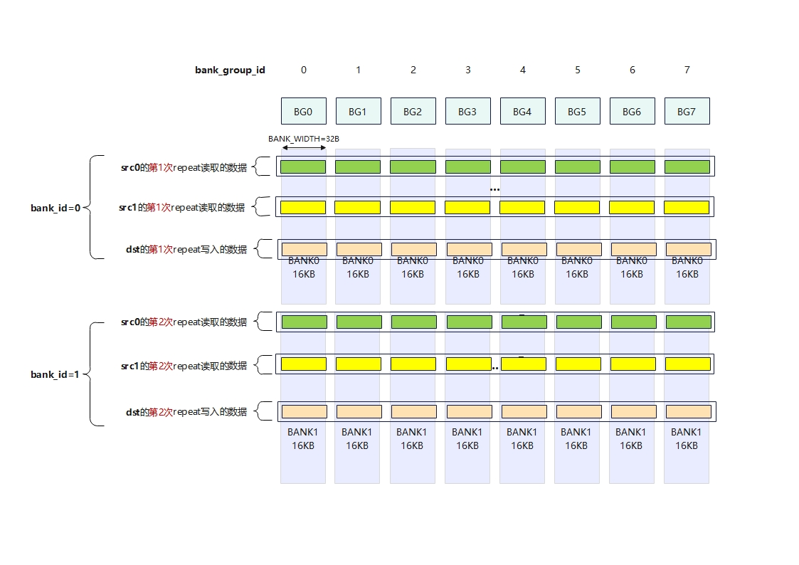

- 循环展开每次迭代处理 2 个 repeat，共迭代 `total_iterations = 4096 × 4 ÷ 256 ÷ 2 = 32` 次。

### 分析结论

- src0、src1、dst 三路首地址均映射到 bank 0：虽然 8 个 DataBlock 分散在 BG 0-7，但三路 tensor 的对应 DataBlock 都落在相同 bank，**存在读读冲突和读写冲突**。

## Case 2：二读一写，src0、src1和dst同一bank，存在读读冲突和读写冲突，不使用循环展开

### 地址解码

地址配置同 Case 1，详见 Case 1 地址解码。

### UB 读写示意


- 未做循环展开，VF单次迭代内处理 1 个 repeat，共迭代 `total_iterations = 4096 × 4 ÷ 256 = 64` 次。

### 分析结论

- 地址布局与 Case 1 完全相同，冲突特征相同。
- 唯一差异是未做循环展开，每次只处理一个 repeat，无指令级并行。
- Case 1 vs Case 2 = 80,948 vs 86,249 cycles（+6.5%），**循环展开对冲突场景有正收益**。

## Case 3：二读一写，src0与src1不同bank，无读读冲突；src1与dst同bank，有读写冲突

### 地址解码

| 操作数 | 首地址 | 18 位二进制（DEPTH BANK BG WIDTH） | bank_id | bank_group_id
| --- | --- | --- | --- | --- |
| src0 | `0x0000` | `000000000 0 000 00000` | 0 | 0 |
| src1 | `0x4100` | `010000010 0 000 00000` | 1 | 0 |
| dst | `0x8900` | `100010010 0 000 00000` | 1 | 0 |

### UB 读写示意

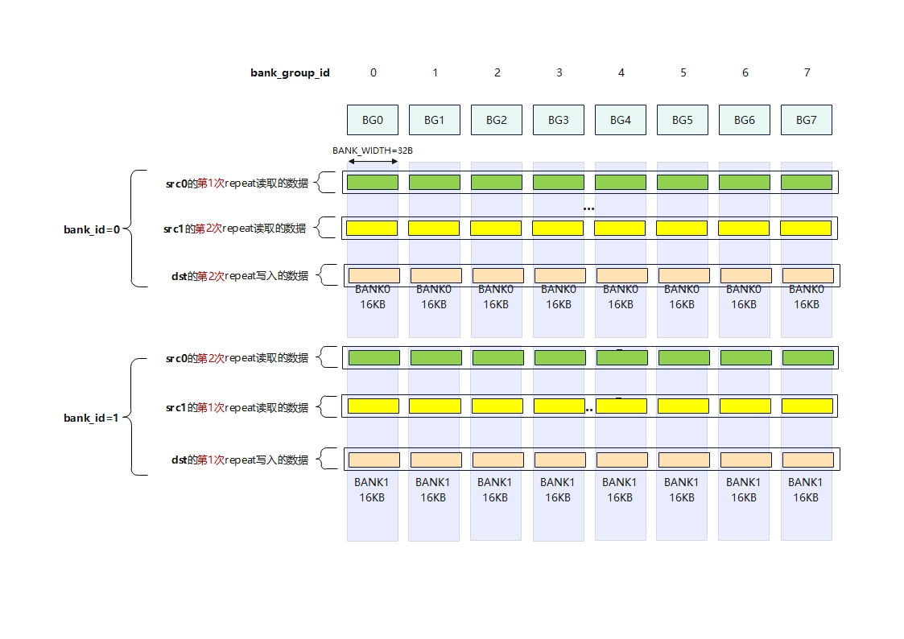

### 分析结论

- src0=bank0，src1=bank1，dst=bank1，读读冲突消除，仍存在读写冲突。
- Case 3 vs Case 1 = 87,601 vs 80,948 cycles，差异很小，说明3510上传统 bank 冲突对性能影响极低。

## Case 4：二读一写，src0与src1位于相同bank的同一起始地址，由于硬件优化，无读读冲突；src0与dst不同bank，无读写冲突

### 地址解码

| 操作数 | 首地址 | 18 位二进制（DEPTH BANK BG WIDTH） | bank_id | bank_group_id |
| --- | --- | --- | --- | --- |
| src0 | `0x0000` | `000000000 0 000 00000` | 0 | 0 |
| src1 | `0x0000` | `000000000 0 000 00000` | 0 | 0 |
| dst | `0x4100` | `010000010 0 000 00000` | 1 | 0 |

### UB 读写示意

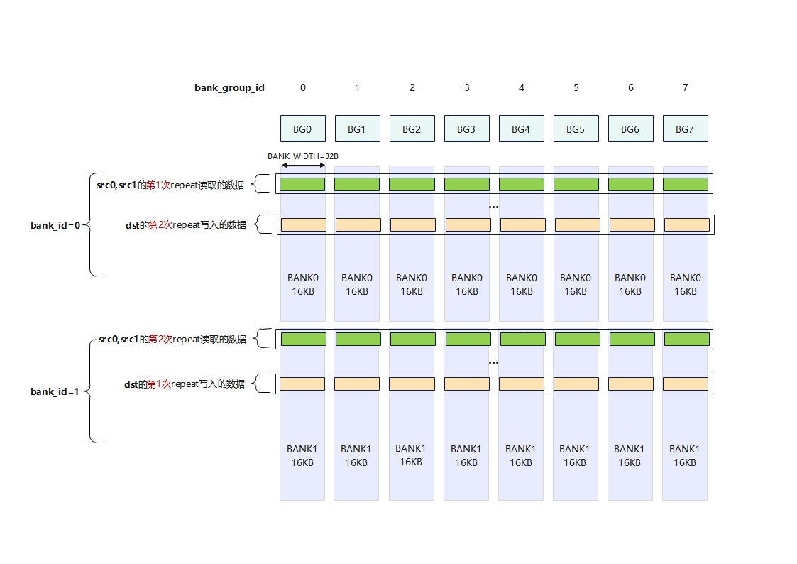

### 分析结论

- src0 和 src1 地址完全重叠，共用同一块 UB 空间，读指令减半（只需一次 Load）。
- Case 4 vs Case 1 = 68,060 vs 80,948 cycles（快 15.9%）。

## Case 5：二读一写，src0、src1和dst同一bank，存在读读冲突和读写冲突，使用双搬入模式交织读取

### 地址解码

| 操作数 | 首地址 | 18 位二进制（DEPTH BANK BG WIDTH） | bank_id | bank_group_id |
| --- | --- | --- | --- | --- |
| src0 | `0x0000` | `000000000 0 000 00000` | 0 | 0 |
| src1 | `0x4000` | `010000000 0 000 00000` | 0 | 0 |
| dst | `0x8000` | `100000000 0 000 00000` | 0 | 0 |

### UB 读写示意

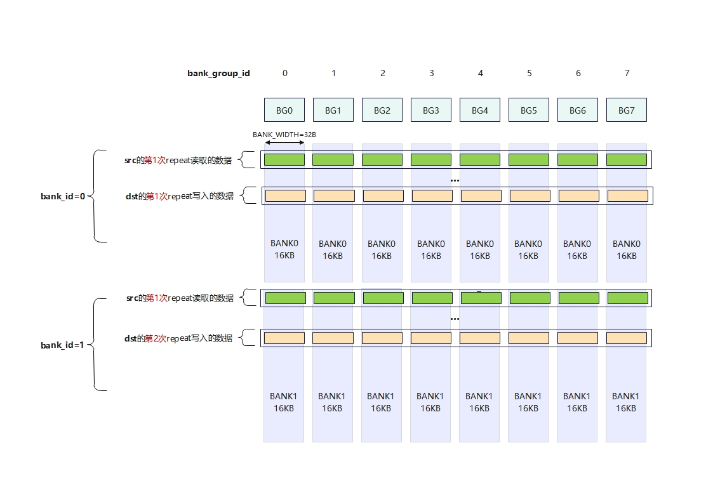

### 分析结论

- 使用 `LoadDist::DIST_DINTLV_B32` 双搬入模式，一条指令同时取回 src0 和 src1（各取 64 bytes 交错排列），消除读读冲突。
- Case 5 vs Case 1 = 89,893 vs 80,948 cycles（慢 11.0%），**双搬入在 Ascend 950PR/Ascend 950DT 上没有带来收益**。

## Case 6：一读一写，src0与dst同bank，发生读写冲突

### 地址解码

| 操作数 | 首地址 | 18 位二进制（DEPTH BANK BG WIDTH） | bank_id | bank_group_id |
| --- | --- | --- | --- | --- |
| src0 | `0x0000` | `000000000 0 000 00000` | 0 | 0 |
| dst | `0x4000` | `010000000 0 000 00000` | 0 | 0 |

### UB 读写示意

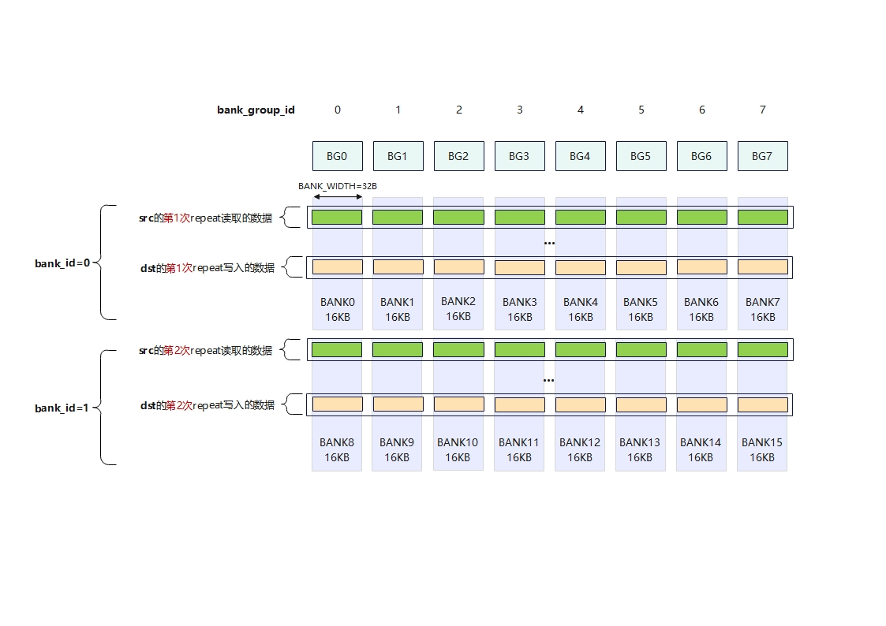

### 分析结论

- 使用 `Adds` 标量加法指令，只读取 src0（src1 为常量 0），src0 与 dst 在同一个 bank（bank 0），**存在读写冲突**。
- Case 6 vs Case 7 = 67,471 vs 68,071 cycles，差异在噪声范围。

## Case 7：一读一写，src0与dst不同bank，消除读写冲突

### 地址解码

| 操作数 | 首地址 | 18 位二进制（DEPTH BANK BG WIDTH） | bank_id | bank_group_id |
| --- | --- | --- | --- | --- |
| src0 | `0x0000` | `000000000 0 000 00000` | 0 | 0 |
| dst | `0x4100` | `010000010 0 000 00000` | 1 | 0 |

### UB 读写示意

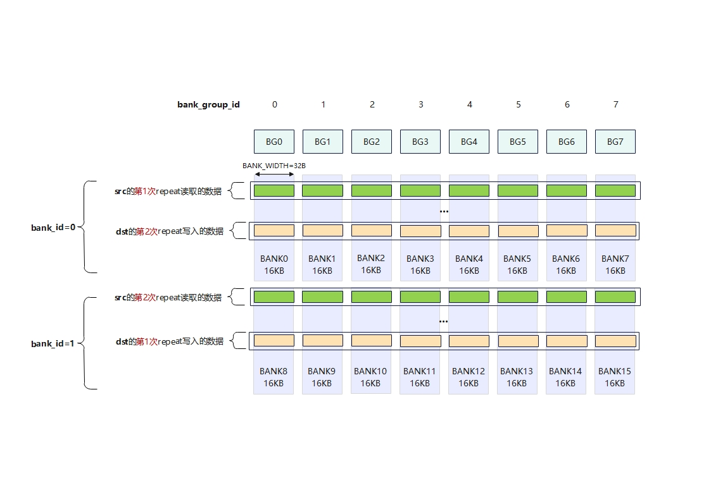

### 分析结论

- src0=bank0，dst=bank1 ,Case 6 vs Case 7 性能几乎无差异，进一步印证 351x 上 VF 层面 bank 冲突不是瓶颈。

## Case 8：离散读写，Gather指令的数据索引在[0..7]重复

### 地址解码

| 操作数 | 首地址 | 18 位二进制（DEPTH BANK BG WIDTH） | bank_id | bank_group_id |
| --- | --- | --- | --- | --- |
| index | `0x0000` | `000000000 0 000 00000` | 0 | 0 |
| data | `0x0400` | `000001000 0 000 00000` | 0 | 0 |
| dst | `0x0400` | `000001000 0 000 00000` | 0 | 0 |

### UB 读写示意

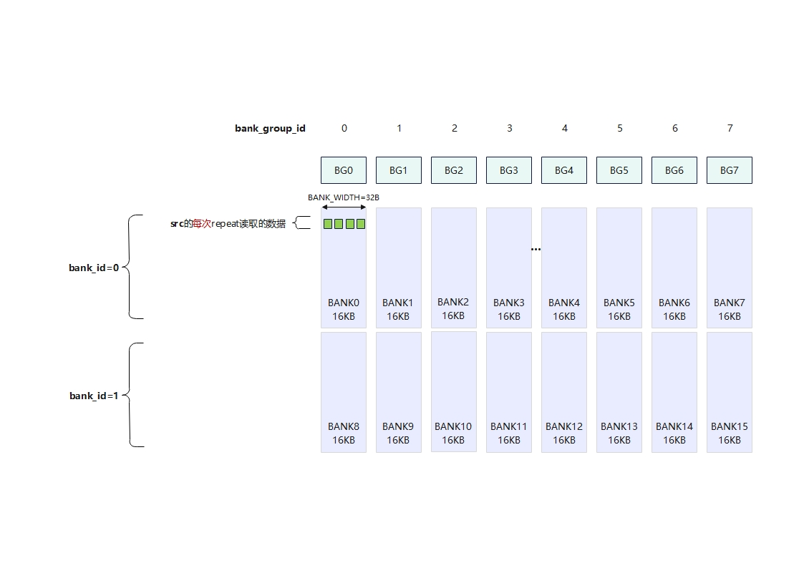

- 索引排布：`[0, 1, 2, 3, 4, 5, 6, 7]` 重复 32 次（共 256 个元素），由 Gather 读取；
- data buffer 起始地址 `0x0400`，每条 Gather 指令从 data 中按 index 取 64 个 float32；
- dst 与 data 地址重叠（`0x0400`），Scatter 写回同一区域。

### 分析结论

- Gather 从 data 中按 index 取 64 个元素：index 仅有 [0..7] 共 8 个 unique 值，很多元素命中相同地址 → 触发硬件优化。
- 每 subbank 仅 2 个 unique addr，读取 2 次即完成，**无 subbank 冲突**。性能为 39,605 cycles。

## Case 9：离散读写，Gather指令的数据索引在[0..255]连续

### 地址解码

| 操作数 | 首地址 | 18 位二进制（DEPTH BANK BG WIDTH） | bank_id | bank_group_id |
| --- | --- | --- | --- | --- |
| index | `0x0000` | `000000000 0 000 00000` | 0 | 0 |
| data | `0x0400` | `000001000 0 000 00000` | 0 | 0 |
| dst | `0x0400` | `000001000 0 000 00000` | 0 | 0 |

### UB 读写示意

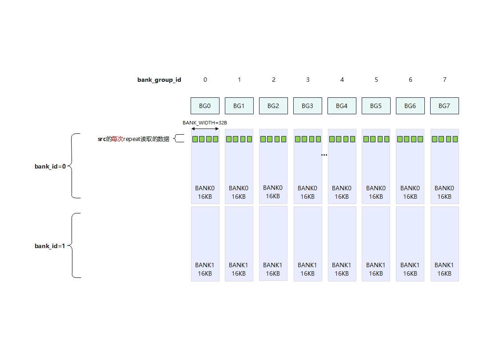

- index 模式：`[0, 1, 2, ..., 255]` 连续递增，每条 Gather 指令处理 64 个连续 index；
- data buffer 起始地址 `0x0400`，dst 与 data 地址重叠。

### 分析结论

- Gather 跨 8 个 bank 分散读取，每 subbank 仅 2 次读操作。连续 index 自然分散到不同 subbank，**无 subbank 冲突**。
- 性能 39,613 cycles，与 Case 8 相当。

## Case 10：离散读写，Gather指令的数据索引0,128交替

### 地址解码

同 Case 8 地址配置。

### UB 读写示意

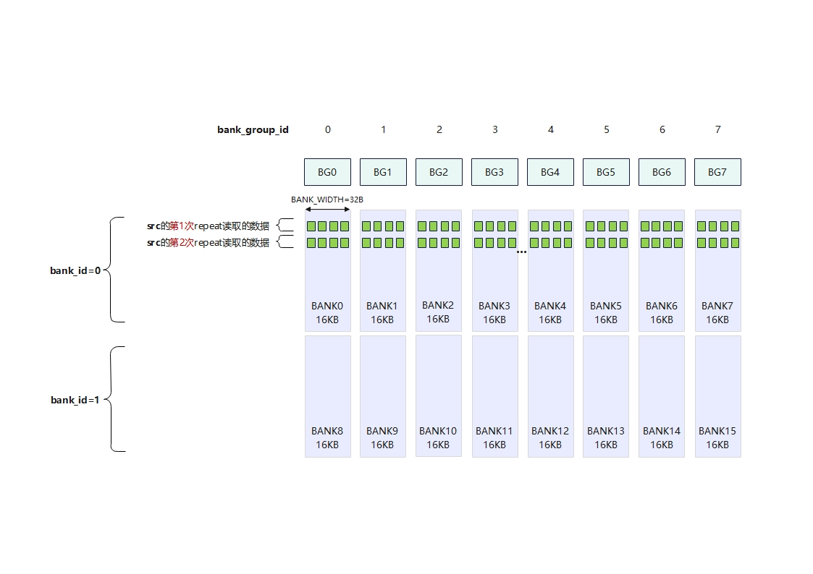

- index 模式：偶数位置为 `0`，奇数位置为 `128`（`[0, 128, 0, 128, ...]` 交替）；
- `0` 和 `128` 在 Ascend 950PR/Ascend 950DT 上都落入 bank 0 的同一 subbank，但属于**不同 depth 行**。

### 分析结论

- Gather 命中**同 subbank + 不同起始地址**（相同 subbank，不同 depth 行），单读口需排队，取出时间翻倍。
- Case 10 vs Case 11 = 45,782 vs 39,582 cycles（**+15.7%**）。

## Case 11：离散读写，Gather指令的数据索引全为0，起始地址全部重叠

### 地址解码

同 Case 8 地址配置。

### UB 读写示意

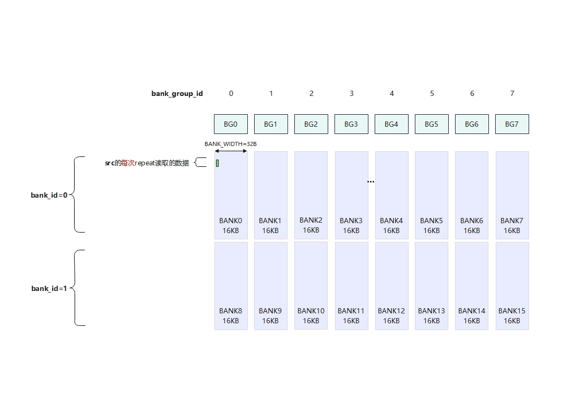

- index 模式：全部为 0，即每次 Gather 都从 data[0] 读取同一个位置。

### 分析结论

- index 全 0，Gather 所有 64 个元素命中同一地址 → 硬件优化为 1 次读。
- 性能 39,582 cycles，最快（用于对比 Case 10 的 subbank 冲突开销）。

## Case 12：对512个（8*64）元素进行加一操作，按行计算，每次repeat读取8个连续的DataBlock

### 地址解码

| 操作数 | 首地址 | 18 位二进制（DEPTH BANK BG WIDTH） | bank_id | bank_group_id |
| --- | --- | --- | --- | --- |
| src0 | `0x0000` | `000000000 0 000 00000` | 0 | 0 |
| dst | `0x4100` | `010000010 0 000 00000` | 1 | 0 |

### 搬运方式

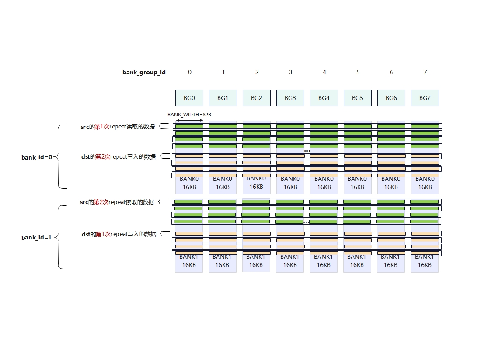

```
i=0: src0[0..63]     → dst[0..63]
i=1: src0[64..127]   → dst[64..127]
...
i=7: src0[448..511]  → dst[448..511]
```

8 轮 × 每轮 64 元素（8 个连续 DataBlock），横着铺满 512 个 float32。

### 分析结论

- `DATA_BLOCK_COPY` stride=1：8 个 DataBlock 连续排布（间隔 32B），等价于普通 `LoadAlign`。
- 性能 26,898 cycles，作为竖着搬运的基准参照。

## Case 13：对512个（8*64）元素进行加一操作，按列计算，每次repeat读取8个不连续的DataBlock

### 地址解码

同 Case 12 地址配置。

### 搬运方式

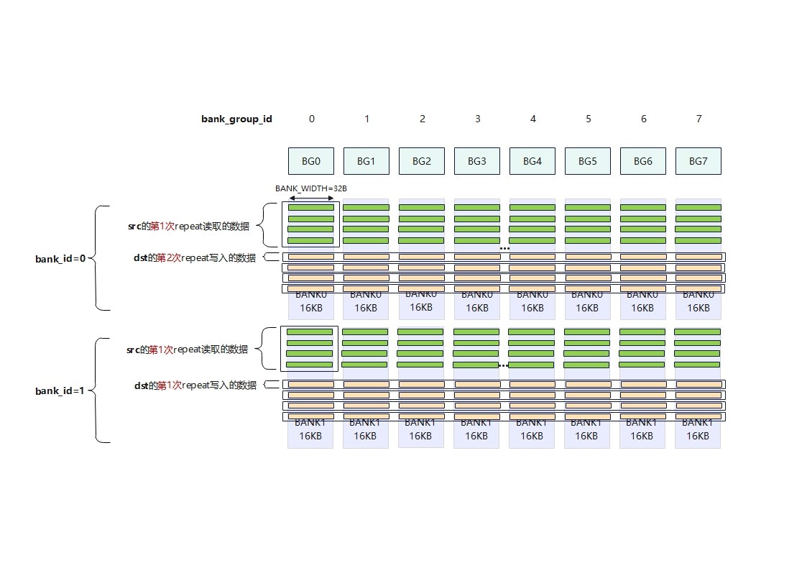

```
i=0: src0[0..7],  src0[64..71],  ..., src0[448..455]  → dst 同上
i=1: src0[8..15], src0[72..79],..., src0[456..463]  → dst 同上
...
i=7: src0[56..63], ..., src0[504..511]  → dst 同上
```

8 轮 × 8 个 DataBlock，每个 DataBlock 间隔 **256B（stride=8 × 32B = 64 float）**，竖着覆盖 512 个 float32。

### 分析结论

- `DATA_BLOCK_COPY` stride=8：8 个 DataBlock 均从 bankgroup0 的不同 depth 行读取，命中**同 bank group 不同行**。
- Case 13 vs Case 12 = 91,815 vs 26,898 cycles（**慢 3.4x**）。


## 小结

- **起始地址不同时，二读一写必然会引发冲突**：对比Atlas A2/A3系列，Ascend 950PR/Ascend 950DT减少了一半的bank group，一条访存指令读/写256字节数据（刚好覆盖所有bank group），同一bank group必然存在二读一写。由于一个bank group最多支持二读或者一读一写，所以bank冲突必然发生。
- **地址重叠有性能收益**：Case 4 省一条 Load，比基准快 15.9%。
- **循环展开对冲突场景有正收益**：Case 1 vs Case 2 = 80,948 vs 86,249 cycles（+6.5%）。
- **双搬入无收益**：Case 5 vs Case 1 = 89,893 vs 80,948 cycles（慢 11.0%），Ascend 950PR/Ascend 950DT 上读读冲突不是瓶颈。
- **VF 层面 bank 冲突难以测量**（Case 1 vs 3，Case 6 vs 7 差异在噪声范围）：Ascend 950PR/Ascend 950DT 低位交织 + 2读口/BG + 8 DB 分散到 8 个 BG 使冲突容错性大幅提升。

## 目录结构

```text
├── bank_conflict.asc              // 算子 host + device 代码
├── config.h                      // 13 个 Case 的地址/类型配置
├── vf_func.h                     // Vector 函数实现
├── data_utils.h                  // 数据读写工具
├── CMakeLists.txt                // 编译工程
├── test.sh                       // 测试脚本
├── figures/                      // 各 Case UB 内存分布图
│   ├── case1_2.jpg
│   ├── case3.jpg
│   ├── case4.jpg
│   ├── case5.jpg
│   ├── case6.jpg
│   ├── case7.jpg
│   ├── case8.jpg
│   ├── case9.jpg
│   ├── case10.jpg
│   ├── case11.jpg
│   ├── case12.jpg
│   └── case13.jpg
└── scripts/
    ├── gen_data.py               // 测试数据生成
    └── verify_result.py          // 精度验证
```

## 运行方式

### 环境准备

```bash
source /path/to/cann/set_env.sh
```

### 编译与运行（单个 Case）

```bash
export CASE_NUM=1          # 1-13 可选
mkdir -p build && cd build
cmake .. -DCMAKE_ASC_ARCHITECTURES=dav-Ascend 950PR/Ascend 950DT -DCASE_NUM=${CASE_NUM}
make -j
python3 ../scripts/gen_data.py --case ${CASE_NUM}
./demo                     # 精度验证 + 打点性能（输出 cycles 计数到 stdout）
python3 ../scripts/verify_result.py output/output_z.bin output/golden.bin
```

### 批量运行

```bash
bash test.sh             # 精度验证
bash test.sh profile     # 精度验证 + profiling
```

### CMake 选项

| 选项 | 可选值 | 说明 |
|:----:|:------:|:----|
| `CMAKE_ASC_ARCHITECTURES` | `dav-3510` | NPU 架构版本 |
| `CASE_NUM` | 1-13 | 切换测试场景 |
| `CMAKE_ASC_RUN_MODE` | `npu` | 上板运行模式 |

