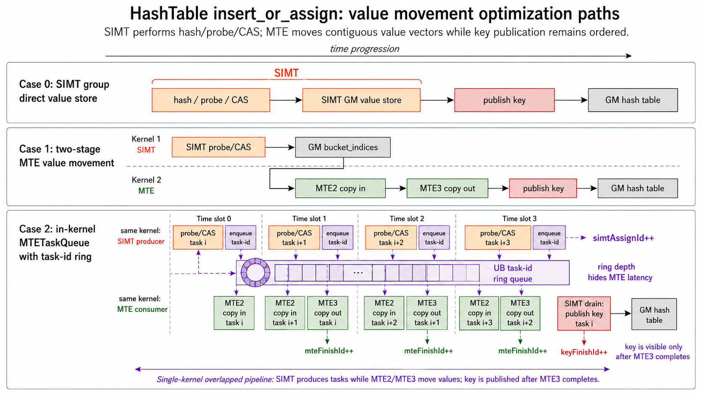

# HashTable中使用MTE队列优化insert_or_assign样例

## 概述

本样例以HashTable `insert_or_assign` 操作为例，介绍SIMT与SIMD C API混合编程场景下，使用MTE搬运长value向量的性能调优方法。样例实现一个C++容器风格的open-addressing HashTable，对比SIMT group直接写value、两阶段MTE搬运value，以及单kernel内使用MTE任务队列搬运value的实现差异。

**优化路径**：

| Case | SCENARIO_NUM | 实现方式 | 说明 |
|:---|:---:|:---|:---|
| Case 0 | 0 | SIMT group直接写value | 一个SIMT协作组完成hash/probe/CAS后，由组内线程分片写入一条value向量，作为baseline。 |
| Case 1 | 1 | 两阶段MTE搬运value | 第一个kernel使用SIMT完成hash/probe/CAS并锁定目标bucket，第二个kernel使用C API MTE搬运value，value写完后发布key。 |
| Case 2 | 2 | MTETaskQueue搬运value | 单kernel内使用task-id ring queue，SIMT持续生产UB任务，MTE按任务批量搬运value，并与后续SIMT探测形成流水。 |

三种Case的数据处理流水如下图所示：



## 本样例支持的产品及CANN软件版本

| 产品 | CANN软件版本 |
|------|-------------|
| Ascend 950PR/Ascend 950DT | > CANN 9.0.0 |

## 目录结构介绍

```
├── simt_and_simd_hash_table_mte_queue
│   ├── CMakeLists.txt                // 编译工程文件
│   ├── figures
│   │   └── hash_table_mte_pipeline.png // 三种Case的数据处理流水图
│   ├── hash_table_mte_value_move.asc // Ascend C样例实现
│   ├── README.md                     // 样例说明文档
│   └── scripts
│       └── run_compare.sh            // 编译并使用msprof op采集三种Case性能数据
```

## 样例描述

**样例功能**：

样例实现一个固定容量open-addressing HashTable，支持 `insert_or_assign` 语义：key已存在时更新value，key不存在时插入key/value。Hash冲突通过线性探测解决，bucket中保存key，value独立存储为 `values[capacity, dim]`，其中 `dim` 为运行时参数。

bucket的key字段同时承载占用信息：

| key字段取值 | 含义 |
|:---|:---|
| `EMPTY_KEY` | 空bucket，可以被插入流程CAS锁定。 |
| `LOCKED_KEY` | bucket正在插入或更新，其他线程需要等待key发布后重新判断。 |
| 真实key | bucket已发布，对find可见。 |

插入或更新过程中，kernel先将目标bucket的key从 `EMPTY_KEY` 或真实key CAS为 `LOCKED_KEY`，再写入value，最后通过 `asc_atomic_exch` 发布真实key。find只匹配真实key，因此不会观察到“key已经可见但value尚未写完”的中间结果。

HashTable插入流程如下：

$$
bucket = hash(key) \& (capacity - 1)
$$

$$
bucket = (bucket + 1) \& (capacity - 1), \quad \text{when collision occurs}
$$

**样例规格**：

<table>
<tr><td rowspan="1" align="center">样例类型(OpType)</td><td colspan="4" align="center">HashTable insert_or_assign</td></tr>
<tr><td rowspan="3" align="center">样例输入</td><td align="center">name</td><td align="center">shape</td><td align="center">data type</td><td align="center">format</td></tr>
<tr><td align="center">keys</td><td align="center">[128 * 1024]</td><td align="center">int64</td><td align="center">ND</td></tr>
<tr><td align="center">values</td><td align="center">[128 * 1024, dim]</td><td align="center">float32</td><td align="center">ND</td></tr>
<tr><td rowspan="2" align="center">样例输出</td><td align="center">table keys</td><td align="center">[256 * 1024]</td><td align="center">int64</td><td align="center">ND</td></tr>
<tr><td align="center">table values</td><td align="center">[256 * 1024, dim]</td><td align="center">float32</td><td align="center">ND</td></tr>
<tr><td rowspan="4" align="center">核函数名</td><td align="center">SCENARIO_NUM=0</td><td colspan="3" align="center"><code>insert_or_assign_group_store_kernel</code></td></tr>
<tr><td rowspan="2" align="center">SCENARIO_NUM=1</td><td colspan="3" align="center"><code>insert_or_assign_probe_kernel</code></td></tr>
<tr><td colspan="3" align="center"><code>write_values_mte_queue_kernel</code></td></tr>
<tr><td align="center">SCENARIO_NUM=2</td><td colspan="3" align="center"><code>insert_or_assign_mte_task_queue_kernel</code></td></tr>
</table>

样例参数如下：

| 参数 | 值 |
|:---|---:|
| `HASH_TABLE_CAPACITY` | 256 * 1024 |
| `KEY_NUM` | 128 * 1024 |
| 负载因子 | 0.5 |
| `TEST_DIMS` | 16, 32, 64, 128, 256 |
| `BLOCK_DIM` | 64 |
| `THREAD_COUNT` | 512 |
| `GROUP_SIZE` | 32 |
| `PROFILE_REPEAT_TIMES` | 默认30，`run_compare.sh`采集性能时设置为1 |

## 样例实现

### 性能指标说明

| 字段名 | 字段含义 |
|:---|:---|
| Task Duration(μs) | Task整体耗时，包含调度到加速器的时间、加速器上的执行时间以及响应结束时间。 |
| aiv_time(μs) | Task 在 AI Vector Core 上的执行时间。 |
| aiv_vec_time(μs) | vec类型指令耗时。SIMT VF调用中的线程计算也体现在该类统计中。 |
| aiv_vec_ratio | vec类型指令cycle数在total cycle数中的占用比。 |
| aiv_scalar_time(μs) | scalar类型指令耗时。 |
| aiv_scalar_ratio | scalar类型指令cycle数在total cycle数中的占用比。 |
| aiv_mte2_time(μs) | mte2类型指令耗时，主要对应GM到UB的搬运。 |
| aiv_mte2_ratio | mte2类型指令cycle数在total cycle数中的占用比。 |
| aiv_mte3_time(μs) | mte3类型指令耗时，主要对应UB到GM的搬运。 |
| aiv_mte3_ratio | mte3类型指令cycle数在total cycle数中的占用比。 |

### Case 0：SIMT group直接写value

**实现方式**：参考 `insert_or_assign_group_store_vf()` 函数实现。

该实现中，每个SIMT group处理一条key。lane 0执行hash、线性探测和CAS锁定bucket，组内线程通过 `asc_shfl` 获取目标bucket index，并按 `GROUP_SIZE` 分片写入value向量。value搬运由SIMT线程直接访问GM完成。

写入顺序为：CAS锁定目标bucket，组内线程写value，执行 `asc_threadfence()`，最后由lane 0发布真实key。

**关键代码**：

```cpp
__simt_vf__ inline void insert_or_assign_group_store_vf(__gm__ Bucket* table,
    __gm__ float* tableValues, __gm__ const int64_t* keys, __gm__ const float* values, uint32_t keyNum,
    uint32_t capacity, uint32_t dim, uint32_t blockIndex, uint32_t blockNum)
{
    const uint32_t laneId = static_cast<uint32_t>(threadIdx.x) % GROUP_SIZE;
    ...
    if (laneId == 0) {
        int64_t oldKey = asc_atomic_cas(keyAddr, EMPTY_KEY, LOCKED_KEY);
        if (oldKey == LOCKED_KEY) {
            oldKey = wait_until_unlocked(keyAddr);
        }
        ...
    }
    ...
    for (uint32_t j = laneId; j < dim; j += GROUP_SIZE) {
        tableValues[dstBase + j] = values[srcBase + j];
    }
    asc_threadfence();
    if (laneId == 0) {
        (void)asc_atomic_exch(&table[bucketIdx].key, key);
    }
}
```

**性能数据**：

| Case | 实现方式 | dim | 核数 | Task Duration(μs) |
|:---|:---|---:|:---:|---:|
| 0 | SIMT group直接写value | 16 | 64 | 217.843 |
| 0 | SIMT group直接写value | 32 | 64 | 212.139 |
| 0 | SIMT group直接写value | 64 | 64 | 261.347 |
| 0 | SIMT group直接写value | 128 | 64 | 367.845 |
| 0 | SIMT group直接写value | 256 | 64 | 559.560 |

**性能数据分析**：

- 随着 `dim` 增大，SIMT线程逐元素写value的耗时明显上升。`dim=256` 时，value搬运已经成为该路径的主要开销。

**原理说明**：

HashTable插入本身包含hash、线性探测、CAS、冲突处理等离散控制流，适合使用SIMT表达。但value向量通常是连续内存，若由SIMT线程逐元素访问GM，搬运粒度和搬运流水利用率不如MTE连续搬运。

本样例后续Case将HashTable控制流与value搬运拆开：SIMT负责离散控制流，MTE负责连续value向量搬运。

**下一步优化方向**：

当前Case作为SIMT group直接写value的基准Case，用于展示HashTable插入时value搬运和控制流耦合在同一段SIMT线程中的性能数据。下一步将把value写入从SIMT线程中拆出来，改由MTE执行GM->UB->GM搬运。

### Case 1：两阶段MTE搬运value

**实现方式**：参考 `insert_or_assign_probe_vf()` 和 `write_values_mte_queue_kernel()` 函数实现。

该实现分为两个kernel：第一个kernel使用SIMT线程执行hash/probe/CAS，锁定目标bucket并输出每条key对应的bucket index；第二个kernel使用C API `asc_copy_gm2ub_align` 和 `asc_copy_ub2gm_align`，按batch把输入value搬入UB，再搬到HashTable的value区域。value搬运完成后，第二个kernel发布真实key。

**关键代码**：

```cpp
__simt_vf__ inline void insert_or_assign_probe_vf(__gm__ Bucket* table, __gm__ const int64_t* keys,
    __gm__ uint32_t* bucketIndices, uint32_t keyNum, uint32_t capacity, uint32_t blockIndex, uint32_t blockNum)
{
    ...
    int64_t oldKey = asc_atomic_cas(keyAddr, EMPTY_KEY, LOCKED_KEY);
    if (oldKey == LOCKED_KEY) {
        oldKey = wait_until_unlocked(keyAddr);
    }
    ...
    bucketIndices[idx] = result;
}

__global__ __vector__ void write_values_mte_queue_kernel(
    __gm__ Bucket* table, __gm__ float* tableValues, __gm__ const int64_t* keys, __gm__ const float* values,
    __gm__ const uint32_t* bucketIndices, uint32_t dim)
{
    asc_copy_gm2ub_align(valueLocal, const_cast<__gm__ float*>(values + baseRow * dim), 1,
        copyInBytes, 0, 0, true, valuesCacheMode, 0, 0);
    asc_sync_pipe(pipe_t::PIPE_ALL);
    ...
    asc_copy_ub2gm_align(tableValues + bucketIdx * dim, valueLocal + i * dim, 1,
        copyOutBytes, tableValuesCacheMode, 0, 0);
    asc_sync_pipe(pipe_t::PIPE_ALL);
    asc_sync_data_barrier(mem_dsb_t::DSB_ALL);
    (void)asc_atomic_exch(&table[bucketIdx].key, keys[baseRow + i]);
}
```

**性能数据**：

| Case | 实现方式 | dim | 核数 | probe Task Duration(μs) | MTE copy Task Duration(μs) | 总耗时(μs) |
|:---|:---|---:|:---:|---:|---:|---:|
| 1 | 两阶段MTE搬运value | 16 | 64 | 29.014 | 671.384 | 700.398 |
| 1 | 两阶段MTE搬运value | 32 | 64 | 28.665 | 652.602 | 681.267 |
| 1 | 两阶段MTE搬运value | 64 | 64 | 29.178 | 660.572 | 689.750 |
| 1 | 两阶段MTE搬运value | 128 | 64 | 29.015 | 670.326 | 699.341 |
| 1 | 两阶段MTE搬运value | 256 | 64 | 28.437 | 705.282 | 733.719 |

**性能数据分析**：

- probe kernel耗时稳定在约29μs，说明hash/probe/CAS控制流开销与value长度关系较小。
- MTE copy kernel需要从GM读取bucket index列表并独立完成value搬运和key发布，kernel边界和GM任务列表中转带来额外开销，本样例实测总耗时高于Case 0。

**原理说明**：

HashTable的hash/probe/CAS是离散访存和控制流密集型逻辑，适合由SIMT线程完成；value向量是连续内存搬运，适合由MTE完成。Case 1把两类任务拆开，减少SIMT线程逐元素GM读写的指令数量，并通过“先写value、再发布key”的顺序保证HashTable语义。

本样例选择 `16/32/64/128/256` 五组dim，覆盖推荐系统中常见embedding维度区间。value越长，SIMT直接写value的搬运成本越高，MTE搬运收益通常越明显。

**下一步优化方向**：

当前Case已经把SIMT控制流和MTE搬运拆开，但仍存在两个额外开销：一是 `insert_or_assign_probe_kernel` 和 `write_values_mte_queue_kernel` 之间存在kernel边界；二是目标bucket列表需要先写入GM，再由第二个kernel读回。下一步将在单kernel内引入任务队列，减少GM任务列表中转，并尝试让SIMT探测和MTE搬运形成流水。

### Case 2：MTETaskQueue搬运value

**实现方式**：参考 `MTETaskQueue` 和 `insert_or_assign_mte_task_queue_kernel()` 函数实现。

该实现仍然由SIMT线程执行hash/probe/CAS，但不再把完整 `bucketIndices` 写入GM。每个Vector Core维护一个UB task-id ring queue，SIMT producer持续把成功锁定的任务写入ring，任务包含输入value源地址、HashTable value目的地址、待发布key和key地址。MTE consumer按ring中的任务批量搬运value，value写完后由SIMT drain路径发布真实key。

Case 2使用 `globalId`、`simtAssignId`、`mteFinishId`、`keyAssignId` 和 `keyFinishId` 管理producer、MTE consumer和key发布进度。SIMT producer按warp申请task-id并填充ring slot；MTE consumer只消费 `simtAssignId` 之前的任务；SIMT drain只发布 `mteFinishId` 之前的key，并通过 `keyFinishId` 防止ring slot在key发布前被覆盖。该协议在单kernel内让SIMT探测和MTE搬运并行推进，同时保持 `insert_or_assign` 的可见性语义。

**关键代码**：

```cpp
class MTETaskQueue {
public:
    __simt_callee__ inline void AssignWarpTask(
        uint64_t srcAddr, uint64_t dstAddr, int64_t key, uint64_t keyAddr, bool needAssign)
    {
        uint32_t writeMask = asc_ballot(needAssign ? 1 : 0);
        uint32_t warpWriteCount = __popc(writeMask);
        uint32_t taskStartId = (laneid() == 0) ? ApplyId(warpWriteCount) : 0;
        taskStartId = asc_shfl(taskStartId, 0);
        Drain(taskStartId + warpWriteCount);
        if (needAssign) {
            uint32_t laneOffset = __popc(writeMask & lanemask_lt());
            FillTaskInfo(taskStartId + laneOffset, srcAddr, dstAddr, key, keyAddr);
        }
        asc_threadfence();
        if (laneid() == 0) {
            AssignTask(taskStartId, taskStartId + warpWriteCount);
        }
    }

    __aicore__ inline void RunTask() const
    {
        while (true) {
            uint32_t simtAssignId = *reinterpret_cast<__ubuf__ volatile uint32_t*>(simtAssignId_);
            uint32_t procCount = min(maxProcBatch, simtAssignId - mteFinishId);
            ...
            asc_copy_gm2ub_align(valueLocal_, srcAddr, 1, valueBytes, 0, 0, true, valuesCacheMode_, 0, 0);
            asc_sync_notify(PIPE_MTE2, PIPE_MTE3, EVENT_ID0);
            asc_sync_wait(PIPE_MTE2, PIPE_MTE3, EVENT_ID0);
            asc_copy_ub2gm_align(dstAddr, valueLocal_, 1, valueBytes, tableValuesCacheMode, 0, 0);
            asc_sync_notify(PIPE_MTE3, PIPE_S, EVENT_ID0);
            asc_sync_wait(PIPE_MTE3, PIPE_S, EVENT_ID0);
            *reinterpret_cast<__ubuf__ volatile uint32_t*>(mteFinishId_) = mteFinishId + procCount;
        }
    }
};
```

**性能数据**：

| Case | 实现方式 | dim | 核数 | Task Duration(μs) |
|:---|:---|---:|:---:|---:|
| 2 | MTETaskQueue搬运value | 16 | 64 | 128.584 |
| 2 | MTETaskQueue搬运value | 32 | 64 | 108.666 |
| 2 | MTETaskQueue搬运value | 64 | 64 | 111.812 |
| 2 | MTETaskQueue搬运value | 128 | 64 | 130.859 |
| 2 | MTETaskQueue搬运value | 256 | 64 | 202.220 |

**性能数据分析**：

- Case 2消除了Case 1中的GM任务列表中转和kernel边界，并在单kernel内让SIMT producer与MTE consumer并行推进。
- 相比Case 0，Case 2在五组dim上均取得加速；`dim=128` 时加速比最高，约2.81x。

**原理说明**：

Case 2把任务保存在UB ring queue中，避免把完整任务列表写入GM后再读回。SIMT producer通过 `simtAssignId` 推进已生产任务，MTE consumer通过 `mteFinishId` 推进已搬运任务，二者之间的距离就是ring中待消费任务数。key发布独立使用 `keyAssignId/keyFinishId` 跟踪，确保真实key只在value写完后可见，并确保ring slot不会在key发布前被复用。该流程在C API的pipe级同步约束下，让SIMT探测和MTE2/MTE3搬运在单kernel内形成流水。

## 性能对比总结

### Ascend 950PR性能对比

下表用于记录本样例在Ascend 950系列产品上运行的性能数据对比：

| dim | Case 0 SIMT直接写value(μs) | Case 1两阶段MTE总耗时(μs) | Case 1加速比 | Case 2 MTETaskQueue(μs) | Case 2加速比 |
|---:|---:|---:|---:|---:|---:|
| 16 | 217.843 | 700.398 | 0.31x | 128.584 | 1.69x |
| 32 | 212.139 | 681.267 | 0.31x | 108.666 | 1.95x |
| 64 | 261.347 | 689.750 | 0.38x | 111.812 | 2.34x |
| 128 | 367.845 | 699.341 | 0.53x | 130.859 | 2.81x |
| 256 | 559.560 | 733.719 | 0.76x | 202.220 | 2.77x |

### 优化要点总结

| 优化手段 | 核心原理 | 样例体现 |
|:---|:---|:---|
| SIMT处理HashTable控制流 | hash/probe/CAS包含离散访存和分支判断，适合SIMT线程表达 | 三种Case都使用SIMT完成HashTable插入或探测逻辑 |
| MTE处理连续value搬运 | value向量是连续内存，使用MTE执行GM->UB->GM批量搬运，可减少SIMT线程逐元素访问GM的成本 | Case 1和Case 2使用C API MTE搬运value |
| value写完后发布key | 真实key发布即表示该bucket可被find匹配，因此必须保证value先写完 | 三种Case均先写value，再发布真实key |
| 任务队列化搬运 | SIMT生成搬运任务，MTE按任务消费，可减少完整任务列表写GM再读回的中转 | Case 2使用UB task-id ring queue组织搬运 |
| 按运行时dim覆盖不同embedding长度 | embedding维度通常由推荐模型配置指定，短value场景搬运成本较小，长value场景更容易体现MTE收益 | `TEST_DIMS` 覆盖 `16/32/64/128/256` 五组value长度 |

---

## 编译运行

在本样例根目录下执行如下步骤，编译并执行样例。

- 切换Case

  在cmake编译时通过 `-DSCENARIO_NUM=N` 指定要编译的Case，各Case说明：
  - `0`: SIMT group直接写value
  - `1`: 两阶段MTE搬运value
  - `2`: MTETaskQueue搬运value

  示例：
  ```bash
  cmake .. -DCMAKE_ASC_ARCHITECTURES=dav-3510 -DSCENARIO_NUM=2
  ```

- 配置环境变量

  请根据当前环境上CANN开发套件包的[安装方式](../../../../../docs/quick_start.md#prepare&install)，配置环境变量。
  ```bash
  source ${install_path}/cann/set_env.sh
  ```

  > **说明：** `${install_path}` 为CANN包安装目录，未指定安装目录时默认安装至 `/usr/local/Ascend` 下。

- 样例执行

  在本样例目录下执行如下命令。
  ```bash
  SCENARIO_NUM=2                                                       # 选择执行场景
  mkdir -p build && cd build;                                          # 创建并进入 build 目录
  cmake -DSCENARIO_NUM=$SCENARIO_NUM -DCMAKE_ASC_ARCHITECTURES=dav-3510 ..;make -j;  # 编译工程
  ./hash_table_mte_value_move 128                                      # 执行单组dim并验证结果
  ```

  也可以直接运行对比脚本，编译三种Case并分别采集 `16/32/64/128/256` 五组dim的性能数据。
  ```bash
  ./scripts/run_compare.sh
  ```

- 编译选项说明

  | 选项 | 可选值 | 说明 |
  |:---|:---|:---|
  | `CMAKE_ASC_ARCHITECTURES` | `dav-3510` | NPU架构，对应 Ascend 950PR/Ascend 950DT |
  | `SCENARIO_NUM` | `0`、`1`、`2` | Case编号：0=SIMT group直接写value，1=两阶段MTE搬运value，2=MTETaskQueue搬运value |
  | `PROFILE_REPEAT_TIMES` | 正整数 | 单次进程中重复执行 `insert_or_assign` 的次数。对比脚本设置为1，使 `msprof op` 采集一次完整insert路径。 |

- 执行结果

  执行结果如下，说明HashTable插入和value校验成功。
  ```bash
  Verification PASSED
  ```

### 性能分析

使用 `msprof op` 工具获取详细性能数据。对比脚本会先普通执行一次样例并检查 `Verification PASSED`，再使用 `msprof op --kill=on` 采集目标kernel的性能数据，避免profiler采集结束后的状态影响HashTable结果校验。

```bash
cmake -DSCENARIO_NUM=0 -DPROFILE_REPEAT_TIMES=1 -DCMAKE_ASC_ARCHITECTURES=dav-3510 ..
make -j
./hash_table_mte_value_move 128
msprof op --warm-up=0 --kill=on ./hash_table_mte_value_move 128
```

两阶段MTE搬运value的Case包含 `insert_or_assign_probe_kernel` 和 `write_values_mte_queue_kernel` 两个kernel，需要指定 `--launch-count=2`，确保同一份结果中采集一次完整两阶段insert路径。由于两阶段Case的第一个kernel会产生锁定中的bucket，使用 `msprof op` 采集时需要设置 `--warm-up=0`，避免工具单独预热probe kernel后留下未发布的bucket。

```bash
cmake -DSCENARIO_NUM=1 -DPROFILE_REPEAT_TIMES=1 -DCMAKE_ASC_ARCHITECTURES=dav-3510 ..
make -j
./hash_table_mte_value_move 128
msprof op --warm-up=0 --kill=on --launch-count=2 ./hash_table_mte_value_move 128
```

MTETaskQueue搬运value的Case是单kernel，使用默认 `launch-count=1` 即可。

当前目录下会生成 `OPPROF_` 前缀的文件夹，保存当前kernel的性能分析数据。

```bash
OPPROF_xxxx_XXXXXXXX
├── ArithmeticUtilization.csv
├── L2Cache.csv
├── Memory.csv
├── MemoryL0.csv
├── MemoryUB.csv
├── OpBasicInfo.csv
├── PipeUtilization.csv
└── ResourceConflictRatio.csv
```

查看具体的性能分析结果：
```bash
# 查看Task Duration等基础信息
cat ./OPPROF_*/OpBasicInfo.csv

# 查看Vector/MTE等流水耗时和占比
cat ./OPPROF_*/PipeUtilization.csv
```
